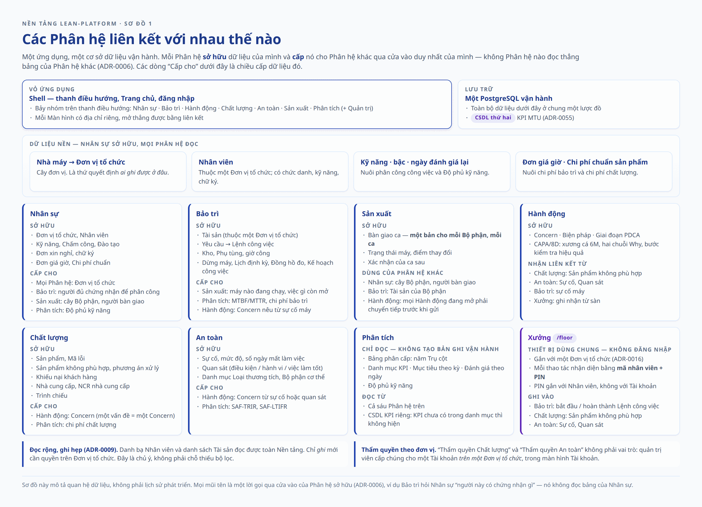

# 00 · Toàn cảnh: Nền tảng gồm những gì, và các Phân hệ nối với nhau ra sao

Chương này để đọc **trước** mọi chương khác, mất khoảng năm phút. Nó không dạy bấm nút
nào — các chương sau làm việc đó. Nó trả lời ba câu mà người học hay hỏi nhất trong
buổi đầu: **Nền tảng có những nhóm việc gì**, **nhóm nào đưa dữ liệu cho nhóm nào**, và
**một việc trên sàn đi qua bao nhiêu màn hình trước khi thành con số**.

## 1. Bảy nhóm việc, một hệ thống

| Nhóm trên thanh điều hướng | Việc trên sàn | Sở hữu dữ liệu gì |
| --- | --- | --- |
| **Nhân sự** | Ai làm việc ở đâu, có tay nghề gì, đã được đào tạo gì | Nhà máy, Đơn vị tổ chức, Nhân viên, Kỹ năng, Chấm công, Đào tạo, Đơn xin nghỉ, Đơn giá giờ |
| **Bảo trì** | Máy có vấn đề, ai sửa, sửa mất bao lâu, tốn gì | Tài sản, Yêu cầu, Lệnh công việc, Kho và Phụ tùng, Dừng máy, Lịch bảo trì định kỳ, Đồng hồ đo |
| **Sản xuất** | Bàn giao ca: ca trước nói gì cho ca sau | Bàn giao ca, trạng thái máy của ca, xác nhận của ca sau |
| **Hành động** | Vì sao việc này xảy ra, và đã làm gì để nó không lặp lại | Concern, biện pháp, giai đoạn PDCA, CAPA/8D |
| **Chất lượng** | Hàng không đạt chuẩn, khách phàn nàn, hàng về sai | Sản phẩm, Mã lỗi, Sản phẩm không phù hợp, Khiếu nại, Nhà cung cấp và NCR |
| **An toàn** | Đã xảy ra chuyện gì, và đã thấy gì trước khi có chuyện | Sự cố, Phân loại thương tích, Quan sát |
| **Phân tích** | Nhà máy đang chạy thế nào | KPI, Mục tiêu theo kỳ, Đánh giá theo ngày, Độ phủ kỹ năng |

Ngoài bảy nhóm đó còn hai chỗ không nằm trên thanh điều hướng của mọi người:

- **Quản trị** (`Phê duyệt`, `Tài khoản`, `Vai trò`) — chỉ quản trị viên mở được. Trả lời
  câu "ai được làm gì, ở đơn vị nào".
- **Xưởng** (`/floor`) — màn hình trên một thiết bị dùng chung ở sàn. Người dùng **không
  đăng nhập** ở đây; mỗi thao tác tự nhận diện bằng **mã nhân viên và PIN**.

## 2. Sơ đồ: các Phân hệ liên kết với nhau thế nào

***Sơ đồ 1.** Mỗi Phân hệ sở hữu dữ liệu của mình (cột "Sở hữu") và cấp nó cho Phân hệ
khác qua cửa vào duy nhất của mình. Đọc từ trên xuống: dữ liệu nền do Nhân sự sở hữu,
bảy Phân hệ dùng lại, và mọi thứ dừng ở một cơ sở dữ liệu vận hành — trừ KPI, nằm ở cơ
sở dữ liệu thứ hai (ADR-0055).*

## 3. Bốn quy tắc nối các Phân hệ

Bốn quy tắc này giải thích gần hết những chỗ người dùng tưởng là lỗi.

1. **Mỗi Phân hệ sở hữu dữ liệu của mình, và cho mượn qua một cửa duy nhất.** Bảo trì
   muốn biết một người có chứng nhận gì thì **hỏi** Nhân sự; nó không đọc thẳng bảng của
   Nhân sự. Hệ quả cho người dùng: một dữ liệu sai chỉ sửa được **ở màn hình sở hữu nó**
   — muốn đổi tên một Nhân viên thì vào Danh bạ, không vào màn hình phân công.
2. **Đọc rộng, ghi hẹp.** Danh bạ Nhân viên và danh sách Tài sản **đọc được toàn Nền
   tảng**; chỉ **ghi** mới cần quyền trên Đơn vị tổ chức (ADR-0009). Thấy dữ liệu của tổ
   khác là bình thường; không sửa được là đúng.
3. **Một việc, một bản ghi.** Một vấn đề lặp lại vẫn là **một** Concern (lần sau *liên
   kết*, không nêu mới). Một Bộ phận có **một** bản bàn giao cho mỗi ca, không phải mỗi
   người một bản. Một Tài sản đã đặt mã thì mã đó **duy nhất trên toàn Nền tảng**.
4. **Quyền là vai trò × đơn vị.** Vai trò quyết định *mã quyền*; Đơn vị tổ chức quyết
   định *nơi mã đó có hiệu lực*. Hai thứ "Thẩm quyền Chất lượng" và "Thẩm quyền An toàn"
   không phải vai trò — chúng được cấp cho một Tài khoản, trên một Đơn vị tổ chức.

## 4. Năm đường đi thường gặp

Bảng này là bản đồ tra nhanh: một việc trên sàn đi qua những Phân hệ nào, và sơ đồ nào
trong tài liệu vẽ đường đó.

| Việc trên sàn | Đi qua | Xem |
| --- | --- | --- |
| Máy hỏng giữa ca | Bảo trì: Yêu cầu → phân loại → Lệnh công việc → sửa → hoàn thành. Sản xuất: ghi máy **không chạy** trong bàn giao ca. Phân tích: MTTR | [Sơ đồ 4](03-bao-tri.md) |
| Hàng lỗi tại máy | Chất lượng: ghi nhận Sản phẩm không phù hợp → phương án xử lý từng phần. Hành động: Concern → CAPA nếu cần nguyên nhân gốc. Phân tích: chi phí chất lượng | [Sơ đồ 6](05-chat-luong.md), [Sơ đồ 5](04-hanh-dong.md) |
| Suýt tai nạn, chưa ai bị gì | An toàn: Quan sát (mức độ = hậu quả xấu nhất **có thể**) → nêu Hành động → đóng quan sát | [Sơ đồ 7](06-an-toan.md) |
| Tai nạn có người bị thương | An toàn: Sự cố → phân loại thương tích (cần thẩm quyền An toàn) → điều tra → số ngày → đóng → Concern | [Sơ đồ 7](06-an-toan.md) |
| Khách phàn nàn | Chất lượng: Khiếu nại → **ghi nhận hoặc liên kết** Sản phẩm không phù hợp → phản hồi → đóng. Hành động: Concern | [Sơ đồ 6](05-chat-luong.md) |
| Giao ca | Sản xuất: bàn giao ca (chốt khi gửi) → ca sau xác nhận; mọi Hành động đang mở phải chuyển tiếp | [Sơ đồ 8](07-san-xuat.md) |
| Họp chất lượng đầu tháng | Phân tích: Bảng phân cấp, Đánh giá KPI, Độ phủ kỹ năng | [Sơ đồ 9](08-phan-tich.md) |
| Người mới vào làm | Quản trị: Phê duyệt (chọn vai trò + đơn vị) → người dùng đổi mật khẩu → Nhân sự: hồ sơ, kỹ năng, đào tạo | [Sơ đồ 2](01-vao-cua-va-tai-khoan.md) |

## 5. Đọc tài liệu này thế nào

- **Mỗi chức năng là một thẻ bốn phần** — *Việc này để làm gì · Ai thao tác được · Các
  bước chính · Điểm then chốt · Vì sao*. Đó là hình thức TWI Job Instruction: đúng thứ tự
  một người đào tạo sẽ nói với một người vận hành.
- **Cuối mỗi chương có bảng tóm tắt** quyền theo vai trò. Tra bảng khi không chắc ai bấm
  được nút nào.
- **Mười sơ đồ** trong tài liệu, đánh số 1–10, mỗi sơ đồ vẽ một luồng hoặc một quan hệ mà
  chữ khó nói rõ. Trong bản PDF, mỗi sơ đồ nằm trên **một trang ngang** riêng để đọc được
  khi in.
- **Bản PDF**: `docs/user-guide/pdf/huong-dan-su-dung.pdf`, sinh lại bằng
  `bash scripts/build-user-guide-pdf.sh`.
