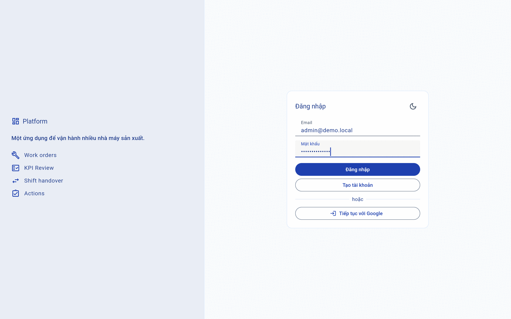
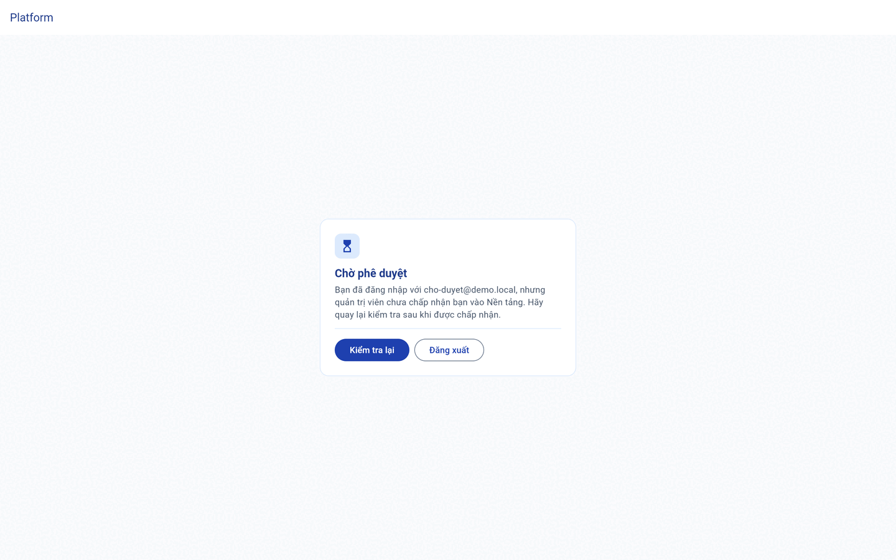
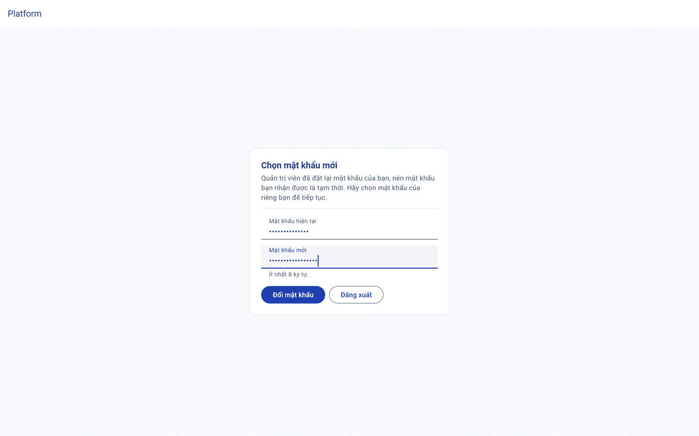
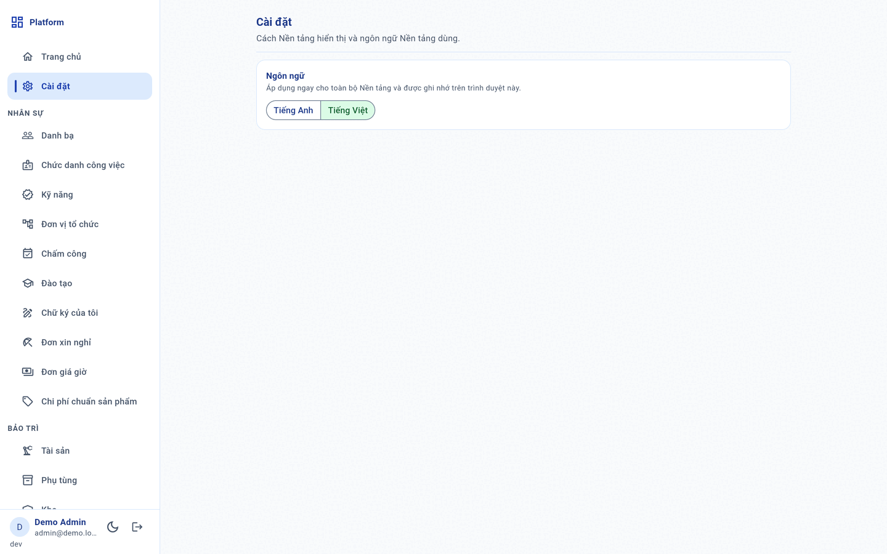
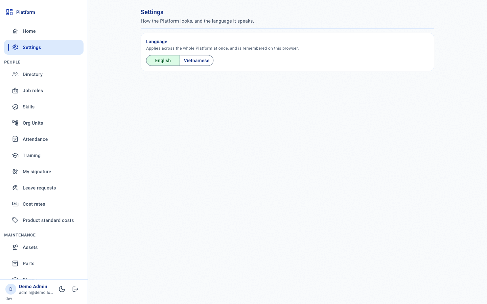
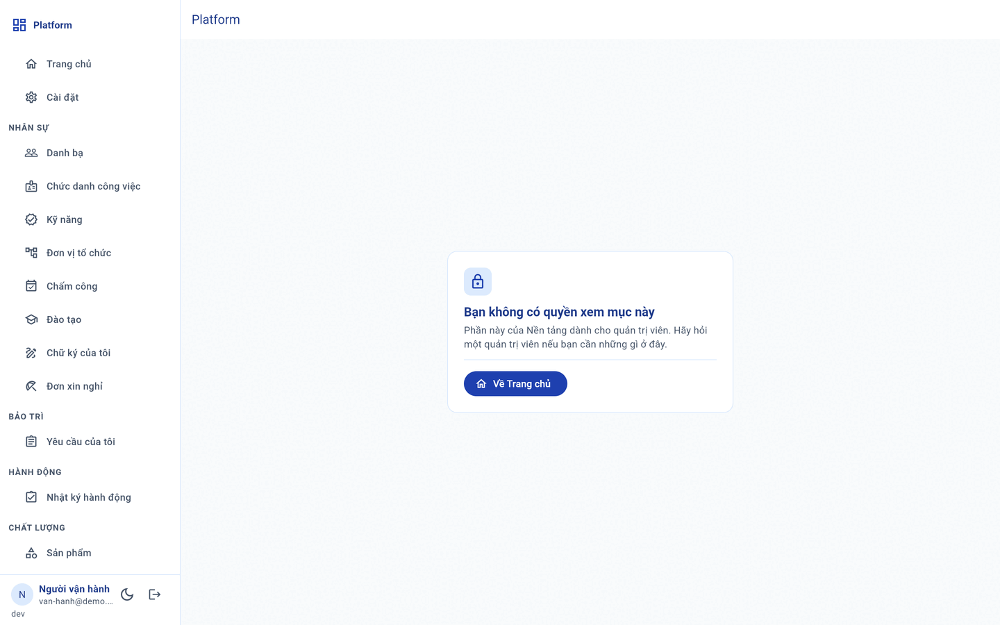

# 01 · Vào cửa và Tài khoản

Tám phiếu dưới đây là những việc phải làm **trước khi** làm được việc gì trên Nền
tảng. Không có mã quyền nào trong chương này: cái quyết định ở đây là bạn đã đăng
nhập chưa và quản trị viên đã chấp nhận bạn chưa.

***Sơ đồ 2.** Sáu bước để vào được Nền tảng. Bước 3 — chờ phê duyệt — là bước hay bị bỏ
qua nhất khi đào tạo: đăng nhập được không có nghĩa là đã được nhận vào.*

---

## Đăng nhập

| Hạng mục | Nội dung |
| --- | --- |
| **Công việc** | Vào Nền tảng bằng email và mật khẩu của chính mình — màn hình **Đăng nhập**, `/sign-in`. Phiếu 01.1. |
| **Ai thao tác được** | Mọi người. Màn hình không hỏi quyền vì chưa có phiên làm việc nào để hỏi. |
| **Vật tư, dữ liệu có trước** | Một Tài khoản do quản trị viên tạo (email + mật khẩu tạm), và địa chỉ Nền tảng của nhà máy. |
| **Công cụ** | Ô **Email**, ô **Mật khẩu**, nút **Đăng nhập**; nút đổi giao diện sáng/tối ở góc trên phải. Không có mã quyền nào ở bước này. |
| **An toàn** | Không có thao tác ghi. Trên máy dùng chung của Xưởng: đăng xuất trước khi rời máy, và đừng để trình duyệt lưu mật khẩu. |
| **Thiết bị đào tạo** | Ảnh 01.1, Ảnh 01.2 |
| **Chủ tài liệu · Rev · Ngày · Trang** | Ban Lean Nền tảng · Rev 2 · 2026-11-15 · 01.1 |

| Các bước chính | Điểm then chốt | Vì sao | Minh hoạ |
| --- | --- | --- | --- |
| **Chung** | [Hỏng] Không bấm **Tiếp tục với Google** và **Tạo tài khoản** | Trên bản triển khai của nhà máy cả hai đều là lời từ chối, in bằng tiếng Anh: không có đăng nhập Google, và không ai tự tạo được Tài khoản — Tài khoản phải do quản trị viên tạo rồi **chấp nhận** ở **Phê duyệt** | — |
| **1.** Mở địa chỉ Nền tảng | [Dễ] Chưa đăng nhập thì mọi địa chỉ khác tự dẫn về `/sign-in`, không cần gõ địa chỉ này | Một địa chỉ không mở được là chuyện của phiên đăng nhập, không phải của trang đó | Ảnh 01.1 |
| **2.** Gõ **Email** của Tài khoản | [Hỏng] Đúng địa chỉ quản trị viên đã cấp, không phải email cá nhân | Tài khoản gắn với email chứ không gắn với tên; gõ nhầm là mở Tài khoản của người khác hoặc không vào được | — |
| **3.** Gõ **Mật khẩu** | [Dễ] Mật khẩu tạm do người tạo Tài khoản đặt và báo trực tiếp cho bạn | Không có nút quên mật khẩu tự phục vụ: quản trị viên đặt lại ở màn hình **Tài khoản** | — |
| **4.** Bấm **Đăng nhập** | [Hỏng] Sai email hay sai mật khẩu cho ra **cùng một** lời từ chối; gõ sai thì kiểm tra lại với quản trị viên, đừng thử nhiều email | Nếu Nền tảng nói email này không có Tài khoản, người lạ dò được ai đang làm ở nhà máy | Ảnh 01.2 |

***Ảnh 01.1.** Form trống: ô Email, ô Mật khẩu, nút **Đăng nhập**, và lối **Tạo tài khoản** cho người chưa có.*

***Ảnh 01.2.** Đã điền xong trước khi bấm **Đăng nhập**. Sai một trong hai thì câu từ chối duy nhất hiện ra — nó không cho biết sai email hay sai mật khẩu.*

---

## Chờ phê duyệt

| Hạng mục | Nội dung |
| --- | --- |
| **Công việc** | Xác nhận mình đã đăng nhập đúng Tài khoản nhưng **chưa được nhận vào** Nền tảng — màn hình **Chờ phê duyệt**, `/awaiting-approval`. Phiếu 01.2. |
| **Ai thao tác được** | Tài khoản có email và mật khẩu đúng, mà quản trị viên chưa bấm **Chấp nhận** ở màn hình **Phê duyệt**. |
| **Vật tư, dữ liệu có trước** | Tài khoản đã đăng nhập được; tên của quản trị viên phụ trách Phê duyệt của nhà máy. |
| **Công cụ** | Màn hình **Chờ phê duyệt**, nút **Kiểm tra lại**, nút **Đăng xuất**. Không có mã quyền nào: quyền chấp nhận nằm ở `ADM_APPROVALS_DECIDE`, của quản trị viên. |
| **An toàn** | Không có thao tác ghi. Chưa chắc đúng người thì **đừng** nhờ chấp nhận: chấp nhận là cấp quyền vào Nền tảng cho người đó. |
| **Thiết bị đào tạo** | Ảnh 01.3 |
| **Chủ tài liệu · Rev · Ngày · Trang** | Ban Lean Nền tảng · Rev 2 · 2026-11-15 · 01.2 |

| Các bước chính | Điểm then chốt | Vì sao | Minh hoạ |
| --- | --- | --- | --- |
| **Chung** | [Hỏng] Đăng nhập được **không phải** là đã được nhận vào | Đây là bước hay bị bỏ qua nhất khi đào tạo: người học tưởng xong việc ở bước đăng nhập | Ảnh 01.3 |
| **1.** Đọc câu trên màn hình, xác nhận đúng email của bạn | [An toàn] Sai email nghĩa là máy đang đăng nhập bằng Tài khoản của người khác | Máy dùng chung ở Xưởng rất hay gặp; nhờ chấp nhận nhầm là cấp quyền cho người khác | Ảnh 01.3 |
| **2.** Nếu sai người: bấm **Đăng xuất**, rồi đăng nhập lại bằng Tài khoản của mình | [Dễ] Đăng xuất trước, đừng nhờ chấp nhận rồi sửa sau | Tài khoản đã chấp nhận không tự trả lại quyền khi bạn đăng xuất | — |
| **3.** Gặp quản trị viên, nhờ **Chấp nhận**, rồi bấm **Kiểm tra lại** | [Hỏng] Nền tảng không tự báo cho quản trị viên — người chờ phải tự nói | Không có thông báo tự động nào giữa màn hình này và hàng chờ Phê duyệt | — |

***Ảnh 01.3.** Đăng nhập được nhưng chưa được chấp nhận: chỉ màn hình này hiện ra, kèm nút **Kiểm tra lại**.*

---

## Chọn mật khẩu mới (bắt buộc)

| Hạng mục | Nội dung |
| --- | --- |
| **Công việc** | Đổi mật khẩu tạm mà quản trị viên vừa cấp thành mật khẩu của riêng bạn — màn hình **Chọn mật khẩu mới**, `/change-password`. Phiếu 01.3. |
| **Ai thao tác được** | Tài khoản vừa được quản trị viên **Đặt lại mật khẩu**. Khi đó Nền tảng chặn mọi địa chỉ khác cho tới khi đổi xong. |
| **Vật tư, dữ liệu có trước** | Mật khẩu tạm mà quản trị viên vừa đưa (qua tin nhắn hoặc giấy, không qua Nền tảng). |
| **Công cụ** | Ô **Mật khẩu hiện tại**, ô **Mật khẩu mới**, nút **Đổi mật khẩu**. Không có mã quyền nào: màn hình chỉ mở cho Tài khoản đang mang mật khẩu tạm. |
| **An toàn** | Mật khẩu tạm chỉ dùng được một lần, cho đúng việc này. Đổi xong thì xoá nó khỏi tin nhắn và giấy. |
| **Thiết bị đào tạo** | Ảnh 01.4 |
| **Chủ tài liệu · Rev · Ngày · Trang** | Ban Lean Nền tảng · Rev 2 · 2026-11-15 · 01.3 |

| Các bước chính | Điểm then chốt | Vì sao | Minh hoạ |
| --- | --- | --- | --- |
| **Chung** | [An toàn] Mật khẩu mới là của riêng bạn — không đưa lại cho quản trị viên | Người biết mật khẩu là người đăng nhập được dưới tên bạn | — |
| **1.** Gõ **Mật khẩu hiện tại** — chính mật khẩu tạm vừa nhận | [Hỏng] Sai mật khẩu hiện tại thì lời từ chối hiện ngay trong màn hình và bạn **vẫn đang đăng nhập** | Bị đá ra ngoài là chuyện khác; ở đây chỉ là chưa đổi được | — |
| **2.** Gõ **Mật khẩu mới** | [Hỏng] Ít nhất **8 ký tự** — con số Nền tảng ghi ngay dưới ô | Đây là độ dài tối thiểu máy chủ chấp nhận, không phải gợi ý | Ảnh 01.4 |
| **3.** Bấm **Đổi mật khẩu** | [Dễ] Đổi xong Nền tảng tự mở Trang chủ, không phải đăng nhập lại bằng tay | Tài khoản được đọc lại ngay sau khi đổi | — |

***Ảnh 01.4.** Hai ô mật khẩu và sàn **ít nhất 8 ký tự**. Mật khẩu tạm không dùng tiếp được: phải chọn mật khẩu của chính bạn.*

---

## Trang chủ

| Hạng mục | Nội dung |
| --- | --- |
| **Công việc** | Xem một chỗ những việc đang chờ **bạn** — màn hình **Trang chủ**, `/`. Phiếu 01.4. |
| **Ai thao tác được** | Mọi Tài khoản đã được chấp nhận. Không có mã quyền riêng: mỗi ô chỉ hiện khi bạn mở được màn hình mà ô đó dẫn tới. |
| **Vật tư, dữ liệu có trước** | Tài khoản đã được chấp nhận; nếu chưa gắn với Nhân viên nào thì trang nói rõ ngay dưới lời chào. |
| **Công cụ** | Ba khối đếm **Hành động**, **Bảo trì**, **Nhân sự**; mỗi con số là một lối vào danh sách đã lọc sẵn. |
| **An toàn** | Không có thao tác ghi. Trên máy dùng chung: đọc tên ở lời chào **trước** khi làm bất cứ việc gì. |
| **Thiết bị đào tạo** | Ảnh 01.5 |
| **Chủ tài liệu · Rev · Ngày · Trang** | Ban Lean Nền tảng · Rev 2 · 2026-11-15 · 01.4 |

| Các bước chính | Điểm then chốt | Vì sao | Minh hoạ |
| --- | --- | --- | --- |
| **1.** Đọc lời chào và tên của bạn ở đầu trang | [An toàn] Không phải tên bạn thì thoát ra ngay: máy đang đăng nhập bằng người khác | Mọi việc làm tiếp theo sẽ ghi vào sổ của người đó | Ảnh 01.5 |
| **2.** Đọc các ô theo nhóm: **Hành động**, **Bảo trì**, **Nhân sự** | [Hỏng] Ô hiện số **0** và ô **không hiện** là hai chuyện khác nhau | Số 0 là không có việc; ô vắng là bạn không mở được màn hình đó — trang chủ chỉ hiện cái vai trò của bạn mở được | — |
| **3.** Bấm vào một ô để mở danh sách đã lọc sẵn | [Dễ] Danh sách mở ra đã lọc đúng theo ô, không phải lọc lại | Cùng một luật với thanh điều hướng: quyền đọc quyết định cái gì hiện | — |
| **4.** Nếu trang báo Tài khoản chưa gắn Nhân viên: báo quản trị viên | [Dễ] Đó là việc của **Tài khoản → Liên kết Nhân viên**, không phải của bạn | Không có liên kết thì giờ công, đào tạo và chữ ký không gắn được về một con người | — |

***Ảnh 01.5.** Ba khối đếm theo đúng nhóm quyền của bạn — Hành động, Bảo trì, Nhân sự — mỗi con số là một lối vào danh sách đã lọc.*

---

## Cài đặt

| Hạng mục | Nội dung |
| --- | --- |
| **Công việc** | Chọn ngôn ngữ và giao diện sáng/tối cho máy đang dùng — màn hình **Cài đặt**, `/settings`. Phiếu 01.5. |
| **Ai thao tác được** | Mọi Tài khoản đã được chấp nhận. Không có mã quyền nào. |
| **Vật tư, dữ liệu có trước** | — |
| **Công cụ** | Mục **Ngôn ngữ** trong **Cài đặt**; nút đổi giao diện sáng/tối trong menu tài khoản ở góc trên phải. |
| **An toàn** | Không có thao tác ghi. Lựa chọn nằm trên **trình duyệt này**, không theo Tài khoản: trên máy dùng chung người ca sau đổi lại được. |
| **Thiết bị đào tạo** | Ảnh 01.6, Ảnh 01.7 |
| **Chủ tài liệu · Rev · Ngày · Trang** | Ban Lean Nền tảng · Rev 2 · 2026-11-15 · 01.5 |

| Các bước chính | Điểm then chốt | Vì sao | Minh hoạ |
| --- | --- | --- | --- |
| **Chung** | [Hỏng] Kiểm tra ngôn ngữ **trước** khi báo lỗi "màn hình toàn tiếng Anh" | Ngôn ngữ theo trình duyệt chứ không theo Tài khoản, nên người ca trước đổi được | — |
| **1.** Mở **Cài đặt** ở cuối thanh điều hướng | — | — | — |
| **2.** Ở **Ngôn ngữ**, chọn **Tiếng Việt** hoặc **Tiếng Anh** | [Dễ] Áp dụng **ngay** cho toàn bộ Nền tảng, không cần tải lại trang | Toàn bộ chuỗi giao diện đổi cùng lúc; không có bước lưu | Ảnh 01.6, Ảnh 01.7 |
| **3.** Đổi giao diện sáng/tối ở menu tài khoản | [Dễ] Lựa chọn được ghi nhớ trên trình duyệt này, máy khác giữ lựa chọn riêng | Không theo Tài khoản, nên không có gì để đồng bộ giữa các máy | — |

***Ảnh 01.6.** Hai lựa chọn ngôn ngữ; chọn **Tiếng Việt** là toàn bộ Nền tảng đổi ngay, và lựa chọn được nhớ trên trình duyệt này.*

***Ảnh 01.7.** Trạng thái mặc định của một tài khoản mới: **English**. Đây là ngôn ngữ gốc của bản giao diện.*

---

## Không tìm thấy màn hình

| Hạng mục | Nội dung |
| --- | --- |
| **Công việc** | Đọc đúng điều Nền tảng đang nói và quay về một màn hình có thật — màn hình **Không tìm thấy**, mọi địa chỉ không tồn tại. Phiếu 01.6. |
| **Ai thao tác được** | Mọi Tài khoản đã được chấp nhận. Không có mã quyền nào. |
| **Vật tư, dữ liệu có trước** | Địa chỉ đã gõ (còn trên thanh địa chỉ của trình duyệt). |
| **Công cụ** | Màn hình **Không tìm thấy**, nút **Về Trang chủ**, thanh điều hướng. |
| **An toàn** | Không có thao tác ghi. Đừng sửa địa chỉ cho tới khi đọc hết câu trên màn hình — hai loại từ chối trông giống nhau. |
| **Thiết bị đào tạo** | Ảnh 01.8 |
| **Chủ tài liệu · Rev · Ngày · Trang** | Ban Lean Nền tảng · Rev 2 · 2026-11-15 · 01.6 |

| Các bước chính | Điểm then chốt | Vì sao | Minh hoạ |
| --- | --- | --- | --- |
| **1.** Đọc địa chỉ Nền tảng in ra trong câu | [Hỏng] Địa chỉ in ra là cái sai — không phải dữ liệu, không phải quyền | Màn hình trả lại đúng địa chỉ đã gõ để bạn so với địa chỉ thật | Ảnh 01.8 |
| **2.** Bấm **Về Trang chủ**, rồi đi tới màn hình bằng thanh điều hướng | [Hỏng] "Không có gì ở đây" khác "bạn không có quyền" — đừng nói với công nhân là hệ thống không cho khi thực ra họ gõ sai đường dẫn | Hai loại từ chối dẫn tới hai việc khác nhau: sửa đường dẫn, hay xin quyền | — |

***Ảnh 01.8.** Địa chỉ sai hiện đúng địa chỉ đã gõ và một lối về Trang chủ — không phải màn hình trắng.*

---

## Không có quyền xem mục này

| Hạng mục | Nội dung |
| --- | --- |
| **Công việc** | Nhận ra mình đang thiếu quyền, và xin đúng thứ còn thiếu — màn hình **Không có quyền**, mọi địa chỉ bị chặn. Phiếu 01.7. |
| **Ai thao tác được** | Tài khoản đã được chấp nhận nhưng thiếu quyền của màn hình đó — ví dụ người vận hành mở `/roles`. |
| **Vật tư, dữ liệu có trước** | Tên màn hình bạn cần mở (còn trên thanh địa chỉ). |
| **Công cụ** | Màn hình **Không có quyền**, nút **Về Trang chủ**; phía quản trị viên là **Vai trò** và **Tài khoản**. |
| **An toàn** | Không có thao tác ghi. Xin quyền theo tên màn hình, đừng xin "thêm quyền" chung — quyền thừa là quyền ghi vào sổ của người khác. |
| **Thiết bị đào tạo** | Ảnh 01.9 |
| **Chủ tài liệu · Rev · Ngày · Trang** | Ban Lean Nền tảng · Rev 2 · 2026-11-15 · 01.7 |

| Các bước chính | Điểm then chốt | Vì sao | Minh hoạ |
| --- | --- | --- | --- |
| **1.** Đọc câu trên màn hình | [Hỏng] Màn hình này **cố tình** không giả vờ là "không tìm thấy" | Nó nói thẳng là thiếu quyền, để bạn biết mình phải xin gì | Ảnh 01.9 |
| **2.** Bấm **Về Trang chủ** | — | — | — |
| **3.** Nếu cần quyền đó để làm việc: nói với quản trị viên và **nêu tên màn hình** | [Hỏng] Quản trị viên sửa ở **Vai trò** (thêm mã quyền cho vai trò) hoặc ở **Tài khoản** (gán thêm vai trò) | Không có tên màn hình thì quản trị viên phải đoán, và hay gán thừa quyền | — |

***Ảnh 01.9.** Một tài khoản người vận hành mở `/roles`: Nền tảng nói rõ thiếu quyền, thay vì ẩn màn hình đi và để người dùng tưởng đã bấm nhầm.*

---

## Không kiểm tra được phiên làm việc

| Hạng mục | Nội dung |
| --- | --- |
| **Công việc** | Phân biệt lỗi kết nối với lỗi quyền, và làm đúng ba việc — màn hình **Không kiểm tra được phiên**, hiện khi `/me` lỗi. Phiếu 01.8. |
| **Ai thao tác được** | Bất kỳ ai đang đăng nhập khi máy chủ không trả lời được. Không có mã quyền nào. |
| **Vật tư, dữ liệu có trước** | — |
| **Công cụ** | Màn hình **Không kiểm tra được phiên làm việc**, nút **Thử lại**, nút **Đăng xuất**. |
| **An toàn** | Không có thao tác ghi. Trong lúc này **đừng** đổi mật khẩu và đừng xin thêm quyền: cả hai đều là đổi cấu hình vì một lỗi mạng. |
| **Thiết bị đào tạo** | Ảnh 01.10 |
| **Chủ tài liệu · Rev · Ngày · Trang** | Ban Lean Nền tảng · Rev 2 · 2026-11-15 · 01.8 |

| Các bước chính | Điểm then chốt | Vì sao | Minh hoạ |
| --- | --- | --- | --- |
| **Chung** | [Hỏng] Lời nhắn trên màn hình là lỗi **kết nối**, không phải lỗi quyền | Nền tảng dừng lại và nói không kiểm tra được phiên, thay vì đoán là bạn đã đăng xuất | Ảnh 01.10 |
| **1.** Chờ vài giây, bấm **Thử lại** | — | — | Ảnh 01.10 |
| **2.** Vẫn lỗi: bấm **Đăng xuất** rồi đăng nhập lại | [Dễ] Đăng nhập lại là cách duy nhất làm mới phiên | Phiên cũ đang giữ trạng thái mà máy chủ không đọc được | — |
| **3.** Vẫn lỗi: báo người quản trị hệ thống | [An toàn] Đừng đổi mật khẩu, đừng xin thêm quyền trong lúc này | Xin quyền vì một lỗi kết nối chỉ làm quản trị viên đi sai hướng | — |

***Ảnh 01.10.** Khi API không trả lời, Nền tảng dừng lại và nói **không kiểm tra được phiên** — nó không đoán là bạn đã đăng xuất.*
