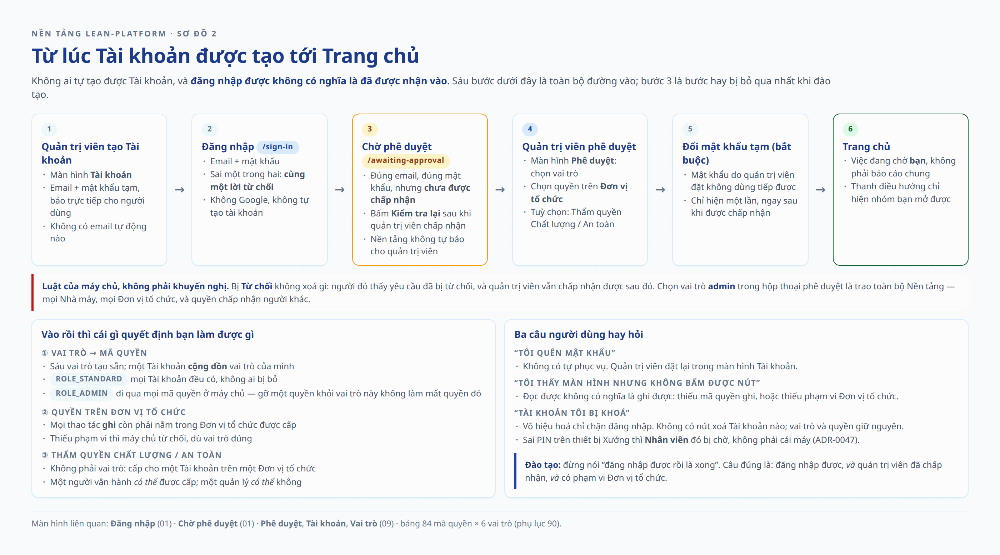
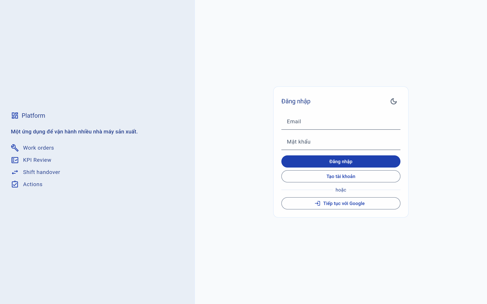
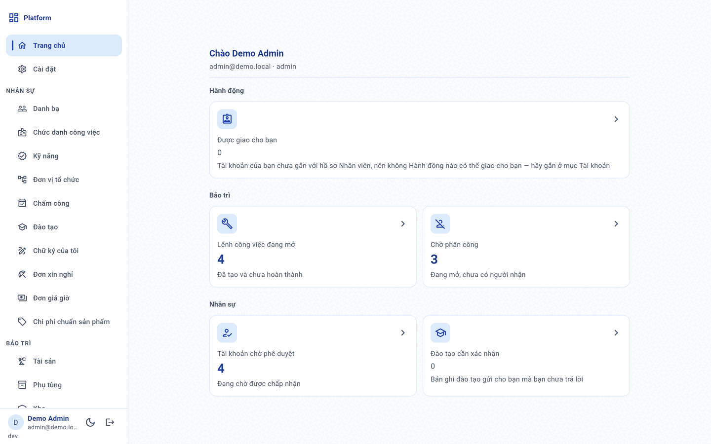
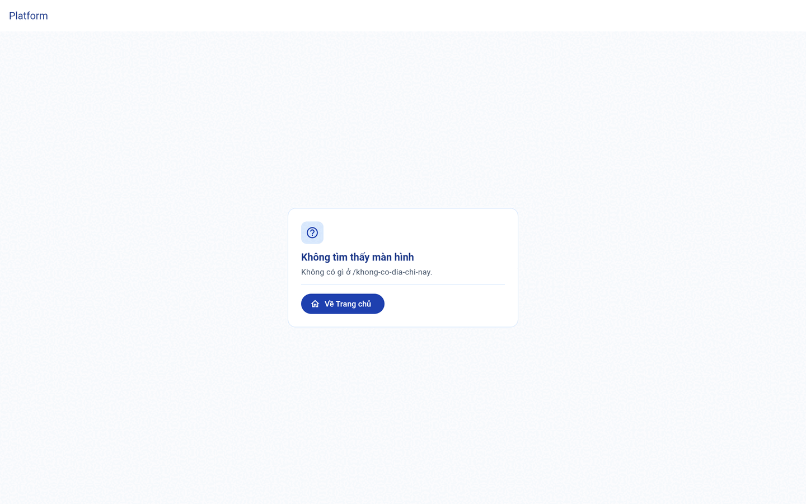
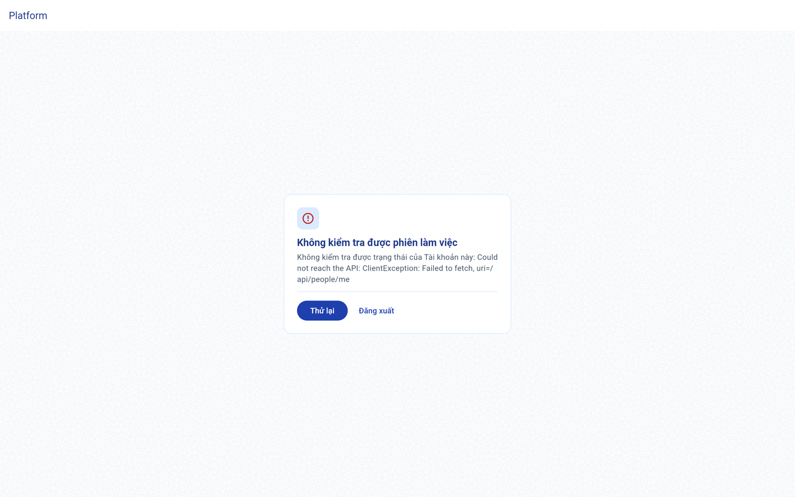

# 01 · Vào cửa và Tài khoản

Phần này dạy sáu màn hình mà một người gặp **trước khi** làm được việc gì trên
Nền tảng. Không có mã quyền nào trong phần này: cái quyết định ở đây là bạn đã
đăng nhập chưa và quản trị viên đã chấp nhận bạn chưa.

---

***Sơ đồ 2.** Sáu bước để vào được Nền tảng. Bước 3 — chờ phê duyệt — là bước hay bị bỏ
qua nhất khi đào tạo: đăng nhập được không có nghĩa là đã được nhận vào.*

## Đăng nhập

**Việc này để làm gì.** Vào Nền tảng bằng email và mật khẩu của chính bạn.

**Ai thao tác được.** Mọi người. Màn hình này không hỏi quyền vì chưa có phiên
làm việc nào để hỏi.

**Các bước chính**

| # | Bước | Điểm then chốt | Vì sao |
| --- | --- | --- | --- |
| 1 | Mở địa chỉ Nền tảng. Chưa đăng nhập thì Nền tảng tự đưa bạn tới `/sign-in`. | Không cần gõ `/sign-in` — mọi địa chỉ khác đều dẫn về đây. | Địa chỉ không mở được là chuyện của phiên, không phải của trang. |
| 2 | Gõ **Email** | Đúng địa chỉ quản trị viên đã cấp cho bạn, không phải email cá nhân. | Tài khoản gắn với email, không gắn với tên. |
| 3 | Gõ **Mật khẩu** | Mật khẩu do người tạo tài khoản đặt và báo trực tiếp cho bạn. | Không có nút "quên mật khẩu" tự phục vụ — mật khẩu được đặt lại bởi quản trị viên trong màn hình **Tài khoản**. |
| 4 | Bấm **Đăng nhập** | | |

***Ảnh 01.1.** Form trống: ô Email, ô Mật khẩu, nút **Đăng nhập**, và lối **Tạo tài khoản** cho người chưa có.*

***Ảnh 01.2.** Đã điền xong trước khi bấm **Đăng nhập**. Sai một trong hai thì câu từ chối duy nhất hiện ra — nó không cho biết sai email hay sai mật khẩu.*

**Điểm then chốt chung của cả ba trường.** Sai email hoặc sai mật khẩu cho ra
**cùng một lời từ chối**, và Nền tảng không nói cái nào sai.

> **Vì sao.** Nếu Nền tảng nói "email này không có tài khoản", người lạ dò được
> ai đang làm ở nhà máy. Gõ sai, hãy kiểm tra lại cùng quản trị viên; đừng thử
> nhiều email.

**Hai nút không dùng được — và đây là chủ ý.** Màn hình có **Tiếp tục với Google**
và **Tạo tài khoản**. Trên bản triển khai của nhà máy, cả hai đều là lời từ chối: không
có đăng nhập qua Google, và **không ai tự tạo được tài khoản**.

> **Vì sao.** Tài khoản phải do quản trị viên tạo và chấp nhận (xem **Phê duyệt**),
> để danh sách người vào được Nền tảng là danh sách do nhà máy quyết định.

Bấm vào hai nút đó, câu hiện ra **bằng tiếng Anh** (chưa dịch): "Accounts on this
deployment are created by an administrator." và "This deployment has no Google
sign-in." Đó là câu trả lời đúng — dặn công nhân điều này trước, đừng để họ tưởng máy
lỗi.

**Góc trên phải** có nút đổi giao diện sáng/tối. Lựa chọn nằm trên trình duyệt
này, không theo Tài khoản.

---

## Chờ phê duyệt

**Việc này để làm gì.** Nói rõ rằng bạn đã đăng nhập được nhưng **chưa được nhận
vào** Nền tảng.

**Ai thấy màn hình này.** Tài khoản có email/mật khẩu đúng nhưng quản trị viên
chưa bấm **Chấp nhận** ở màn hình **Phê duyệt**.

**Các bước chính**

| # | Bước | Điểm then chốt | Vì sao |
| --- | --- | --- | --- |
| 1 | Đọc câu trên màn hình, xác nhận đúng email của bạn. | Sai email nghĩa là bạn đã đăng nhập bằng tài khoản khác. | Rất hay gặp khi máy dùng chung. |
| 2 | Bấm **Đăng xuất** nếu sai người, rồi đăng nhập lại. | | |
| 3 | **Gặp quản trị viên** và nhờ chấp nhận, rồi bấm **Kiểm tra lại**. | Nền tảng không tự báo cho quản trị viên. | Không có thông báo tự động nào; người chờ phải tự nói. |

***Ảnh 01.3.** Đăng nhập được nhưng chưa được chấp nhận: chỉ màn hình này hiện ra, kèm nút **Kiểm tra lại**.*

> **Điểm then chốt quan trọng nhất.** Đăng nhập thành công **không** phải là được
> nhận vào. Đừng nói với công nhân "đăng nhập được rồi là xong".

---

## Chọn mật khẩu mới (bắt buộc)

**Việc này để làm gì.** Đổi mật khẩu tạm thời mà quản trị viên vừa cấp thành mật
khẩu của riêng bạn.

**Ai thấy màn hình này.** Tài khoản vừa được quản trị viên **Đặt lại mật khẩu**.
Khi đó Nền tảng chặn mọi địa chỉ khác cho tới khi bạn đổi xong.

**Các bước chính**

| # | Bước | Điểm then chốt | Vì sao |
| --- | --- | --- | --- |
| 1 | Gõ **Mật khẩu hiện tại** — chính mật khẩu tạm quản trị viên vừa đưa. | Mật khẩu tạm này chỉ dùng được một lần cho việc này. | Nếu không đổi được, mật khẩu tạm nằm lại trong tin nhắn/giấy của hai người. |
| 2 | Gõ **Mật khẩu mới** | Ít nhất **8 ký tự** (Nền tảng báo con số ngay dưới ô). | Đây là độ dài tối thiểu máy chủ chấp nhận, không phải gợi ý. |
| 3 | Bấm **Đổi mật khẩu** | Tài khoản được đọc lại; nếu mật khẩu đúng, Nền tảng tự mở trang chủ. | Không phải đăng nhập lại bằng tay. |

***Ảnh 01.4.** Hai ô mật khẩu và sàn **ít nhất 8 ký tự**. Mật khẩu tạm không dùng tiếp được: phải chọn mật khẩu của chính bạn.*

Sai mật khẩu hiện tại: lời từ chối hiện **ngay trong màn hình** và **bạn vẫn
đang đăng nhập**. Không phải bị đá ra.

---

## Trang chủ

**Việc này để làm gì.** Xem một chỗ những việc đang chờ **bạn** — không phải báo
cáo, chỉ là việc.

**Ai thao tác được.** Mọi Tài khoản đã được chấp nhận. Không có mã quyền: mỗi ô
chỉ hiện khi bạn mở được màn hình mà ô đó dẫn tới.

**Các bước chính**

| # | Bước | Điểm then chốt | Vì sao |
| --- | --- | --- | --- |
| 1 | Đọc lời chào và tên của bạn ở đầu trang. | Nếu đó không phải tên bạn, thoát ra — máy đang đăng nhập bằng người khác. | |
| 2 | Đọc các ô theo nhóm: **Hành động** (việc giao cho bạn), **Bảo trì** (lệnh công việc), **Nhân sự** (tài khoản chờ phê duyệt, đào tạo cần xác nhận). | Ô nào bạn không có quyền thì **không hiện** — không phải lỗi. | Sidebar và trang chủ cùng một luật: quyền đọc quyết định cái gì hiện. |
| 3 | Bấm vào một ô để mở đúng danh sách đã lọc sẵn. | | |

***Ảnh 01.5.** Ba khối đếm theo đúng nhóm quyền của bạn — Hành động, Bảo trì, Nhân sự — mỗi con số là một lối vào danh sách đã lọc.*

**Điểm then chốt.** Ô hiện số **0** và ô **không hiện** là hai chuyện khác nhau.
Số 0 nghĩa là không có việc; ô vắng nghĩa là bạn không mở được màn hình đó.

> **Vì sao.** Người vận hành hay tưởng "trang chủ trống là hệ thống hỏng". Thực ra
> trang chủ chỉ hiện cái vai trò của bạn mở được.

Nếu Tài khoản chưa gắn với Nhân viên nào, trang chủ nói rõ điều đó ngay dưới lời
chào. Đó là việc của quản trị viên (**Tài khoản → Liên kết Nhân viên**), không
phải của bạn.

---

## Cài đặt

**Việc này để làm gì.** Chọn ngôn ngữ và giao diện sáng/tối.

**Ai thao tác được.** Mọi Tài khoản đã được chấp nhận.

**Các bước chính**

| # | Bước | Điểm then chốt | Vì sao |
| --- | --- | --- | --- |
| 1 | Mở **Cài đặt** ở cuối thanh điều hướng. | | |
| 2 | Ở **Ngôn ngữ**, chọn **Tiếng Việt** hoặc **Tiếng Anh**. | Áp dụng **ngay** cho toàn bộ Nền tảng, không cần tải lại trang. | |
| 3 | Đổi giao diện sáng/tối ở menu tài khoản (góc trên phải). | Lựa chọn được **ghi nhớ trên trình duyệt này**. | Máy khác vẫn giữ lựa chọn riêng của nó. |

***Ảnh 01.6.** Hai lựa chọn ngôn ngữ; chọn **Tiếng Việt** là toàn bộ Nền tảng đổi ngay, và lựa chọn được nhớ trên trình duyệt này.*

***Ảnh 01.7.** Trạng thái mặc định của một tài khoản mới: **English**. Đây là ngôn ngữ gốc của bản giao diện.*

> **Điểm then chốt cho người đào tạo.** Ngôn ngữ **không** theo Tài khoản mà theo
> trình duyệt. Trên thiết bị Xưởng dùng chung, người ca sau có thể đổi lại — hãy
> dặn công nhân kiểm tra ngôn ngữ trước khi báo lỗi "màn hình toàn tiếng Anh".

---

## Không tìm thấy màn hình

**Việc này để làm gì.** Báo rằng địa chỉ bạn mở không có gì ở đó.

**Ai thấy màn hình này.** Ai gõ một địa chỉ sai hoặc theo một liên kết cũ.

**Các bước chính**

| # | Bước | Điểm then chốt | Vì sao |
| --- | --- | --- | --- |
| 1 | Đọc địa chỉ Nền tảng in ra trong câu. | Địa chỉ đó là cái sai — không phải dữ liệu. | |
| 2 | Bấm **Về Trang chủ**, rồi đi tới màn hình bằng thanh điều hướng. | | |

***Ảnh 01.8.** Địa chỉ sai hiện đúng địa chỉ đã gõ và một lối về Trang chủ — không phải màn hình trắng.*

> **Phân biệt với màn hình tiếp theo.** "Không có gì ở đây" khác "bạn không có
> quyền". Đừng nói với công nhân là "hệ thống không cho" khi thực ra họ gõ sai
> đường dẫn.

---

## Không có quyền xem mục này

**Việc này để làm gì.** Báo rằng địa chỉ bạn mở có thật, nhưng vai trò của bạn
không mở được nó.

**Ai thấy màn hình này.** Tài khoản đã được chấp nhận nhưng thiếu quyền của màn
hình đó — ví dụ một người vận hành gõ `/approvals`, hoặc `/roles` khi thiếu
`ADM_ROLES_DISPLAY`.

**Các bước chính**

| # | Bước | Điểm then chốt | Vì sao |
| --- | --- | --- | --- |
| 1 | Đọc câu: phần này dành cho quản trị viên. | | |
| 2 | Bấm **Về Trang chủ**. | | |
| 3 | Nếu bạn **cần** quyền đó để làm việc, nói với quản trị viên và nêu tên màn hình. | Quản trị viên sửa ở **Vai trò** (thêm mã quyền cho vai trò) hoặc ở **Tài khoản** (gán thêm vai trò cho bạn). | |

***Ảnh 01.9.** Một tài khoản người vận hành mở `/roles`: Nền tảng nói rõ thiếu quyền, thay vì ẩn màn hình đi và để người dùng tưởng đã bấm nhầm.*

> **Điểm then chốt.** Màn hình này **cố tình** không giả vờ là "không tìm thấy".
> Nó nói thẳng là thiếu quyền, để bạn biết mình phải xin gì.

---

## Không kiểm tra được phiên làm việc

**Việc này để làm gì.** Báo rằng Nền tảng không đọc được trạng thái Tài khoản của
bạn — mạng hoặc máy chủ có vấn đề, không phải quyền của bạn.

**Ai thấy màn hình này.** Bất kỳ ai đang đăng nhập khi máy chủ không trả lời được.

**Các bước chính**

| # | Bước | Điểm then chốt | Vì sao |
| --- | --- | --- | --- |
| 1 | Chờ vài giây, bấm **Thử lại**. | | |
| 2 | Nếu vẫn lỗi, bấm **Đăng xuất** và đăng nhập lại. | | |
| 3 | Vẫn lỗi thì báo người quản trị hệ thống — **đừng** đổi mật khẩu, đừng xin thêm quyền. | Lời nhắn trên màn hình là lỗi kết nối, không phải lỗi quyền. | Xin quyền trong lúc này chỉ làm quản trị viên đi sai hướng. |

***Ảnh 01.10.** Khi API không trả lời, Nền tảng dừng lại và nói **không kiểm tra được phiên** — nó không đoán là bạn đã đăng xuất.*

