# 02 · Nhân sự

Nhóm **Nhân sự** trả lời bốn câu: ai làm việc ở đây, họ làm được gì, ai có mặt ở ca
nào, và ai đã được đào tạo cái gì. Ngoài ra có hai danh mục tiền (**Đơn giá giờ**,
**Chi phí chuẩn sản phẩm**) và một màn hình tự phục vụ (**Chữ ký của tôi**).

Mười chín phiếu dưới đây theo đúng thứ tự một buổi đào tạo nên đi: đọc trước, ghi
sau. **Đọc rộng, ghi hẹp** — Danh bạ, Chức danh, Kỹ năng, Đơn vị tổ chức, Đào tạo
và Đơn xin nghỉ ai cũng đọc được; ghi thì phần lớn chỉ quản trị viên, và mọi thao
tác ghi đều cần phạm vi **Đơn vị tổ chức**.

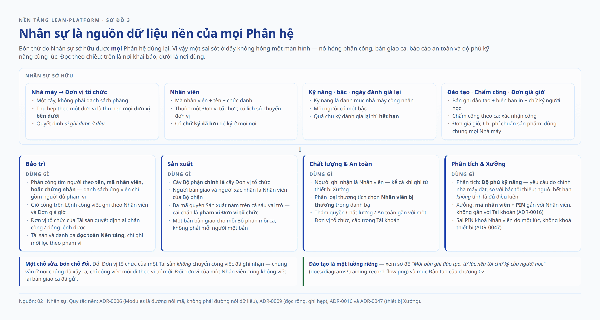

***Sơ đồ 3.** Bốn thứ Nhân sự sở hữu được bốn Phân hệ dùng lại. Một sai sót ở đây hỏng
phân công, bàn giao ca, báo cáo an toàn và độ phủ kỹ năng cùng lúc.*

---

## Danh bạ

| Hạng mục | Nội dung |
| --- | --- |
| **Công việc** | Tìm một Nhân viên và mở hồ sơ của họ — màn hình **Danh bạ**, `/directory`. Phiếu 02.1. |
| **Ai thao tác được** | Đọc: mọi vai trò, kể cả người vận hành. Ghi: **chỉ quản trị viên**. Đọc hồ sơ của chính mình: mọi Tài khoản, qua **Hồ sơ của tôi**. |
| **Vật tư, dữ liệu có trước** | Danh bạ đã có Nhân viên — hồ sơ do quản trị viên tạo (phiếu 02.2). |
| **Công cụ** | Ô **Tìm theo tên**, bộ lọc **Đơn vị tổ chức** và **Chức danh công việc**, ô **Gồm cả người đã rời**; mã quyền đọc `PPL_DIRECTORY_DISPLAY`, mã quyền ghi `PPL_DIRECTORY_CHANGE`. |
| **An toàn** | Không có thao tác ghi ở phiếu này. Danh bạ đọc được toàn Nền tảng theo chủ ý — đừng thêm bộ lọc Đơn vị tổ chức "cho chặt", đó là thiết kế. |
| **Thiết bị đào tạo** | Ảnh 02.1 |
| **Chủ tài liệu · Rev · Ngày · Trang** | Ban Lean Nền tảng · Rev 2 · 2026-11-15 · 02.1 |

| Các bước chính | Điểm then chốt | Vì sao | Minh hoạ |
| --- | --- | --- | --- |
| **1.** Gõ tên vào ô **Tìm theo tên**, rồi bấm dòng đúng người để mở **Hồ sơ Nhân viên** | [Hỏng] Tìm theo **tên**, không theo mã nhân viên | Mã nhân viên dùng để tìm trong các ô chọn Nhân viên khác, ví dụ khi thêm học viên đào tạo | Ảnh 02.1 |
| **2.** Thu hẹp bằng **Đơn vị tổ chức** và **Chức danh công việc** khi danh sách dài | [Dễ] Bộ lọc Đơn vị tổ chức **bao gồm mọi đơn vị bên dưới** nó | Chọn "Bộ phận Sản xuất" là thấy cả các tổ bên trong, không phải chọn từng tổ | — |
| **3.** Không thấy người: bật **Gồm cả người đã rời** | [Hỏng] Đừng kết luận "không có người này" khi chưa bật ô đó | Người đã rời bị **ẩn** mặc định — đây là lỗi hay gặp nhất ở Danh bạ | — |

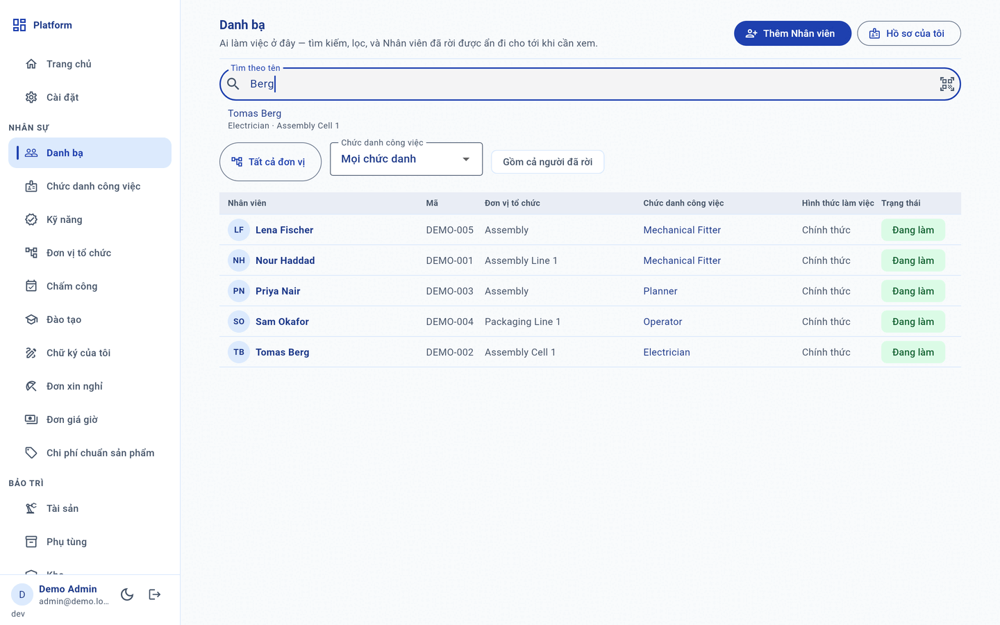

***Ảnh 02.1.** Gõ một phần tên vào ô tìm: danh sách lọc ngay, vẫn giữ nguyên bộ lọc Đơn vị tổ chức bên cạnh.*

### Thêm một Nhân viên

| Hạng mục | Nội dung |
| --- | --- |
| **Công việc** | Tạo hồ sơ một con người trong Danh bạ — hộp thoại **Thêm Nhân viên**, mở từ `/directory`. Phiếu 02.2. |
| **Ai thao tác được** | Chỉ quản trị viên. |
| **Vật tư, dữ liệu có trước** | Mã nhân viên do nhà máy cấp; Đơn vị tổ chức để phân công (phiếu 02.6) đã tồn tại. |
| **Công cụ** | Nút **Thêm Nhân viên**, hộp thoại của nó, và nút **Phân công** trên hồ sơ vừa tạo; mã quyền ghi `PPL_DIRECTORY_CHANGE`. |
| **An toàn** | Thêm Nhân viên **không** phải là tạo Tài khoản: Tài khoản là quyền đăng nhập, do quản trị viên tạo ở **Tài khoản** rồi **chấp nhận** ở **Phê duyệt**. Đừng hứa "đã có tài khoản" sau phiếu này. |
| **Thiết bị đào tạo** | Ảnh 02.2 |
| **Chủ tài liệu · Rev · Ngày · Trang** | Ban Lean Nền tảng · Rev 2 · 2026-11-15 · 02.2 |

| Các bước chính | Điểm then chốt | Vì sao | Minh hoạ |
| --- | --- | --- | --- |
| **1.** Bấm **Thêm Nhân viên**, điền **Mã nhân viên**, **Họ**, **Tên**, **Loại hình làm việc** | [Hỏng] Mã nhân viên không đổi được về sau, và là thứ công nhân quét ở thiết bị Xưởng | Sai mã là công nhân không đăng nhập được ở Xưởng, và phải sửa cả sổ đã ghi | Ảnh 02.2 |
| **2.** Điền **Email công việc** nếu có | [Dễ] Không bắt buộc, nhưng là thứ để gắn Tài khoản về con người này sau | Thiếu email thì quản trị viên vẫn gắn được bằng tay ở **Tài khoản → Liên kết Nhân viên** | — |
| **3.** Mở hồ sơ vừa tạo, bấm **Phân công**, gán vào Đơn vị tổ chức | [Hỏng] Một Nhân viên chưa phân công **chưa thuộc tổ nào** và không hiện trong bảng chấm công của ca | Đây là nguyên nhân số một của câu "người này không có trong bảng chấm công" | — |

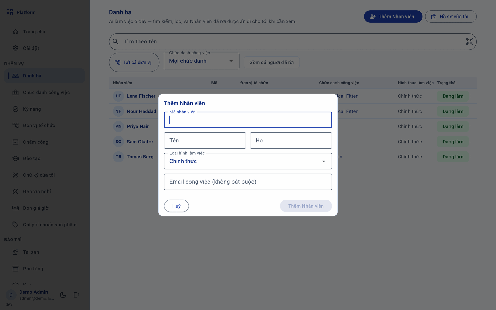

***Ảnh 02.2.** Hộp thoại chỉ hỏi những gì Danh bạ sở hữu; Đơn vị tổ chức và chức danh là lựa chọn, không phải ô gõ tay.*

---

## Hồ sơ Nhân viên

| Hạng mục | Nội dung |
| --- | --- |
| **Công việc** | Xem một người: đang làm ở đâu, đã từng làm ở đâu, có chứng nhận gì, chữ ký nào, đã làm bao nhiêu giờ — màn hình **Hồ sơ Nhân viên**, `/directory/:id` hoặc `/directory/me`. Phiếu 02.3. |
| **Ai thao tác được** | Đọc: mọi Tài khoản đã được chấp nhận. **Sửa hồ sơ**, **Phân công**, **Ghi nhận đã rời**, **Khôi phục**: quản trị viên. **Ghi nhận kỹ năng**, **Đánh giá lại**: quản trị viên. |
| **Vật tư, dữ liệu có trước** | Hồ sơ Nhân viên đã tồn tại (phiếu 02.2). |
| **Công cụ** | Các mục **Lịch sử phân công**, **Kỹ năng**, **Chữ ký**; các nút **Sửa hồ sơ**, **Phân công**, **Giờ đã làm**, **Ghi nhận kỹ năng**, **Ghi nhận đã rời**, **Khôi phục**; mã quyền ghi `PPL_DIRECTORY_CHANGE`, `PPL_SKILLS_CHANGE`. |
| **An toàn** | **Ghi nhận đã rời** không xoá ai và **Khôi phục** được — nhưng đừng dùng nó như một cách "dọn" danh sách: lịch sử chấm công, đào tạo và lệnh công việc đều trỏ về hồ sơ này. |
| **Thiết bị đào tạo** | Ảnh 02.3 |
| **Chủ tài liệu · Rev · Ngày · Trang** | Ban Lean Nền tảng · Rev 2 · 2026-11-15 · 02.3 |

| Các bước chính | Điểm then chốt | Vì sao | Minh hoạ |
| --- | --- | --- | --- |
| **1.** Vào từ một dòng ở Danh bạ, hoặc bấm **Hồ sơ của tôi** | [Dễ] **Hồ sơ của tôi** mở đúng hồ sơ gắn với Tài khoản đang đăng nhập | Ai cũng xem được hồ sơ mình mà không phải tìm mình trong danh sách | Ảnh 02.3 |
| **2.** Đọc **Lịch sử phân công**: dòng **Hiện tại**, rồi các dòng đã hết hiệu lực | [Hỏng] Chỉ dòng **Hiện tại** quyết định họ thuộc ca nào bây giờ | Một người có thể đổi tổ nhiều lần; đọc nhầm dòng cũ là ghi giờ công cho sai tổ | — |
| **3.** Xem phần **Kỹ năng** và **Chữ ký** | [Dễ] Nút **Ghi nhận kỹ năng** nằm ngay trên phần kỹ năng | Ghi nhận kỹ năng là việc của phiếu 02.5, làm ngay tại đây | — |
| **4.** Bấm **Giờ đã làm** để xem số giờ theo ngày | [Hỏng] Con số này chỉ tính chấm công **đã xác nhận** | Xem phiếu 02.4 trước khi kết luận "người này không đi làm" | — |
| **5.** Cho một người rời nhà máy: **Ghi nhận đã rời** | [An toàn] Không có nút xoá Nhân viên, và đó là chủ ý: xoá hồ sơ sẽ làm hỏng các bản ghi trỏ về nó | Người đã rời chuyển trạng thái **Đã rời**, bị ẩn khỏi Danh bạ, và **Khôi phục** đưa họ trở lại | — |

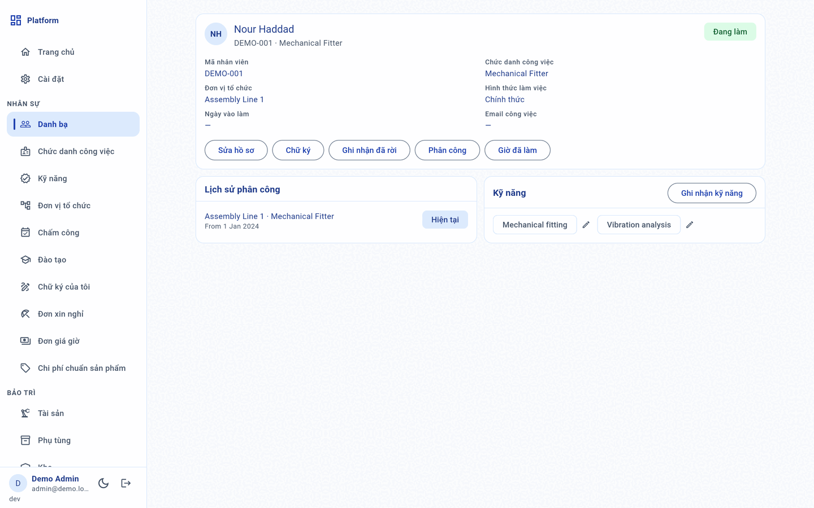

***Ảnh 02.3.** Một hồ sơ gom: mã nhân viên, chức danh, đơn vị tổ chức, hình thức làm việc, và các mục con (giờ công, kỹ năng, đào tạo) — mỗi mục là một liên kết.*

---

## Giờ đã làm của một Nhân viên

| Hạng mục | Nội dung |
| --- | --- |
| **Công việc** | Đọc số giờ một người **thực sự** đã làm, theo từng ngày — màn hình **Giờ đã làm**, `/directory/:employeeId/work-hours`, mở từ hồ sơ Nhân viên. Phiếu 02.4. |
| **Ai thao tác được** | Mọi Tài khoản đã được chấp nhận. |
| **Vật tư, dữ liệu có trước** | Bảng chấm công của các ca có người đó, **đã bấm Xác nhận** (phiếu 02.8). |
| **Công cụ** | Ô **Từ**, ô **Đến**, bảng **Ngày** · **Đã làm** · **Ngoài giờ**, dòng **Tổng cộng**. |
| **An toàn** | Không có thao tác ghi. Đây là số liệu giờ công — đừng đọc nó như sổ chấm công: bảng chưa xác nhận không xuất hiện ở đây. |
| **Thiết bị đào tạo** | Ảnh 02.4 |
| **Chủ tài liệu · Rev · Ngày · Trang** | Ban Lean Nền tảng · Rev 2 · 2026-11-15 · 02.4 |

| Các bước chính | Điểm then chốt | Vì sao | Minh hoạ |
| --- | --- | --- | --- |
| **1.** Đặt **Từ** và **Đến** | [Dễ] Đặt khoảng đủ rộng trước khi kết luận thiếu giờ | Khoảng hẹp là lý do hay gặp nhất của một bảng trông trống | — |
| **2.** Đọc bảng: **Ngày**, **Đã làm**, **Ngoài giờ**, và "trên {X} theo lịch" | [Hỏng] Cột "theo lịch" là số giờ ca **dự kiến**, không phải giờ đã làm | Đọc nhầm cột là báo cáo giờ công sai cho cả tháng | Ảnh 02.4 |
| **3.** Đọc dòng **Tổng cộng** | — | — | Ảnh 02.4 |
| **4.** Nếu bảng trống: mở **Chấm công cần xác nhận** trước khi kết luận | [Hỏng] Chỉ chấm công **đã xác nhận** mới được tính; bảng chưa xác nhận chỉ là bản nháp | Câu trả lời thường không phải "người này không đi làm" mà là "giám sát chưa xác nhận chấm công" | — |

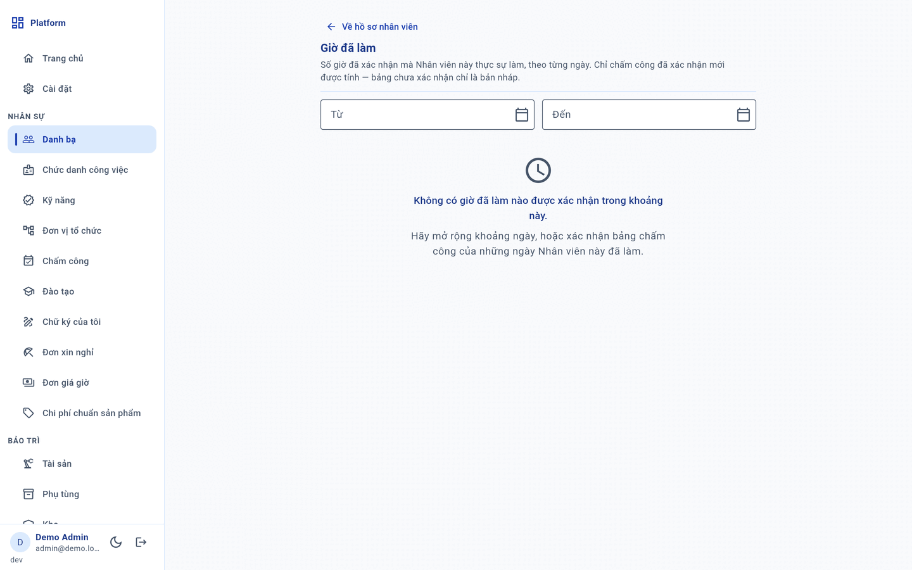

***Ảnh 02.4.** Tổng giờ theo từng ngày, kèm câu nhắc: **bảng chưa xác nhận chỉ là bản nháp** — chỉ giờ đã xác nhận mới được tính.*

---

## Chức danh công việc

| Hạng mục | Nội dung |
| --- | --- |
| **Công việc** | Khai báo danh mục nghề của nhà máy — màn hình **Chức danh công việc**, `/job-roles`. Phiếu 02.5. |
| **Ai thao tác được** | Đọc: mọi vai trò. Ghi: chỉ quản trị viên. |
| **Vật tư, dữ liệu có trước** | — |
| **Công cụ** | Ô tìm theo **tên hoặc mã**, nút **Thêm chức danh**, nút **Điều chỉnh**, ô **Đang làm**; mã quyền đọc `PPL_JOB_ROLES_DISPLAY`, ghi `PPL_JOB_ROLES_CHANGE`. |
| **An toàn** | Danh mục dùng chung cho **mọi** Nhà máy — thêm một chức danh ở đây là thêm cho cả Nền tảng, không riêng nhà máy này. |
| **Thiết bị đào tạo** | Ảnh 02.5 |
| **Chủ tài liệu · Rev · Ngày · Trang** | Ban Lean Nền tảng · Rev 2 · 2026-11-15 · 02.5 |

| Các bước chính | Điểm then chốt | Vì sao | Minh hoạ |
| --- | --- | --- | --- |
| **1.** Tìm theo **tên hoặc mã** | [Dễ] Tìm trước khi thêm — chức danh đã có thì dùng lại | Thêm trùng mã là hai chức danh cho một nghề, và hồ sơ Nhân viên sẽ có hai lựa chọn giống nhau | Ảnh 02.5 |
| **2.** Bấm **Thêm chức danh**: điền **Mã**, **Tên** | [Dễ] Mã ngắn, không dấu, viết hoa | Mã xuất hiện trong danh sách chọn ở hồ sơ Nhân viên, cạnh các mã khác | — |
| **3.** Ngừng dùng một chức danh: **Điều chỉnh**, bỏ **Đang làm** | [Hỏng] Ngừng dùng **không** rút chức danh khỏi hồ sơ người đang giữ nó | Danh mục là lịch sử, không phải danh sách hiện hành; người đang giữ vẫn giữ | — |

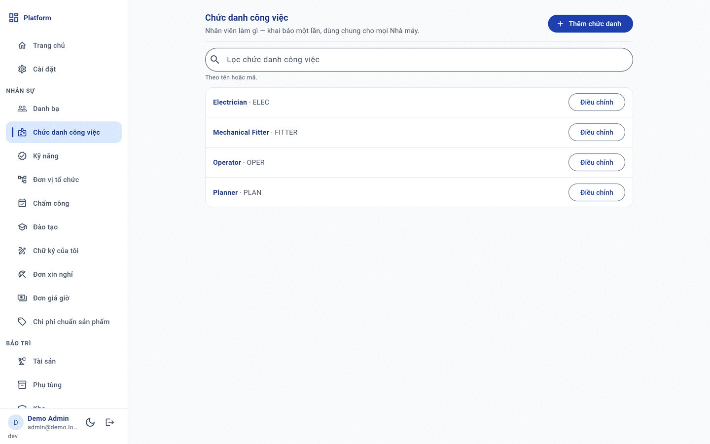

***Ảnh 02.5.** Danh mục khai báo một lần, dùng chung cho mọi Nhà máy — đây là chỗ chức danh được đặt tên.*

---

## Kỹ năng

| Hạng mục | Nội dung |
| --- | --- |
| **Công việc** | Khai báo danh mục kỹ năng nhà máy công nhận, và ghi nhận một người đã đạt kỹ năng nào — màn hình **Kỹ năng**, `/skills`. Phiếu 02.6. |
| **Ai thao tác được** | Đọc: mọi vai trò. Ghi danh mục và ghi nhận kỹ năng cho một người: **chỉ quản trị viên**. |
| **Vật tư, dữ liệu có trước** | Hồ sơ Nhân viên của người được ghi nhận (phiếu 02.2); minh chứng đào tạo nếu có. |
| **Công cụ** | Ô tìm theo **tên, mã hoặc hạng mục**; nút **Thêm kỹ năng**, nút **Ai đang có kỹ năng này**; trên hồ sơ là **Ghi nhận kỹ năng**; mã quyền đọc `PPL_SKILLS_DISPLAY`, ghi `PPL_SKILLS_CHANGE`. |
| **An toàn** | Ghi nhận kỹ năng là nói nhà máy **công nhận** một người làm được việc đó — nó quyết định ai hiện trong danh sách ứng viên phân công lệnh công việc. Ghi theo đánh giá thật, không theo cảm tình. |
| **Thiết bị đào tạo** | Ảnh 02.6 |
| **Chủ tài liệu · Rev · Ngày · Trang** | Ban Lean Nền tảng · Rev 2 · 2026-11-15 · 02.6 |

| Các bước chính | Điểm then chốt | Vì sao | Minh hoạ |
| --- | --- | --- | --- |
| **1.** Tìm theo **tên, mã hoặc hạng mục** | — | — | Ảnh 02.6 |
| **2.** Bấm **Thêm kỹ năng**: **Mã**, **Tên**, **Hạng mục**, **Cần chứng nhận**, **Chu kỳ đánh giá lại (tháng)** | [Hỏng] Để trống chu kỳ đánh giá lại nghĩa là kỹ năng này **không bao giờ** hết hạn | Chu kỳ là thứ Nền tảng dùng để cảnh báo hết hạn; bỏ trống là tự tắt lời cảnh báo | — |
| **3.** Bấm **Ai đang có kỹ năng này** | [Dễ] Đây là câu hỏi thật của người đào tạo, không phải một cột trong bảng | Cho biết ai đủ điều kiện trước khi phân công việc cần kỹ năng đó | Ảnh 02.6 |
| **4.** Ghi nhận cho một người: **Hồ sơ Nhân viên → Ghi nhận kỹ năng**: **Mức thành thạo (0–4, ILUO)**, **Đánh giá ngày**, **Hết hạn ngày**, **Tham chiếu minh chứng** | [Hỏng] **0 — không có** là một mức hợp lệ, khác với không ghi gì | 0 là đã đánh giá và không đạt; bỏ trống là chưa đánh giá — hai chuyện khác nhau khi xét hết hạn | — |
| **5.** Để trống **Hết hạn ngày** khi muốn Nền tảng tự tính | [Dễ] Nền tảng tự tính từ **chu kỳ đánh giá lại** của kỹ năng đó | Ghi tay ngày hết hạn thì lần đánh giá sau phải sửa tay lần nữa | — |

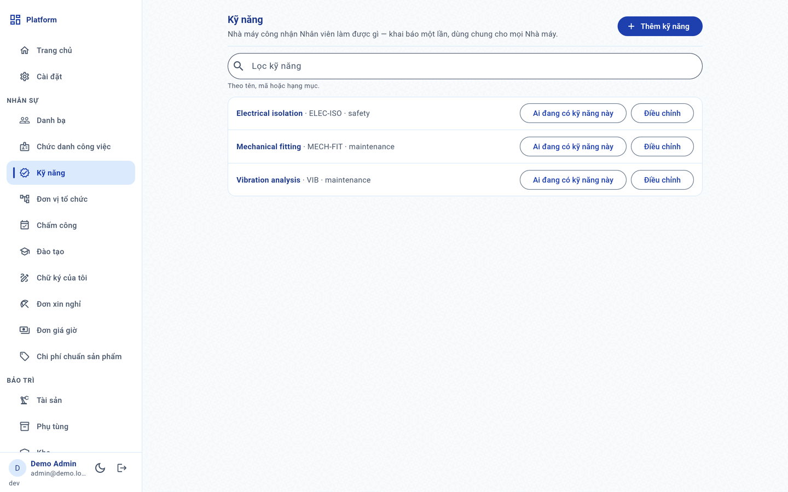

***Ảnh 02.6.** Mỗi kỹ năng có lối **Ai đang có kỹ năng này** — câu hỏi thật của người đào tạo, không phải một cột trong bảng.*

---

## Đơn vị tổ chức

| Hạng mục | Nội dung |
| --- | --- |
| **Công việc** | Dựng hình thù của nhà máy — **Nhà máy** ở trên, các **Đơn vị tổ chức** lồng nhau bên dưới — màn hình **Đơn vị tổ chức**, `/org-units`. Phiếu 02.7. |
| **Ai thao tác được** | Đọc: mọi vai trò. Ghi: **chỉ quản trị viên**. |
| **Vật tư, dữ liệu có trước** | Danh sách bộ phận / tổ / khu vực của nhà máy, kèm mã cho từng đơn vị. |
| **Công cụ** | Ô chọn **Nhà máy**, nút **Thu gọn** / **Mở rộng**, ô **Tìm Đơn vị tổ chức theo tên**, các nút **Thêm Đơn vị tổ chức ở đây**, **Thêm Nhà máy**, **Ngừng sử dụng**, **Nhập một nhánh**; mã quyền đọc `PPL_ORG_UNITS_DISPLAY`, ghi `PPL_ORG_UNITS_CHANGE`. |
| **An toàn** | Đây là cây mà **mọi phạm vi ghi** bám vào: một đơn vị đặt sai chỗ làm giám sát mất quyền ghi (hoặc có quyền ở tổ khác). **Ngừng sử dụng** không xoá, và **Khôi phục** được, nhưng lịch sử công việc và chấm công vẫn trỏ về đơn vị đó. |
| **Thiết bị đào tạo** | Ảnh 02.7 |
| **Chủ tài liệu · Rev · Ngày · Trang** | Ban Lean Nền tảng · Rev 2 · 2026-11-15 · 02.7 |

| Các bước chính | Điểm then chốt | Vì sao | Minh hoạ |
| --- | --- | --- | --- |
| **1.** Chọn **Nhà máy** ở đầu trang | [Hỏng] Cây bên dưới chỉ là của Nhà máy đang chọn | Nền tảng hỗ trợ nhiều Nhà máy; lẫn hai nhà máy là lỗi hay gặp khi nhà máy thứ hai vừa được thêm | — |
| **2.** **Thu gọn** / **Mở rộng** các nhánh, hoặc gõ vào ô **Tìm Đơn vị tổ chức theo tên** | [Dễ] Chọn một kết quả tìm kiếm sẽ **mở và chọn** đơn vị đó trong cây | Cây lớn thì tìm nhanh hơn cuộn | Ảnh 02.7 |
| **3.** Bấm **Thêm Đơn vị tổ chức ở đây** trên một đơn vị: **Mã**, **Tên**, **Loại đơn vị**, **Thứ tự sắp xếp** | [Hỏng] **Loại đơn vị** quyết định rất nhiều chỗ khác: bộ phận / tổ / khu vực | Chọn sai loại là bảng chấm công và bảng Bộ phận không hiện đúng | — |
| **4.** Bắt đầu một nhà máy mới: **Thêm Nhà máy**: **Mã**, **Tên**, **Mã quốc gia (không bắt buộc)** | [Hỏng] Mọi Đơn vị tổ chức đều nằm dưới một Nhà máy — không có đơn vị nào đứng ngoài | Một đơn vị không có Nhà máy thì không nhà máy nào thấy nó | — |
| **5.** Ngừng một đơn vị: **Ngừng sử dụng**, xác nhận | [An toàn] Đơn vị được **ghi là đã ngừng** chứ **không bị xoá**; **Khôi phục** được bất cứ lúc nào | Lịch sử công việc và chấm công vẫn trỏ về nó | — |
| **6.** Nhập một nhánh: **Nhập một nhánh** với **một mảng JSON** | [Hỏng] Mỗi dòng tham chiếu cha bằng **`parentCode`** — một dòng khác trong cùng mảng, hoặc một mã đã có ở Nhà máy này — **không bao giờ bằng id** | Bạn nhập cây trước khi biết id (id do máy chủ sinh); dùng `parentCode` thì cùng một tệp nhập được vào cả môi trường thử và môi trường thật | — |

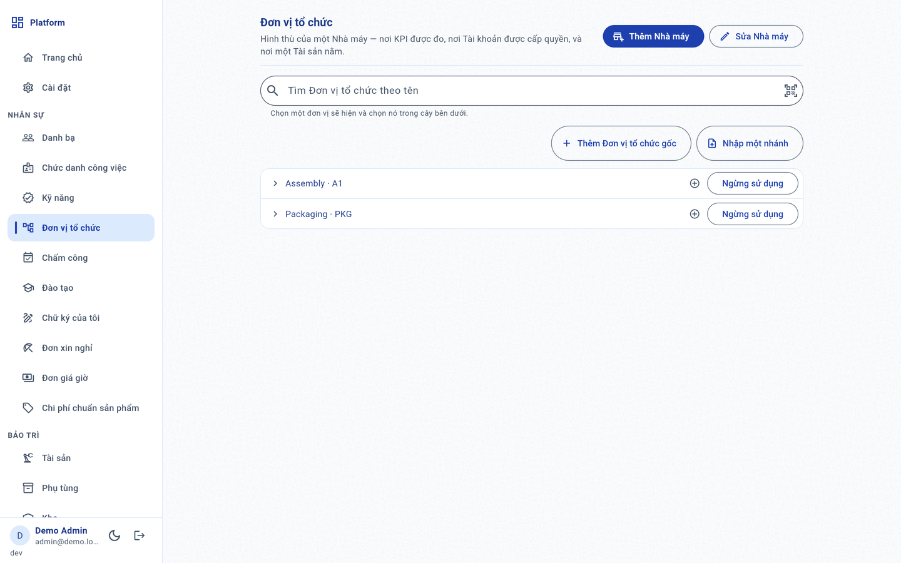

***Ảnh 02.7.** Cây Đơn vị tổ chức của Nhà máy, kèm lối sửa và thêm nhánh. Đây là cây mà mọi phạm vi ghi quyền bám vào.*

---

## Chấm công

| Hạng mục | Nội dung |
| --- | --- |
| **Công việc** | Chọn đúng ca để mở bảng chấm công của nó — màn hình **Chấm công**, `/attendance`. Phiếu 02.8. |
| **Ai thao tác được** | Xem danh sách ca: mọi vai trò. **Mở và xác nhận** một bảng: supervisor, engineer, manager, quản trị viên — **và** quyền sửa trên Đơn vị tổ chức của ca đó. |
| **Vật tư, dữ liệu có trước** | Cây **Đơn vị tổ chức** (phiếu 02.7) và ca đã được xếp cho ngày sản xuất đó; Nhân viên đã được **Phân công** vào tổ (phiếu 02.2). |
| **Công cụ** | Ô chọn **Nhà máy**, **Đơn vị tổ chức**, **Ngày sản xuất**; danh sách ca của ngày; mã quyền đọc `PPL_ATTENDANCE_DISPLAY`, quyền ghi `PPL_ATTENDANCE_CHANGE`. |
| **An toàn** | Mở bảng là mở một sổ giờ công của người thật. Một giám sát **không có quyền sửa ở tổ đó không mở được bảng**, kể cả cùng vai trò — đó là phạm vi Đơn vị tổ chức đang làm việc, không phải lỗi. |
| **Thiết bị đào tạo** | Ảnh 02.8 |
| **Chủ tài liệu · Rev · Ngày · Trang** | Ban Lean Nền tảng · Rev 2 · 2026-11-15 · 02.8 |

| Các bước chính | Điểm then chốt | Vì sao | Minh hoạ |
| --- | --- | --- | --- |
| **1.** Chọn **Nhà máy**, **Đơn vị tổ chức** và **Ngày sản xuất** | [Hỏng] **Ngày sản xuất** không phải ngày dương lịch của bạn — ca đêm thuộc về ngày sản xuất của nó | Ghi nhầm ngày là giờ công rơi sang ca khác, và tháng đó lệch hai lần | Ảnh 02.8 |
| **2.** Chọn ca trong danh sách để mở **Bảng chấm công** | [Dễ] Ngày đó không có ca nào thì Nền tảng nói rõ, không phải lỗi | Không có ca là chưa xếp ca, không phải mất dữ liệu | — |
| **3.** Không mở được bảng: kiểm tra quyền sửa ở Đơn vị tổ chức của ca | [An toàn] Cùng một vai trò, hai tổ khác nhau, kết quả khác nhau | Người vận hành mở địa chỉ này sẽ thấy câu "Chưa có ai có quyền sửa ở đây mở bảng này" — đó là câu trả lời đúng | — |

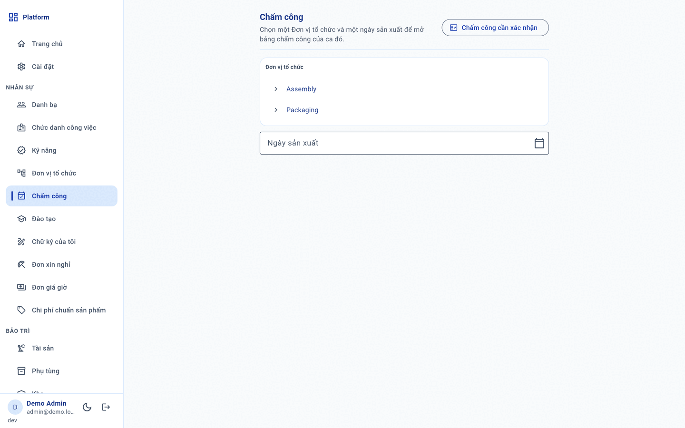

***Ảnh 02.8.** Chọn một Đơn vị tổ chức và một **ngày sản xuất**; các ca của ngày đó hiện ra kèm số người cần xác nhận.*

---

## Bảng chấm công một ca

| Hạng mục | Nội dung |
| --- | --- |
| **Công việc** | Ghi giờ công của từng người trong ca và **xác nhận** bảng — màn hình **Bảng chấm công**, `/attendance/:shiftInstanceId`. Phiếu 02.9. |
| **Ai thao tác được** | Người mang quyền ghi chấm công **và** quyền sửa bao trùm Đơn vị tổ chức của ca này (hoặc quản trị viên). |
| **Vật tư, dữ liệu có trước** | Bảng chấm công của ca đã mở (phiếu 02.8); bảng phân ca của ngày. |
| **Công cụ** | Các dòng người trong ca với **Trạng thái**, **Số phút đã làm**, **Số phút ngoài giờ**, **Lý do**, **Ghi chú**; các nút **Thêm người thay ca**, **Đánh dấu ngoại lệ**, **Bỏ khỏi bảng**, **Xác nhận**; mã quyền ghi `PPL_ATTENDANCE_CHANGE`. |
| **An toàn** | Bảng đã **Xác nhận** là số liệu giờ công đã vào sổ — sửa sau đó là sửa số đã báo cáo. Ghi **số phút**, không ghi giờ. |
| **Thiết bị đào tạo** | Ảnh 02.9 |
| **Chủ tài liệu · Rev · Ngày · Trang** | Ban Lean Nền tảng · Rev 2 · 2026-11-15 · 02.9 |

| Các bước chính | Điểm then chốt | Vì sao | Minh hoạ |
| --- | --- | --- | --- |
| **1.** Bấm một dòng để **Chấm công** người đó: **Trạng thái**, **Số phút đã làm**, **Số phút ngoài giờ**, **Lý do**, **Ghi chú** | [Hỏng] **Số phút**, không phải số giờ: 8 giờ là `480` | Đây là chỗ sai nhiều nhất của cả màn hình | Ảnh 02.9 |
| **2.** Người có mặt mà không có trong ca: **Thêm người thay ca**, tìm trong **Danh bạ** | [Dễ] Tìm theo tên; mã nhân viên cũng tìm được | Người thay ca vẫn phải có hồ sơ trong Danh bạ | — |
| **3.** Người trong ca mà không đi làm: **Đánh dấu ngoại lệ** | [Hỏng] Đừng dùng **Bỏ khỏi bảng** cho việc này | **Bỏ khỏi bảng** là xoá người khỏi ca và mất dấu họ đã được xếp ca; **ngoại lệ** mới là "có đi làm hay không" | — |
| **4.** Bấm **Xác nhận** | [An toàn] Chỉ từ lúc này giờ công mới vào **Giờ đã làm** | Bảng ghi được nhiều lần nhưng chỉ lần **Xác nhận** mới có giá trị — đừng rời màn hình khi chưa bấm | Ảnh 02.9 |

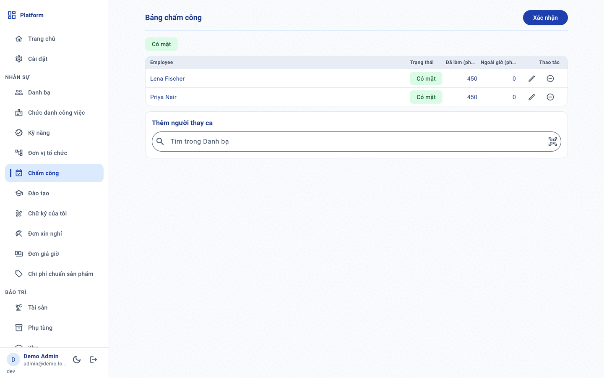

***Ảnh 02.9.** Từng người trong ca với số phút đã làm và số phút ngoài giờ, cùng hai thao tác trên mỗi dòng: **Đánh dấu ngoại lệ** và **Bỏ khỏi bảng**.*

---

## Chấm công cần xác nhận

| Hạng mục | Nội dung |
| --- | --- |
| **Công việc** | Đọc danh sách việc: các ca **đã qua** mà bảng chấm công còn thiếu hoặc chưa xác nhận — màn hình **Chấm công cần xác nhận**, `/attendance/to-confirm`. Phiếu 02.10. |
| **Ai thao tác được** | Người mang quyền ghi chấm công (supervisor trở lên); chỉ thấy các Đơn vị tổ chức mình xác nhận được. |
| **Vật tư, dữ liệu có trước** | — |
| **Công cụ** | Ô **Từ** / **Đến**, bộ lọc **Đơn vị tổ chức**, nút **Mở bảng chấm công** trên từng dòng; mã quyền `PPL_ATTENDANCE_CHANGE`. |
| **An toàn** | Không có thao tác ghi ở chính màn hình này; mở bảng ra là bước sang phiếu 02.9, nơi có **Xác nhận**. |
| **Thiết bị đào tạo** | — |
| **Chủ tài liệu · Rev · Ngày · Trang** | Ban Lean Nền tảng · Rev 2 · 2026-11-15 · 02.10 |

| Các bước chính | Điểm then chốt | Vì sao | Minh hoạ |
| --- | --- | --- | --- |
| **1.** Đặt **Từ** / **Đến** và **Lọc theo Đơn vị tổ chức** | [Dễ] Danh sách xếp **cũ nhất trước** | Việc cũ nhất là việc đang chặn báo cáo giờ công tháng | — |
| **2.** Bấm **Mở bảng chấm công** trên một dòng, làm xong bảng rồi quay lại danh sách | [Dễ] Dòng đó biến mất khỏi danh sách | Còn hiện nghĩa là chưa bấm **Xác nhận** ở phiếu 02.9 | — |

---

## Đào tạo

| Hạng mục | Nội dung |
| --- | --- |
| **Công việc** | Tổ chức một buổi đào tạo và gửi cho học viên — màn hình **Đào tạo**, `/training`. Phiếu 02.11. |
| **Ai thao tác được** | Đọc: mọi vai trò. Tạo, sửa, thêm học viên, gửi: supervisor trở lên. |
| **Vật tư, dữ liệu có trước** | Nhân viên đã có trong Danh bạ (phiếu 02.2); Kỹ năng của buổi đó đã khai báo (phiếu 02.6) nếu cần gắn. |
| **Công cụ** | Nút **Tạo bản ghi đào tạo**, hộp thoại của nó, nút **Thêm học viên**, **Gửi cho học viên**, **Bỏ bản nháp**; mã quyền ghi `PPL_TRAINING_CHANGE`. |
| **An toàn** | Đã gửi là **chốt**: học viên đã thấy và đã ký. Sửa sau khi gửi là sửa việc người khác đã xác nhận. |
| **Thiết bị đào tạo** | Ảnh 02.10 |
| **Chủ tài liệu · Rev · Ngày · Trang** | Ban Lean Nền tảng · Rev 2 · 2026-11-15 · 02.11 |

| Các bước chính | Điểm then chốt | Vì sao | Minh hoạ |
| --- | --- | --- | --- |
| **1.** Bấm **Tạo bản ghi đào tạo**: **Tiêu đề**, **Đào tạo ngày**, **Thời lượng (giờ)**, **Người đào tạo**, **Mục tiêu** | [Hỏng] **Thời lượng** dùng dấu phẩy thập phân: `1,5` | Dấu chấm bị hiểu là phân cách nghìn và thời lượng thành 15 giờ | Ảnh 02.10 |
| **2.** Mở bản ghi vừa tạo, bấm **Thêm học viên**: chọn **Nhân viên của {đơn vị}** hoặc **Toàn bộ Danh bạ** | [Dễ] Chọn theo đơn vị trước, rồi tìm — danh sách ngắn hơn nhiều | Danh bạ toàn Nền tảng rất dài, dễ chọn nhầm người trùng tên | — |
| **3.** Bấm **Gửi cho học viên** | [An toàn] Trước khi gửi là **bản nháp**: sửa và thêm người được; sau khi gửi là **chốt** | Sửa sau khi gửi là sửa việc người khác đã ký | — |
| **4.** Ghi nhầm cả bản nháp: **Bỏ bản nháp** | [Hỏng] Chỉ làm được khi **chưa ai được hỏi** | Bản nháp đã gửi thì không bỏ được — phải xử lý bằng câu trả lời của học viên | — |

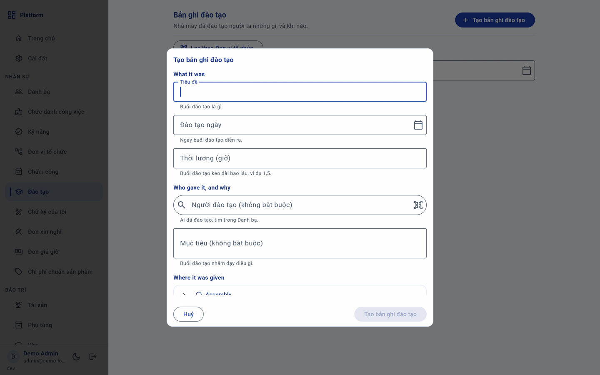

***Ảnh 02.10.** Tạo bản ghi đào tạo từ danh sách: chọn người, kỹ năng và người hướng dẫn; bản ghi sau đó đi theo vòng đời của nó.*

### Xác nhận một buổi đào tạo

| Hạng mục | Nội dung |
| --- | --- |
| **Công việc** | Học viên tự xác nhận mình có tham gia buổi đào tạo — màn hình **Đào tạo cần xác nhận**, `/training/to-confirm`. Phiếu 02.12. |
| **Ai thao tác được** | Mọi vai trò: Tài khoản tự trả lời đào tạo của chính mình. Không ai trả lời thay được. |
| **Vật tư, dữ liệu có trước** | Một bản ghi đào tạo đã **Gửi cho học viên** và có tên bạn in phiếu 02.11. |
| **Công cụ** | Danh sách **Đào tạo cần xác nhận**, các nút **Xác nhận**, **Từ chối**, **Dùng chữ ký của tôi**, **Vẽ ngay**, **Không có chữ ký**. |
| **An toàn** | Sổ đào tạo chỉ có giá trị khi học viên **tự** bấm xác nhận — không có cách nào để người tổ chức xác nhận thay. |
| **Thiết bị đào tạo** | — |
| **Chủ tài liệu · Rev · Ngày · Trang** | Ban Lean Nền tảng · Rev 2 · 2026-11-15 · 02.12 |

| Các bước chính | Điểm then chốt | Vì sao | Minh hoạ |
| --- | --- | --- | --- |
| **1.** Vào **Đào tạo cần xác nhận** (`/training/to-confirm`), hoặc ô "Đào tạo cần xác nhận" ở Trang chủ | [Dễ] Danh sách xếp **cũ nhất trước** và chỉ có bản gửi **cho chính bạn** | Không thấy bản của người khác là đúng thiết kế | — |
| **2.** Bấm **Xác nhận** nếu bạn đã tham gia, hoặc **Từ chối** nếu bản ghi sai | [Hỏng] Từ chối khi bản ghi ghi sai tên, sai ngày hay sai nội dung — từ chối là câu trả lời đúng, không phải phá buổi học | Người tổ chức đọc được câu trả lời và sửa cho lần sau | — |
| **3.** Ký: **Dùng chữ ký của tôi**, hoặc **Vẽ ngay**, hoặc **Không có chữ ký** | [Hỏng] Chọn **Không có chữ ký** vẫn xác nhận được — người xác nhận không bị chặn | Có người chưa lưu chữ ký; chặn họ lại thì sổ đào tạo không khép được | — |

---

## Bản ghi đào tạo (chi tiết)

| Hạng mục | Nội dung |
| --- | --- |
| **Công việc** | Xem một buổi đào tạo và câu trả lời của từng học viên — màn hình **Bản ghi đào tạo**, `/training/:id`. Phiếu 02.13. |
| **Ai thao tác được** | Đọc: mọi Tài khoản. Ghi: người mang quyền ghi đào tạo. |
| **Vật tư, dữ liệu có trước** | Một bản ghi đào tạo (phiếu 02.11). |
| **Công cụ** | Phần **Buổi đào tạo**, **Học viên (n)**, **Câu trả lời**, nút **Biểu mẫu**; mã quyền đọc `PPL_TRAINING_DISPLAY`. |
| **An toàn** | Không có thao tác ghi ở đây ngoài phần sửa của người tổ chức — câu trả lời của học viên là bản ghi, đọc chứ không sửa. |
| **Thiết bị đào tạo** | — |
| **Chủ tài liệu · Rev · Ngày · Trang** | Ban Lean Nền tảng · Rev 2 · 2026-11-15 · 02.13 |

| Các bước chính | Điểm then chốt | Vì sao | Minh hoạ |
| --- | --- | --- | --- |
| **1.** Đọc phần **Buổi đào tạo** và **Học viên (n)**; cần bản in để ký giấy thì bấm **Biểu mẫu** (`/training/:id/form`, phiếu 02.14) | — | — | — |
| **2.** Đọc **Câu trả lời** của từng người: đã xác nhận hay từ chối | [Hỏng] Một người chưa trả lời không phải là đã tham gia | Sổ chỉ khép khi mọi học viên đã trả lời | — |

---

## Biểu mẫu in của bản ghi đào tạo

| Hạng mục | Nội dung |
| --- | --- |
| **Công việc** | In "Biên bản ghi nhận đào tạo" để ký tay — biểu mẫu **Đào tạo**, `/training/:id/form`. Phiếu 02.14. |
| **Ai thao tác được** | Mọi Tài khoản. |
| **Vật tư, dữ liệu có trước** | Bản ghi đào tạo có ít nhất một học viên. |
| **Công cụ** | Biểu mẫu trong trình duyệt và hộp thoại in của trình duyệt (Ctrl+P). Không có nút in riêng của Nền tảng. |
| **An toàn** | Giấy đã ký là bản ghi **bổ sung**, không được thay thế bản điện tử và không được là bản duy nhất. |
| **Thiết bị đào tạo** | — |
| **Chủ tài liệu · Rev · Ngày · Trang** | Ban Lean Nền tảng · Rev 2 · 2026-11-15 · 02.14 |

| Các bước chính | Điểm then chốt | Vì sao | Minh hoạ |
| --- | --- | --- | --- |
| **1.** Mở biểu mẫu từ trang chi tiết bản ghi, rồi in bằng **trình duyệt** (Ctrl+P) | [Dễ] Không có nút in riêng của Nền tảng | Một nút in riêng sẽ là đường thứ hai để sinh ra cùng một tài liệu | — |
| **2.** Ký giấy, rồi lưu bản giấy theo quy định của nhà máy | [Hỏng] Ký giấy là **thêm** vào sổ điện tử, không thay thế nó | Câu trả lời của học viên trong Nền tảng là bản có dấu thời gian | — |

---

## Chữ ký của tôi

| Hạng mục | Nội dung |
| --- | --- |
| **Công việc** | Lưu dấu của chính bạn, để dùng ở mọi nơi bạn phải ký — màn hình **Chữ ký của tôi**, `/me/signature`. Phiếu 02.15. |
| **Ai thao tác được** | Mọi Tài khoản, cho chữ ký của chính mình. Quản trị viên đặt chữ ký **cho** một Nhân viên ở **Hồ sơ Nhân viên → Chữ ký**, không ở đây. |
| **Vật tư, dữ liệu có trước** | Ảnh chữ ký có sẵn trên giấy nếu muốn tải lên, hoặc chuột / ngón tay để vẽ. |
| **Công cụ** | Nút **Tải ảnh lên**, khung **Vẽ tại đây**, nút **Giữ chữ ký này**, **Vẽ chữ ký mới**, **Thay bằng ảnh**, **Xoá**; mã quyền `PPL_SIGNATURE_OWN`. |
| **An toàn** | Chữ ký là dấu của bạn: không đưa Tài khoản cho người khác dùng chung. **Thay chữ ký không làm thay đổi bảng nào bạn đã ký.** |
| **Thiết bị đào tạo** | Ảnh 02.11 |
| **Chủ tài liệu · Rev · Ngày · Trang** | Ban Lean Nền tảng · Rev 2 · 2026-11-15 · 02.15 |

| Các bước chính | Điểm then chốt | Vì sao | Minh hoạ |
| --- | --- | --- | --- |
| **1.** Mở **Chữ ký của tôi** | [Dễ] Khi chưa có, màn hình nói rõ **chưa lưu** và cách vẽ | Không phải lỗi — chưa lưu là trạng thái bình thường của người mới | Ảnh 02.11 |
| **2.** **Tải ảnh lên** một ảnh chữ ký có sẵn, hoặc **Vẽ tại đây** rồi bấm **Giữ chữ ký này** | [Dễ] Ảnh cần nền sáng, nét đậm | Ảnh nền tối hoặc nét mảnh in ra không đọc được trên biên bản | — |
| **3.** Đổi chữ ký: **Vẽ chữ ký mới** hoặc **Thay bằng ảnh**; bỏ hẳn: **Xoá** | [An toàn] Thay chữ ký **không** làm thay đổi bảng nào bạn đã ký | Chữ ký được gắn vào bản ghi tại thời điểm ký; nếu đổi mà bản ghi cũ đổi theo, một chữ ký mới hôm nay sẽ "ký lại" cả năm trước và biên bản mất giá trị | — |

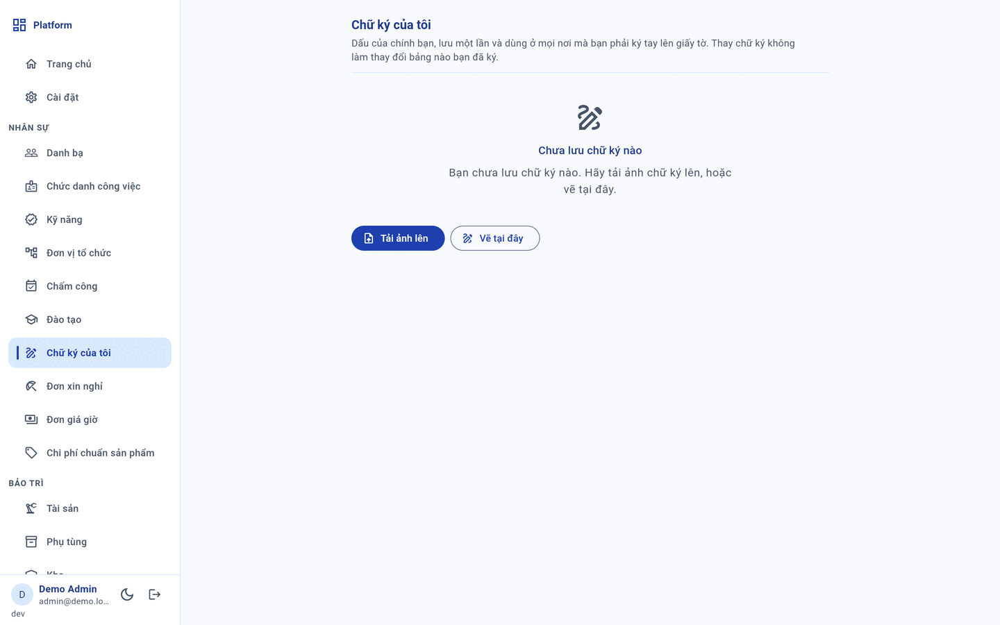

***Ảnh 02.11.** Chữ ký lưu một lần: khi chưa có, màn hình nói rõ **chưa lưu** và cách vẽ; thay chữ ký không làm thay đổi bảng đã ký.*

---

## Đơn xin nghỉ

| Hạng mục | Nội dung |
| --- | --- |
| **Công việc** | Gửi một đơn xin nghỉ và theo dõi kết quả — màn hình **Đơn xin nghỉ**, `/leave-requests`, form ở `/leave-requests/new`. Phiếu 02.16. |
| **Ai thao tác được** | Đọc: mọi vai trò, nhưng chỉ thấy **đơn của mình**. Gửi và huỷ đơn của mình: mọi vai trò. |
| **Vật tư, dữ liệu có trước** | Tài khoản đã được chấp nhận, gắn với Nhân viên (Trang chủ báo nếu chưa gắn). |
| **Công cụ** | Nút **Xin nghỉ**, ô **Loại nghỉ**, **Ngày đầu**, **Ngày cuối**, **Ghi chú**, tab **Của tôi**, nút **Huỷ đơn**; mã quyền `PPL_LEAVE_REQUESTS_RAISE`. |
| **An toàn** | Đơn đi vào sổ nhân sự: ghi đúng ngày, đừng ghi dư "cho chắc". |
| **Thiết bị đào tạo** | Ảnh 02.12 |
| **Chủ tài liệu · Rev · Ngày · Trang** | Ban Lean Nền tảng · Rev 2 · 2026-11-15 · 02.16 |

| Các bước chính | Điểm then chốt | Vì sao | Minh hoạ |
| --- | --- | --- | --- |
| **1.** Bấm **Xin nghỉ** (`/leave-requests/new`), chọn **Loại nghỉ**, **Ngày đầu**, **Ngày cuối**, **Ghi chú**, bấm gửi, rồi tìm đơn trong tab **Của tôi** | [Hỏng] **Ngày cuối** được tính luôn — đơn tính cả hai đầu | Nhập ngày cuối là ngày đi làm lại thì đơn dài hơn thực tế một ngày | Ảnh 02.12 |
| **2.** Đổi ý khi **chưa có quyết định**: **Huỷ đơn** → **Huỷ đơn** | [Hỏng] Đơn đã duyệt rồi thì không huỷ được | Đơn đã duyệt đã vào sổ nhân sự và kế hoạch ca | — |

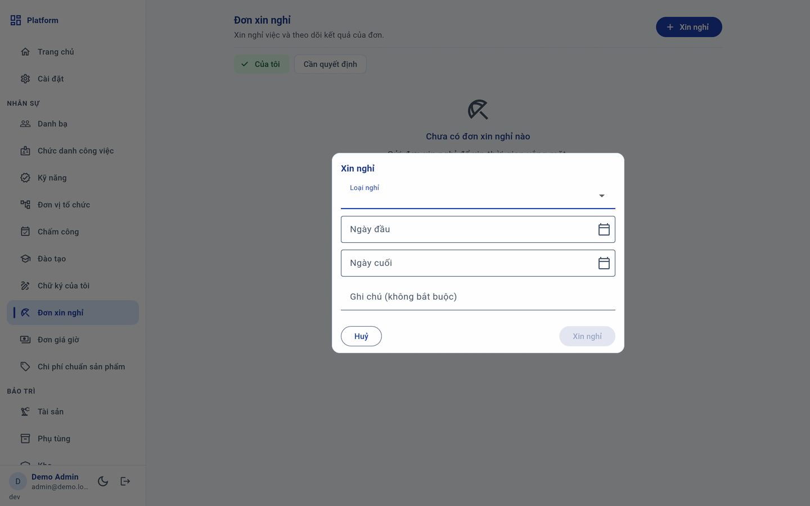

***Ảnh 02.12.** Form gửi đơn: **Loại nghỉ** là lựa chọn có sẵn, ghi chú là tuỳ chọn; gửi xong đơn nằm ở danh sách chờ quyết định.*

### Duyệt hoặc từ chối một đơn

| Hạng mục | Nội dung |
| --- | --- |
| **Công việc** | Quyết định một đơn xin nghỉ — tab **Cần quyết định** của màn hình **Đơn xin nghỉ**. Phiếu 02.17. |
| **Ai thao tác được** | Supervisor trở lên, và chỉ với đơn thuộc phạm vi Đơn vị tổ chức mình quyết định được. |
| **Vật tư, dữ liệu có trước** | Đơn đã được gửi (phiếu 02.16). |
| **Công cụ** | Tab **Cần quyết định**, nút **Duyệt**, **Từ chối**, ô **Ghi chú**; mã quyền `PPL_LEAVE_REQUESTS_DECIDE`. |
| **An toàn** | Người quyết định là người có quyền trên **Đơn vị tổ chức của Nhân viên xin nghỉ**, không phải quản lý trực tiếp trong sơ đồ tổ chức. |
| **Thiết bị đào tạo** | — |
| **Chủ tài liệu · Rev · Ngày · Trang** | Ban Lean Nền tảng · Rev 2 · 2026-11-15 · 02.17 |

| Các bước chính | Điểm then chốt | Vì sao | Minh hoạ |
| --- | --- | --- | --- |
| **1.** Mở tab **Cần quyết định** | [Hỏng] "Không có gì cần quyết định" thường là chuyện phạm vi Đơn vị tổ chức, không phải hết việc | Đơn của người ngoài phạm vi không hiện ở đây, và không ai khác đang chờ bạn | — |
| **2.** Bấm **Duyệt** hoặc **Từ chối**, ghi **Ghi chú** | [Dễ] Ghi chú đi vào sổ và người xin nghỉ đọc được | Lý do từ chối là thứ người xin nghỉ cần để sắp xếp lại | — |
| **3.** Không quyết định cũng là một lựa chọn hợp lệ — đơn ở lại tab chờ | [Dễ] Đơn không tự hết hạn, nhưng cũng không tự duyệt | Người xin nghỉ vẫn thấy đơn đang chờ | — |

---

## Đơn giá giờ

| Hạng mục | Nội dung |
| --- | --- |
| **Công việc** | Khai báo một giờ công tốn bao nhiêu — màn hình **Đơn giá giờ**, `/cost-rates`. Phiếu 02.18. |
| **Ai thao tác được** | Chỉ quản trị viên. |
| **Vật tư, dữ liệu có trước** | Nhà máy, Đơn vị tổ chức, Tài sản hoặc trung tâm chi phí sẽ gắn đơn giá — phải tồn tại trước. |
| **Công cụ** | Nút **Thêm đơn giá giờ**, ô **Phạm vi**, **Loại đơn giá**, **Số tiền mỗi giờ**, **Tiền tệ**, **Hệ số**, **Có hiệu lực từ**, **Áp dụng đến**, nút **Thay thế**; mã quyền `PPL_COST_RATES_MAINTAIN`. |
| **An toàn** | Đơn giá đã dùng để báo cáo chi phí tháng trước không được sửa — đổi giá là **Thay thế**, để con số cũ giữ nguyên. |
| **Thiết bị đào tạo** | Ảnh 02.13 |
| **Chủ tài liệu · Rev · Ngày · Trang** | Ban Lean Nền tảng · Rev 2 · 2026-11-15 · 02.18 |

| Các bước chính | Điểm then chốt | Vì sao | Minh hoạ |
| --- | --- | --- | --- |
| **1.** Bấm **Thêm đơn giá giờ**, chọn **Phạm vi** (Nhà máy / Đơn vị tổ chức / Tài sản / trung tâm chi phí) và **Loại đơn giá** | [Hỏng] **Phạm vi** và **Loại đơn giá** không sửa được sau khi lưu | Muốn đổi thì thêm đơn giá cho phạm vi mới — hộp thoại nói rõ điều này | Ảnh 02.13 |
| **2.** Điền **Số tiền mỗi giờ**, **Tiền tệ**, **Hệ số**, **Có hiệu lực từ** | [Hỏng] **Hệ số** là số nhân, không phải phần trăm | `1,5` là gấp rưỡi cho giờ làm thêm; `150` sẽ ra số tiền gấp 150 lần | — |
| **3.** Để **Áp dụng đến** trống nếu đây là đơn giá hiện hành | [Dễ] Đặt ngày kết thúc thì đơn giá đóng **vào ngày đó**, không tính ngày ấy | Một ngày lệch là một ngày chi phí không có đơn giá | — |
| **4.** Đổi giá: bấm **Thay thế** trên đơn giá cũ | [Hỏng] Đơn giá cũ **bị đóng**, không bị ghi đè | Nếu sửa giá cũ, mọi báo cáo chi phí quá khứ đổi theo và báo cáo đã gửi cho quản lý thành sai | — |

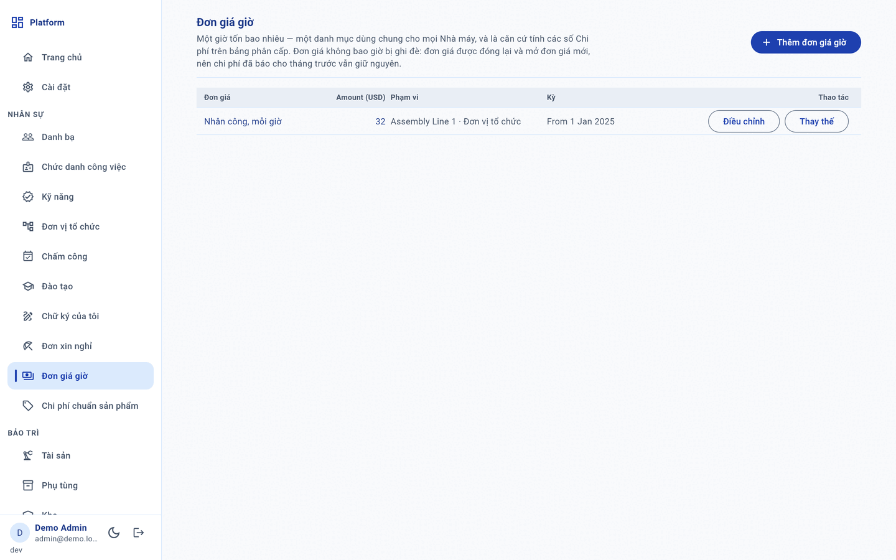

***Ảnh 02.13.** Các đơn giá đang hiệu lực, kèm **Thay thế** — đơn giá cũ không bị xoá, nó được đóng lại theo kỳ.*

---

## Chi phí chuẩn sản phẩm

| Hạng mục | Nội dung |
| --- | --- |
| **Công việc** | Khai báo một đơn vị sản phẩm tốn bao nhiêu — màn hình **Chi phí chuẩn sản phẩm**, `/product-costs`. Phiếu 02.19. |
| **Ai thao tác được** | Chỉ quản trị viên. |
| **Vật tư, dữ liệu có trước** | Sản phẩm đã có trong danh mục Chất lượng (`/products`). |
| **Công cụ** | Nút **Thêm chi phí chuẩn**, ô chọn **Sản phẩm**, **Chi phí chuẩn, mỗi đơn vị**, **Tiền tệ**, **Có hiệu lực từ**, nút **Thay thế**; mã quyền `PPL_PRODUCT_COSTS_MAINTAIN`. |
| **An toàn** | Chưa đặt chi phí thì hàng lỗi và hàng làm lại **không được tính giá** — số tiền hiện 0, không phải "miễn phí". |
| **Thiết bị đào tạo** | Ảnh 02.14 |
| **Chủ tài liệu · Rev · Ngày · Trang** | Ban Lean Nền tảng · Rev 2 · 2026-11-15 · 02.19 |

| Các bước chính | Điểm then chốt | Vì sao | Minh hoạ |
| --- | --- | --- | --- |
| **1.** Bấm **Thêm chi phí chuẩn**, chọn **Sản phẩm** | [Hỏng] **Sản phẩm của một chi phí không sửa được** | Ghi chi phí cho Sản phẩm đúng, đừng sửa chi phí của Sản phẩm khác | Ảnh 02.14 |
| **2.** Điền **Chi phí chuẩn, mỗi đơn vị**, **Tiền tệ**, **Có hiệu lực từ** | — | — | — |
| **3.** Đổi giá: **Thay thế** | [Hỏng] Chi phí cũ **đóng**, chi phí mới mở — cùng luật với Đơn giá giờ | Báo cáo chi phí đã gửi phải giữ nguyên con số của tháng đó | — |

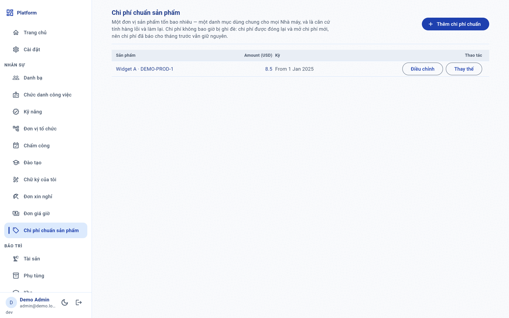

***Ảnh 02.14.** Chi phí chuẩn theo Sản phẩm và theo kỳ — con số mà mọi báo cáo chi phí sau đó dựa vào.*

---

## Bảng tóm tắt phần Nhân sự

Bảng này để người đào tạo trả lời nhanh "ai làm được việc này". Nó **không** thay
các dòng **Ai thao tác được** ở từng phiếu: ghi còn cần phạm vi Đơn vị tổ chức —
xem [README §1](README.md#1-sáu-vai-trò-và-cách-đọc-phần-ai-thao-tác-được).

| Việc | Mọi vai trò | Người vận hành | Giám sát | Kỹ sư | Quản lý | Quản trị viên |
| --- | :-: | :-: | :-: | :-: | :-: | :-: |
| Xem Danh bạ, hồ sơ, giờ đã làm | ✓ | ✓ | ✓ | ✓ | ✓ | ✓ |
| Xem Chức danh, Kỹ năng, Đơn vị tổ chức | ✓ | ✓ | ✓ | ✓ | ✓ | ✓ |
| Xem Đào tạo, Đơn xin nghỉ (của mình) | ✓ | ✓ | ✓ | ✓ | ✓ | ✓ |
| Lưu và đổi **Chữ ký của tôi** | ✓ | ✓ | ✓ | ✓ | ✓ | ✓ |
| Gửi / huỷ **đơn xin nghỉ của mình** | ✓ | ✓ | ✓ | ✓ | ✓ | ✓ |
| Tự xác nhận **đào tạo của mình** | ✓ | ✓ | ✓ | ✓ | ✓ | ✓ |
| Duyệt / Từ chối đơn xin nghỉ | · | · | ✓ | ✓ | ✓ | ✓ |
| Tạo bản ghi Đào tạo, thêm học viên, gửi | · | · | ✓ | ✓ | ✓ | ✓ |
| Mở và xác nhận **Bảng chấm công** | · | · | ✓ | ✓ | ✓ | ✓ |
| Thêm Nhân viên, sửa hồ sơ, phân công, cho rời | · | · | · | · | · | ✓ |
| Thêm/sửa Chức danh, Kỹ năng, Đơn vị tổ chức | · | · | · | · | · | ✓ |
| Ghi nhận kỹ năng cho một người | · | · | · | · | · | ✓ |
| Đơn giá giờ, Chi phí chuẩn sản phẩm | · | · | · | · | · | ✓ |

(✓ = theo mã quyền ở từng phiếu. Ghi còn cần phạm vi Đơn vị tổ chức — xem
[README §1](README.md#1-sáu-vai-trò-và-cách-đọc-phần-ai-thao-tác-được).)
