# 03 · Bảo trì

Nhóm **Bảo trì** là chuỗi công việc trên máy: có máy nào (**Tài sản**), ai báo hỏng
(**Yêu cầu**), ai làm (**Lệnh công việc**), lấy phụ tùng ở đâu (**Kho**, **Phụ
tùng**), và làm phòng ngừa thế nào (**Lịch bảo trì định kỳ**, **Đồng hồ đo**,
**Kế hoạch công việc**).

Hai điều đúng cho cả mười bốn phiếu dưới đây. **Người vận hành không thấy nhóm Bảo
trì trên thanh điều hướng**, trừ **Yêu cầu của tôi** — việc của họ là nêu Yêu cầu
rồi theo dõi kết quả; mọi màn hình còn lại cần supervisor trở lên. **Vị trí Đơn vị
tổ chức quyết định ai làm được gì**: một Lệnh công việc thuộc về Đơn vị tổ chức của
Tài sản, nên muốn phân công hay đóng nó, bạn cần quyền sửa **ở đơn vị đó**.

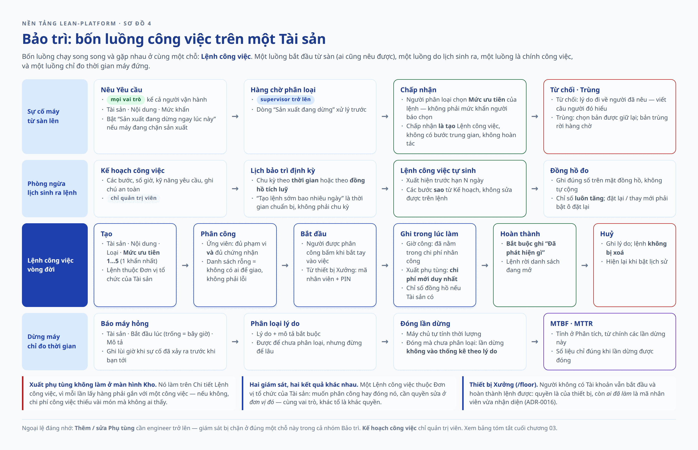

***Sơ đồ 4.** Bốn luồng chạy song song và gặp nhau ở Lệnh công việc: sự cố từ sàn, lịch
phòng ngừa, vòng đời của chính lệnh, và dừng máy chỉ để đo thời gian.*

---

## Tài sản

| Hạng mục | Nội dung |
| --- | --- |
| **Công việc** | Khai báo máy của Nhà máy và giữ đúng chỗ của nó trong cây — màn hình **Tài sản**, `/assets`. Phiếu 03.1. |
| **Ai thao tác được** | Supervisor, engineer, manager, quản trị viên — đọc và ghi. Người vận hành không thấy mục này trên thanh điều hướng. |
| **Vật tư, dữ liệu có trước** | Đơn vị tổ chức nơi đặt máy (phiếu 02.7) đã tồn tại; mã Tài sản do nhà máy cấp. |
| **Công cụ** | Ô chọn **Nhà máy**, ô tìm theo **tên hoặc mã**; các nút **Thêm Tài sản**, **Sửa thông tin…**, **Đổi Đơn vị tổ chức…**, **Đặt dưới…**, **Tách ra**, **Ngừng dùng**; ô **Hiện cả đã ngừng dùng**; mã quyền đọc `MTN_ASSETS_DISPLAY`, ghi `MTN_ASSETS_CHANGE`. |
| **An toàn** | **Ngừng dùng** không xoá máy và **Khôi phục** được, nhưng lịch sử công việc vẫn trỏ về nó. **Đổi Đơn vị tổ chức** là thao tác đổi ai được ghi trên máy — làm sai chỗ thì đúng người cũng mất quyền. |
| **Thiết bị đào tạo** | Ảnh 03.1, Ảnh 03.2 |
| **Chủ tài liệu · Rev · Ngày · Trang** | Ban Lean Nền tảng · Rev 2 · 2026-11-15 · 03.1 |

| Các bước chính | Điểm then chốt | Vì sao | Minh hoạ |
| --- | --- | --- | --- |
| **1.** Chọn **Nhà máy**, rồi tìm theo **tên hoặc mã** | [Dễ] Danh sách chỉ là máy của Nhà máy đang chọn | Máy của nhà máy khác không hiện ở đây, kể cả khi cùng tên | Ảnh 03.1 |
| **2.** Bấm **Thêm Tài sản**: **Mã**, **Tên**, **Kiểu**, **Mức trọng yếu**, và Đơn vị tổ chức nơi máy nằm | [Hỏng] **Mã Tài sản là duy nhất trên toàn Nền tảng**, không chỉ trong Nhà máy này | Hai nhà máy dùng chung mã thì máy chủ từ chối — và đó là điều đúng, vì lệnh công việc trỏ theo mã | Ảnh 03.2 |
| **3.** Đổi vị trí máy: bấm **Đổi Đơn vị tổ chức…** | [Hỏng] Vị trí **không** sửa trong hộp thoại **Sửa thông tin…** | Sửa vị trí là thao tác riêng vì nó quyết định ai được nêu và đóng công việc trên máy | — |
| **4.** Máy lồng trong máy: **Đặt dưới…** một máy khác | [Dễ] **Tách ra** để bỏ quan hệ đó | Một cụm có nhiều bộ phận thì mỗi bộ phận là một Tài sản riêng, có lịch sử riêng | — |
| **5.** Máy thanh lý: **Ngừng dùng**, xác nhận | [An toàn] Máy được ghi **Đã ngừng dùng** chứ không bị xoá, và **Khôi phục** được | Lịch sử công việc, giờ công và phụ tùng vẫn trỏ về máy đó | — |
| **6.** Xem cả máy đã ngừng: bật **Hiện cả đã ngừng dùng** | [Hỏng] Máy vừa ngừng **biến mất** khỏi danh sách mặc định — không phải mất dữ liệu | Người mới hay kết luận "máy bị xoá" ở đúng bước này | — |

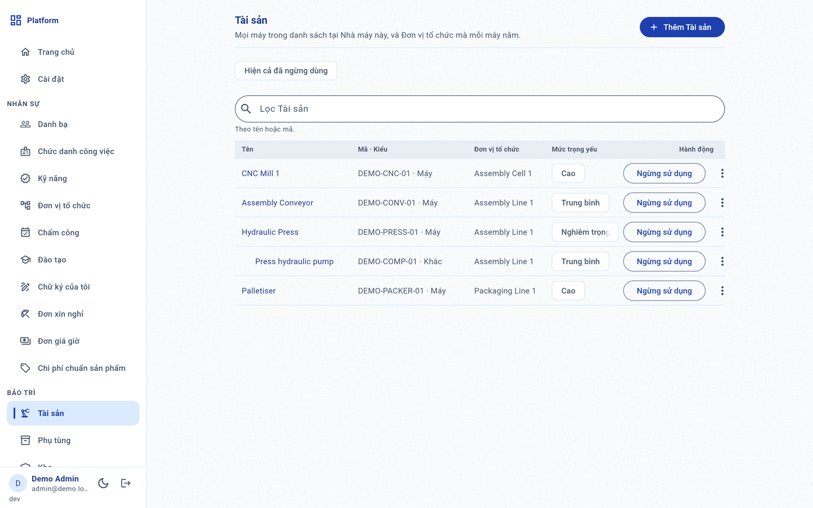

***Ảnh 03.1.** Danh sách máy của Nhà máy: tên, mã · kiểu, Đơn vị tổ chức, mức trọng yếu, và lối **Ngừng sử dụng** trên từng dòng.*

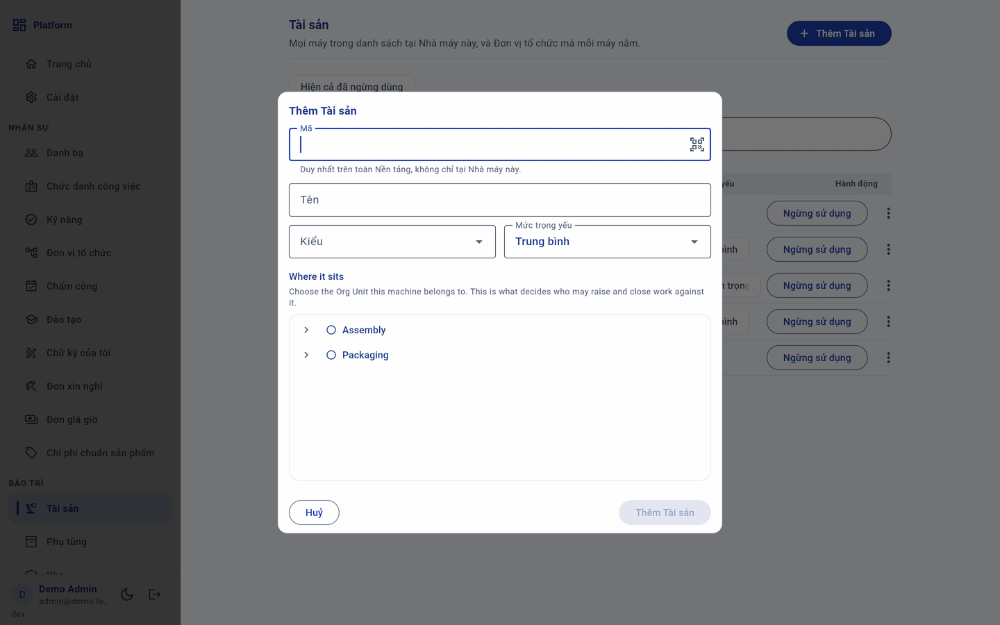

***Ảnh 03.2.** Bốn trường và Đơn vị tổ chức. **Mã Tài sản là duy nhất trên toàn Nền tảng**, nên hộp thoại này từ chối mã đã dùng ở Nhà máy khác.*

---

## Phụ tùng

| Hạng mục | Nội dung |
| --- | --- |
| **Công việc** | Khai báo danh mục phụ tùng dùng chung cho mọi Nhà máy — màn hình **Phụ tùng**, `/parts`. Phiếu 03.2. |
| **Ai thao tác được** | Đọc: supervisor, engineer, manager, quản trị viên. Ghi: **engineer, manager, quản trị viên — không có supervisor**. |
| **Vật tư, dữ liệu có trước** | Mã phụ tùng và đơn vị đo do kho / kỹ thuật cấp. |
| **Công cụ** | Ô tìm theo **mã phụ tùng hoặc mô tả**; các nút **Thêm phụ tùng**, **Điều chỉnh**; ô **Mã phụ tùng**, **Mô tả**, **Đơn vị đo**; mã quyền đọc `MTN_PARTS_DISPLAY`, ghi `MTN_PARTS_CHANGE`. |
| **An toàn** | **Đơn vị đo** quyết định mọi con số tồn kho về sau. Sửa đơn vị đo của một mã đã có giao dịch là làm sai toàn bộ lịch sử kho của mã đó. |
| **Thiết bị đào tạo** | Ảnh 03.3 |
| **Chủ tài liệu · Rev · Ngày · Trang** | Ban Lean Nền tảng · Rev 2 · 2026-11-15 · 03.2 |

| Các bước chính | Điểm then chốt | Vì sao | Minh hoạ |
| --- | --- | --- | --- |
| **Chung** | [Hỏng] Giám sát không thấy nút **Thêm phụ tùng** — đó là thiết kế, không phải lỗi tài khoản | Đây là **chỗ duy nhất** trong nhóm Bảo trì mà một giám sát bị chặn còn một kỹ sư thì không: thêm một mã phụ tùng là khai báo danh mục, không phải việc sàn | — |
| **1.** Tìm theo **mã phụ tùng hoặc mô tả** | [Dễ] Tìm trước khi thêm — mã đã có thì dùng lại | Hai mã cho cùng một món là tồn kho bị chia đôi | Ảnh 03.3 |
| **2.** Bấm **Thêm phụ tùng**: **Mã phụ tùng**, **Mô tả**, **Đơn vị đo** | [An toàn] **Đơn vị đo** quyết định số lượng ở mọi chỗ khác — nhập kho, xuất kho | Chọn sai đơn vị đo là mọi con số tồn kho sai theo, và sửa lại phải sửa từng phiếu | — |
| **3.** Sửa một phụ tùng: **Điều chỉnh** | [Dễ] Sửa mô tả thì được; đổi đơn vị đo của mã đã có giao dịch thì đừng | Lịch sử kho đã ghi theo đơn vị cũ | — |

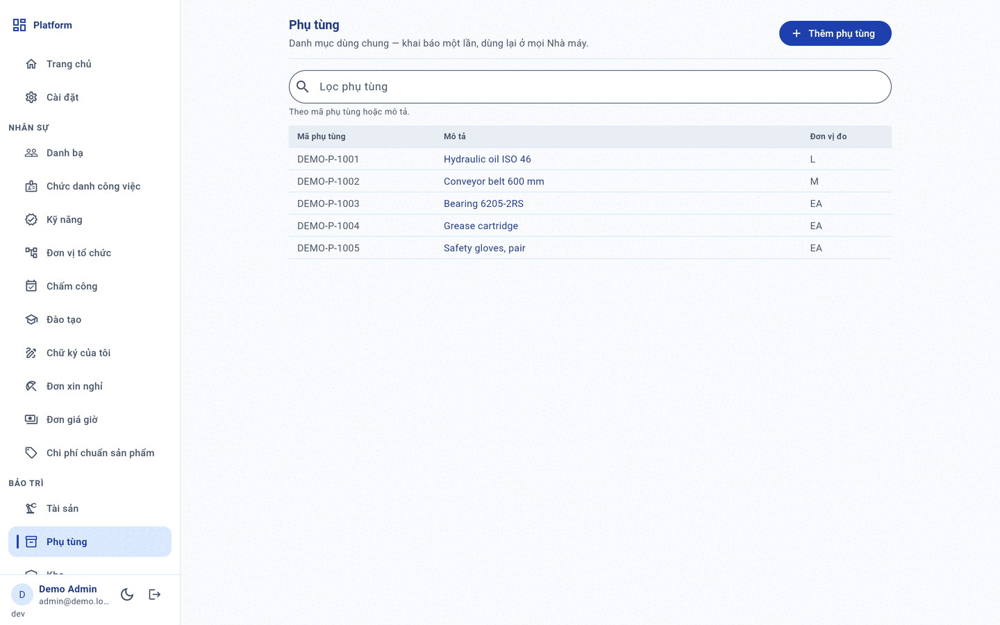

***Ảnh 03.3.** Danh mục dùng chung: mã, mô tả, **Đơn vị đo** — đơn vị đo là thứ quyết định mọi con số tồn kho về sau.*

---

## Kho

| Hạng mục | Nội dung |
| --- | --- |
| **Công việc** | Nhập phụ tùng về kệ và đọc tồn kho của một kệ — màn hình **Kho**, `/stores`, tồn kho ở `/stores/:id`. Phiếu 03.3. |
| **Ai thao tác được** | Supervisor trở lên — đọc và ghi. |
| **Vật tư, dữ liệu có trước** | Phụ tùng đã có mã trong danh mục **Phụ tùng** (phiếu 03.2); Kho đã được tạo. |
| **Công cụ** | Ô tìm kho theo **tên hoặc mã**, danh sách **Tồn kho**, ô tìm phụ tùng theo **mã hoặc mô tả**, nút **Nhập kho**; mã quyền đọc `MTN_STORES_DISPLAY`, ghi `MTN_STORES_CHANGE`. |
| **An toàn** | **Xuất phụ tùng không làm ở màn hình Kho** — nó làm ở **Chi tiết Lệnh công việc → Xuất phụ tùng**, vì mỗi lần lấy hàng phải gắn với một công việc. Xuất kho "trắng" làm chi phí công việc thiếu vài món. |
| **Thiết bị đào tạo** | Ảnh 03.4, Ảnh 03.5 |
| **Chủ tài liệu · Rev · Ngày · Trang** | Ban Lean Nền tảng · Rev 2 · 2026-11-15 · 03.3 |

| Các bước chính | Điểm then chốt | Vì sao | Minh hoạ |
| --- | --- | --- | --- |
| **1.** Tìm kho theo **tên hoặc mã**, bấm một kho để mở **Tồn kho**, rồi tìm phụ tùng theo **mã hoặc mô tả** | [Dễ] Kệ trống hiện **Kệ trống** — đó là trạng thái hợp lệ, không phải lỗi | Không có hàng là chưa nhập, không phải mất dữ liệu | Ảnh 03.4 |
| **2.** Nhập hàng về: bấm **Nhập kho**, chọn **Phụ tùng**, **Số lượng**, **Lý do** | [An toàn] Số lượng tính theo **Đơn vị đo** của phụ tùng — đọc lại đơn vị trước khi gõ số | Một lần nhập sai đơn vị là tồn kho sai cho tới lần kiểm kê sau | Ảnh 03.5 |
| **3.** Lấy hàng ra để sửa máy: **không** làm ở đây — mở **Chi tiết Lệnh công việc → Xuất phụ tùng** (phiếu 03.5) | [Hỏng] Chỉ gắn với Lệnh công việc thì Nền tảng mới biết phụ tùng nằm trong chi phí của công việc nào | Xuất kho không gắn lệnh làm chi phí công việc thiếu, và cuối tháng không đối chiếu được | — |

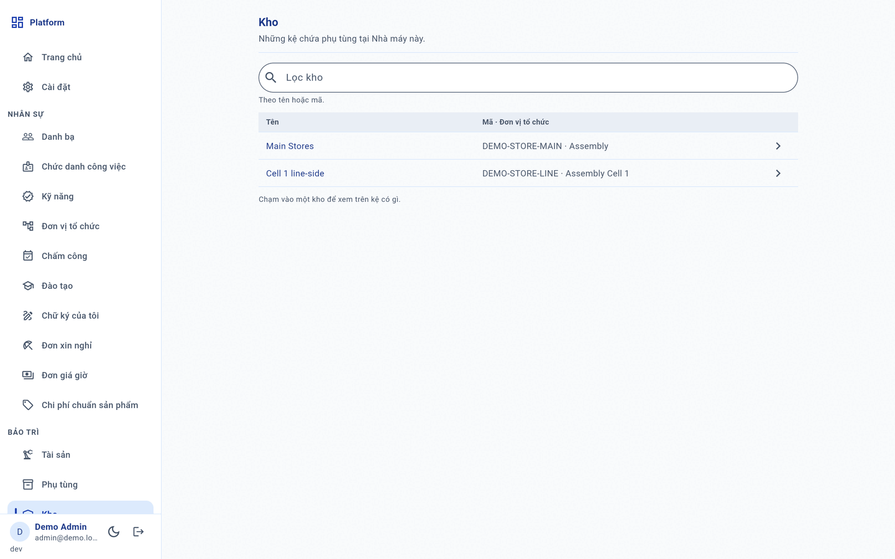

***Ảnh 03.4.** Các kệ của Nhà máy; bấm một kệ để mở tồn kho của nó.*

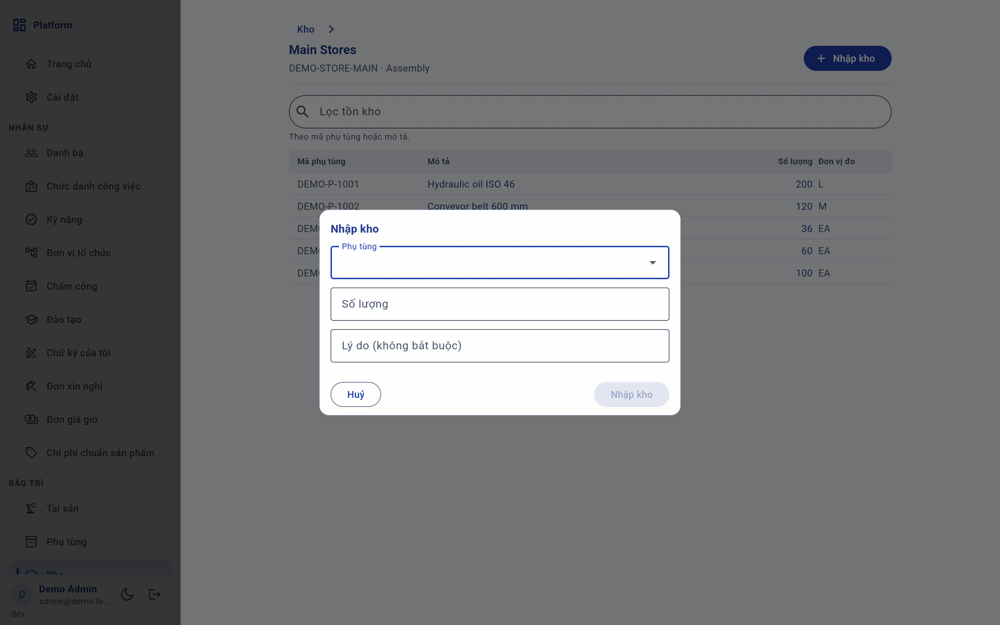

***Ảnh 03.5.** Nhập kho hỏi phụ tùng, số lượng và đơn vị đo: một lần nhập là một dòng có dấu trong sổ kho.*

---

## Lệnh công việc

| Hạng mục | Nội dung |
| --- | --- |
| **Công việc** | Tạo và theo dõi công việc trên máy: làm gì, trên máy nào, ai phụ trách — màn hình **Lệnh công việc**, `/work-orders`, tạo ở `/work-orders/new`. Phiếu 03.4. |
| **Ai thao tác được** | Supervisor trở lên — đọc và ghi (tạo, phân công, hoàn thành, huỷ). |
| **Vật tư, dữ liệu có trước** | Tài sản đã có trong danh mục (phiếu 03.1); người sẽ nhận việc đã có hồ sơ Nhân viên và đã được phân công vào tổ. |
| **Công cụ** | Ô tìm theo **nội dung, số lệnh công việc hoặc Thiết bị**, ô **Thu hẹp theo Đơn vị tổ chức**; các nút **Tạo lệnh công việc**, **Phân công**, **Phân công lại**, **Bắt đầu**, **Hoàn thành**, **Huỷ**; ô **Hiện cả đã hoàn thành và đã huỷ**; mã quyền đọc `MTN_WORK_ORDERS_DISPLAY`, ghi `MTN_WORK_ORDERS_CHANGE`. |
| **An toàn** | Lệnh công việc thuộc về **Đơn vị tổ chức của Tài sản** — phân công và đóng lệnh cần quyền sửa ở đơn vị đó, không chỉ đúng vai trò. |
| **Thiết bị đào tạo** | Ảnh 03.6, Ảnh 03.7 |
| **Chủ tài liệu · Rev · Ngày · Trang** | Ban Lean Nền tảng · Rev 2 · 2026-11-15 · 03.4 |

| Các bước chính | Điểm then chốt | Vì sao | Minh hoạ |
| --- | --- | --- | --- |
| **1.** Tìm theo **nội dung, số lệnh công việc hoặc Thiết bị**; **Thu hẹp theo Đơn vị tổ chức** khi danh sách dài | [Dễ] Thu hẹp theo đơn vị **bao gồm mọi đơn vị bên dưới** nó | Chọn bộ phận là thấy cả các tổ trong bộ phận | Ảnh 03.6 |
| **2.** Bấm **Tạo lệnh công việc**: **Tài sản**, **Nội dung**, **Loại công việc**, **Mức ưu tiên**, **Mô tả** | [Hỏng] **Mức ưu tiên 1 là khẩn cấp nhất**, 5 là ít nhất — và ô chọn hiện số **kèm từ tiếng Anh** ("1 - Most urgent"), chưa được dịch: đọc **số**, đừng đọc từ | Đọc ngược thang này là lỗi phổ biến khi mới dùng | Ảnh 03.7 |
| **3.** Bấm **Phân công** trên một dòng, hoặc **Phân công lại** | [Dễ] Danh sách ứng viên tìm theo **tên, mã nhân viên, hoặc chứng nhận họ có** | Đây là chỗ dùng tới Kỹ năng đã ghi nhận ở phiếu 02.6 | — |
| **4.** Người được phân công bấm **Bắt đầu** khi bắt tay vào việc | — | — | — |
| **5.** Xong: **Hoàn thành**, ghi **Đã phát hiện gì** | [Hỏng] Phải ghi nội dung phát hiện — không hoàn thành "trắng" | Không có nội dung thì lần sau không ai biết đã sửa cái gì | — |
| **6.** Không làm nữa: **Huỷ**, nêu **Vì sao huỷ** | [An toàn] Huỷ không xoá lệnh — nó chuyển sang trạng thái đã huỷ | Giữ dấu việc đã được nêu, để không ai nêu lại lần nữa | — |
| **7.** Xem việc đã xong: bật **Hiện cả đã hoàn thành và đã huỷ** | [Hỏng] Danh sách mặc định **chỉ hiện việc đang mở**; lệnh vừa hoàn thành **biến mất** | Không phải mất dữ liệu — đây là chỗ người mới hay báo lỗi nhất | — |

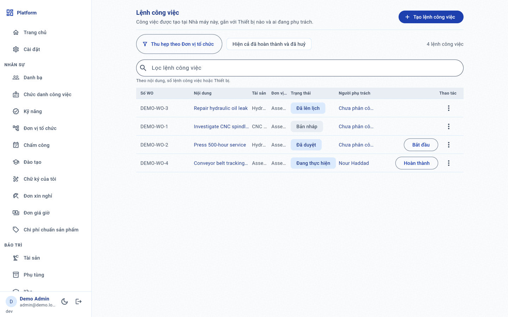

***Ảnh 03.6.** Sổ lệnh công việc của Nhà máy: số lệnh, nội dung, Tài sản, Đơn vị tổ chức, trạng thái, người phụ trách — và các thao tác trên từng dòng.*

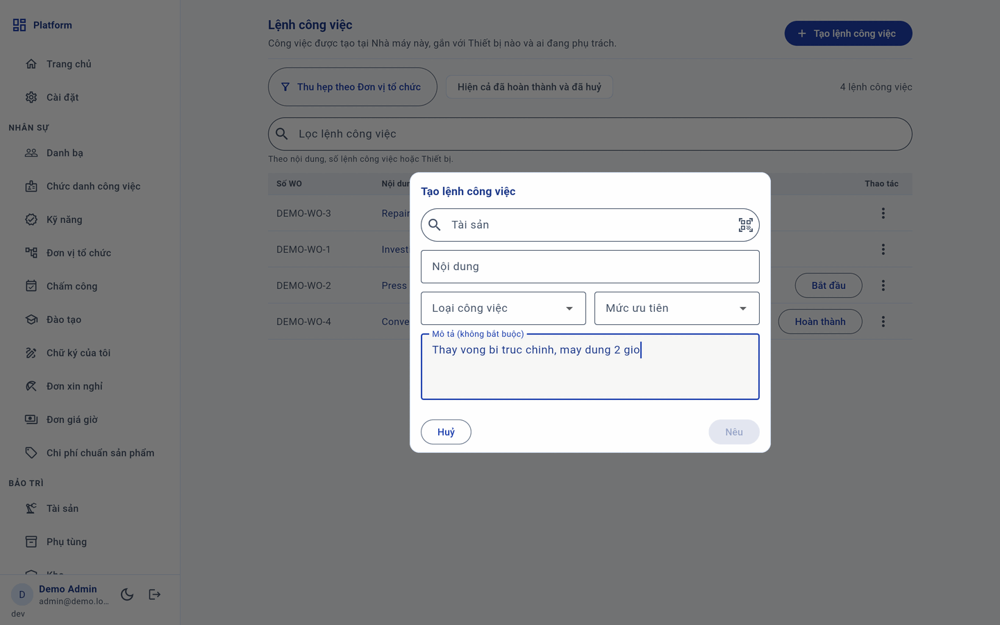

***Ảnh 03.7.** Mô tả đã gõ; **Tài sản**, **Loại công việc** và **Mức ưu tiên** là lựa chọn. Lệnh công việc thuộc về Đơn vị tổ chức của Tài sản được chọn.*

---

## Chi tiết Lệnh công việc

| Hạng mục | Nội dung |
| --- | --- |
| **Công việc** | Ghi lại việc đã làm trên một lệnh: giờ công, phụ tùng, chỉ số đồng hồ — màn hình **Chi tiết Lệnh công việc**, `/work-orders/:id`. Phiếu 03.5. |
| **Ai thao tác được** | Mang quyền đọc lệnh công việc để xem; ghi giờ công, xuất phụ tùng, ghi chỉ số cần quyền ghi lệnh công việc, và quyền sửa trên Đơn vị tổ chức của Tài sản. |
| **Vật tư, dữ liệu có trước** | Lệnh công việc đã tạo (phiếu 03.4); Kho và mã phụ tùng (phiếu 03.2, 03.3); người đã có hồ sơ Nhân viên. |
| **Công cụ** | Các khối **Các bước**, **Ghi giờ công**, **Xuất phụ tùng**, **Chi phí đến nay**; các nút **Ghi giờ công**, **Xuất phụ tùng**, **Ghi chỉ số**; mã quyền ghi `MTN_WORK_ORDERS_CHANGE`. |
| **An toàn** | Giờ công và phụ tùng ghi ở đây đi thẳng vào chi phí bảo trì của nhà máy — ghi sai thì con số báo cáo tháng sai, và không có đường xoá dễ dàng. |
| **Thiết bị đào tạo** | Ảnh 03.8, Ảnh 03.9 |
| **Chủ tài liệu · Rev · Ngày · Trang** | Ban Lean Nền tảng · Rev 2 · 2026-11-15 · 03.5 |

| Các bước chính | Điểm then chốt | Vì sao | Minh hoạ |
| --- | --- | --- | --- |
| **1.** Đọc **Các bước** | [Hỏng] Các bước được **sao từ Kế hoạch công việc** đã tạo ra lệnh này và **không sửa được** ở đây | Muốn đổi cách làm thì sửa Kế hoạch (phiếu 03.14), không sửa lệnh — lệnh là bản đã chụp | Ảnh 03.8 |
| **2.** Bấm **Ghi giờ công**: **Nhân viên**, **Bắt đầu lúc**, **Kết thúc lúc**, **Hoạt động**, **Ngoài giờ**, **Ghi chú** | [Hỏng] Giờ công đã ghi **nằm trong chi phí nhân công của nhà máy đã báo cáo** — không phải chi phí mới phát sinh | Ghi trùng một lần là chi phí tháng đó bị tính hai lần | — |
| **3.** Bấm **Xuất phụ tùng**: **Phụ tùng**, **Kho**, **Số lượng**, **Mã phụ tùng**, **Đơn giá** | [An toàn] Phụ tùng **là** chi phí mới — thành phần duy nhất làm tăng chi phí bảo trì | Xuất phụ tùng sai kho là tồn kho của kho đó sai, và lệnh gánh một món không dùng | Ảnh 03.9 |
| **4.** Nếu Tài sản có đồng hồ đo: **Ghi chỉ số** | [Hỏng] Ghi đúng số trên mặt đồng hồ, không tự cộng | Lịch bảo trì định kỳ theo đồng hồ dựa vào đúng con số này | — |
| **5.** Đọc **Chi phí đến nay** ở cuối | [Dễ] Con số cập nhật ngay sau mỗi lần ghi giờ công và xuất phụ tùng | Cho biết lệnh đang tốn bao nhiêu trước khi nó đóng | Ảnh 03.8 |

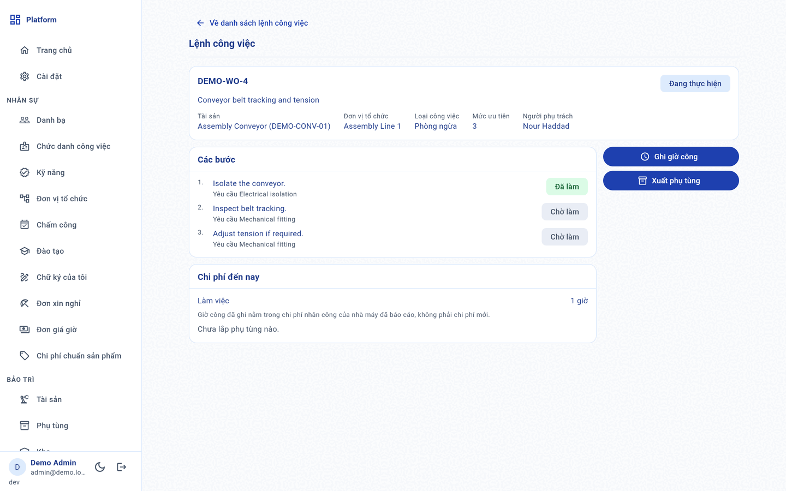

***Ảnh 03.8.** Một lệnh gom bốn khối: **Các bước**, **Ghi giờ công**, **Xuất phụ tùng**, **Chi phí đến nay** — nhìn được ngay lệnh đang tốn bao nhiêu.*

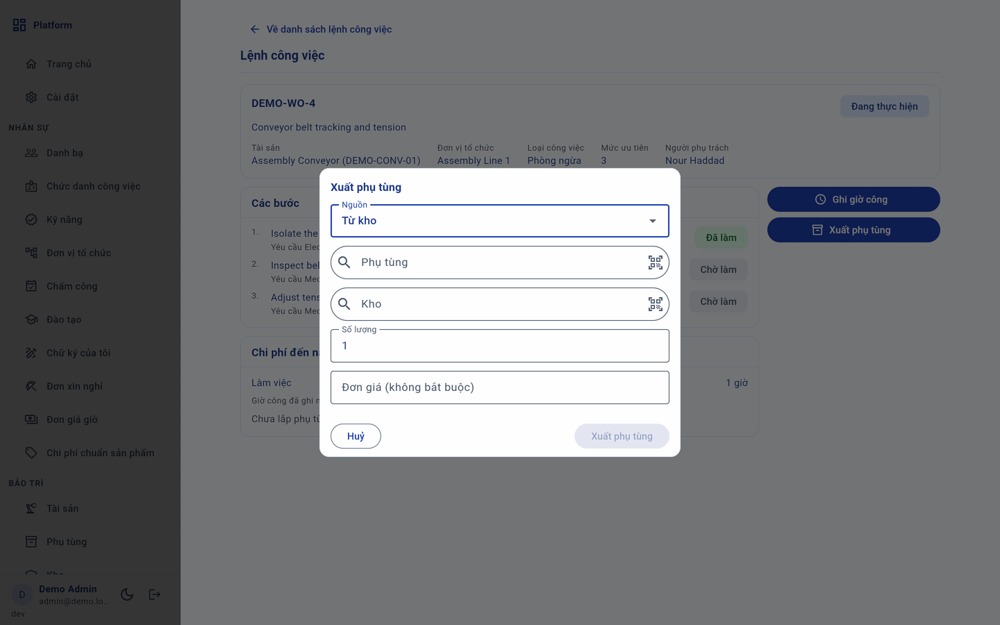

***Ảnh 03.9.** Xuất phụ tùng trừ tồn kho của Kho và cộng vào chi phí của lệnh; cùng một hộp thoại cũng là chỗ ghi lại phụ tùng đã lấy.*

---

## Phân công Lệnh công việc

| Hạng mục | Nội dung |
| --- | --- |
| **Công việc** | Chọn người làm một lệnh — hộp thoại **Phân công**, `/work-orders/:id/assign`. Phiếu 03.6. |
| **Ai thao tác được** | Mang quyền ghi lệnh công việc **và** quyền sửa trên Đơn vị tổ chức của Tài sản. |
| **Vật tư, dữ liệu có trước** | Lệnh đang mở (phiếu 03.4); ứng viên đã có hồ sơ Nhân viên và đã được phân công vào tổ. |
| **Công cụ** | Ô **Tìm một người**; mã quyền ghi `MTN_WORK_ORDERS_CHANGE`. |
| **An toàn** | Phân công người không đủ kỹ năng là đưa một rủi ro vào sổ: hộp thoại lọc theo chứng nhận, đừng bỏ qua bộ lọc cho nhanh. |
| **Thiết bị đào tạo** | Ảnh 03.10 |
| **Chủ tài liệu · Rev · Ngày · Trang** | Ban Lean Nền tảng · Rev 2 · 2026-11-15 · 03.6 |

| Các bước chính | Điểm then chốt | Vì sao | Minh hoạ |
| --- | --- | --- | --- |
| **1.** Tìm trong ô **Tìm một người** theo **tên, mã nhân viên, hoặc chứng nhận họ có**, rồi bấm tên người để giao lệnh | [Hỏng] Danh sách chỉ gồm người **đủ điều kiện theo phạm vi**; danh sách rỗng nghĩa là không có ai để giao | Người không hiện không phải vì Nền tảng "ghét" họ: hoặc ngoài phạm vi, hoặc bộ lọc chứng nhận đang lọc ra — gõ mã nhân viên trực tiếp để chắc chắn | Ảnh 03.10 |

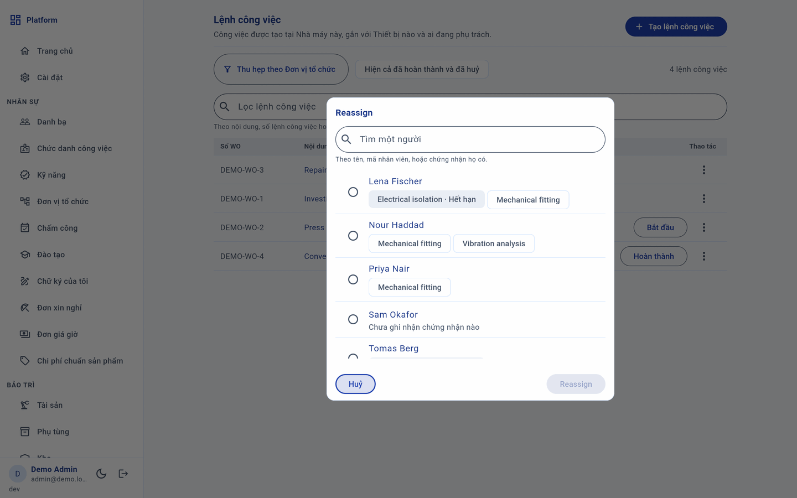

***Ảnh 03.10.** Chọn người theo tên, mã nhân viên hoặc chứng nhận họ có. Hộp thoại này chỉ liệt kê người có quyền sửa ở Đơn vị tổ chức của Tài sản.*

---

## Hoàn thành Lệnh công việc

| Hạng mục | Nội dung |
| --- | --- |
| **Công việc** | Đóng một lệnh đã làm xong và ghi điều đã làm — hộp thoại **Hoàn thành**, `/work-orders/:id/complete`. Phiếu 03.7. |
| **Ai thao tác được** | Mang quyền ghi lệnh công việc, và quyền sửa trên Đơn vị tổ chức của Tài sản. |
| **Vật tư, dữ liệu có trước** | Công việc đã làm xong; giờ công và phụ tùng đã ghi ở phiếu 03.5 (nếu chưa ghi thì ghi trước khi đóng). |
| **Công cụ** | Ô **Đã phát hiện gì**, nút **Hoàn thành Lệnh công việc này**; mã quyền ghi `MTN_WORK_ORDERS_CHANGE`. |
| **An toàn** | Đóng lệnh là chốt chi phí của nó; ghi giờ công sau khi đóng là sửa một bản ghi đã vào báo cáo. |
| **Thiết bị đào tạo** | Ảnh 03.11 |
| **Chủ tài liệu · Rev · Ngày · Trang** | Ban Lean Nền tảng · Rev 2 · 2026-11-15 · 03.7 |

| Các bước chính | Điểm then chốt | Vì sao | Minh hoạ |
| --- | --- | --- | --- |
| **1.** Ghi **Đã phát hiện gì** | [Hỏng] Đây là trường bắt buộc về mặt thực hành, không chỉ hình thức | Người sau đọc lệnh để biết máy đã bị gì; ô trống làm lịch sử máy vô dụng | Ảnh 03.11 |
| **2.** Bấm **Hoàn thành Lệnh công việc này** | [An toàn] Lệnh đã hoàn thành vẫn còn trong sổ — nó không bị xoá, và mọi giờ công, phụ tùng đã ghi vẫn trỏ về nó | Đóng lệnh là đóng trạng thái, không phải xoá việc | — |

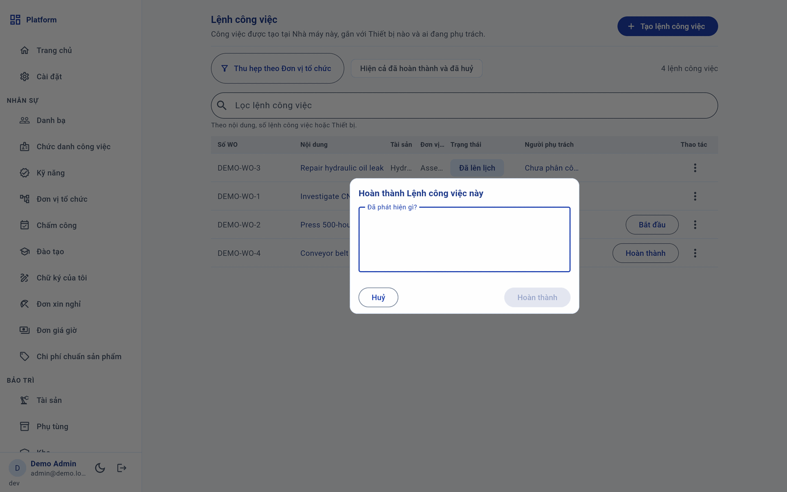

***Ảnh 03.11.** Đóng lệnh: ghi điều đã làm. Lệnh đã hoàn thành vẫn còn trong sổ — nó không bị xoá, và mọi giờ công, phụ tùng đã ghi vẫn trỏ về nó.*

---

## Huỷ Lệnh công việc

| Hạng mục | Nội dung |
| --- | --- |
| **Công việc** | Đóng một lệnh không làm nữa và ghi lý do — hộp thoại **Huỷ Lệnh công việc**, `/work-orders/:id/cancel`. Phiếu 03.8. |
| **Ai thao tác được** | Mang quyền ghi lệnh công việc, và quyền sửa trên Đơn vị tổ chức của Tài sản. |
| **Vật tư, dữ liệu có trước** | Lệnh đang mở (phiếu 03.4). |
| **Công cụ** | Ô **Vì sao huỷ?**, nút **Huỷ Lệnh công việc này**, nút **Để mở**; mã quyền ghi `MTN_WORK_ORDERS_CHANGE`. |
| **An toàn** | Huỷ **không** xoá lệnh — nó chuyển trạng thái và hiện khi bật lịch sử. Không có đường hoàn tác, nên đọc lại trước khi bấm. |
| **Thiết bị đào tạo** | Ảnh 03.12 |
| **Chủ tài liệu · Rev · Ngày · Trang** | Ban Lean Nền tảng · Rev 2 · 2026-11-15 · 03.8 |

| Các bước chính | Điểm then chốt | Vì sao | Minh hoạ |
| --- | --- | --- | --- |
| **1.** Ghi **Vì sao huỷ?** | [Hỏng] Ghi lý do cho người đã nêu việc, không phải cho hồ sơ | Lý do là thứ duy nhất giải thích vì sao việc đã nêu mà không làm | Ảnh 03.12 |
| **2.** Bấm **Huỷ Lệnh công việc này**, hoặc **Để mở** để quay ra | [An toàn] Huỷ giữ dấu việc đã được nêu, nhưng lệnh đã huỷ không còn trong danh sách đang mở | Bấm nhầm thì lệnh vẫn còn trong sổ nhưng phải bật lịch sử mới thấy | — |

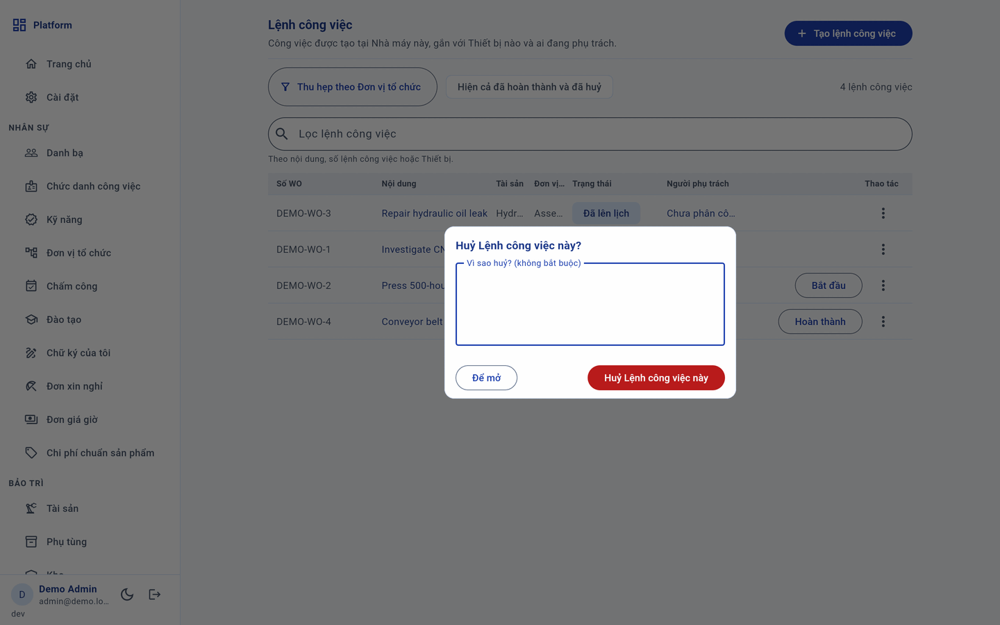

***Ảnh 03.12.** Huỷ lệnh mở từ dòng của lệnh trong danh sách: ghi **Vì sao huỷ?**, rồi **Huỷ Lệnh công việc này** — hoặc **Để mở** để quay ra.*

---

## Yêu cầu của tôi

| Hạng mục | Nội dung |
| --- | --- |
| **Công việc** | Báo máy có vấn đề và theo dõi kết quả — màn hình **Yêu cầu của tôi**, `/my-requests`. Phiếu 03.9. |
| **Ai thao tác được** | **Mọi vai trò, kể cả người vận hành** — việc duy nhất trong nhóm Bảo trì mà mọi Tài khoản làm được. |
| **Vật tư, dữ liệu có trước** | Tài sản đã có trong danh mục (phiếu 03.1) để chọn đúng máy. |
| **Công cụ** | Nút **Nêu một yêu cầu**: **Tài sản**, **Nội dung**, **Mô tả**, **Mức khẩn**, ô **Sản xuất đang dừng ngay lúc này**; cột **Kết quả**; mã quyền `MTN_REQUESTS_RAISE`. |
| **An toàn** | **Mức khẩn** bạn chọn không phải mức ưu tiên của Lệnh công việc — người phân loại chọn mức ưu tiên riêng khi chấp nhận. Đừng dùng "khẩn" cho mọi việc. |
| **Thiết bị đào tạo** | Ảnh 03.13 |
| **Chủ tài liệu · Rev · Ngày · Trang** | Ban Lean Nền tảng · Rev 2 · 2026-11-15 · 03.9 |

| Các bước chính | Điểm then chốt | Vì sao | Minh hoạ |
| --- | --- | --- | --- |
| **1.** Bấm **Nêu một yêu cầu**: **Tài sản**, **Nội dung**, **Mô tả**, **Mức khẩn** | [An toàn] Nếu máy đang dừng sản xuất, **bật ô "Sản xuất đang dừng ngay lúc này"** | Ô đó là thứ đẩy yêu cầu lên đầu hàng chờ của bảo trì; không bật thì yêu cầu xếp như mọi yêu cầu khác | Ảnh 03.13 |
| **2.** Bấm gửi | [Dễ] Yêu cầu nằm ở cột **Kết quả** | Không có bước phân loại nào cho người nêu — việc đó của giám sát | — |
| **3.** Theo dõi cột **Kết quả** | [Hỏng] Ba kết quả có thể: **Đã thành Lệnh công việc {số}**, **Bị từ chối: {lý do}**, hoặc đang chờ | Người nêu yêu cầu thấy được kết quả mà không phải hỏi bảo trì | — |

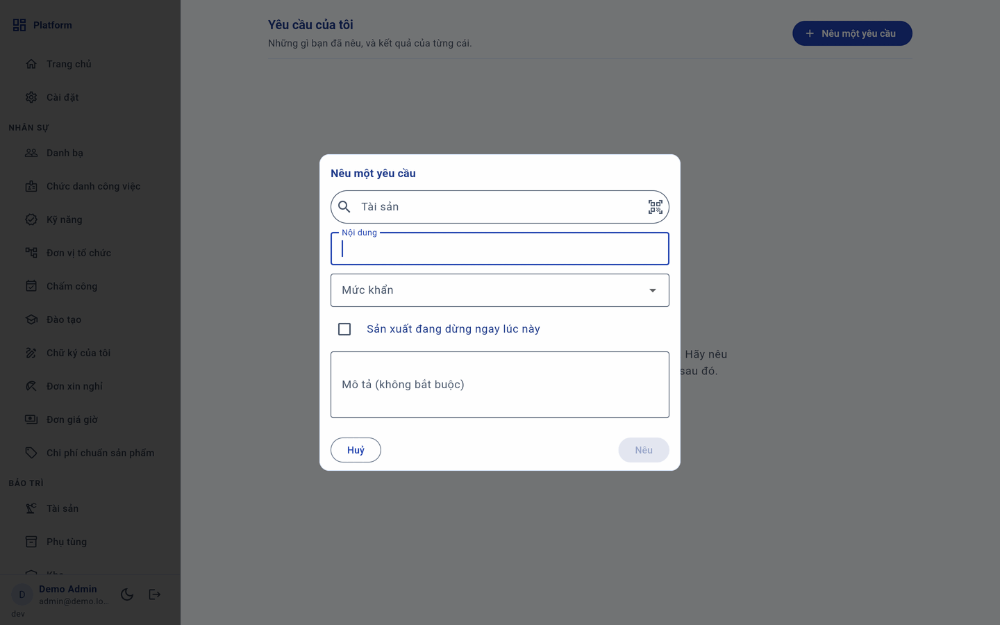

***Ảnh 03.13.** Người vận hành chỉ cần nói máy nào và chuyện gì; việc phân loại, phân công là của giám sát.*

---

## Hàng chờ phân loại

| Hạng mục | Nội dung |
| --- | --- |
| **Công việc** | Quyết định mỗi Yêu cầu thành Lệnh công việc, bị từ chối, hay là bản trùng — màn hình **Hàng chờ phân loại**, `/requests`. Phiếu 03.10. |
| **Ai thao tác được** | Supervisor trở lên. |
| **Vật tư, dữ liệu có trước** | Yêu cầu đã được nêu (phiếu 03.9). |
| **Công cụ** | Danh sách chờ với cột **Mức khẩn** và dòng **Sản xuất đang dừng**; các nút **Chấp nhận**, **Từ chối**, **Đánh dấu trùng**, **Để chờ tiếp**; mã quyền `MTN_REQUESTS_TRIAGE`. |
| **An toàn** | **Chấp nhận là tạo Lệnh công việc** — không có bước trung gian và không có cách hoàn tác. Nghi ngờ thì bấm **Để chờ tiếp**. |
| **Thiết bị đào tạo** | Ảnh 03.14 |
| **Chủ tài liệu · Rev · Ngày · Trang** | Ban Lean Nền tảng · Rev 2 · 2026-11-15 · 03.10 |

| Các bước chính | Điểm then chốt | Vì sao | Minh hoạ |
| --- | --- | --- | --- |
| **1.** Đọc danh sách, chú ý cột **Mức khẩn** và dòng **Sản xuất đang dừng** | [Dễ] Yêu cầu có "Sản xuất đang dừng" xử lý trước | Máy đang dừng sản xuất là máy đang làm mất sản lượng ngay lúc đó | Ảnh 03.14 |
| **2.** Bấm **Chấp nhận**: chọn **Mức ưu tiên** cho Lệnh công việc sẽ sinh ra | [Hỏng] **Mức ưu tiên do bạn quyết định, không phải mức khẩn người báo chọn** | Người báo nói "khẩn" cho mọi việc; người phân loại nhìn cả hàng chờ mới xếp được thứ tự | — |
| **3.** Hoặc **Từ chối**: ghi **Vì sao từ chối yêu cầu này?** | [Dễ] Lý do từ chối đi về người đã nêu — viết câu người đó hiểu được | Người nêu việc đọc lý do ở cột **Kết quả** của phiếu 03.9 | — |
| **4.** Yêu cầu trùng: **Đánh dấu trùng**, chọn **Yêu cầu nào được giữ lại** | [Hỏng] Bản bị đánh dấu trùng **rời hàng chờ**; bản giữ lại tiếp tục | Giữ lại bản có mô tả đầy đủ hơn và có người báo gần máy hơn | — |

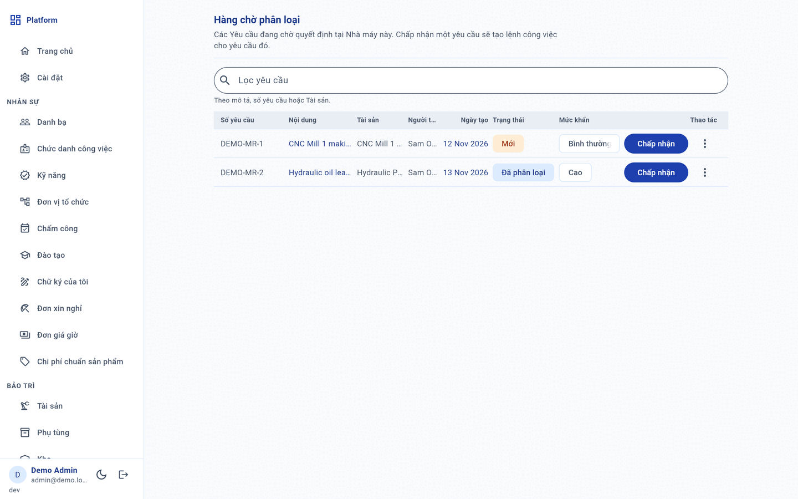

***Ảnh 03.14.** Các Yêu cầu đang chờ quyết định. **Chấp nhận** một yêu cầu sẽ tạo lệnh công việc cho nó — đó là lý do màn hình này chỉ dành cho giám sát trở lên.*

---

## Thời gian dừng máy

| Hạng mục | Nội dung |
| --- | --- |
| **Công việc** | Ghi máy nào đang không chạy, vì sao, và đã dừng bao lâu — màn hình **Thời gian dừng máy**, `/downtime`. Phiếu 03.11. |
| **Ai thao tác được** | Supervisor trở lên — đọc và ghi. |
| **Vật tư, dữ liệu có trước** | Tài sản đã có trong danh mục (phiếu 03.1). |
| **Công cụ** | Nút **Báo máy hỏng** với **Tài sản**, **Bắt đầu lúc**, **Mô tả**; thao tác **Phân loại** với **Lý do** và **Mô tả**; nút **Đóng** với **Kết thúc lúc**; ô lọc theo **Tài sản, lý do hoặc mô tả**; mã quyền đọc `MTN_DOWNTIME_DISPLAY`, ghi `MTN_DOWNTIME_CHANGE`. |
| **An toàn** | Hai thao tác **Phân loại** và **Đóng** là hai việc khác nhau — đóng mà chưa phân loại thì lần dừng đó không vào thống kê theo lý do. |
| **Thiết bị đào tạo** | Ảnh 03.15 |
| **Chủ tài liệu · Rev · Ngày · Trang** | Ban Lean Nền tảng · Rev 2 · 2026-11-15 · 03.11 |

| Các bước chính | Điểm then chốt | Vì sao | Minh hoạ |
| --- | --- | --- | --- |
| **1.** **Báo máy hỏng**: **Tài sản**, **Bắt đầu lúc**, **Mô tả** | [Hỏng] Để trống **Bắt đầu lúc** nghĩa là tính từ lúc bấm — dùng khi bạn vừa phát hiện máy dừng | Ghi lùi giờ là cách duy nhất tính đúng thời gian dừng đã xảy ra trước khi bạn tới | Ảnh 03.15 |
| **2.** **Phân loại** lần dừng: chọn **Lý do**, ghi **Mô tả** (bắt buộc), hoặc **Để chưa phân loại** | [Hỏng] Chưa phân loại được, nhưng **đừng để lâu** — chỉ số dừng máy theo lý do sẽ thiếu | Số dừng máy theo lý do là thứ quyết định dòng máy nào đáng đầu tư | — |
| **3.** Máy chạy lại: **Đóng**, ghi **Kết thúc lúc** | [Dễ] Máy chủ tự tính thời gian đã dừng | Không có trường "đã dừng bao lâu" để gõ tay | — |
| **4.** Lọc theo **Tài sản, lý do hoặc mô tả** | — | — | — |

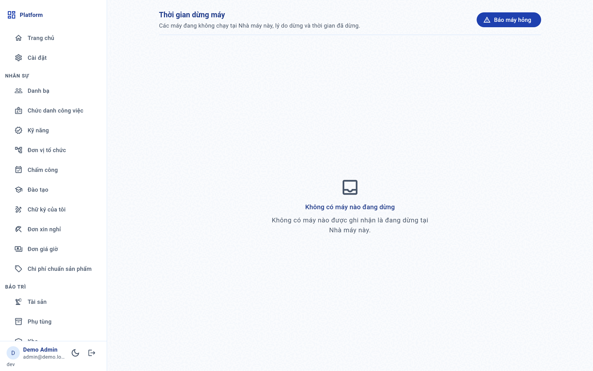

***Ảnh 03.15.** Các lần dừng của máy theo lý do — dữ liệu này là thứ quyết định dòng máy nào xuất hiện trong bàn giao ca.*

---

## Lịch bảo trì định kỳ

| Hạng mục | Nội dung |
| --- | --- |
| **Công việc** | Gắn một Kế hoạch công việc với một Tài sản để Nền tảng tự tạo Lệnh công việc **trước khi** máy hỏng — màn hình **Lịch bảo trì định kỳ**, `/pm-schedules`. Phiếu 03.12. |
| **Ai thao tác được** | Supervisor trở lên — đọc và ghi. |
| **Vật tư, dữ liệu có trước** | Tài sản (phiếu 03.1); Kế hoạch công việc (phiếu 03.14); Đồng hồ đo đã định nghĩa nếu lịch tính theo lượng sử dụng (phiếu 03.13). |
| **Công cụ** | Nút **Thêm lịch bảo trì định kỳ**: **Tài sản**, **Kế hoạch công việc**, **Chu kỳ tính theo** (**Thời gian đã trôi qua** / **Lượng sử dụng tích luỹ**), **Bao nhiêu ngày một lần**, **Đồng hồ đo**, **Bao nhiêu lượng sử dụng tích luỹ một lần**, **Tạo lệnh sớm bao nhiêu ngày**, **Mức ưu tiên**, **Ngày đến hạn đầu tiên**; nút **Lên lịch**; mã quyền đọc `MTN_PM_SCHEDULES_DISPLAY`, ghi `MTN_PM_SCHEDULES_CHANGE`. |
| **An toàn** | Chọn sai **Chu kỳ tính theo** thì lịch không bao giờ đến hạn — và sẽ không có lệnh công việc nào được tạo, im lặng. |
| **Thiết bị đào tạo** | Ảnh 03.16 |
| **Chủ tài liệu · Rev · Ngày · Trang** | Ban Lean Nền tảng · Rev 2 · 2026-11-15 · 03.12 |

| Các bước chính | Điểm then chốt | Vì sao | Minh hoạ |
| --- | --- | --- | --- |
| **1.** Bấm **Thêm lịch bảo trì định kỳ**: **Tài sản**, **Kế hoạch công việc**, **Chu kỳ tính theo** | [Hỏng] **Chu kỳ tính theo** có hai lựa chọn: **Thời gian đã trôi qua** (theo ngày) hoặc **Lượng sử dụng tích luỹ** (theo đồng hồ đo) | Chọn sai loại là lịch không bao giờ đến hạn, và không có lệnh nào được tạo | Ảnh 03.16 |
| **2.** Theo ngày: điền **Bao nhiêu ngày một lần**. Theo đồng hồ: chọn **Đồng hồ đo** rồi điền **Bao nhiêu lượng sử dụng tích luỹ một lần** | [Hỏng] Chỉ **đồng hồ đo tích luỹ** mới đặt được lịch | Đồng hồ đo không tích luỹ (ví dụ nhiệt độ) không có "mỗi X một lần" | — |
| **3.** Điền **Tạo lệnh sớm bao nhiêu ngày**, **Mức ưu tiên**, **Ngày đến hạn đầu tiên** | [Hỏng] **Tạo lệnh sớm bao nhiêu ngày** là thời gian chuẩn bị, không phải chu kỳ: đặt 7 nghĩa là lệnh xuất hiện **7 ngày trước** hạn | Đặt số này bằng chu kỳ là lịch chạy liên tục, lệnh này chưa đóng đã có lệnh sau | — |
| **4.** Bấm **Lên lịch** | [Dễ] Để trống ngày đầu thì Nền tảng tính **một chu kỳ kể từ hôm nay** | Lịch mới chưa có lần đến hạn nào để so | — |

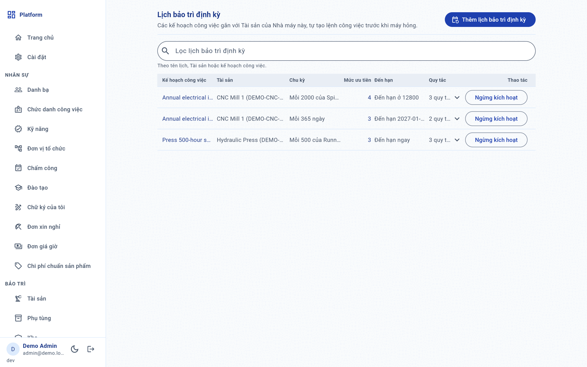

***Ảnh 03.16.** Việc phòng ngừa theo chu kỳ hoặc theo đồng hồ đo; mỗi lịch sinh ra lệnh công việc khi đến hạn.*

---

## Đồng hồ đo

| Hạng mục | Nội dung |
| --- | --- |
| **Công việc** | Định nghĩa các chỉ số chạy của máy và ghi số đọc — màn hình **Đồng hồ đo**, `/meters`. Phiếu 03.13. |
| **Ai thao tác được** | Supervisor trở lên — đọc và ghi. |
| **Vật tư, dữ liệu có trước** | Tài sản (phiếu 03.1) và số đọc trên mặt đồng hồ của nó. |
| **Công cụ** | Ô **Tài sản**, **Mã**, **Tên**, **Loại đồng hồ đo**, **Đơn vị đo**; thao tác **Ghi chỉ số** với **Đồng hồ đang chỉ bao nhiêu**, **Ghi chú**; ô **Đồng hồ đã được đặt lại hoặc thay mới**, **Đồng hồ mới đang chỉ bao nhiêu**; mã quyền đọc `MTN_METERS_DISPLAY`, ghi `MTN_METERS_CHANGE`. |
| **An toàn** | Số đọc sai làm lịch bảo trì theo giờ chạy sai theo, và không có gì báo cho bạn biết ngoài một lệnh không bao giờ tới hạn. |
| **Thiết bị đào tạo** | Ảnh 03.17 |
| **Chủ tài liệu · Rev · Ngày · Trang** | Ban Lean Nền tảng · Rev 2 · 2026-11-15 · 03.13 |

| Các bước chính | Điểm then chốt | Vì sao | Minh hoạ |
| --- | --- | --- | --- |
| **1.** **Định nghĩa đồng hồ đo**: **Tài sản**, **Mã**, **Tên**, **Loại đồng hồ đo**, **Đơn vị đo** | [Dễ] **Mã** là cách đồng hồ được gọi trên tài sản, ví dụ `RUN-HRS` | Người vận hành đọc mã đó, không đọc tên dài | Ảnh 03.17 |
| **2.** **Ghi chỉ số**: điền **Đồng hồ đang chỉ bao nhiêu**, **Ghi chú** | [Hỏng] Ghi **đúng số trên mặt đồng hồ**, không tự cộng | Nền tảng tự tính lượng tích luỹ; tự cộng là đếm hai lần | — |
| **3.** Đồng hồ bị đặt lại về 0 hoặc thay mới: bật **Đồng hồ đã được đặt lại hoặc thay mới**, điền **Đồng hồ mới đang chỉ bao nhiêu** | [An toàn] Không bật ô này thì tổng sử dụng tụt về gần 0 và **mọi lịch theo đồng hồ sai** | Nền tảng chuyển lượng tích luỹ sang phần bù để tổng không tụt — đó là cách duy nhất giữ lịch đúng | — |

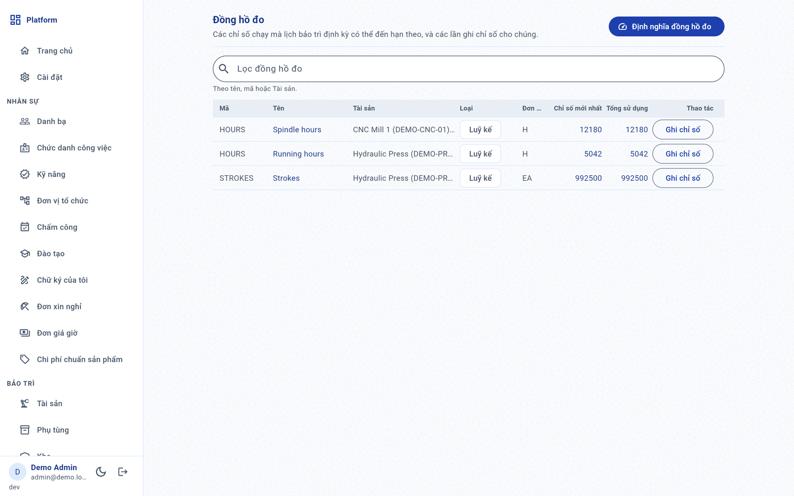

***Ảnh 03.17.** Các đồng hồ gắn vào Tài sản và số đọc gần nhất — nguồn của lịch bảo trì theo giờ chạy.*

---

## Kế hoạch công việc

| Hạng mục | Nội dung |
| --- | --- |
| **Công việc** | Viết cách thực hiện một loại việc định kỳ: các bước và mỗi bước yêu cầu gì — màn hình **Kế hoạch công việc**, `/job-plans`. Phiếu 03.14. |
| **Ai thao tác được** | Chỉ quản trị viên. |
| **Vật tư, dữ liệu có trước** | Kỹ năng yêu cầu của từng bước đã khai báo (phiếu 02.6); mã kế hoạch do kỹ thuật cấp. |
| **Công cụ** | Nút **Thêm kế hoạch công việc**: **Mã**, **Tên**, **Mô tả**, **Loại công việc**, **Số giờ ước tính**, **Cần dừng máy**; nút **Thêm bước** (**Hướng dẫn**, **Số giờ**, **Kỹ năng yêu cầu**, **Ghi chú an toàn**), **Xoá bước này**, **Thêm kế hoạch**, **Ngừng kích hoạt**, **Kích hoạt lại**; mã quyền `MTN_JOB_PLANS_MAINTAIN`. |
| **An toàn** | Lệnh công việc **đi theo** kế hoạch chứ không sửa kế hoạch: sửa kế hoạch không làm đổi các lệnh đã tạo từ nó. |
| **Thiết bị đào tạo** | Ảnh 03.18 |
| **Chủ tài liệu · Rev · Ngày · Trang** | Ban Lean Nền tảng · Rev 2 · 2026-11-15 · 03.14 |

| Các bước chính | Điểm then chốt | Vì sao | Minh hoạ |
| --- | --- | --- | --- |
| **1.** Bấm **Thêm kế hoạch công việc**: **Mã**, **Tên**, **Mô tả**, **Loại công việc**, **Số giờ ước tính**, **Cần dừng máy** | [Dễ] **Cần dừng máy** là thông tin người lập kế hoạch sản xuất cần — đừng bỏ trống cho nhanh | Không có nó thì lịch dừng máy do bảo trì gây ra không được báo trước cho sản xuất | Ảnh 03.18 |
| **2.** Bấm **Thêm bước** cho từng bước: **Hướng dẫn**, **Số giờ**, **Kỹ năng yêu cầu**, **Ghi chú an toàn**, rồi bấm **Thêm kế hoạch** để lưu | [Dễ] Bước được đánh số theo thứ tự thêm vào; **Xoá bước này** bỏ một bước | Thứ tự các bước chính là thứ tự người thợ đọc trên lệnh công việc | — |
| **3.** Ngừng dùng: **Ngừng kích hoạt**, và **Kích hoạt lại** khi cần | [An toàn] Kế hoạch đã tạo lệnh công việc rồi vẫn ngừng được — các lệnh cũ không đổi | Ngừng kích hoạt là chặn lịch mới, không phải sửa lịch sử | — |

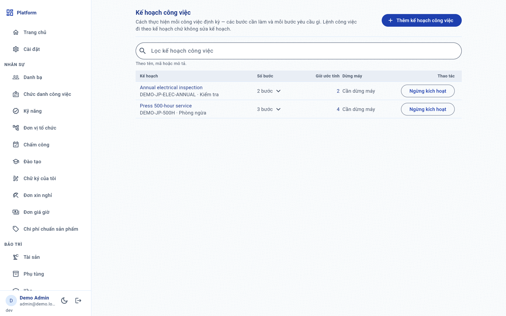

***Ảnh 03.18.** Một kế hoạch là danh sách các bước chuẩn cho một loại việc — chép vào lệnh công việc thay vì viết lại từ đầu.*

---

## Bảng tóm tắt phần Bảo trì

Bảng này để người đào tạo trả lời nhanh "ai làm được việc này". Nó **không** thay
các dòng **Ai thao tác được** ở từng phiếu: ghi còn cần phạm vi Đơn vị tổ chức —
xem [README §1](README.md#1-sáu-vai-trò-và-cách-đọc-phần-ai-thao-tác-được).

| Việc | Mọi vai trò | Người vận hành | Giám sát | Kỹ sư | Quản lý | Quản trị viên |
| --- | :-: | :-: | :-: | :-: | :-: | :-: |
| Nêu Yêu cầu, theo dõi Yêu cầu của tôi | ✓ | ✓ | ✓ | ✓ | ✓ | ✓ |
| Xem Tài sản, Kho, Lệnh công việc, Dừng máy, Lịch, Đồng hồ | · | · | ✓ | ✓ | ✓ | ✓ |
| Thêm/sửa Tài sản, đổi vị trí, ngừng dùng | · | · | ✓ | ✓ | ✓ | ✓ |
| Tạo / phân công / hoàn thành / huỷ Lệnh công việc | · | · | ✓ | ✓ | ✓ | ✓ |
| Ghi giờ công, xuất phụ tùng, ghi chỉ số trên lệnh | · | · | ✓ | ✓ | ✓ | ✓ |
| Phân loại Hàng chờ, chấp nhận / từ chối Yêu cầu | · | · | ✓ | ✓ | ✓ | ✓ |
| Báo hỏng, phân loại và đóng lần dừng máy | · | · | ✓ | ✓ | ✓ | ✓ |
| Nhập kho | · | · | ✓ | ✓ | ✓ | ✓ |
| Lên lịch bảo trì định kỳ, định nghĩa Đồng hồ đo | · | · | ✓ | ✓ | ✓ | ✓ |
| **Thêm / sửa Phụ tùng** | · | · | **·** | ✓ | ✓ | ✓ |
| **Kế hoạch công việc** | · | · | · | · | · | ✓ |

(✓ = theo mã quyền ở từng phiếu. Ghi còn cần phạm vi Đơn vị tổ chức — xem
[README §1](README.md#1-sáu-vai-trò-và-cách-đọc-phần-ai-thao-tác-được).)
