# 04 · Hành động

Nhóm **Hành động** là chỗ nhà máy trả lời câu "vì sao việc này xảy ra, và mình đã
làm gì để nó không xảy ra nữa". Có hai thứ trong đó:

- **Concern** — một vấn đề được nêu lên, mang theo các **biện pháp** và đi qua các
  **giai đoạn** cho tới khi đóng.
- **CAPA** — một cuộc **điều tra 8D** mở trên một Concern, khi có người quyết định
  vấn đề cần nguyên nhân gốc và một bản sửa giữ được kết quả.

**Quyền ở nhóm này khác hẳn ba nhóm trước.** Chín mã quyền của Hành động nằm trên
**cả sáu vai trò**, kể cả nhóm mặc định — nghĩa là **mọi Tài khoản đều nêu được
Concern, ghi biện pháp, xác minh và đóng giai đoạn**. Đây là chủ ý: nêu ra một vấn đề
không phải là một đặc quyền. Cái chặn là **phạm vi Đơn vị tổ chức**.

**Một chỗ mã quyền không nói hết, và người đào tạo phải nói rõ.** **Mở CAPA** còn cần
**thẩm quyền Chất lượng** ở Đơn vị tổ chức của Concern, không chỉ mã `ACT_CAPA_OPEN`.
Mở một cuộc điều tra 8D là một phán quyết về vấn đề, không phải một việc làm trên nó
(ADR-0035). Một Tài khoản không có thẩm quyền Chất lượng sẽ thấy hộp thoại **Mở CAPA
cần thẩm quyền** thay vì nút mở.

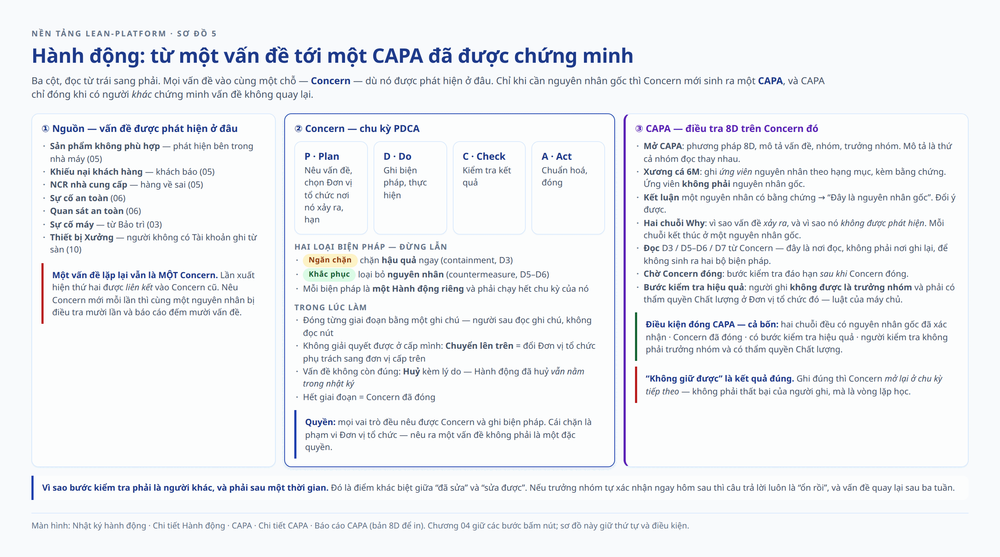

***Sơ đồ 5.** Ba cột: vấn đề được phát hiện ở đâu, Concern chạy chu kỳ PDCA thế nào, và
CAPA 8D đóng khi nào. Điều kiện đóng CAPA có bốn phần — xem cột thứ ba.*

---

## Nhật ký hành động

| Hạng mục | Nội dung |
| --- | --- |
| **Công việc** | Đọc những gì nhà máy còn nợ — đã phát hiện gì, ai phụ trách, khi nào đến hạn — màn hình **Nhật ký hành động**, `/actions`. Phiếu 04.1. |
| **Ai thao tác được** | Đọc: `ACT_LOG_DISPLAY` — mọi vai trò. |
| **Vật tư, dữ liệu có trước** | Đã có ít nhất một Concern được nêu; Đơn vị tổ chức và Trụ cột đã có trong hệ thống. |
| **Công cụ** | Ô lọc **Đơn vị tổ chức**, **Trạng thái**, **Loại hành động**; ô **Hiện cả việc đã đóng**; mỗi dòng đọc **Đến hạn**, **Quá hạn {n} ngày**, **Người phụ trách**, số **biện pháp**. |
| **An toàn** | Đọc **số biện pháp** mà kết luận "đã xử lý" là sai: chỉ **biện pháp khắc phục** mới chữa nguyên nhân, **biện pháp khoanh vùng** chỉ chặn hậu quả. |
| **Thiết bị đào tạo** | Ảnh 04.1 |
| **Chủ tài liệu · Rev · Ngày · Trang** | Ban Lean Nền tảng · Rev 2 · 2026-11-15 · 04.1 |

| Các bước chính | Điểm then chốt | Vì sao | Minh hoạ |
| --- | --- | --- | --- |
| **1.** Chọn **Đơn vị tổ chức**, **Trạng thái**, **Loại hành động**; bật **Hiện cả việc đã đóng** khi cần xem lịch sử | [Dễ] Thu hẹp theo đơn vị **bao gồm mọi đơn vị bên dưới** nó | Chọn bộ phận là thấy cả các tổ trong bộ phận, không phải chỉ việc của bộ phận | Ảnh 04.1 |
| **2.** Đọc **Đến hạn** và **Quá hạn {n} ngày** trên từng dòng | [Hỏng] **Quá hạn xếp trước** — đọc số ngày, đừng đọc màu | Quá hạn ba ngày và quá hạn ba tuần đều là một dòng đỏ; con số mới nói việc nào gấp | Ảnh 04.1 |
| **3.** Đọc cột biện pháp: "{n} biện pháp, trong đó {m} là biện pháp khắc phục" | [Hỏng] Chỉ **biện pháp khắc phục** mới chữa nguyên nhân | Một Concern có năm biện pháp khoanh vùng và không có **biện pháp khắc phục** nào là một Concern chưa được sửa | — |
| **4.** Bấm một dòng để mở **Chi tiết Hành động** | [Dễ] Danh sách không có nút sửa — mọi thao tác nằm ở màn hình chi tiết | Người mới hay tìm nút **Hoàn thành** trên danh sách và kết luận không có quyền | — |

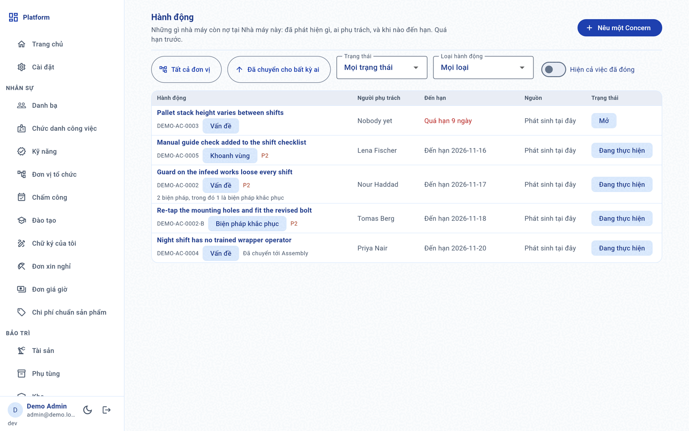

***Ảnh 04.1.** Những gì nhà máy còn nợ, quá hạn trước: đã phát hiện gì, ai phụ trách, khi nào đến hạn.*

---

## Nêu một Concern

| Hạng mục | Nội dung |
| --- | --- |
| **Công việc** | Ghi một vấn đề lên nhật ký, tại đúng nơi bạn gặp nó — màn hình **Nhật ký hành động**, tạo ở `/actions/new`. Phiếu 04.2. |
| **Ai thao tác được** | `ACT_RAISE` — **mọi vai trò**. Ghi còn cần phạm vi Đơn vị tổ chức. |
| **Vật tư, dữ liệu có trước** | Đơn vị tổ chức nơi vấn đề xảy ra đã tồn tại; danh mục Trụ cột đọc được. |
| **Công cụ** | Nút **Nêu một Concern**; ô **Phát hiện ở đâu**, **Nội dung**, **Chi tiết (không bắt buộc)**, **Loại hành động**, **Mức ưu tiên**, **Trụ cột (không bắt buộc)**, **Người phụ trách (không bắt buộc)**, **Đến hạn (không bắt buộc)**; nút **Nêu**. |
| **An toàn** | Ô **Phát hiện ở đâu** quyết định **ai** đóng được Concern này. Chọn nhầm đơn vị thì người thực sự phụ trách không đóng được nó, và Concern nằm mở vĩnh viễn. |
| **Thiết bị đào tạo** | Ảnh 04.2 |
| **Chủ tài liệu · Rev · Ngày · Trang** | Ban Lean Nền tảng · Rev 2 · 2026-11-15 · 04.2 |

| Các bước chính | Điểm then chốt | Vì sao | Minh hoạ |
| --- | --- | --- | --- |
| **1.** Tìm trong **Nhật ký hành động** trước xem vấn đề này đã có Concern chưa | [Hỏng] **Một vấn đề lặp lại nhiều lần vẫn là MỘT Concern** — lần xuất hiện thứ hai được **liên kết**, không nêu mới | Nếu mỗi lần hỏng máy lại nêu một Concern riêng, cùng một nguyên nhân bị điều tra mười lần và báo cáo đếm mười vấn đề | Ảnh 04.2 |
| **2.** Mở **Nêu một Concern**, chọn **Phát hiện ở đâu** — Đơn vị tổ chức nơi vấn đề xảy ra | [An toàn] Đây là điều quyết định **ai thao tác được** trên Concern này; hộp thoại nói lại đơn vị ngay dưới ô chọn | Chọn nhầm ở bước này là giao vấn đề cho người không nhìn thấy nó, và không ai sửa được nữa | Ảnh 04.2 |
| **3.** Ghi **Nội dung** — một dòng, cái hiện trên nhật ký | [Dễ] Viết sao cho người ngoài đọc hiểu; **Nguyên nhân ghi ở giai đoạn Lập kế hoạch**, không phải ở đây | Nêu vấn đề trước, tìm nguyên nhân sau — ghi nguyên nhân ngay là bỏ qua bước điều tra | Ảnh 04.2 |
| **4.** Chọn **Loại hành động**, **Mức ưu tiên**; điền **Trụ cột (không bắt buộc)**, **Người phụ trách (không bắt buộc)**, **Đến hạn (không bắt buộc)** | [Hỏng] Để trống **Người phụ trách** thì Concern là của không ai — màn hình cảnh báo đúng điều đó | Một Hành động không có người phụ trách không ai đóng, và không hiện trên màn hình việc đang chờ của bất kỳ ai | — |
| **5.** Bấm **Nêu** | [Dễ] Concern mở ở giai đoạn **Lập kế hoạch** và xuất hiện ngay trên nhật ký | Người nêu không phải người phải điền hết — nêu xong là vấn đề đã được ghi | — |

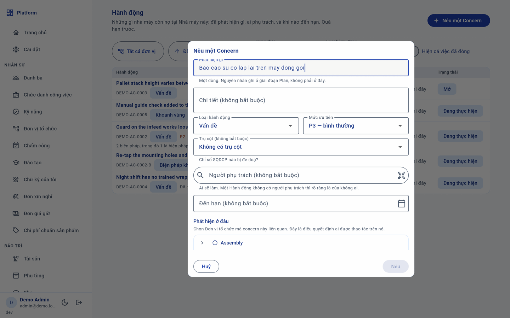

***Ảnh 04.2.** Một dòng mô tả là đủ để mở Hành động. **Nguyên nhân ghi ở giai đoạn Lập kế hoạch**, không phải ở đây — nêu vấn đề trước, tìm nguyên nhân sau.*

---

## Chi tiết Hành động

| Hạng mục | Nội dung |
| --- | --- |
| **Công việc** | Làm thật một Concern: ghi biện pháp, chạy các giai đoạn, liên kết cái gì với nó, và đóng nó — màn hình **Chi tiết Hành động**, `/actions/:id`. Phiếu 04.3. |
| **Ai thao tác được** | Đọc: `ACT_LOG_DISPLAY`. Ghi biện pháp: `ACT_MEASURE`. Xác minh: `ACT_VERIFY`. Sửa liên kết, chuyển lên, huỷ: `ACT_CHANGE`. Mở CAPA: `ACT_CAPA_OPEN` **và** thẩm quyền Chất lượng. Mọi mã trên đều có ở cả sáu vai trò; cái chặn là phạm vi Đơn vị tổ chức. |
| **Vật tư, dữ liệu có trước** | Concern đã được nêu (phiếu 04.2); người sẽ nhận biện pháp đã có hồ sơ Nhân viên. |
| **Công cụ** | Khối **Tình trạng hiện tại**; nút **Thêm biện pháp**, **Hoàn thành {giai đoạn}**, **Chuyển lên trên…**, **Mở một CAPA…**, **Huỷ hành động…**, **Bỏ liên kết…**, **Nêu từ đây**. |
| **An toàn** | **Khoanh vùng**, **Biện pháp khắc phục** và **Hành động phòng ngừa** là ba loại khác nhau: chọn sai loại làm báo cáo CAPA thiếu D3 hoặc D5–D6, và bản sửa không bao giờ chạm tới nguyên nhân. |
| **Thiết bị đào tạo** | Ảnh 04.3 |
| **Chủ tài liệu · Rev · Ngày · Trang** | Ban Lean Nền tảng · Rev 2 · 2026-11-15 · 04.3 |

| Các bước chính | Điểm then chốt | Vì sao | Minh hoạ |
| --- | --- | --- | --- |
| **1.** Đọc **Tình trạng hiện tại** và dòng **Đang mở — chờ chính hành động này** | [Hỏng] Một Hành động chờ **hành động con** của nó — đóng con trước thì cha mới đi tiếp | Người mới bấm **Hoàn thành** trên cha rồi thắc mắc sao không có nút: nút nằm trên đứa con đang mở | Ảnh 04.3 |
| **2.** Bấm **Thêm biện pháp**, chọn đúng loại **Khoanh vùng**, **Biện pháp khắc phục** hoặc **Hành động phòng ngừa** (xem phiếu 04.7) | [An toàn] **Mỗi biện pháp là một Hành động riêng**, có chu kỳ riêng tới giai đoạn **Chuẩn hoá** | Ghi biện pháp ở đây không phải là làm xong nó — nó mở một Hành động con phải chạy hết chu kỳ | Ảnh 04.3 |
| **3.** Liên kết những lần xuất hiện: **Sản phẩm không phù hợp**, **Sự cố**, **Quan sát**, hoặc **Nêu từ đây** | [Hỏng] Đây là **những lần xuất hiện** mà Concern trả lời — không phải bằng chứng đính kèm | Một Concern trả lời nhiều lần xuất hiện là một vấn đề; nhiều Concern cho một vấn đề là thống kê hỏng | — |
| **4.** Liên kết nhầm: bấm **Bỏ liên kết…** | [Hỏng] Bản ghi **không bị xoá**, chỉ rời khỏi Concern này | Chỉ dùng khi đã liên kết nhầm — gỡ một lần xuất hiện thật làm Concern mất dấu vấn đề | — |
| **5.** Đóng giai đoạn đang mở: bấm **Hoàn thành {giai đoạn}** (xem phiếu 04.4) | [Dễ] Chỉ giai đoạn **đang mở** mới đóng được; nút của giai đoạn khác từ chối | Đóng sai thứ tự thì PDCA không còn đọc được như một câu chuyện | — |
| **6.** Không giải quyết được ở cấp mình: **Chuyển lên trên…** (xem phiếu 04.5) | [An toàn] Chuyển lên **không** đổi người phụ trách — nó báo cho cấp trên biết về hành động này | Hiểu nhầm bước này là "giao việc" thì vấn đề không ai nhận và cấp trên không biết | — |
| **7.** Cần điều tra nguyên nhân gốc: **Mở một CAPA…** (xem phiếu 04.9) | [Hỏng] Nút này cần **thẩm quyền Chất lượng** ở Đơn vị tổ chức của Concern, không chỉ vai trò | Không có thẩm quyền thì hộp thoại nói **Mở CAPA cần thẩm quyền** — đó là thiết kế, không phải lỗi tài khoản | — |

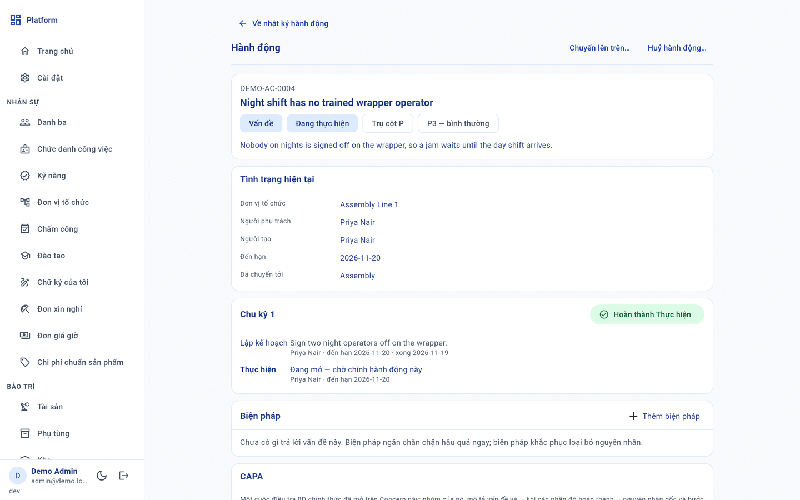

***Ảnh 04.3.** Tình trạng hiện tại, chu kỳ PDCA, các biện pháp, CAPA và Sản phẩm không phù hợp liên quan — tất cả trên một màn hình.*

---

## Hoàn thành một giai đoạn

| Hạng mục | Nội dung |
| --- | --- |
| **Công việc** | Đóng giai đoạn đang mở của Hành động (**Lập kế hoạch**, **Thực hiện**, **Kiểm tra**, **Chuẩn hoá**) và để nó đi tiếp — hộp thoại **Hoàn thành {giai đoạn}**, `/actions/:id/phases/:phase/complete`. Phiếu 04.4. |
| **Ai thao tác được** | `ACT_MEASURE` khi ghi biện pháp; `ACT_VERIFY` khi xác minh. Ghi còn cần phạm vi Đơn vị tổ chức. |
| **Vật tư, dữ liệu có trước** | Hành động còn giai đoạn để đóng; bằng chứng của giai đoạn đó đã có trong tay. |
| **Công cụ** | Ô **Đã làm gì** ở **Lập kế hoạch**, **Thực hiện**, **Chuẩn hoá** hoặc **Đã đo được gì** ở **Kiểm tra**; cặp chọn **Có giữ được kết quả không?** ở giai đoạn **Kiểm tra**; nút **Hoàn thành {giai đoạn}**. |
| **An toàn** | Ở giai đoạn **Kiểm tra**, trả lời **không** không phải là thất bại — nó mở chu kỳ tiếp theo. Trả lời **có** khi chưa đo là điều làm một bản sửa sai được coi là đã xong. |
| **Thiết bị đào tạo** | Ảnh 04.4 |
| **Chủ tài liệu · Rev · Ngày · Trang** | Ban Lean Nền tảng · Rev 2 · 2026-11-15 · 04.4 |

| Các bước chính | Điểm then chốt | Vì sao | Minh hoạ |
| --- | --- | --- | --- |
| **1.** Mở nút **Hoàn thành {giai đoạn}** của giai đoạn đang mở | [Hỏng] Chỉ giai đoạn **đang mở** mới có nút; bấm giai đoạn khác thì hộp thoại nói **Đó không phải giai đoạn đang mở** | Hành động chờ hành động con: hộp thoại nói rõ nó đang chờ giai đoạn nào, của đứa con nào | Ảnh 04.4 |
| **2.** Ghi **Đã làm gì** — hoặc **Đã đo được gì** nếu là giai đoạn **Kiểm tra** | [Dễ] Ô đổi tên theo giai đoạn, và dòng mô tả phía trên nói giai đoạn này cần gì | **Lập kế hoạch** cần mục tiêu, **Thực hiện** cần việc đã làm, **Kiểm tra** cần số đo — ghi sai loại là ghi lại việc của giai đoạn khác | Ảnh 04.4 |
| **3.** Ở giai đoạn **Kiểm tra**: trả lời **Có giữ được kết quả không?** | [An toàn] Trả lời **không** sẽ **mở chu kỳ tiếp theo** thay vì đóng Hành động, và giữ vòng này trong hồ sơ | Đây là điểm khác biệt giữa "đã sửa" và "sửa được"; trả lời **có** cho xong là bỏ mất vòng kiểm tra | Ảnh 04.4 |
| **4.** Bấm **Hoàn thành {giai đoạn}** | [Dễ] Hành động **không còn giai đoạn nào** thì nó đã đóng | Trạng thái đi theo giai đoạn, không phải theo một cột sửa tay | — |

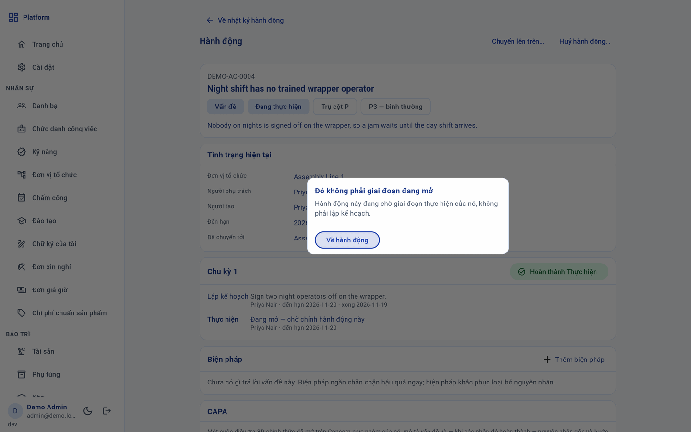

***Ảnh 04.4.** Mỗi giai đoạn PDCA đóng bằng một câu ghi lại việc đã làm; đóng giai đoạn là thứ làm Hành động tiến lên, không phải một cột trạng thái sửa tay.*

---

## Chuyển Hành động lên trên

| Hạng mục | Nội dung |
| --- | --- |
| **Công việc** | Báo cho Đơn vị tổ chức cấp trên biết về một Hành động đang mắc — hộp thoại **Chuyển {số} lên trên**, `/actions/:id/escalate`. Phiếu 04.5. |
| **Ai thao tác được** | `ACT_CHANGE` — mọi vai trò, cộng phạm vi Đơn vị tổ chức. |
| **Vật tư, dữ liệu có trước** | Hành động còn mở; Đơn vị tổ chức của nó **có đơn vị cấp trên** trong cùng Nhà máy. |
| **Công cụ** | Danh sách đơn vị **cấp trên** kèm ghi chú "{mã} · đơn vị gần nhất ở trên"; nút **Chuyển lên trên**, **Để sau**. |
| **An toàn** | Hành động **vẫn ở nguyên chỗ cũ**, giữ người phụ trách và chu kỳ. Đây là **yêu cầu cấp trên biết về nó**, không phải chuyển giao — dạy nhầm điều này thì không ai nhận việc. |
| **Thiết bị đào tạo** | Ảnh 04.5 |
| **Chủ tài liệu · Rev · Ngày · Trang** | Ban Lean Nền tảng · Rev 2 · 2026-11-15 · 04.5 |

| Các bước chính | Điểm then chốt | Vì sao | Minh hoạ |
| --- | --- | --- | --- |
| **1.** Mở **Chuyển lên trên…** trên Chi tiết Hành động | [Hỏng] Nút chỉ có khi đơn vị của Hành động **có cấp trên**; ở đơn vị cao nhất hộp thoại nói **Không có ai ở trên đơn vị này** | Ở cấp cao nhất không có gì để chuyển — đó là trạng thái đúng, không phải thiếu quyền | — |
| **2.** Chọn đơn vị sẽ nhận trong danh sách cấp trên | [Hỏng] Danh sách chỉ có đơn vị **ở trên**, không có mọi đơn vị — chuyển ngang cấp không phải là chuyển lên | Chọn một đơn vị không phải cấp trên là gửi việc đi sai nhánh và mất dấu | Ảnh 04.5 |
| **3.** Bấm **Chuyển lên trên** | [An toàn] Hành động **không đổi chỗ, không đổi người phụ trách, không đổi chu kỳ** — chỉ cấp trên được báo | Người đào tạo phải nói đúng câu này: chuyển lên là **báo**, không phải **giao**. Ai tưởng là giao sẽ chờ một việc không bao giờ được nhận | — |

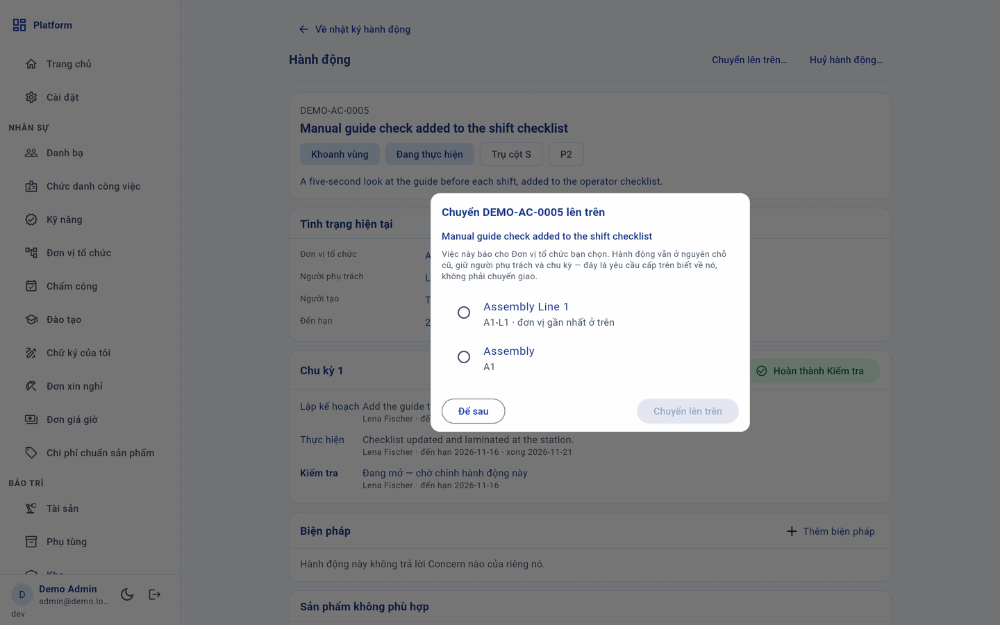

***Ảnh 04.5.** Danh sách đơn vị cấp trên kèm ghi chú đơn vị nào là đơn vị gần nhất ở trên; chọn một đơn vị rồi bấm **Chuyển lên trên**.*

---

## Huỷ một Hành động

| Hạng mục | Nội dung |
| --- | --- |
| **Công việc** | Kết thúc một Hành động không còn đúng, để lại dấu trên nhật ký — hộp thoại **Huỷ {số}?**, `/actions/:id/cancel`. Phiếu 04.6. |
| **Ai thao tác được** | `ACT_CHANGE` — mọi vai trò, cộng phạm vi Đơn vị Tổ chức. |
| **Vật tư, dữ liệu có trước** | Hành động **chưa đóng** và **chưa bị huỷ**; hộp thoại từ chối cả hai trường hợp bằng một câu riêng. |
| **Công cụ** | Ô **Lý do (không bắt buộc)**; gợi ý **Nêu nhầm, bị trùng, hoặc đã bị việc khác vượt qua**; nút **Huỷ hành động**, **Để nguyên**. |
| **An toàn** | Hành động đã huỷ **vẫn nằm trong nhật ký**. Xoá dấu một vấn đề đã nêu là điều nhật ký không cho phép — huỷ không phải xoá. |
| **Thiết bị đào tạo** | Ảnh 04.6 |
| **Chủ tài liệu · Rev · Ngày · Trang** | Ban Lean Nền tảng · Rev 2 · 2026-11-15 · 04.6 |

| Các bước chính | Điểm then chốt | Vì sao | Minh hoạ |
| --- | --- | --- | --- |
| **1.** Mở **Huỷ hành động…** trên Chi tiết Hành động | [Dễ] Hộp thoại nói trước hậu quả: kết thúc hồ sơ mà không khẳng định đã làm được gì | Người bấm cần biết mình đang kết thúc việc gì trước khi bấm | — |
| **2.** Ghi **Lý do (không bắt buộc)** — nêu nhầm, bị trùng, hoặc đã bị việc khác vượt qua | [An toàn] Lý do **không bắt buộc** nhưng là thứ duy nhất người sau đọc được; để trống thì dòng chỉ có chữ "đã huỷ" | Sáu tháng sau, một dòng huỷ không lý do là một vấn đề không ai giải thích được | Ảnh 04.6 |
| **3.** Bấm **Huỷ hành động** | [Hỏng] Dòng **vẫn còn** trên nhật ký, ở trạng thái đã huỷ, kèm lý do | Đây là điều làm nhật ký đáng tin: không có đường nào xoá một vấn đề đã nêu | — |

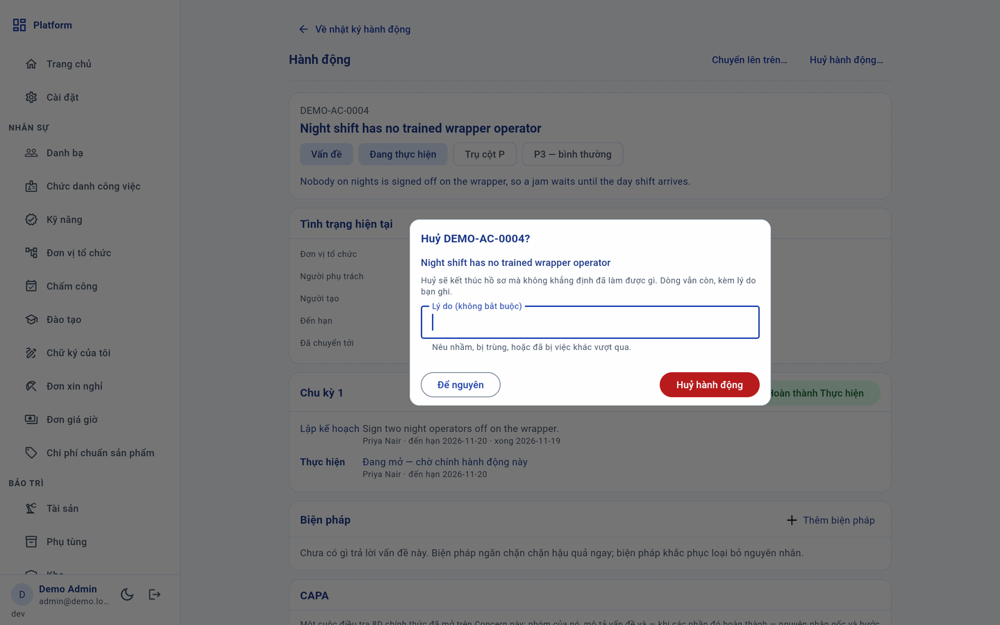

***Ảnh 04.6.** Ô **Lý do (không bắt buộc)** mang gợi ý nêu nhầm, bị trùng, hoặc đã bị việc khác vượt qua; huỷ vẫn giữ dấu việc đã nêu.*

---

## Thêm một biện pháp

| Hạng mục | Nội dung |
| --- | --- |
| **Công việc** | Mở một biện pháp trên Concern, chọn đó là khoanh vùng, khắc phục hay phòng ngừa, và giao nó cho một người — hộp thoại **Thêm khoanh vùng** / **Thêm biện pháp khắc phục** / **Thêm hành động phòng ngừa**, `/actions/:id/measures/:measureType/new`. Phiếu 04.7. |
| **Ai thao tác được** | `ACT_MEASURE` — mọi vai trò, cộng phạm vi Đơn vị tổ chức. |
| **Vật tư, dữ liệu có trước** | Concern đang mở; người sẽ nhận biện pháp đã có hồ sơ Nhân viên. |
| **Công cụ** | Ô **Sẽ làm gì**, **Chi tiết (không bắt buộc)**, **Người phụ trách (không bắt buộc)**, **Đến hạn (không bắt buộc)**, **Mức ưu tiên**, **Công việc này diễn ra ở đâu**; nút **Thêm {loại}** (tên loại đã chọn, viết thường: *Thêm khoanh vùng*). |
| **An toàn** | **Khoanh vùng** (containment) ≠ **Biện pháp khắc phục** (countermeasure) ≠ **Hành động phòng ngừa** (preventive). Chọn sai loại làm báo cáo CAPA thiếu D3 hoặc D5–D6, và bản sửa không chạm tới nguyên nhân. |
| **Thiết bị đào tạo** | Ảnh 04.7 |
| **Chủ tài liệu · Rev · Ngày · Trang** | Ban Lean Nền tảng · Rev 2 · 2026-11-15 · 04.7 |

| Các bước chính | Điểm then chốt | Vì sao | Minh hoạ |
| --- | --- | --- | --- |
| **1.** Trên Chi tiết Hành động, bấm **Thêm biện pháp** và chọn **loại** | [An toàn] **Khoanh vùng** chặn hậu quả ngay; **Biện pháp khắc phục** loại bỏ nguyên nhân; **Hành động phòng ngừa** giữ nó không quay lại ở chỗ khác | Đây là chỗ hay lẫn nhất trong cả nhóm, và là chỗ quyết định CAPA có D3 hay D5–D6 | Ảnh 04.7 |
| **2.** Ghi **Sẽ làm gì** — câu người nhận đọc | [Dễ] Viết như một việc, không phải như một mong muốn | Biện pháp không nói được "làm gì" thì không ai làm được nó | — |
| **3.** Chọn **Người phụ trách**, **Đến hạn**, **Mức ưu tiên** | [Hỏng] Mỗi biện pháp là **một Hành động riêng** và phải chạy hết chu kỳ của nó tới giai đoạn **Chuẩn hoá** | Ghi biện pháp xong không có nghĩa là đã làm; nó chỉ mở một Hành động con | — |
| **4.** Chọn **Công việc này diễn ra ở đâu** | [An toàn] Để trống thì biện pháp được ghi tại Đơn vị tổ chức **của Concern**; một sửa đổi thuộc nơi khác — kho, nhà cung cấp — có thể nêu đơn vị đó thay vào | Ghi nhầm đơn vị là giao việc cho người không thấy nó, hoặc cho người không có quyền ở đó | — |
| **5.** Bấm nút **Thêm {loại}** | [Dễ] Nút mang đúng tên loại đã chọn (*Thêm khoanh vùng*, *Thêm biện pháp khắc phục*), nên đọc nút trước khi bấm là một lần kiểm tra | Bấm xong mới nhận ra chọn nhầm loại thì phải huỷ một Hành động con vừa mở | — |

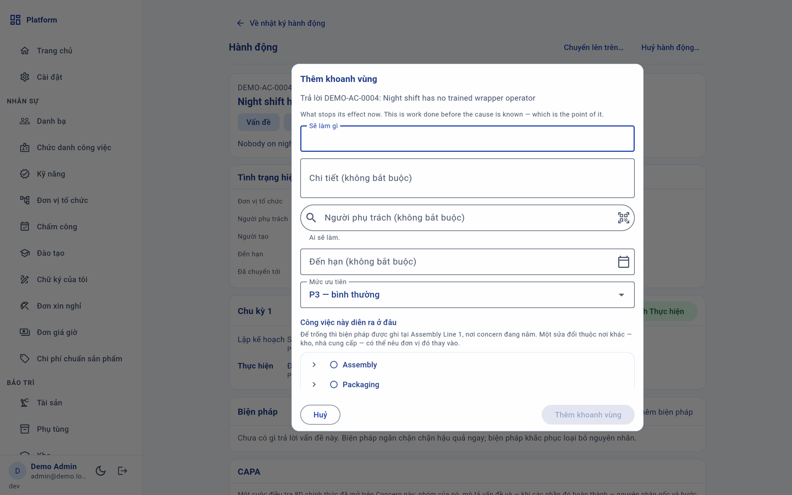

***Ảnh 04.7.** Biện pháp ghi đủ **Sẽ làm gì**, **Chi tiết**, **Người phụ trách**, **Đến hạn**, **Mức ưu tiên** và **Công việc này diễn ra ở đâu**; đây là biện pháp khoanh vùng của một Concern.*

---

## CAPA

| Hạng mục | Nội dung |
| --- | --- |
| **Công việc** | Đọc các cuộc điều tra đã mở trên các Concern, và **bước kiểm tra hiệu quả** mà mỗi cuộc đang chờ — màn hình **CAPA**, `/actions/capas`. Phiếu 04.8. |
| **Ai thao tác được** | Đọc: `ACT_CAPA_DISPLAY` — mọi vai trò. |
| **Vật tư, dữ liệu có trước** | Đã có ít nhất một CAPA được mở trên một Concern. |
| **Công cụ** | Ô lọc **Đơn vị tổ chức**, **Trạng thái**, và ô **Kiểm tra quá hạn**; mỗi dòng đọc **Nhóm**, số người trong nhóm, và ngày bước kiểm tra đến hạn. |
| **An toàn** | Cột **Kiểm tra quá hạn** là việc gấp nhất trong cả danh sách: quá hạn nghĩa là đã qua thời hạn chứng minh vấn đề không quay lại, và không ai còn đang kiểm tra. |
| **Thiết bị đào tạo** | Ảnh 04.8 |
| **Chủ tài liệu · Rev · Ngày · Trang** | Ban Lean Nền tảng · Rev 2 · 2026-11-15 · 04.8 |

| Các bước chính | Điểm then chốt | Vì sao | Minh hoạ |
| --- | --- | --- | --- |
| **1.** Bật **Kiểm tra quá hạn** trước, rồi mới lọc **Đơn vị tổ chức** và **Trạng thái** | [Hỏng] **Kiểm tra quá hạn** là việc gấp nhất — bật nó trước khi thu hẹp đơn vị | Lọc theo đơn vị trước là bỏ sót đúng những CAPA đã trễ hạn ở đơn vị khác | Ảnh 04.8 |
| **2.** Đọc từng dòng: **Nhóm**, số người trong nhóm, và ngày kiểm tra | [Dễ] Dòng nói **đến hạn vào** ngày nào, hoặc **đã đến hạn vào** ngày nào | Một CAPA không có ngày là một CAPA chưa có mốc để trễ | Ảnh 04.8 |
| **3.** Bấm một dòng để mở **Chi tiết CAPA** (phiếu 04.10) | [Dễ] Danh sách là để đọc và chọn việc gấp; mọi thao tác nằm ở màn hình chi tiết | Người mới tìm nút ghi kết quả trên danh sách và kết luận không có quyền | — |

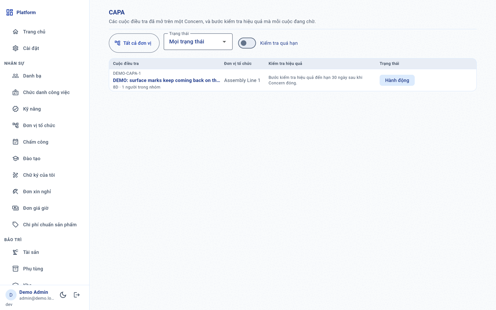

***Ảnh 04.8.** Mọi cuộc điều tra trên Nền tảng và lần kiểm tra hiệu quả mà mỗi cuộc đang chờ.*

---

## Mở một CAPA

| Hạng mục | Nội dung |
| --- | --- |
| **Công việc** | Quyết định rằng một Concern cần điều tra nguyên nhân gốc, và mở cuộc điều tra 8D — hộp thoại **Mở CAPA trên {số}**, `/actions/:id/capa`. Phiếu 04.9. |
| **Ai thao tác được** | `ACT_CAPA_OPEN` **và thẩm quyền Chất lượng** ở Đơn vị tổ chức của Concern. Thiếu thẩm quyền thì hộp thoại nói **Mở CAPA cần thẩm quyền** thay vì cho mở. |
| **Vật tư, dữ liệu có trước** | Concern đang mở và **chưa có CAPA** nào; nhóm điều tra đã có hồ sơ Nhân viên. |
| **Công cụ** | Ô **Vấn đề (không bắt buộc)**, khối **Nhóm**, **Trưởng nhóm (không bắt buộc)**, **Thêm thành viên nhóm (không bắt buộc)**; nút **Mở CAPA**. |
| **An toàn** | **Trưởng nhóm không được tự ghi bước kiểm tra hiệu quả của CAPA mình dẫn** — máy chủ từ chối. Cần người thứ hai xác nhận bản sửa có giữ được, nên chọn trưởng nhóm là chọn luôn ai **không** kiểm tra được. |
| **Thiết bị đào tạo** | Ảnh 04.9 |
| **Chủ tài liệu · Rev · Ngày · Trang** | Ban Lean Nền tảng · Rev 2 · 2026-11-15 · 04.9 |

| Các bước chính | Điểm then chốt | Vì sao | Minh hoạ |
| --- | --- | --- | --- |
| **1.** Trên Chi tiết Hành động, bấm **Mở một CAPA…** | [Hỏng] Nút mở CAPA chỉ chạy khi Concern **chưa có CAPA**; Concern đã có thì màn hình dẫn thẳng sang cuộc điều tra đó | Mỗi Concern chỉ có một cuộc điều tra — mở lần hai là mở một cuộc điều tra không bao giờ đóng | — |
| **2.** Ghi **Vấn đề (không bắt buộc)** — mô tả vấn đề bằng lời của cả nhóm | [Dễ] Để trống vẫn mở được: màn hình điền sẵn nội dung của Concern | Mô tả là thứ cả nhóm đọc thay cho nhau, nên viết một lần cho đúng | Ảnh 04.9 |
| **3.** Chọn **Nhóm** và **Trưởng nhóm (không bắt buộc)** từ Danh bạ Nhân viên | [An toàn] Trưởng nhóm **không được** ghi bước kiểm tra hiệu quả của CAPA mình dẫn | Đây là luật của máy chủ, không phải khuyến nghị: cần người thứ hai xác nhận bản sửa có giữ được | Ảnh 04.9 |
| **4.** Bấm **Mở CAPA** | [Dễ] Mở CAPA **không** đóng Concern — Concern vẫn chạy tiếp và phải đóng **trước** khi bước kiểm tra đến hạn | Truyền đạt nhầm điều này là dạy rằng điều tra thay thế được việc sửa | — |

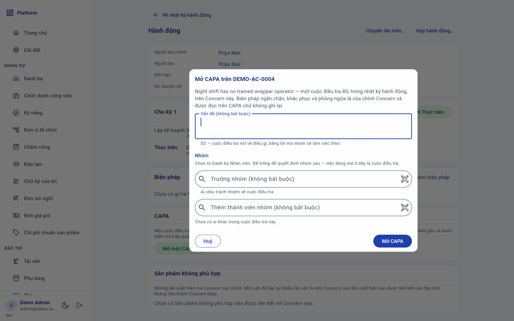

***Ảnh 04.9.** CAPA mở từ chính Hành động, nên vấn đề và người liên quan đi theo; hộp thoại chỉ hỏi ai tham gia.*

---

## Chi tiết CAPA

| Hạng mục | Nội dung |
| --- | --- |
| **Công việc** | Điều tra: vì sao vấn đề xảy ra, vì sao nó không được phát hiện, và chứng minh bản sửa giữ được — màn hình **Chi tiết CAPA**, `/actions/capas/:id`. Phiếu 04.10. |
| **Ai thao tác được** | Đọc: `ACT_CAPA_DISPLAY`. Ghi nguyên nhân, Why, kết luận: `ACT_CAPA_VERIFY` (+ phạm vi ghi ở Đơn vị tổ chức của CAPA, hoặc là thành viên nhóm). Ghi bước kiểm tra: `ACT_CAPA_EFFECTIVENESS` **và** thẩm quyền Chất lượng. |
| **Vật tư, dữ liệu có trước** | CAPA đã mở (phiếu 04.9); danh mục hạng mục 6M có sẵn trong màn hình. |
| **Công cụ** | Khối **Nhóm**, **Vấn đề**; biểu đồ xương cá với **Nguyên nhân ứng viên**; các nút **Ghi một nguyên nhân**, **Kết luận**, **Đây là nguyên nhân gốc**, **Đổi kết luận**, **Bỏ đánh dấu nguyên nhân gốc**, **Thêm một Why**, **Chuyển lên trước trong chuỗi**, **Chuyển ra sau trong chuỗi**, **Ghi bước kiểm tra hiệu quả**, **Báo cáo**. |
| **An toàn** | Ứng viên **không** phải nguyên nhân gốc. Ghi thẳng "nguyên nhân gốc" ở bước ghi ứng viên là bỏ qua bước có bằng chứng, và cả cuộc điều tra thành một câu chuyện kể. |
| **Thiết bị đào tạo** | Ảnh 04.10 |
| **Chủ tài liệu · Rev · Ngày · Trang** | Ban Lean Nền tảng · Rev 2 · 2026-11-15 · 04.10 |

| Các bước chính | Điểm then chốt | Vì sao | Minh hoạ |
| --- | --- | --- | --- |
| **1.** Đọc **Nhóm** và **Vấn đề** trước khi ghi bất cứ gì | [Dễ] Vấn đề ở đây là câu cả nhóm thống nhất, không phải nội dung của Concern chép lại | Điều tra một câu hỏi khác với vấn đề đã nêu là điều tra sai chỗ | Ảnh 04.10 |
| **2.** Ghi **nguyên nhân ứng viên** dưới hạng mục 6M, kèm **Bằng chứng** | [An toàn] Ứng viên **không** phải nguyên nhân gốc — nó chỉ là cái nhóm nghi ngờ, và phải có bằng chứng | Ghi thẳng "nguyên nhân gốc" ở bước này làm hỏng cả cuộc điều tra | Ảnh 04.10 |
| **3.** Khi có bằng chứng: **Kết luận** → **Đây là nguyên nhân gốc** | [Dễ] Đổi ý được: **Đổi kết luận** và **Bỏ đánh dấu nguyên nhân gốc** | Một điều tra tốt đổi kết luận khi bằng chứng đổi — không phải một lần phán rồi giữ | — |
| **4.** Chạy **hai** chuỗi Why: *vì sao vấn đề xảy ra* và *vì sao nó không được phát hiện* (phiếu 04.11) | [An toàn] Thiếu chuỗi thứ hai là thiếu câu trả lời "tại sao QC không bắt được" | Một bản sửa không trả lời được vì sao lỗi lọt qua thì lỗi sau lọt qua y như vậy | — |
| **5.** Đọc **Những gì Concern đã làm**: D3 khoanh vùng, D5–D6 khắc phục, D7 phòng ngừa | [Hỏng] Đây là nơi **đọc**, không phải nơi **ghi lại** — chúng được ghi trên Concern | Ghi trùng ở đây tạo hai bộ biện pháp khác nhau, và báo cáo 8D in ra cả hai | — |
| **6.** Khi Concern đã đóng: **Ghi bước kiểm tra hiệu quả** (phiếu 04.13) | [Hỏng] Người ghi **không được là trưởng nhóm**, và phải có thẩm quyền Chất lượng ở Đơn vị tổ chức | Cần người thứ hai, sau một thời gian — bước kiểm tra mà trưởng nhóm tự ghi là tự chấm bài | — |
| **7.** Bấm **Báo cáo** để đọc hoặc in bản 8D (phiếu 04.14) | [Dễ] Báo cáo mở ngoài khung điều hướng, nên in là ra đúng tờ báo cáo | In từ màn hình điều tra là in cả thanh điều hướng — sửa bằng cách mở đúng đường dẫn | — |

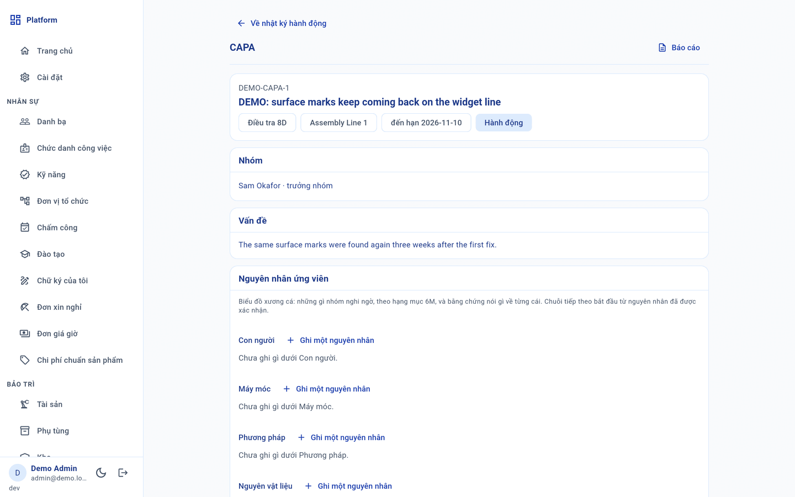

***Ảnh 04.10.** Biểu đồ xương cá với bốn nhóm nguyên nhân: mỗi nhánh là một chỗ ghi nguyên nhân ứng viên, và mỗi nguyên nhân phải có phán quyết.*

> **Điều kiện đóng CAPA — nói đúng câu này khi đào tạo.** CAPA chỉ đóng khi **cả
> hai** chuỗi đều có nguyên nhân gốc đã xác nhận, **Concern đã đóng**, **và** một
> người có thẩm quyền Chất lượng **không** phải trưởng nhóm đã xác minh — **sau một
> thời gian** — rằng vấn đề không quay lại.

> **Vì sao.** Đây là điểm khác biệt giữa "đã sửa" và "sửa được". Nếu trưởng nhóm tự
> xác nhận ngay hôm sau, câu trả lời luôn là "ổn rồi" và vấn đề quay lại sau ba tuần.

---

## Chuỗi Why

| Hạng mục | Nội dung |
| --- | --- |
| **Công việc** | Viết từng bước lập luận từ nguyên nhân đã xác nhận xuống, trong đúng chuỗi — hộp thoại **Thêm một Why**, `/actions/capas/:id/whys/:chain/new`. Phiếu 04.11. |
| **Ai thao tác được** | `ACT_CAPA_VERIFY`, cộng phạm vi ghi ở Đơn vị tổ chức của CAPA, hoặc là thành viên nhóm điều tra. |
| **Vật tư, dữ liệu có trước** | Đã có ít nhất một nguyên nhân **đã xác nhận** để bắt đầu chuỗi từ đó. |
| **Công cụ** | Nút **Thêm một Why**; ô **Why** và **Bằng chứng**; **Sửa Why {số}** / **Xoá Why {số}?** trên từng dòng; **Chuyển lên trước trong chuỗi** / **Chuyển ra sau trong chuỗi**. |
| **An toàn** | Có **hai** chuỗi — *vì sao xảy ra* và *vì sao không phát hiện*. Thêm Why vào nhầm chuỗi làm cuộc điều tra trả lời một câu hỏi khác, và chuỗi kia không bao giờ kết thúc. |
| **Thiết bị đào tạo** | Ảnh 04.11 |
| **Chủ tài liệu · Rev · Ngày · Trang** | Ban Lean Nền tảng · Rev 2 · 2026-11-15 · 04.11 |

| Các bước chính | Điểm then chốt | Vì sao | Minh hoạ |
| --- | --- | --- | --- |
| **1.** Bấm **Thêm một Why** trong **đúng chuỗi** | [An toàn] Hai chuỗi: *vì sao vấn đề xảy ra* và *vì sao nó không được phát hiện* | Chuỗi thứ hai là chuỗi chứng minh hệ kiểm soát có lỗ — thiếu nó thì vấn đề quay lại | — |
| **2.** Ghi câu **Why** — mỗi câu phải trả lời được "vì sao" cho câu trên nó | [Dễ] Nói sao cho người sau theo được, không phải cho gọn | Một chuỗi Why mà mỗi câu không nối vào câu trước là một danh sách, không phải một lập luận | Ảnh 04.11 |
| **3.** Ghi **Bằng chứng** cho câu đó | [Hỏng] Why không có bằng chứng là một phỏng đoán được xếp thứ tự | Điều tra dựa trên phỏng đoán cho ra bản sửa đúng cho một nguyên nhân không tồn tại | — |
| **4.** Sắp lại: **Chuyển lên trước trong chuỗi** / **Chuyển ra sau trong chuỗi**; bỏ một Why bằng **Xoá Why {số}?** | [Dễ] Bỏ một Why thì các Why sau nó dồn lên một bậc, phần còn lại không bị đụng | Sửa thứ tự là việc bình thường của một cuộc điều tra đang nghĩ, không phải dấu hiệu làm sai | — |

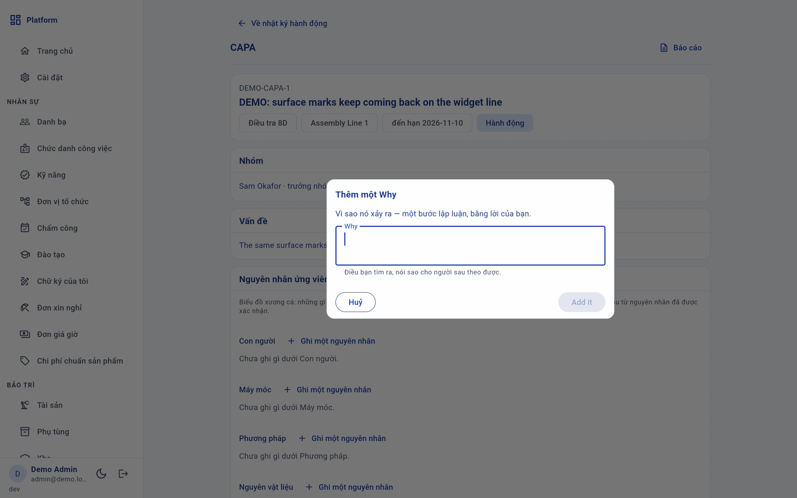

***Ảnh 04.11.** Một **Why** là một bước lập luận: câu Why phải trả lời được "vì sao" cho câu trên nó, và phải kèm **Bằng chứng**.*

---

## Nguyên nhân và kết luận

| Hạng mục | Nội dung |
| --- | --- |
| **Công việc** | Ghi nguyên nhân ứng viên theo hạng mục 6M, phán quyết nguyên nhân gốc, và bắt đầu chuỗi Why từ đó — `/actions/capas/:id/causes/:category/new`. Phiếu 04.12. |
| **Ai thao tác được** | `ACT_CAPA_VERIFY`, cộng phạm vi ghi ở Đơn vị tổ chức của CAPA, hoặc là thành viên nhóm điều tra. |
| **Vật tư, dữ liệu có trước** | CAPA đang chạy; hạng mục 6M có sẵn (Con người, Máy, Vật liệu, Phương pháp, Đo lường, Môi trường). |
| **Công cụ** | **Ghi một nguyên nhân**, **Nguyên nhân ứng viên**, **Bằng chứng**, **Ghi kết luận**, **Đây là nguyên nhân gốc**, **Đổi kết luận**, **Bỏ đánh dấu nguyên nhân gốc**, **Bắt đầu chuỗi**, **Sửa nguyên nhân**, **Xoá nguyên nhân này?**. |
| **An toàn** | Chỉ **một** nguyên nhân mỗi chuỗi được là nguyên nhân gốc. Bỏ đánh dấu là bỏ **vĩnh viễn** khỏi nhánh, và một chuỗi bắt đầu từ nó vẫn giữ Why đầu tiên. |
| **Thiết bị đào tạo** | Ảnh 04.12 |
| **Chủ tài liệu · Rev · Ngày · Trang** | Ban Lean Nền tảng · Rev 2 · 2026-11-15 · 04.12 |

| Các bước chính | Điểm then chốt | Vì sao | Minh hoạ |
| --- | --- | --- | --- |
| **1.** **Ghi một nguyên nhân** dưới một **hạng mục 6M** | [Hỏng] Hạng mục là cái làm báo cáo 8D đọc được — đừng dồn hết vào "Con người" | Một xương cá chỉ có nhánh Con người là dấu hiệu cuộc điều tra dừng ở chỗ dễ nhất | Ảnh 04.12 |
| **2.** Ghi **Bằng chứng** cho nguyên nhân đó | [An toàn] Ứng viên không có bằng chứng thì **không kết luận được** | Nút kết luận chỉ mở khi có bằng chứng — đó là máy chủ giữ luật, không phải người dùng | — |
| **3.** **Ghi kết luận** → **Đây là nguyên nhân gốc** khi bằng chứng đã đủ | [Dễ] Một nguyên nhân đã xác nhận thì **Bắt đầu chuỗi** được từ nó | Đây là sợi dây nối xương cá với chuỗi Why: không có nó thì hai nửa điều tra rời nhau | — |
| **4.** Đổi ý: **Đổi kết luận**, hoặc **Bỏ đánh dấu nguyên nhân gốc** | [Hỏng] Bỏ đánh dấu là bỏ **vĩnh viễn** khỏi nhánh, và một chuỗi bắt đầu từ nó vẫn giữ Why đầu tiên | Đây là thao tác có hậu quả không lùi được — nói trước khi bấm | — |

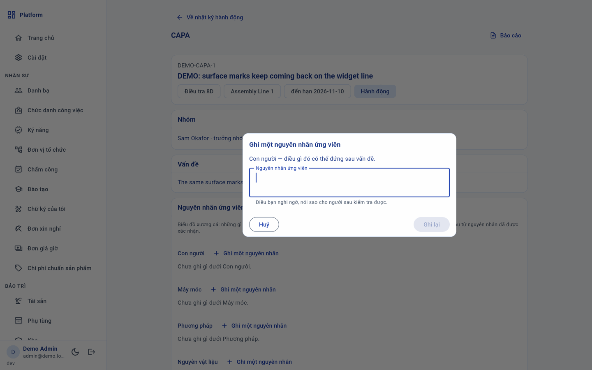

***Ảnh 04.12.** Nguyên nhân ứng viên ghi dưới một hạng mục 6M — ở đây là **Con người** — kèm bằng chứng, rồi mới kết luận.*

---

## Ghi bước kiểm tra hiệu quả

| Hạng mục | Nội dung |
| --- | --- |
| **Công việc** | Xác nhận, sau một thời gian, rằng bản sửa giữ được — `/actions/capas/:id/effectiveness`. Phiếu 04.13. |
| **Ai thao tác được** | `ACT_CAPA_EFFECTIVENESS` **và** thẩm quyền Chất lượng ở Đơn vị tổ chức của CAPA. **Trưởng nhóm CAPA không ghi được** — máy chủ từ chối bằng một câu riêng. |
| **Vật tư, dữ liệu có trước** | **Concern đã đóng**; cả hai chuỗi đã có nguyên nhân gốc đã xác nhận. |
| **Công cụ** | Khối **Người khác phải kiểm tra việc này** / **Không phải phần bạn được quyết**; ô **Bước kiểm tra tìm thấy gì**; cặp chọn giữ được / không giữ được. |
| **An toàn** | Trả lời "không giữ được" **không phải thất bại của bạn** — đó là kết quả đúng và cần thiết, và nó mở lại Concern ở chu kỳ tiếp theo. Ghi "giữ được" khi chưa kiểm tra là làm hỏng đúng thứ bước này tồn tại để bảo vệ. |
| **Thiết bị đào tạo** | Ảnh 04.13 |
| **Chủ tài liệu · Rev · Ngày · Trang** | Ban Lean Nền tảng · Rev 2 · 2026-11-15 · 04.13 |

| Các bước chính | Điểm then chốt | Vì sao | Minh hoạ |
| --- | --- | --- | --- |
| **1.** Chờ **Concern đóng** | [Hỏng] Bước kiểm tra đến hạn **{n} ngày sau khi Concern đóng**; trước đó chưa có mốc, và hộp thoại nói đúng điều đó | Kiểm tra trước khi Concern đóng là kiểm tra khi bản sửa chưa chạy đủ lâu | — |
| **2.** Đọc câu cảnh báo của màn hình trước khi ghi | [An toàn] Nếu bạn là trưởng nhóm, màn hình nói **Người khác phải kiểm tra việc này** và nói vì sao | Bước kiểm tra mà trưởng nhóm tự ghi là cây nhà lá vườn — cần người thứ hai | — |
| **3.** Ghi **Bước kiểm tra tìm thấy gì** — bằng chứng cho kết luận | [Dễ] Đây là thứ người đọc sau cân nhắc được, không phải một câu kết | Một bước kiểm tra không có bằng chứng là một ý kiến có ngày tháng | Ảnh 04.13 |
| **4.** Trả lời giữ được hay không | [An toàn] **Không giữ được** thì Concern **mở lại ở chu kỳ tiếp theo** — công việc nằm trên màn hình của chính Concern đó | Ghi đúng để Concern mở lại là cách duy nhất vấn đề quay lại được xử lý | — |

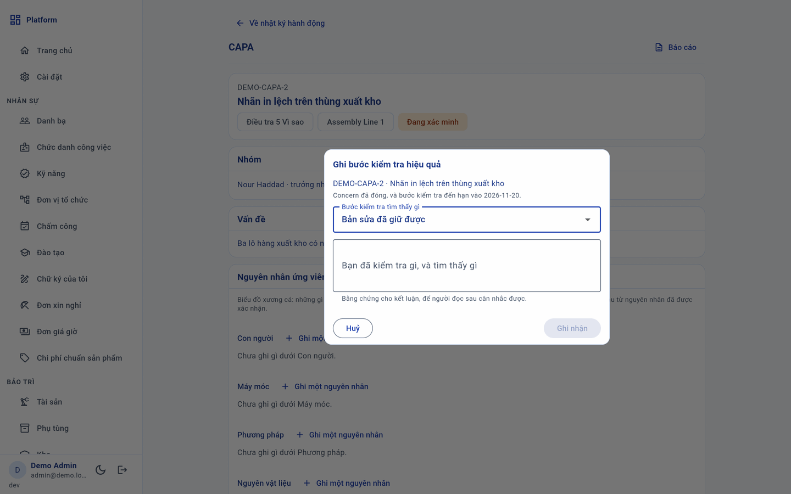

***Ảnh 04.13.** Bước kiểm tra hiệu quả: chọn giữ được hay không giữ được, rồi ghi **Bước kiểm tra tìm thấy gì** làm bằng chứng cho kết luận.*

---

## Báo cáo CAPA

| Hạng mục | Nội dung |
| --- | --- |
| **Công việc** | Đọc hoặc in bản 8D của một cuộc điều tra — màn hình **Báo cáo CAPA**, `/actions/capas/:id/report`. Phiếu 04.14. |
| **Ai thao tác được** | `ACT_CAPA_DISPLAY` — mọi vai trò. |
| **Vật tư, dữ liệu có trước** | CAPA đã mở; càng nhiều phần đã ghi thì báo cáo càng đầy. |
| **Công cụ** | Nút **Báo cáo** trên Chi tiết CAPA; trình duyệt tự in bằng **Ctrl+P** — không có nút in riêng. |
| **An toàn** | Báo cáo mở **ngoài khung điều hướng**. In từ màn hình điều tra là in cả thanh điều hướng, và tờ 8D mất phần đầu trang. |
| **Thiết bị đào tạo** | Ảnh 04.14 |
| **Chủ tài liệu · Rev · Ngày · Trang** | Ban Lean Nền tảng · Rev 2 · 2026-11-15 · 04.14 |

| Các bước chính | Điểm then chốt | Vì sao | Minh hoạ |
| --- | --- | --- | --- |
| **1.** Bấm **Báo cáo** trên Chi tiết CAPA | [Dễ] Màn hình mở ngoài khung điều hướng, nên nó in ra đúng tờ báo cáo | Đây là đường dẫn duy nhất in được một tờ 8D sạch | Ảnh 04.14 |
| **2.** Đọc lại báo cáo trước khi in: mọi phần đã ghi đều hiện ở đây | [Hỏng] Phần nào còn trống trên báo cáo là phần chưa ghi — không phải lỗi in | Báo cáo là bản kiểm tra cuối cùng của cả cuộc điều tra, miễn phí | Ảnh 04.14 |
| **3.** In bằng **Ctrl+P** của trình duyệt | [Dễ] **Không có nút in riêng** — tìm nút đó là tìm một thứ không tồn tại | Người mới mất vài phút tìm nút in trên một màn hình chỉ để đọc | — |

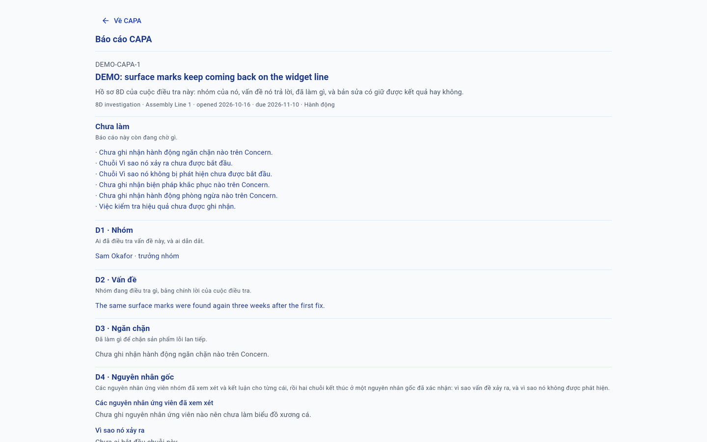

***Ảnh 04.14.** Cùng một cuộc điều tra, in ra thành báo cáo 8D — mở ngoài khung điều hướng nên in là ra đúng tờ báo cáo.*

---

## Bảng tóm tắt phần Hành động

| Việc | Mọi vai trò | Người vận hành | Giám sát | Kỹ sư | Quản lý | Quản trị viên |
| --- | :-: | :-: | :-: | :-: | :-: | :-: |
| Xem Nhật ký hành động | ✓ | ✓ | ✓ | ✓ | ✓ | ✓ |
| Nêu Concern | ✓ | ✓ | ✓ | ✓ | ✓ | ✓ |
| Ghi biện pháp, hoàn thành giai đoạn | ✓ | ✓ | ✓ | ✓ | ✓ | ✓ |
| Chuyển lên trên, huỷ Hành động, sửa liên kết | ✓ | ✓ | ✓ | ✓ | ✓ | ✓ |
| Ghi nguyên nhân gốc, Why, kết luận | ✓ | ✓ | ✓ | ✓ | ✓ | ✓ |
| **Mở CAPA** | **cần thẩm quyền Chất lượng** | | | | | |
| **Ghi bước kiểm tra hiệu quả** | **cần thẩm quyền Chất lượng** | | | | | |

Chín mã quyền Hành động đều nằm trên cả sáu vai trò, nên cột nào cũng ✓. Cái thật sự
chặn là **phạm vi Đơn vị tổ chức** — và với **mở CAPA** cùng **bước kiểm tra hiệu
quả** là **thẩm quyền Chất lượng**, thứ được cấp riêng trong màn hình **Tài khoản**
(`orgUnitPickerQualityAuthority`). Hai dòng cuối là hai dòng duy nhất trong nhóm này
mà một vai trò không tự quyết được.
