# 05 · Chất lượng

Nhóm **Chất lượng** ghi lại cái không đạt chuẩn và điều gì đã làm với nó. Có **hai
cửa vào** cùng một việc, và người đào tạo phải phân biệt rõ:

- **Sản phẩm không phù hợp** — phát hiện **bên trong** nhà máy, ở một điểm phát hiện.
- **NCR nhà cung cấp** — phát hiện ở khâu **nhận hàng**, hàng về sai.

Và hai cửa **từ phía khách hàng**: **Khiếu nại khách hàng** (khách báo) — rồi từ đó
mới sinh ra một Sản phẩm không phù hợp.

**Điều đáng nói nhất về quyền ở nhóm này.** Bốn danh mục (Sản phẩm, Mã lỗi, Khách
hàng, Nhà cung cấp) là **chỉ quản trị viên**. Nhưng **ghi nhận** và **xử lý** sản
phẩm không phù hợp, ghi nhận khiếu nại, ghi nhận NCR thì **mọi vai trò** làm được —
vì đó là việc của sàn, và một người vận hành phát hiện hàng lỗi phải ghi được ngay.

**Và bốn quyết định mà không vai trò nào tự quyết.** **Nhượng bộ**, **hạ mức độ**,
**mở lại** và **huỷ vì ghi nhầm** cần **thẩm quyền Chất lượng** ở Đơn vị tổ chức của
bản ghi — không phải một vai trò, mà một quyền cấp riêng trong màn hình **Tài khoản**.
Ghi nhận phương án xử lý cho số hàng đó thì **không** cần: đó là việc ghi sổ.

---

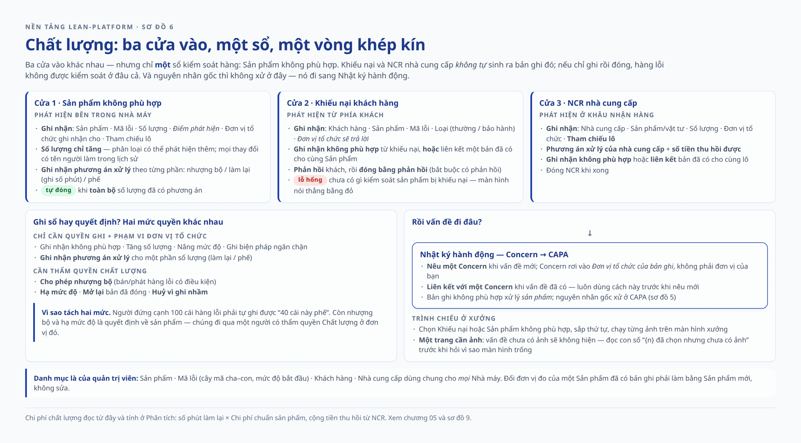

***Sơ đồ 6.** Ba cửa vào (bên trong nhà máy, khách hàng, nhận hàng) nhưng chỉ một sổ kiểm
soát hàng. Khiếu nại và NCR không tự sinh Sản phẩm không phù hợp — phải làm ở bước tiếp.*

---

## Sản phẩm

| Hạng mục | Nội dung |
| --- | --- |
| **Công việc** | Khai báo nhà máy sản xuất gì, và mỗi Sản phẩm được đo bằng gì — màn hình **Sản phẩm**, `/products`. Phiếu 05.1. |
| **Ai thao tác được** | Đọc: `QLT_PRODUCTS_DISPLAY` — mọi vai trò. Ghi: `QLT_PRODUCTS_CHANGE` — **chỉ quản trị viên**. |
| **Vật tư, dữ liệu có trước** | Mã và tên Sản phẩm do nhà máy cấp; đơn vị đo đã thống nhất với sản xuất. |
| **Công cụ** | Nút **Thêm Sản phẩm**, **Điều chỉnh**; ô **Mã**, **Tên**, **Đơn vị đo**, và hộp chọn **Đang làm**. |
| **An toàn** | **Đơn vị đo** là đơn vị mọi số lượng không phù hợp được đếm bằng. Đổi đơn vị đo của một Sản phẩm đã có bản ghi phải làm bằng **Sản phẩm mới**, không sửa — lịch sử chất lượng đã ghi theo đơn vị cũ. |
| **Thiết bị đào tạo** | Ảnh 05.1 |
| **Chủ tài liệu · Rev · Ngày · Trang** | Ban Lean Nền tảng · Rev 2 · 2026-11-15 · 05.1 |

| Các bước chính | Điểm then chốt | Vì sao | Minh hoạ |
| --- | --- | --- | --- |
| **1.** Bấm **Thêm Sản phẩm**: **Mã**, **Tên**, **Đơn vị đo**, giữ **Đang làm** | [An toàn] **Đơn vị đo** là đơn vị mọi số lượng không phù hợp được đếm bằng | Chọn sai ở đây là mọi bản ghi không phù hợp của Sản phẩm này sai đơn vị, và báo cáo chất lượng sai theo | Ảnh 05.1 |
| **2.** Sửa: bấm **Điều chỉnh** trên dòng | [Hỏng] Sửa **tên** thì được; **đơn vị đo** của Sản phẩm đã có bản ghi thì đừng | Lịch sử chất lượng đã ghi theo đơn vị cũ, và không có cách nào đổi lại lịch sử | Ảnh 05.1 |
| **3.** Ngừng dùng: bỏ **Đang làm** trong hộp thoại sửa | [Dễ] Sản phẩm ngừng dùng **không bị xoá** và vẫn đọc được ở bản ghi cũ | Danh mục dùng chung cho **mọi** Nhà máy — thêm một Sản phẩm ở đây là thêm cho toàn Nền tảng | — |

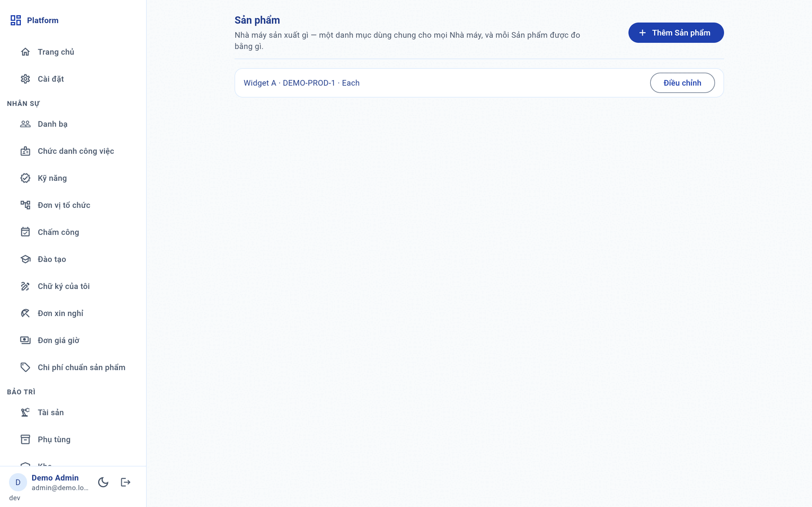

***Ảnh 05.1.** Danh mục Sản phẩm của Nhà máy — thứ mà Sản phẩm không phù hợp và khiếu nại trỏ tới.*

---

## Mã lỗi

| Hạng mục | Nội dung |
| --- | --- |
| **Công việc** | Khai báo các kiểu sai hỏng, mỗi mã có **Mức độ mặc định** riêng — màn hình **Mã lỗi**, `/defect-codes`. Phiếu 05.2. |
| **Ai thao tác được** | Đọc: `QLT_DEFECT_CODES_DISPLAY` — mọi vai trò. Ghi: `QLT_DEFECT_CODES_CHANGE` — **chỉ quản trị viên**. |
| **Vật tư, dữ liệu có trước** | Cây mã lỗi cha đã có; thang mức độ đã thống nhất với chất lượng. |
| **Công cụ** | Nút **Thêm Mã lỗi**, **Điều chỉnh**; ô **Mã**, **Tên**, **Mức độ mặc định**, và **Thuộc {mã cha}** với mục **Cấp cao nhất**. |
| **An toàn** | Giá trị **Mức độ mặc định** là mức độ một bản ghi mới **mặc định** nhận. Đặt cao quá thì mọi bản ghi của mã đó đều bị đẩy lên; đặt thấp quá thì lỗi nặng được ghi như lỗi nhẹ. |
| **Thiết bị đào tạo** | Ảnh 05.2 |
| **Chủ tài liệu · Rev · Ngày · Trang** | Ban Lean Nền tảng · Rev 2 · 2026-11-15 · 05.2 |

| Các bước chính | Điểm then chốt | Vì sao | Minh hoạ |
| --- | --- | --- | --- |
| **1.** Bấm **Thêm Mã lỗi**: **Mã**, **Tên**, **Mức độ mặc định** | [Hỏng] Giá trị **Mức độ mặc định** là mặc định của **mọi** bản ghi mới dùng mã này | Đây là chỗ duy nhất đặt mức độ cho cả một kiểu lỗi; sửa sau phải sửa từng bản ghi | Ảnh 05.2 |
| **2.** Nếu là mã con: chọn **Thuộc {mã cha}**; nếu là mã gốc: để **Cấp cao nhất** | [Dễ] Mã con **kế thừa** ngữ cảnh của mã cha, và cây mã lỗi quyết định báo cáo Pareto đọc được hay không | Dồn mọi lỗi vào một mã gốc là mất khả năng phân tích — cây là thứ làm Pareto có nghĩa | Ảnh 05.2 |
| **3.** Sửa: **Điều chỉnh** | [Hỏng] **Nâng** mức độ trên một bản ghi chỉ cần quyền ghi; **hạ** mức độ là quyết định riêng, cần thẩm quyền Chất lượng (phiếu 05.6) | Dạy nhầm điều này thì người vận hành tưởng mình hạ được mức độ, và bị từ chối giữa ca | — |

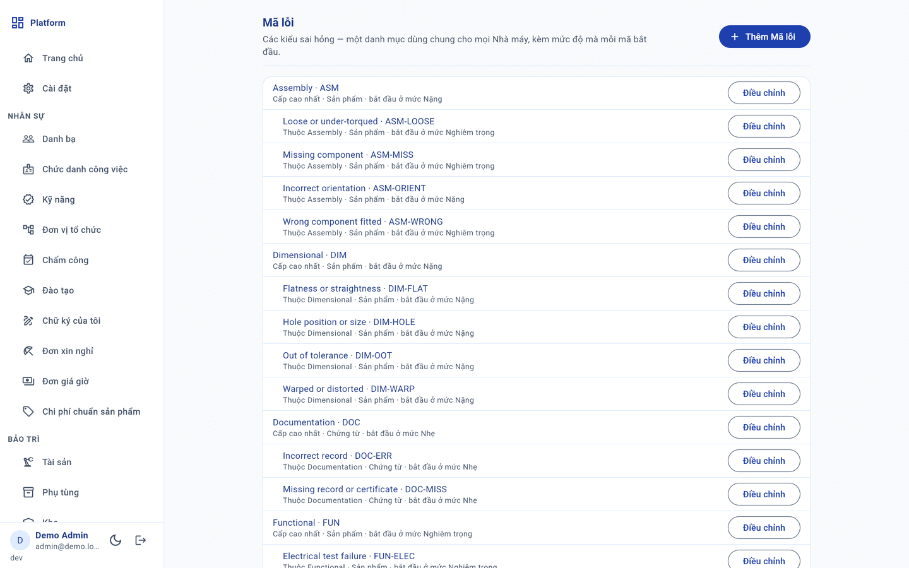

***Ảnh 05.2.** Cây Mã lỗi: mỗi nút là một cách sai, và **mức độ** của nó là giá trị mặc định khi ghi nhận.*

---

## Sản phẩm không phù hợp

| Hạng mục | Nội dung |
| --- | --- |
| **Công việc** | Ghi lại những gì không đạt chuẩn — phát hiện ở đâu, số lượng bao nhiêu — và đọc sổ đó — màn hình **Sản phẩm không phù hợp**, `/non-conformances`, ghi nhận ở `/non-conformances/new`. Phiếu 05.3. |
| **Ai thao tác được** | Đọc: `QLT_NONCONFORMANCES_DISPLAY`. Ghi nhận: `QLT_NONCONFORMANCES_RECORD` — **mọi vai trò**, cộng phạm vi Đơn vị tổ chức. |
| **Vật tư, dữ liệu có trước** | Sản phẩm và Mã lỗi đã có trong danh mục (phiếu 05.1, 05.2); Điểm phát hiện đã được khai. |
| **Công cụ** | Ô **Quét tem**; các ô **Sản phẩm**, **Mã lỗi**, **Số lượng**, **Điểm phát hiện**, **Phát hiện ở đâu**, **Tham chiếu lô (không bắt buộc)**, **Ngăn chặn tức thời (không bắt buộc)**, **Tài sản (không bắt buộc)**, **Phát hiện lúc (không bắt buộc)**, **Chi tiết (không bắt buộc)**; nút **Ghi nhận**. |
| **An toàn** | **Số lượng bị ảnh hưởng không bao giờ giảm.** Phân loại có thể phát hiện nhiều hơn con số ban đầu, nên chỉ **tăng** được, và mọi thay đổi nằm trong **Lịch sử số lượng**. |
| **Thiết bị đào tạo** | Ảnh 05.3, Ảnh 05.4 |
| **Chủ tài liệu · Rev · Ngày · Trang** | Ban Lean Nền tảng · Rev 2 · 2026-11-15 · 05.3 |

| Các bước chính | Điểm then chốt | Vì sao | Minh hoạ |
| --- | --- | --- | --- |
| **1.** Lọc sổ theo **Đơn vị tổ chức**, **Trạng thái**, **Mức độ**, **Mã lỗi**, **Sản phẩm**, **Phát hiện từ ngày** và **Phát hiện đến ngày** | [Dễ] Bộ lọc ngày là **ngày phát hiện**, không phải ngày ghi nhận | Lọc theo ngày ghi nhận là bỏ sót hàng phát hiện hôm qua nhưng ghi hôm nay | Ảnh 05.3 |
| **2.** Bấm **Ghi nhận không phù hợp** và **quét tem** ở ô đầu tiên | [An toàn] Một lần quét điền **Sản phẩm**, **số lô** và **số lượng** cùng lúc — đọc dòng xác nhận bên dưới ô trước khi đi tiếp | Gõ tay ba trường này là ba chỗ để sai, và số lượng sai là con số báo cáo sai | Ảnh 05.4 |
| **3.** Kiểm lại **Sản phẩm**: tem ghi mã không có trong danh sách thì ô để trống và phiếu nói rõ mã đã đọc | [Hỏng] Tem lạ **không** tự tạo Sản phẩm — bạn phải chọn tay trong danh sách | Người mới tưởng phiếu lỗi; thực ra đây là chốt chặn để không có Sản phẩm rác trong danh mục | Ảnh 05.4 |
| **4.** Chọn **Mã lỗi** — mức độ tự điền từ **mức độ bắt đầu** của mã | [Dễ] Mức độ điền sẵn là mặc định, không phải phán quyết; nâng lên được, hạ xuống là quyết định về sau | Hiểu nhầm mức độ mặc định là đã đánh giá xong thì lỗi nặng bị ghi như lỗi nhẹ | Ảnh 05.4 |
| **5.** Chọn **Điểm phát hiện**, rồi **Phát hiện ở đâu** | [An toàn] **Phát hiện ở đâu** quyết định **ai được xử lý** bản ghi này; phiếu nói lại đơn vị ngay dưới ô chọn | Chọn nhầm đơn vị là bản ghi không ai xử lý được, và số hàng nằm đó vô chủ | Ảnh 05.4 |
| **6.** Ghi **Số lượng**, và điền **Tham chiếu lô (không bắt buộc)** nếu có | [Hỏng] **Tham chiếu lô** là thứ duy nhất nối bản ghi với số hàng thật đang nằm trong kho | Không có số lô thì không biết phải giữ lại bao nhiêu hàng, và không truy được lô khác | — |
| **7.** Bấm **Ghi nhận** | [Dễ] Bản ghi mở ở trạng thái chưa có phương án xử lý, và tự đóng khi **toàn bộ** số lượng đã có phương án | Ghi nhận không phải là xử lý — hai việc, hai phiếu (05.5) | — |

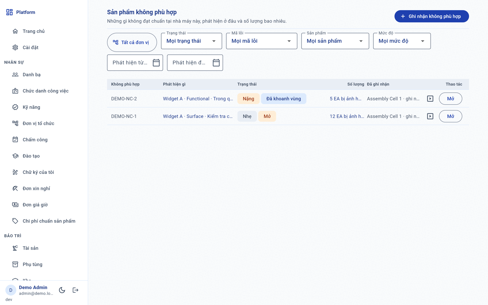

***Ảnh 05.3.** Sổ không phù hợp: cái gì không đạt, phát hiện ở đâu, số lượng bao nhiêu — lọc được theo Đơn vị tổ chức và trạng thái.*

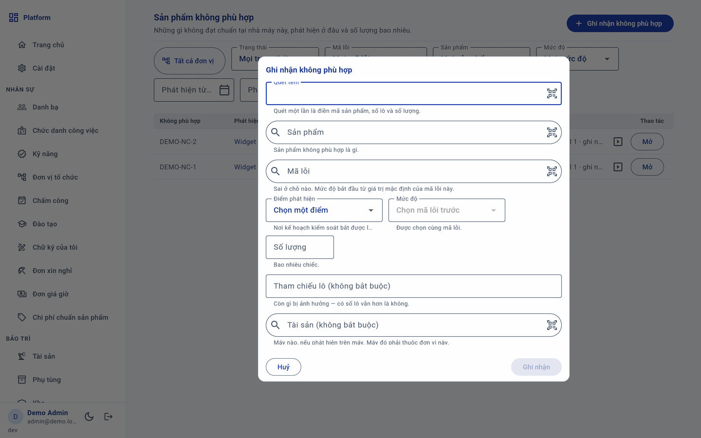

***Ảnh 05.4.** Ô đầu tiên là **quét tem**: một lần quét điền Sản phẩm, số lô và số lượng. Bên dưới là Sản phẩm, Mã lỗi và mức độ.*

---

## Chi tiết Sản phẩm không phù hợp

| Hạng mục | Nội dung |
| --- | --- |
| **Công việc** | Đọc toàn bộ một bản ghi và chọn việc phải làm với số hàng đó — màn hình **Chi tiết Sản phẩm không phù hợp**, `/non-conformances/:id`. Phiếu 05.4. |
| **Ai thao tác được** | Đọc: `QLT_NONCONFORMANCES_DISPLAY`. Tăng số lượng, nâng mức độ/ngăn chặn, ghi phương án xử lý: `QLT_NONCONFORMANCES_RECORD` + quyền sửa ở Đơn vị tổ chức. Nhượng bộ, hạ mức độ, mở lại, huỷ: `QLT_NONCONFORMANCES_DISPOSE` **và** thẩm quyền Chất lượng. |
| **Vật tư, dữ liệu có trước** | Bản ghi đã được ghi nhận (phiếu 05.3). |
| **Công cụ** | Khối **Có thể làm gì**: **Tăng số lượng**, **Nâng mức độ hoặc ngăn chặn**, **Ghi nhận phương án xử lý**, **Cho phép nhượng bộ**, **Hạ mức độ**, **Mở lại**, **Huỷ vì ghi nhầm**, **Nêu một Concern**, **Liên kết với một Concern**; các khối **Số lượng bị ảnh hưởng**, **Lịch sử số lượng**, **Nguyên nhân**, **Phương án xử lý**. |
| **An toàn** | **Ghi nhận phương án xử lý** chỉ cần quyền ghi, **không** cần thẩm quyền Chất lượng — máy chủ coi đó là việc ghi sổ. Bốn nút cần thẩm quyền là bốn **quyết định**: nhượng bộ, hạ mức độ, mở lại, huỷ. |
| **Thiết bị đào tạo** | Ảnh 05.5 |
| **Chủ tài liệu · Rev · Ngày · Trang** | Ban Lean Nền tảng · Rev 2 · 2026-11-15 · 05.4 |

| Các bước chính | Điểm then chốt | Vì sao | Minh hoạ |
| --- | --- | --- | --- |
| **1.** Đọc **Số lượng bị ảnh hưởng** và dòng **{đã xử lý}/{tổng} {đơn vị} đã có phương án xử lý** | [Hỏng] Còn **một** cái chưa quyết định là bản ghi còn mở — dòng này là câu trả lời duy nhất | Đọc "đã có phương án" thành "đã xong" là đóng nhầm một bản ghi còn hàng chưa quyết | Ảnh 05.5 |
| **2.** Phân loại phát hiện thêm: bấm **Tăng số lượng** | [An toàn] Số lượng **chỉ tăng**, và mọi lần thay đổi nằm trong **Lịch sử số lượng** kèm tên người làm | Cho phép giảm là cho phép một người làm nhỏ con số trên báo cáo chất lượng | Ảnh 05.5 |
| **3.** Đổi mức độ lên, hoặc ghi biện pháp tức thời: **Nâng mức độ hoặc ngăn chặn** | [Dễ] **Ngăn chặn tức thời** là việc đã làm ngay lúc đó; ghi lại thì bản ghi được coi là đã ngăn chặn | Ngăn chặn không phải khắc phục — nó chặn hậu quả, không chữa nguyên nhân | — |
| **4.** Chọn việc với số hàng: **Ghi nhận phương án xử lý** (phiếu 05.5) | [An toàn] Việc này **không** cần thẩm quyền Chất lượng, chỉ cần quyền ghi ở Đơn vị tổ chức | Nếu nó cũng đòi thẩm quyền, người đứng cạnh 100 cái hàng lỗi không tự ghi được "40 cái này phế" | — |
| **5.** Quyết định về sản phẩm: **Cho phép nhượng bộ**, **Hạ mức độ**, **Mở lại**, **Huỷ vì ghi nhầm** (phiếu 05.6) | [An toàn] Bốn nút này cần **thẩm quyền Chất lượng** — thiếu thì hộp thoại nói đúng câu đó thay vì cho bấm | Đây là bốn quyết định về sản phẩm, không phải việc làm trên sổ; dạy chung với quyền ghi là dạy sai | — |
| **6.** Cần nguyên nhân gốc: **Nêu một Concern** hoặc **Liên kết với một Concern** (phiếu 05.7) | [Hỏng] Bản ghi này xử lý **sản phẩm**; vấn đề phía sau thuộc **Nhật ký hành động** | Xử lý hàng và sửa nguyên nhân là hai việc; gộp lại thì không cái nào xong | — |

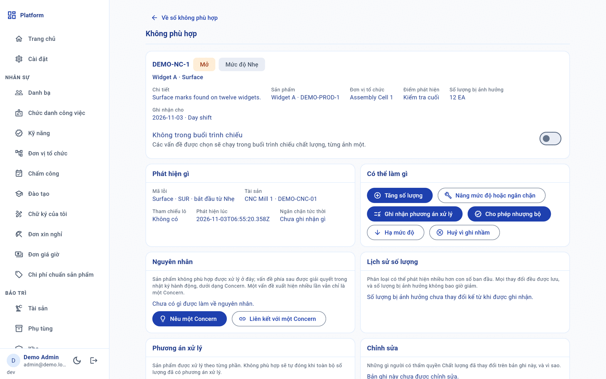

***Ảnh 05.5.** Phát hiện gì, có thể làm gì, nguyên nhân, ảnh, và lịch sử số lượng — mỗi nút là một thao tác có ghi dấu.*

---

## Ghi nhận phương án xử lý

| Hạng mục | Nội dung |
| --- | --- |
| **Công việc** | Quyết định số hàng đó thành gì — nhượng bộ, làm lại, hay phế — theo từng phần — `/non-conformances/:id/disposition`. Phiếu 05.5. |
| **Ai thao tác được** | `QLT_NONCONFORMANCES_RECORD` **và** quyền sửa ở Đơn vị tổ chức của bản ghi. **Không** cần thẩm quyền Chất lượng. |
| **Vật tư, dữ liệu có trước** | Bản ghi đã có số lượng bị ảnh hưởng; nếu chọn làm lại thì đã biết số phút. |
| **Công cụ** | Hộp chọn **Phương án xử lý**, ô **Số lượng** (kèm dòng **Tối đa {n} {đơn vị}.**), ô **Số phút làm lại** khi chọn làm lại. |
| **An toàn** | Xử lý **theo từng phần**: 100 cái lỗi có thể chia 60 làm lại + 40 phế. Bản ghi chỉ tự đóng khi **toàn bộ** số lượng đã có phương án — không có đường tắt. |
| **Thiết bị đào tạo** | Ảnh 05.6 |
| **Chủ tài liệu · Rev · Ngày · Trang** | Ban Lean Nền tảng · Rev 2 · 2026-11-15 · 05.5 |

| Các bước chính | Điểm then chốt | Vì sao | Minh hoạ |
| --- | --- | --- | --- |
| **1.** Chọn **Phương án xử lý** — huỷ bỏ, làm lại, hoặc trả lại nhà cung cấp | [Dễ] Mỗi lần ghi là một dòng trong **Phương án xử lý**, kèm ai ghi và khi nào | Sửa một phương án đã ghi là thêm một dòng, không phải sửa lịch sử — nên chọn đúng ngay | Ảnh 05.6 |
| **2.** Ghi **Số lượng**, đọc dòng **Tối đa {n} {đơn vị}.** | [An toàn] Không ghi được nhiều hơn số còn lại — dòng **Tối đa** là giới hạn thật của lần ghi này | Ghi quá số còn lại là báo cáo chất lượng đếm một cái hàng hai lần | Ảnh 05.6 |
| **3.** Nếu chọn **làm lại**: ghi **Số phút làm lại** | [Hỏng] Số phút này là căn cứ tính chi phí làm lại, dùng **Chi phí chuẩn sản phẩm** (phiếu 02.19) | Không ghi phút thì chi phí chất lượng kém thiếu đúng khoản làm lại | Ảnh 05.6 |
| **4.** Ghi phần còn lại ở lần sau, cho tới khi dòng đạt **{tổng}/{tổng}** | [An toàn] Bản ghi chỉ **tự đóng** khi **toàn bộ** số lượng đã có phương án | Một bản ghi còn 1 cái chưa quyết vẫn mở, và vẫn hiện trong sổ như việc chưa xong | — |

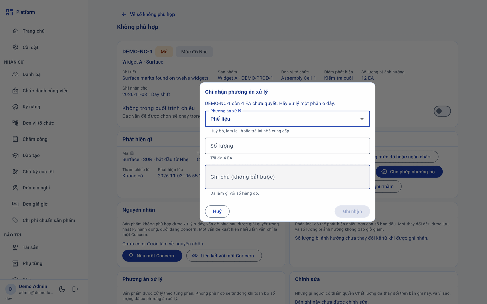

***Ảnh 05.6.** Phương án xử lý đóng bản ghi lại bằng lý do và cách xử lý; số lượng đã xử lý được ghi riêng nên không mất dấu phần còn lại.*

---

## Bốn quyết định cần thẩm quyền Chất lượng

| Hạng mục | Nội dung |
| --- | --- |
| **Công việc** | Bốn quyết định về sản phẩm hoặc về sổ: **cho phép nhượng bộ**, **hạ mức độ**, **mở lại**, **huỷ vì ghi nhầm** — mỗi cái một hộp thoại trên Chi tiết Sản phẩm không phù hợp. Phiếu 05.6. |
| **Ai thao tác được** | `QLT_NONCONFORMANCES_DISPOSE` **và thẩm quyền Chất lượng** ở Đơn vị tổ chức của bản ghi. Thiếu thẩm quyền thì mỗi hộp thoại nói đúng câu của nó thay vì cho bấm. |
| **Vật tư, dữ liệu có trước** | Bản ghi đã được ghi nhận; với **mở lại**, bản ghi đã đóng; với **nhượng bộ**, đã có điều kiện chấp nhận. |
| **Công cụ** | Hộp thoại **Cho phép nhượng bộ** (dùng nút **Cấp nhượng bộ**), **Hạ mức độ** (**Hạ mức độ xuống**), **Mở lại** (**Mở lại Sản phẩm không phù hợp này**), **Huỷ vì ghi nhầm**. |
| **An toàn** | Đây là bốn quyết định, không phải bốn thao tác ghi sổ. **Nhượng bộ** là chấp nhận bán hàng lỗi; **huỷ** làm một bản ghi rời khỏi thống kê nhưng vẫn nằm trong sổ. Cả bốn đều có dấu tên người quyết. |
| **Thiết bị đào tạo** | — |
| **Chủ tài liệu · Rev · Ngày · Trang** | Ban Lean Nền tảng · Rev 2 · 2026-11-15 · 05.6 |

| Các bước chính | Điểm then chốt | Vì sao | Minh hoạ |
| --- | --- | --- | --- |
| **1.** **Cho phép nhượng bộ**: mở hộp thoại, ghi điều kiện, bấm **Cấp nhượng bộ** | [An toàn] Điều kiện bạn ghi là thứ khách hàng và lần kiểm tra sau này đọc — đó là toàn bộ giá trị của một nhượng bộ | Nhượng bộ không có điều kiện là bán hàng lỗi mà không ai biết vì sao nó được chấp nhận | — |
| **2.** **Hạ mức độ**: bấm **Hạ mức độ**, chọn mức mới, xác nhận | [An toàn] Hạ mức độ là **quyết định về sản phẩm**, nên nó cần thẩm quyền Chất lượng, không chỉ quyền ghi bản ghi | Hạ mức độ làm con số chất lượng đẹp lên — đó chính là lý do nó là một quyết định | — |
| **3.** **Mở lại**: bấm **Mở lại**, xác nhận **Mở lại Sản phẩm không phù hợp này** | [Hỏng] Số lượng và phương án đã ghi **giữ nguyên**; bản ghi về trạng thái đã có phương án xử lý, và mốc thời gian đóng bị bỏ theo | Mở lại không phải làm lại từ đầu — nó chỉ bỏ mốc đóng | — |
| **4.** **Huỷ vì ghi nhầm**: bấm **Huỷ vì ghi nhầm** | [An toàn] Bản ghi **vẫn nằm trong sổ** ở trạng thái đã huỷ, có lý do — huỷ không phải xoá | Đây là điều làm sổ chất lượng đáng tin: không có đường nào xoá một bản ghi đã ghi | — |

---

## Nêu hoặc Liên kết một Concern

| Hạng mục | Nội dung |
| --- | --- |
| **Công việc** | Đưa vấn đề phía sau một bản ghi không phù hợp vào Nhật ký hành động — `/non-conformances/:id/raise-concern`, `/non-conformances/:id/link-concern`. Phiếu 05.7. |
| **Ai thao tác được** | Nêu: `ACT_RAISE` — mọi vai trò. Liên kết: `ACT_CHANGE` — mọi vai trò. Cả hai cộng phạm vi Đơn vị tổ chức. |
| **Vật tư, dữ liệu có trước** | Bản ghi không phù hợp đã ghi nhận; nếu **liên kết** thì Concern đích đã tồn tại. |
| **Công cụ** | Hai lối **Nêu một Concern** và **Liên kết với một Concern** trong khối **Có thể làm gì**. |
| **An toàn** | Concern được nêu **rơi vào Đơn vị tổ chức của bản ghi không phù hợp**, không phải đơn vị của bạn — và bạn không chọn được đơn vị khác trong hộp thoại này. |
| **Thiết bị đào tạo** | — |
| **Chủ tài liệu · Rev · Ngày · Trang** | Ban Lean Nền tảng · Rev 2 · 2026-11-15 · 05.7 |

| Các bước chính | Điểm then chốt | Vì sao | Minh hoạ |
| --- | --- | --- | --- |
| **1.** Tìm trong **Nhật ký hành động** xem vấn đề này đã có Concern chưa | [Hỏng] Nêu trùng là điều làm hỏng thống kê hành động | Một vấn đề lặp lại vẫn là **một** Concern; nêu lần hai làm báo cáo đếm hai vấn đề | — |
| **2.** Đã có Concern: bấm **Liên kết với một Concern** và chọn Concern đó | [An toàn] **Luôn dùng cái này khi đã có Concern** — nó gắn bản ghi vào cuộc điều tra đang chạy | Nêu mới thay vì liên kết là mở một cuộc điều tra thứ hai cho cùng một nguyên nhân | — |
| **3.** Chưa có: bấm **Nêu một Concern** và ghi **Nội dung**, **Mô tả** | [An toàn] Concern mới **rơi vào Đơn vị tổ chức của bản ghi**, nên vấn đề được giải quyết ở nơi nó xảy ra | Chọn tay đơn vị là giao vấn đề cho người không nhìn thấy hàng lỗi | — |
| **4.** Đọc lại dòng **được nêu từ bản ghi này** trên Chi tiết Sản phẩm không phù hợp | [Dễ] Dòng đó là dấu duy nhất nối sổ chất lượng với nhật ký hành động | Không có dòng đó thì hai sổ rời nhau, và người sau không biết vấn đề đã được nêu | — |

---

## Khách hàng

| Hạng mục | Nội dung |
| --- | --- |
| **Công việc** | Khai báo khách hàng của nhà máy, để khiếu nại có người thuộc về và phản hồi có nơi gửi tới — màn hình **Khách hàng**, `/customers`. Phiếu 05.8. |
| **Ai thao tác được** | Đọc: `QLT_CUSTOMERS_DISPLAY` — mọi vai trò. Ghi: `QLT_CUSTOMERS_CHANGE` — **chỉ quản trị viên**. |
| **Vật tư, dữ liệu có trước** | Mã và tên khách hàng do bộ phận kinh doanh cấp. |
| **Công cụ** | Nút **Thêm Khách hàng**, **Điều chỉnh**; ô **Mã**, **Tên**. |
| **An toàn** | Danh sách dùng chung cho **mọi** Nhà máy. Một khách hàng khai hai lần là khiếu nại của họ bị chia làm hai, và không ai thấy được toàn bộ. |
| **Thiết bị đào tạo** | Ảnh 05.7 |
| **Chủ tài liệu · Rev · Ngày · Trang** | Ban Lean Nền tảng · Rev 2 · 2026-11-15 · 05.8 |

| Các bước chính | Điểm then chốt | Vì sao | Minh hoạ |
| --- | --- | --- | --- |
| **1.** Bấm **Thêm Khách hàng**: **Mã**, **Tên** | [Hỏng] Tìm trong danh sách trước — khách hàng khai hai lần làm khiếu nại bị chia đôi | Mọi báo cáo theo khách hàng đếm trên danh mục này, nên trùng ở đây là sai ở mọi báo cáo | Ảnh 05.7 |
| **2.** Sửa: **Điều chỉnh** trên dòng | [Dễ] Thêm và sửa đều là hộp thoại trên danh sách, để bản sửa nằm trong ngữ cảnh nó thuộc về | Danh mục dùng chung cho mọi Nhà máy — sửa ở đây là sửa cho toàn Nền tảng | Ảnh 05.7 |

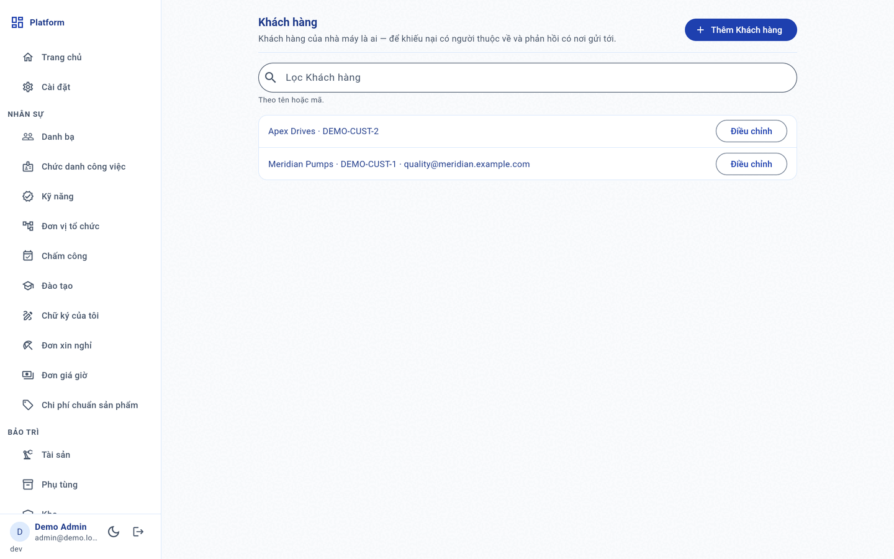

***Ảnh 05.7.** Danh sách Khách hàng: thêm và sửa là hộp thoại trên danh sách, để bản sửa nằm trong ngữ cảnh nó thuộc về.*

---

## Khiếu nại khách hàng

| Hạng mục | Nội dung |
| --- | --- |
| **Công việc** | Ghi nhận khách đã khiếu nại gì, và đọc sổ khiếu nại — màn hình **Khiếu nại khách hàng**, `/complaints`, ghi nhận ở `/complaints/new`. Phiếu 05.9. |
| **Ai thao tác được** | Đọc: `QLT_COMPLAINTS_DISPLAY` — mọi vai trò. Ghi nhận: `QLT_COMPLAINTS_RECORD` — **mọi vai trò**, cộng phạm vi Đơn vị tổ chức. |
| **Vật tư, dữ liệu có trước** | Khách hàng (phiếu 05.8), Sản phẩm (phiếu 05.1) và Mã lỗi (phiếu 05.2) đã có trong danh mục. |
| **Công cụ** | Nút **Ghi nhận khiếu nại**; ô **Khách hàng**, **Sản phẩm**, **Mã lỗi (không bắt buộc)**, **Số lượng (không bắt buộc)**, **Loại** với mục **Yêu cầu bảo hành**, **Ai trả lời khiếu nại này**, **Khách hàng đã nói gì**, **Hạn phản hồi (không bắt buộc)**. |
| **An toàn** | Ô **Ai trả lời khiếu nại này** quyết định **ai thao tác được** trên khiếu nại đó. Để trống hoặc chọn nhầm là khiếu nại không ai trả lời, và khách không nhận được câu nào. |
| **Thiết bị đào tạo** | Ảnh 05.8 |
| **Chủ tài liệu · Rev · Ngày · Trang** | Ban Lean Nền tảng · Rev 2 · 2026-11-15 · 05.9 |

| Các bước chính | Điểm then chốt | Vì sao | Minh hoạ |
| --- | --- | --- | --- |
| **1.** Bấm **Ghi nhận khiếu nại**: **Khách hàng**, **Sản phẩm**, **Mã lỗi (không bắt buộc)** | [Dễ] **Mã lỗi** để trống được — có mã thì báo cáo Pareto chất lượng đếm được khiếu nại này | Một khiếu nại không mã lỗi không hiện trong bất kỳ phân tích lỗi nào | Ảnh 05.8 |
| **2.** Chọn **Loại** — khiếu nại thường hoặc **Yêu cầu bảo hành** | [Hỏng] **Yêu cầu bảo hành** là một loại riêng, không phải một ghi chú | Bảo hành và khiếu nại thường được đếm riêng, nên chọn sai loại là vào nhầm báo cáo | Ảnh 05.8 |
| **3.** Chọn **Ai trả lời khiếu nại này** | [An toàn] Đây là trường hay bị bỏ qua nhất, và nó quyết định **ai thao tác được** trên khiếu nại | Bỏ trống là khiếu nại rơi vào không ai, và khách chờ một câu trả lời không bao giờ tới | Ảnh 05.8 |
| **4.** Ghi **Khách hàng đã nói gì** — lời của khách, không phải bản dịch của bạn | [Dễ] Điều khách nói được mang theo sang Sản phẩm không phù hợp ghi nhận từ khiếu nại này | Viết lại theo cách hiểu của mình là mất đúng thứ khách đã nói | Ảnh 05.8 |

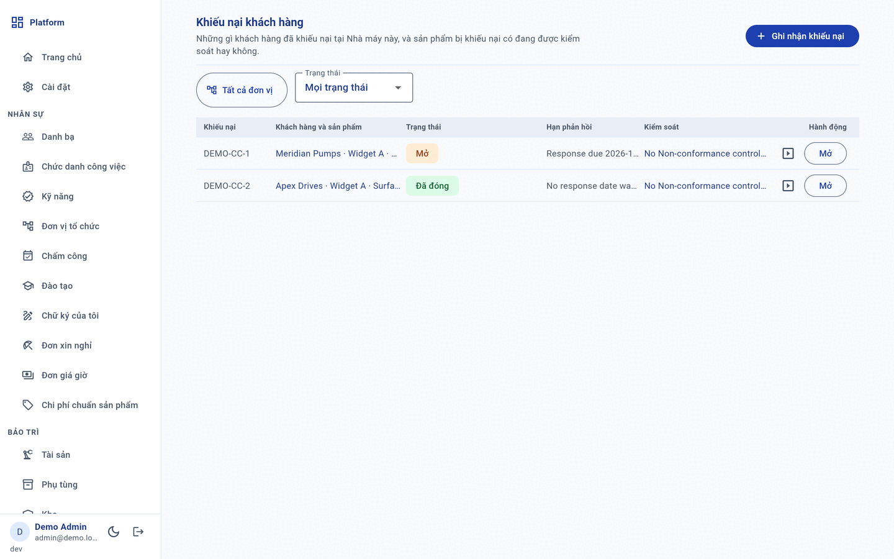

***Ảnh 05.8.** Sổ khiếu nại: khách nào, về cái gì, và đã trả lời chưa.*

---

## Chi tiết Khiếu nại

| Hạng mục | Nội dung |
| --- | --- |
| **Công việc** | Kiểm soát sản phẩm bị khiếu nại, trả lời khách, và đóng khiếu nại — màn hình **Chi tiết Khiếu nại**, `/complaints/:id`. Phiếu 05.10. |
| **Ai thao tác được** | Đọc: `QLT_COMPLAINTS_DISPLAY`. Ghi phản hồi: `QLT_COMPLAINTS_RECORD`. Ghi nhận không phù hợp từ khiếu nại còn cần `QLT_NONCONFORMANCES_RECORD`. |
| **Vật tư, dữ liệu có trước** | Khiếu nại đã ghi nhận (phiếu 05.9); sản phẩm bị khiếu nại đã có trong danh mục Sản phẩm. |
| **Công cụ** | Khối **Sản phẩm mà khiếu nại này nói tới**; các lối **Ghi nhận không phù hợp**, **Liên kết một bản đã có**, **Phản hồi**, **Đóng bằng phản hồi**. |
| **An toàn** | Khiếu nại **không tự** sinh Sản phẩm không phù hợp. Ghi khiếu nại rồi đóng là **hàng lỗi không được kiểm soát ở đâu cả** — màn hình cảnh báo điều này bằng đỏ. |
| **Thiết bị đào tạo** | Ảnh 05.9 |
| **Chủ tài liệu · Rev · Ngày · Trang** | Ban Lean Nền tảng · Rev 2 · 2026-11-15 · 05.10 |

| Các bước chính | Điểm then chốt | Vì sao | Minh hoạ |
| --- | --- | --- | --- |
| **1.** Đọc **Sản phẩm mà khiếu nại này nói tới** và cảnh báo đỏ nếu có | [An toàn] Cảnh báo "chưa có gì kiểm soát sản phẩm" là việc phải làm ngay, không phải lỗi hiển thị | Chưa có gì kiểm soát hàng bị khiếu nại là một lỗ hổng thật: hàng vẫn đang chạy | Ảnh 05.9 |
| **2.** Kiểm soát hàng: **Ghi nhận không phù hợp** (cần `QLT_NONCONFORMANCES_RECORD`), hoặc **Liên kết một bản đã có** cho cùng Sản phẩm | [An toàn] Ghi nhận **từ** khiếu nại thì bản ghi mang theo nội dung khách nói | Bản ghi kiểm soát hàng nằm ở màn hình **Sản phẩm không phù hợp**, không nằm ở khiếu nại | Ảnh 05.9 |
| **3.** Trả lời khách: bấm **Phản hồi**, ghi điều đã nói lại | [Dễ] Phản hồi là câu **đã gửi**, không phải ghi chú nội bộ | Đây là bản ghi duy nhất chứng minh khách đã được trả lời | Ảnh 05.9 |
| **4.** Đóng khiếu nại: bấm **Đóng bằng phản hồi** | [Hỏng] **Phải có phản hồi trước khi đóng** — nút đóng dựa vào chính phản hồi đó | Không có phản hồi thì khách không biết đã được xử lý, và khiếu nại đóng mà không ai trả lời | — |

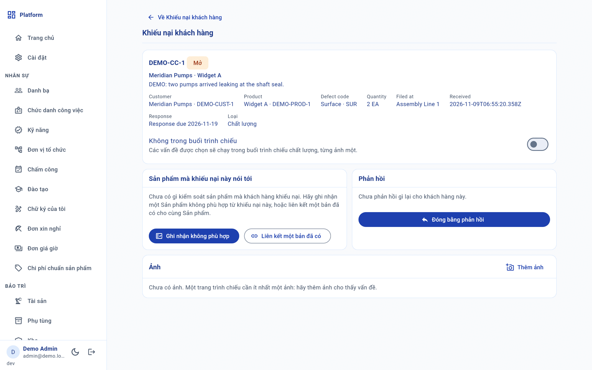

***Ảnh 05.9.** Một khiếu nại gom phần khách nói, phần trả lời, và các lối **Phản hồi**, **Ghi nhận không phù hợp** và **Liên kết một bản đã có**.*

---

## Trình chiếu

| Hạng mục | Nội dung |
| --- | --- |
| **Công việc** | Chọn các vấn đề chất lượng cho màn hình ở xưởng, sắp thứ tự, và chạy — màn hình **Trình chiếu**, `/slide-show`. Phiếu 05.11. |
| **Ai thao tác được** | Đọc: `QLT_SLIDESHOW_DISPLAY`. Chọn và sắp thứ tự: `QLT_SLIDESHOW_CHOOSE` — **mọi vai trò**. |
| **Vật tư, dữ liệu có trước** | Đã có ít nhất một Khiếu nại hoặc một Sản phẩm không phù hợp, **và một ảnh trên màn hình của vấn đề đó**. |
| **Công cụ** | Nút **Thêm** trên màn hình của từng vấn đề; **Chuyển lên trước**, **Chuyển ra sau**, **Bỏ khỏi màn hình**; **Chạy trình chiếu**, **Tạm dừng trình chiếu**, **Trang trước**, **Trang sau**; dòng đếm đầu trang. |
| **An toàn** | **Một trang trình chiếu cần ảnh.** Vấn đề chưa có ảnh **sẽ không hiện** — dòng đầu trang đếm sẵn cho bạn "{n} đã chọn nhưng chưa có ảnh". Đọc con số đó trước khi hỏi vì sao màn hình trống. |
| **Thiết bị đào tạo** | — |
| **Chủ tài liệu · Rev · Ngày · Trang** | Ban Lean Nền tảng · Rev 2 · 2026-11-15 · 05.11 |

| Các bước chính | Điểm then chốt | Vì sao | Minh hoạ |
| --- | --- | --- | --- |
| **1.** Mở màn hình của một vấn đề và **thêm ít nhất một ảnh** cho nó | [An toàn] **Không có ảnh thì vấn đề không hiện trên màn hình**, dù đã được chọn | Đây là lỗi phổ biến nhất: người dùng chọn vấn đề rồi thắc mắc sao màn hình trống | — |
| **2.** Chọn vấn đề đó cho buổi trình chiếu | [Dễ] Chọn được từ danh sách hoặc từ màn hình của chính vấn đề | Hai lối vào cùng một việc, nên chọn ở đâu cũng được | — |
| **3.** Sắp thứ tự: **Chuyển lên trước** / **Chuyển ra sau** | [Dễ] Thứ tự là thứ buổi trình chiếu chạy, nên sắp theo câu chuyện bạn muốn kể | Một buổi trình chiếu không có thứ tự là một chồng ảnh | — |
| **4.** Đọc dòng đếm đầu trang: "{n} đã chọn nhưng chưa có ảnh" | [Hỏng] Con số này là câu trả lời cho "sao trình chiếu trống" | Kiểm tra ở đây rẻ hơn nhiều so với tìm lỗi trong lúc đang họp giao ban | — |
| **5.** Chạy: **Chạy trình chiếu**, rồi **Tạm dừng trình chiếu**, **Trang trước** / **Trang sau** | [Dễ] **Bỏ khỏi màn hình** gỡ một vấn đề mà không đụng tới bản ghi của nó | Gỡ khỏi trình chiếu không phải xoá — bản ghi vẫn nguyên trong sổ | — |

---

## Nhà cung cấp

| Hạng mục | Nội dung |
| --- | --- |
| **Công việc** | Khai báo nhà máy mua hàng từ ai, để một lô về sai có người thuộc về — màn hình **Nhà cung cấp**, `/suppliers`. Phiếu 05.12. |
| **Ai thao tác được** | Đọc: `QLT_SUPPLIERS_DISPLAY` — mọi vai trò. Ghi: `QLT_SUPPLIERS_CHANGE` — **chỉ quản trị viên**. |
| **Vật tư, dữ liệu có trước** | Mã và tên nhà cung cấp do bộ phận mua hàng cấp. |
| **Công cụ** | Nút **Thêm Nhà cung cấp**, **Điều chỉnh**; ô **Mã**, **Tên**. |
| **An toàn** | Danh sách dùng chung cho mọi Nhà máy. Một nhà cung cấp khai hai lần làm NCR của họ bị chia đôi, và số tiền thu hồi được không cộng lại được. |
| **Thiết bị đào tạo** | Ảnh 05.10 |
| **Chủ tài liệu · Rev · Ngày · Trang** | Ban Lean Nền tảng · Rev 2 · 2026-11-15 · 05.12 |

| Các bước chính | Điểm then chốt | Vì sao | Minh hoạ |
| --- | --- | --- | --- |
| **1.** Bấm **Thêm Nhà cung cấp**: **Mã**, **Tên** | [Hỏng] Khai một lần, dùng ở mọi nơi — trùng mã làm NCR và số tiền thu hồi bị chia đôi | Số tiền đòi lại từ nhà cung cấp là con số quản lý đọc, và nó cộng trên danh mục này | Ảnh 05.10 |
| **2.** Sửa: **Điều chỉnh** | [Dễ] Cùng hình thức với Khách hàng: danh sách, và hộp thoại thêm/sửa | Người đã biết màn hình Khách hàng thì dùng được màn hình này ngay | Ảnh 05.10 |

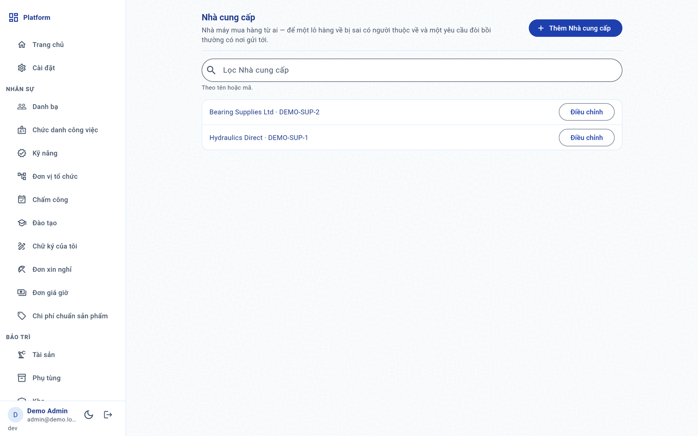

***Ảnh 05.10.** Danh sách Nhà cung cấp — cùng hình thức với Khách hàng: danh sách, và hộp thoại thêm/sửa.*

---

## NCR nhà cung cấp

| Hạng mục | Nội dung |
| --- | --- |
| **Công việc** | Ghi nhận hàng về từ nhà cung cấp bị sai, và đọc sổ NCR — màn hình **NCR nhà cung cấp**, `/supplier-ncrs`, ghi nhận ở `/supplier-ncrs/new`. Phiếu 05.13. |
| **Ai thao tác được** | Đọc: `QLT_SUPPLIER_NCRS_DISPLAY` — mọi vai trò. Ghi nhận: `QLT_SUPPLIER_NCRS_RECORD` — **mọi vai trò**, cộng phạm vi Đơn vị tổ chức. |
| **Vật tư, dữ liệu có trước** | Nhà cung cấp (phiếu 05.12) và Sản phẩm (phiếu 05.1) đã có trong danh mục; phiếu giao hàng đã có trong tay. |
| **Công cụ** | Nút **Ghi nhận NCR nhà cung cấp**; ô **Nhà cung cấp**, **Sản phẩm (không bắt buộc)**, **Số lượng**, **Số tham chiếu lô hàng về (không bắt buộc)**, **Số tham chiếu mua hàng (không bắt buộc)**, **Hạn trả lời (không bắt buộc)**. |
| **An toàn** | **Số tham chiếu lô hàng về** là thứ duy nhất nối NCR với số hàng thật đang nằm trong kho. Không có số lô thì không biết phải giữ lại bao nhiêu hàng. |
| **Thiết bị đào tạo** | Ảnh 05.11 |
| **Chủ tài liệu · Rev · Ngày · Trang** | Ban Lean Nền tảng · Rev 2 · 2026-11-15 · 05.13 |

| Các bước chính | Điểm then chốt | Vì sao | Minh hoạ |
| --- | --- | --- | --- |
| **1.** Bấm **Ghi nhận NCR nhà cung cấp**: **Nhà cung cấp**, **Sản phẩm (không bắt buộc)**, **Số lượng** | [Hỏng] **Số lượng** tính theo **đơn vị đo của Sản phẩm** đã chọn — đọc lại đơn vị trước khi gõ số | Ghi số lượng theo đơn vị khác là con số NCR sai, và số tiền thu hồi tính trên nó cũng sai | Ảnh 05.11 |
| **2.** Ghi **Số tham chiếu lô hàng về (không bắt buộc)**, lấy từ phiếu giao hàng | [An toàn] Số lô là thứ nối NCR với số hàng thật trong kho — không có nó thì không biết giữ lại bao nhiêu | Lô hàng đã nhập kho mà không có số tham chiếu là hàng không truy được | Ảnh 05.11 |
| **3.** Ghi **Số tham chiếu mua hàng (không bắt buộc)** — đơn hàng mà lô này về theo | [Dễ] Đơn hàng là thứ bộ phận mua hàng đối chiếu khi đòi bồi thường | Không có số đơn thì cuộc đòi tiền bắt đầu bằng việc đi tìm đơn | — |
| **4.** Ghi nhận xong, đọc lại sổ: lọc theo **Nhà cung cấp**, **Đơn vị tổ chức**, **Trạng thái** | [Hỏng] NCR **không** tự tạo Sản phẩm không phù hợp — phải làm ở bước tiếp (phiếu 05.14) | Vật tư sai mà không có bản ghi không phù hợp nào là vật tư không ai kiểm soát | — |

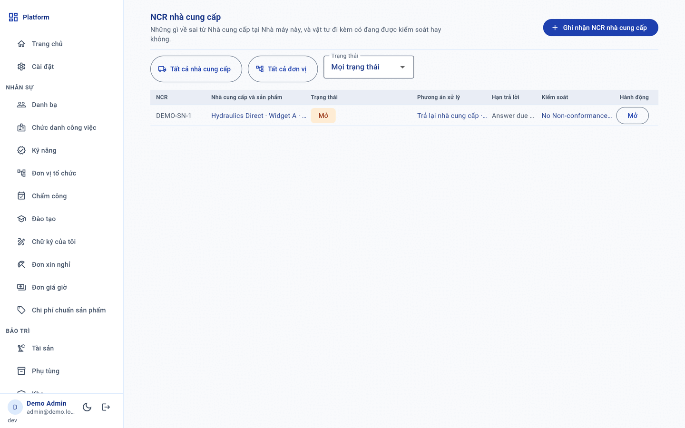

***Ảnh 05.11.** Sổ NCR: hàng của nhà cung cấp nào không đạt, và đang chờ xử lý gì.*

---

## Chi tiết NCR nhà cung cấp

| Hạng mục | Nội dung |
| --- | --- |
| **Công việc** | Ghi phương án xử lý của nhà cung cấp, số tiền đòi lại được, kiểm soát vật tư, và đóng NCR — màn hình **Chi tiết NCR nhà cung cấp**, `/supplier-ncrs/:id`. Phiếu 05.14. |
| **Ai thao tác được** | Đọc: `QLT_SUPPLIER_NCRS_DISPLAY`. Ghi: `QLT_SUPPLIER_NCRS_RECORD`, cộng phạm vi Đơn vị tổ chức. Ghi nhận không phù hợp từ NCR còn cần `QLT_NONCONFORMANCES_RECORD`. |
| **Vật tư, dữ liệu có trước** | NCR đã ghi nhận (phiếu 05.13); nhà cung cấp đã trả lời hoặc đã có phương án. |
| **Công cụ** | Khối **Phương án xử lý của Nhà cung cấp**; các lối **Sửa phương án xử lý**, **Ghi nhận không phù hợp**, **Liên kết một bản đã có**, **Đóng NCR**; ô **Chi phí thu hồi (không bắt buộc)** và đơn vị tiền. |
| **An toàn** | Đây là **phương án của nhà cung cấp**, không phải của nhà máy. Ghi phương án của mình vào đây là ghi sai bên chịu trách nhiệm, và cuộc đòi bồi thường mất căn cứ. |
| **Thiết bị đào tạo** | Ảnh 05.12 |
| **Chủ tài liệu · Rev · Ngày · Trang** | Ban Lean Nền tảng · Rev 2 · 2026-11-15 · 05.14 |

| Các bước chính | Điểm then chốt | Vì sao | Minh hoạ |
| --- | --- | --- | --- |
| **1.** Đọc **Phương án xử lý của Nhà cung cấp**; sửa bằng **Sửa phương án xử lý** khi họ đổi ý | [An toàn] Đây là **phương án của nhà cung cấp**, không phải của nhà máy | Ghi phương án của mình vào đây là ghi sai bên chịu trách nhiệm | Ảnh 05.12 |
| **2.** Ghi **Chi phí thu hồi (không bắt buộc)** và đơn vị tiền, khi đã đòi được | [Hỏng] Để trống nếu **không đòi gì** — chi tiết hiện **Đã thu hồi {số tiền}** chỉ khi có số | Đây là con số duy nhất cho biết NCR có mang lại tiền về hay không, và nó cộng vào báo cáo chi phí | Ảnh 05.12 |
| **3.** Kiểm soát vật tư: **Ghi nhận không phù hợp** từ NCR, hoặc **Liên kết một bản đã có** cho cùng lô | [An toàn] Chưa có gì kiểm soát vật tư là lỗ hổng thật — màn hình cảnh báo bằng đỏ | NCR là giấy đòi tiền; bản ghi không phù hợp mới là thứ kiểm soát hàng | Ảnh 05.12 |
| **4.** **Đóng NCR** khi xong | [Dễ] NCR đã đóng vẫn nằm trong sổ kèm ngày đóng | Đóng để sổ nói đúng việc nào còn mở, không phải để giấu lịch sử | — |

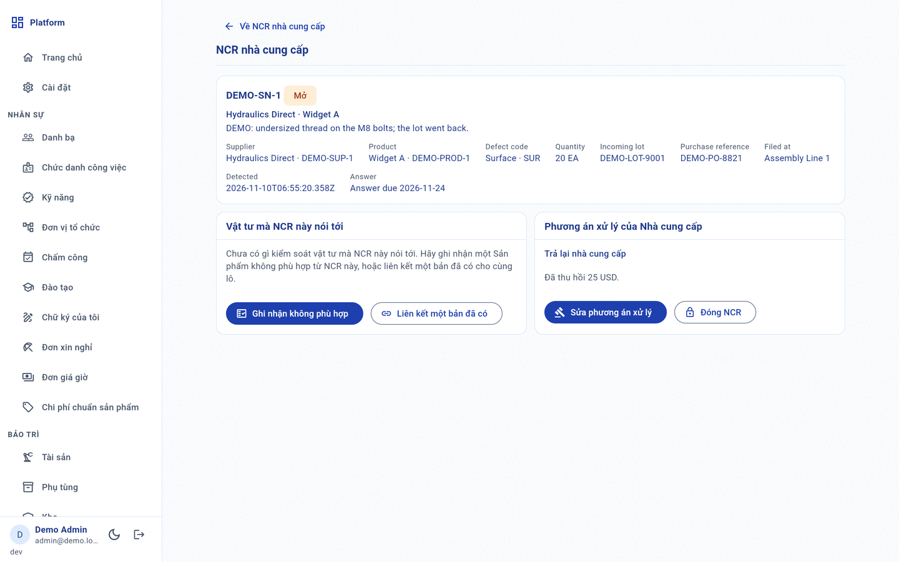

***Ảnh 05.12.** Chi tiết một NCR: lô hàng, cách xử lý, và các lối nêu không phù hợp hoặc liên kết sang bản ghi đã có.*

---

## Bảng tóm tắt phần Chất lượng

| Việc | Mọi vai trò | Người vận hành | Giám sát | Kỹ sư | Quản lý | Quản trị viên |
| --- | :-: | :-: | :-: | :-: | :-: | :-: |
| Xem mọi sổ Chất lượng | ✓ | ✓ | ✓ | ✓ | ✓ | ✓ |
| Ghi nhận Sản phẩm không phù hợp | ✓ | ✓ | ✓ | ✓ | ✓ | ✓ |
| Tăng số lượng, nâng mức độ, ngăn chặn | ✓ | ✓ | ✓ | ✓ | ✓ | ✓ |
| **Ghi nhận phương án xử lý** (làm lại / phế một phần) | ✓ | ✓ | ✓ | ✓ | ✓ | ✓ |
| Nêu / liên kết một Concern | ✓ | ✓ | ✓ | ✓ | ✓ | ✓ |
| Ghi nhận Khiếu nại, NCR nhà cung cấp | ✓ | ✓ | ✓ | ✓ | ✓ | ✓ |
| Phản hồi khách, đóng khiếu nại | ✓ | ✓ | ✓ | ✓ | ✓ | ✓ |
| Chọn vấn đề cho Trình chiếu | ✓ | ✓ | ✓ | ✓ | ✓ | ✓ |
| **Nhượng bộ · Hạ mức độ · Mở lại · Huỷ** | **cần thẩm quyền Chất lượng** | | | | | |
| **Danh mục** Sản phẩm, Mã lỗi, Khách hàng, Nhà cung cấp | · | · | · | · | · | ✓ |

**Thẩm quyền Chất lượng** không phải một vai trò — nó là một quyền gắn với một Đơn
vị tổ chức, quản trị viên cấp trong màn hình **Tài khoản** (mục *Thẩm quyền Chất
lượng*). Một người vận hành **có thể** được cấp thẩm quyền này; một quản lý có thể
**không** được cấp.
