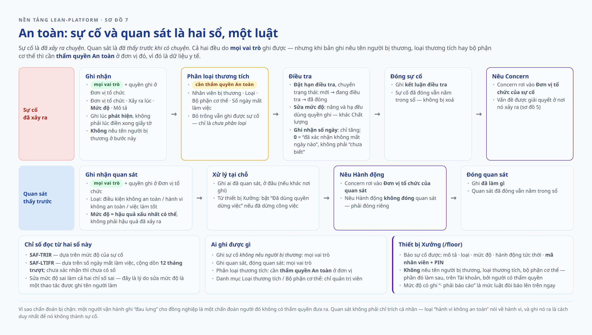
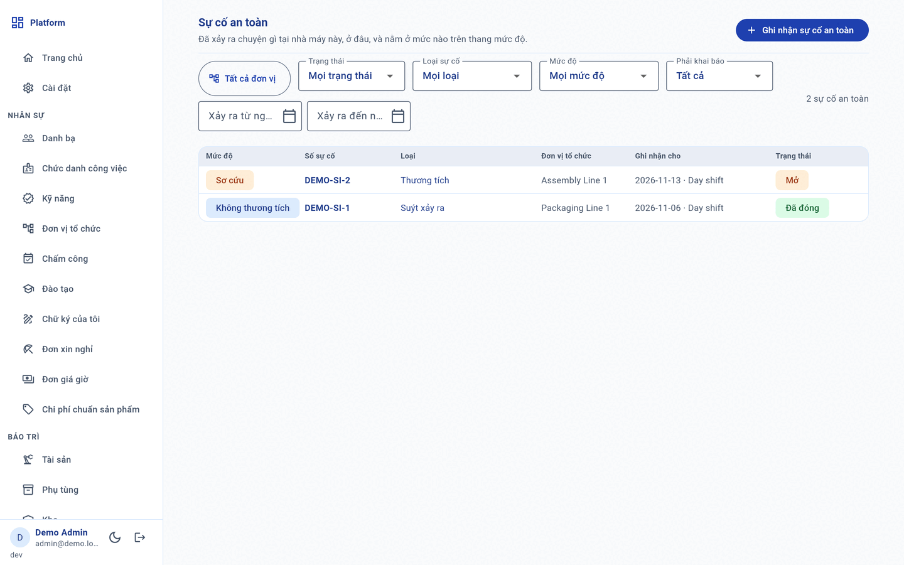
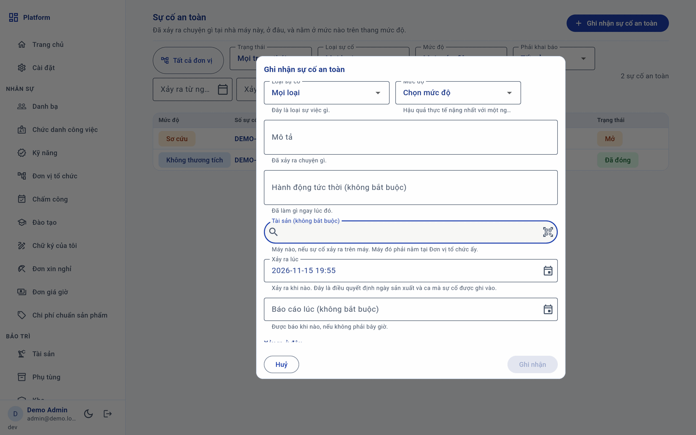
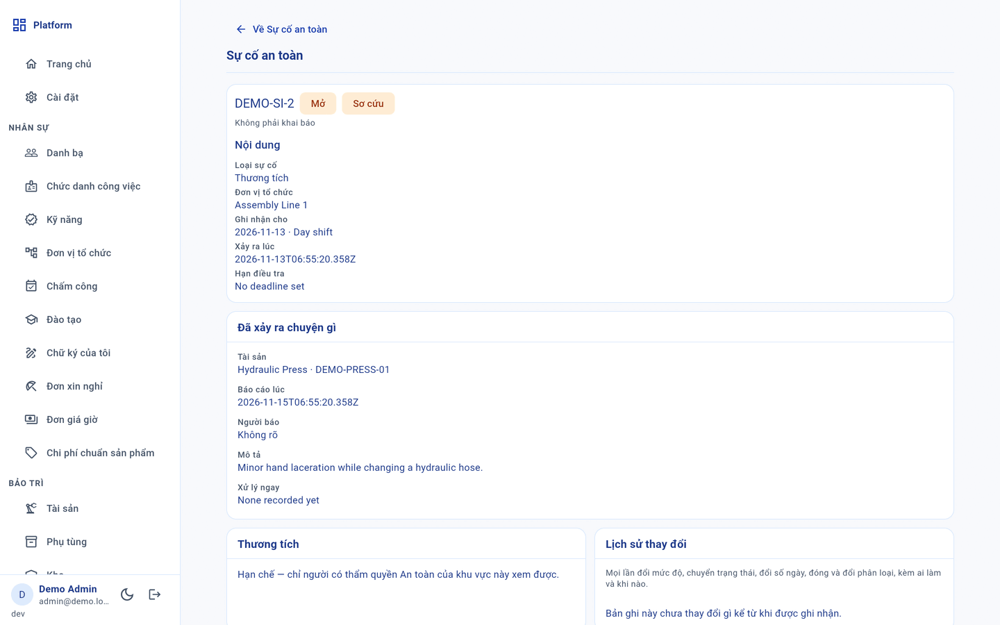
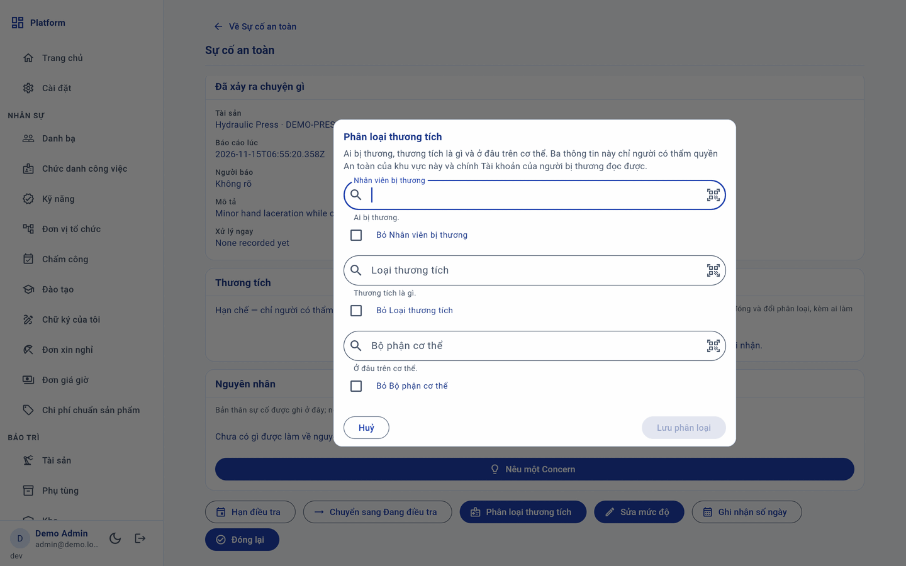
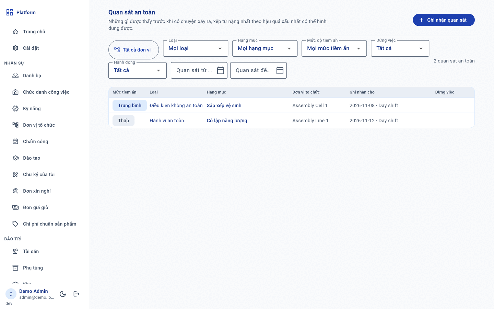
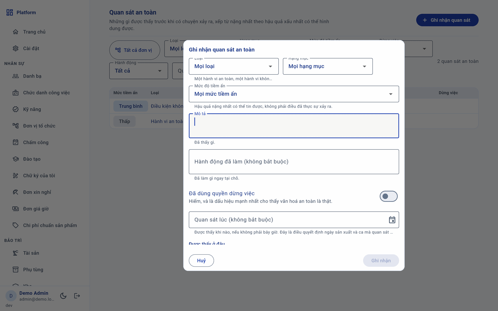
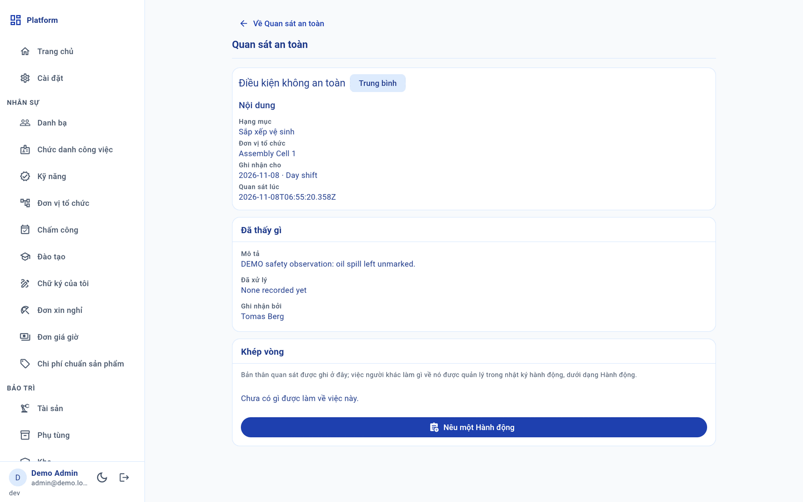
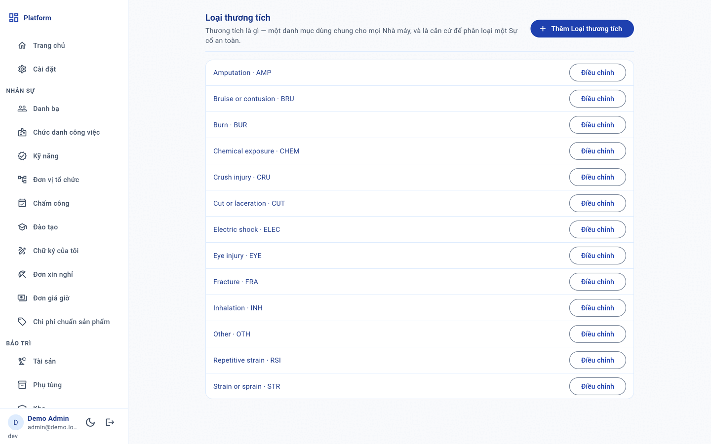
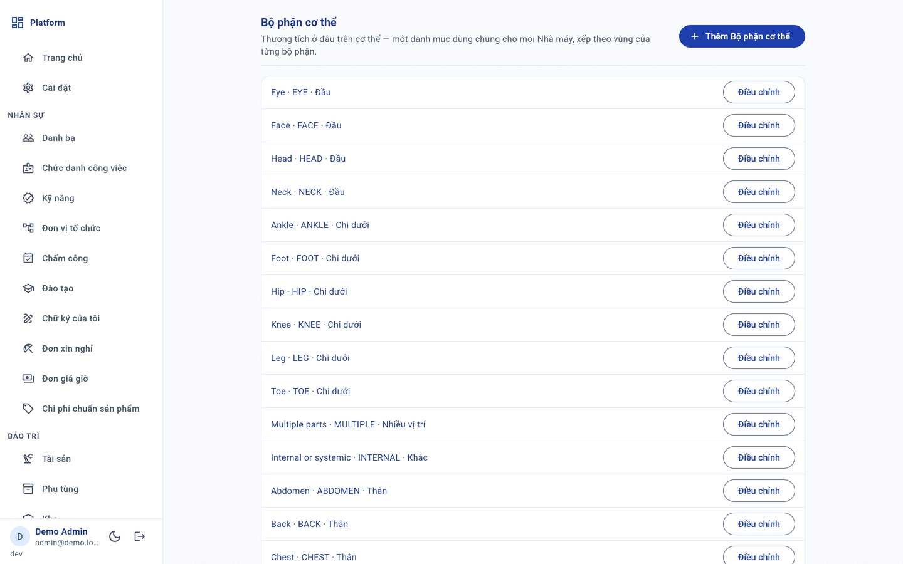

# 06 · An toàn

Nhóm **An toàn** có hai sổ, và người đào tạo phải phân biệt rõ ngay từ câu đầu:

- **Sự cố** — *đã xảy ra chuyện*. Có người bị thương, hoặc suýt bị.
- **Quan sát** — *đã thấy trước khi có chuyện*. Một điều kiện không an toàn, một hành
  vi nguy hiểm, ghi lại để nó không thành sự cố.

**Đây là nhóm mà mọi Tài khoản đều ghi được.** Ghi nhận sự cố, ghi nhận quan sát —
mọi vai trò. Đó là chủ ý: người đứng cạnh cái máy là người phải ghi được, không phải
người có tài khoản quản lý.

**Nhưng có một luật riêng, và nó là điểm then chốt quan trọng nhất của cả nhóm này.**
Khi ghi một sự cố mà bạn **nêu tên người bị thương, loại thương tích, hoặc bộ phận cơ
thể**, hệ thống đòi thêm **thẩm quyền An toàn** ở Đơn vị tổ chức đó. Một "suýt xảy ra"
không nêu ai bị gì thì ai cũng ghi được.

> **Vì sao.** Chẩn đoán của một người là **dữ liệu y tế**, không phải quan sát sàn.
> Một người vận hành ghi "đau lưng" cho đồng nghiệp là một chẩn đoán mà người đó
> không có thẩm quyền đưa ra.

**Và luật đó áp cả khi đọc.** Mức độ, loại sự việc, mô tả, xử lý ngay và số ngày là
những con số nhà máy hành động trên đó nên ai thấy Nhà máy cũng đọc được. Nhưng **ai
bị thương, thương tích là gì, ở đâu trên cơ thể** chỉ người có **thẩm quyền An toàn**
ở đơn vị đó — và chính Tài khoản của người bị thương — đọc được. Người khác thấy ô
trống, không thấy "ẩn".

***Sơ đồ 7.** Hai sổ, hai luồng. Điểm khác biệt duy nhất về quyền: nêu tên người bị
thương, loại thương tích hay bộ phận cơ thể cần thẩm quyền An toàn ở đơn vị đó.*

---

## Sự cố

| Hạng mục | Nội dung |
| --- | --- |
| **Công việc** | Ghi lại đã xảy ra chuyện gì tại nhà máy, ở đâu, và nằm ở mức nào trên thang mức độ — màn hình **Sự cố an toàn**, `/safety/incidents`. Phiếu 06.1. |
| **Ai thao tác được** | Đọc: `SAF_INCIDENTS_DISPLAY` — mọi vai trò. Ghi nhận: `SAF_INCIDENTS_RECORD` — **mọi vai trò**, cộng quyền ghi ở Đơn vị tổ chức. Nêu tên người bị thương / loại thương tích / bộ phận cơ thể: `SAF_CLASSIFY` **và thẩm quyền An toàn**. |
| **Vật tư, dữ liệu có trước** | Đơn vị tổ chức nơi sự cố xảy ra; danh mục **Loại thương tích** và **Bộ phận cơ thể** đã có (phiếu 06.9) nếu định phân loại. |
| **Công cụ** | Nút **Ghi nhận sự cố an toàn**; ô **Xảy ra ở đâu**, **Xảy ra lúc**, **Báo cáo lúc (không bắt buộc)**, **Mức độ**, **Mô tả**, **Đã làm gì ngay lúc đó**, **Nhân viên bị thương (không bắt buộc)**, **Tài sản (không bắt buộc)**. |
| **An toàn** | Ô **Nhân viên bị thương** cần **thẩm quyền An toàn** ở Đơn vị tổ chức đó. Ghi sự cố **không** nêu ai bị gì thì ai cũng ghi được — và đó là cách đúng để một người vận hành báo một vụ suýt xảy ra. |
| **Thiết bị đào tạo** | Ảnh 06.1, Ảnh 06.2 |
| **Chủ tài liệu · Rev · Ngày · Trang** | Ban Lean Nền tảng · Rev 2 · 2026-11-15 · 06.1 |

| Các bước chính | Điểm then chốt | Vì sao | Minh hoạ |
| --- | --- | --- | --- |
| **1.** Bấm **Ghi nhận sự cố an toàn** và chọn **Xảy ra ở đâu** — Đơn vị tổ chức nơi chuyện xảy ra | [An toàn] Đây là điều quyết định **ai thao tác được** trên sự cố; phiếu nói lại đơn vị ngay dưới ô chọn | Chọn nhầm đơn vị là giao một sự cố cho người không có thẩm quyền An toàn ở đó, và nó nằm chờ | Ảnh 06.2 |
| **2.** Ghi **Xảy ra lúc** | [Hỏng] Đây là lúc **xảy ra**, không phải lúc điền giấy tờ — nó quyết định ngày sản xuất và ca mà sự cố thuộc về | Một sự cố ghi sau ba ngày là một sự cố mà thống kê xếp vào tuần sau | Ảnh 06.2 |
| **3.** Chọn **Mức độ** — hậu quả thực tế nặng nhất với một người, theo thứ tự mức độ | [An toàn] **Mức độ** là câu hỏi "chuyện này nặng tới đâu", từ **suýt xảy ra** tới **thương tích mất ngày làm** | Đây là con số nuôi TRIR và LTIFR; ước lượng cho nhanh là báo cáo an toàn sai cả năm | Ảnh 06.2 |
| **4.** Ghi **Mô tả** và **Đã làm gì ngay lúc đó** | [Dễ] Đây là bản ghi mà mọi cuộc điều tra sau đó dựa vào — viết cho người không có mặt đọc | Mô tả mơ hồ là cuộc điều tra bắt đầu bằng việc đi hỏi lại người đã quên | Ảnh 06.2 |
| **5.** Nếu **có** người bị thương: điền **Nhân viên bị thương** | [An toàn] Ô này cần **thẩm quyền An toàn** ở Đơn vị tổ chức — không có thì hộp thoại từ chối cả phiếu, kèm lý do | Nêu tên người bị thương là ghi dữ liệu y tế về một người; không có thẩm quyền thì bỏ trống và ghi sự cố trước | — |
| **6.** Bấm ghi nhận | [Dễ] Sự cố mới ở trạng thái **mới**, và **chưa phân loại** thương tích — hai việc khác nhau | Ghi xong không phải là điều tra xong; phân loại là phiếu 06.3 | — |
| **7.** Lọc sổ theo **Đơn vị tổ chức**, **Mức độ**, **Trạng thái**, **Xảy ra từ ngày** / **Xảy ra đến ngày** | [Dễ] Khoảng ngày là **ngày sản xuất** của sự cố, không phải ngày ghi | Lọc theo ngày ghi là bỏ sót sự cố của ca đêm hôm trước | Ảnh 06.1 |

***Ảnh 06.1.** Đã xảy ra chuyện gì, ở đâu, và nằm ở mức nào trên thang mức độ — lọc được theo Đơn vị tổ chức và trạng thái.*

***Ảnh 06.2.** Loại sự việc và mức độ là lựa chọn; mô tả điều đã xảy ra và hành động tức thời là ô gõ. Đây là bản ghi mà mọi cuộc điều tra sau đó dựa vào.*

---

## Chi tiết Sự cố an toàn

| Hạng mục | Nội dung |
| --- | --- |
| **Công việc** | Điều tra và đóng một sự cố: nó nặng tới đâu, ai phụ trách, hạn điều tra là khi nào, và đã làm gì — màn hình **Chi tiết Sự cố an toàn**, `/safety/incidents/:id`. Phiếu 06.2. |
| **Ai thao tác được** | Đọc: `SAF_INCIDENTS_DISPLAY`. **Hạn điều tra** và **Chuyển trạng thái**: `SAF_INCIDENTS_RECORD` + quyền ghi ở Đơn vị tổ chức. **Sửa mức độ** và **Phân loại thương tích**: `SAF_CLASSIFY` **+ thẩm quyền An toàn**. **Ghi nhận số ngày** và **Đóng sự cố**: `SAF_INCIDENTS_RECORD` **+ thẩm quyền An toàn**. |
| **Vật tư, dữ liệu có trước** | Sự cố đã ghi nhận (phiếu 06.1). |
| **Công cụ** | Các nút **Hạn điều tra**, **Chuyển trạng thái**, **Sửa mức độ**, **Phân loại thương tích**, **Ghi nhận số ngày**, **Đóng Sự cố an toàn này**, **Nêu một Concern**; các khối **Thương tích**, **Lịch sử thay đổi**. |
| **An toàn** | **Ba nút cuối nhìn như việc ghi sổ nhưng là quyết định**: sửa mức độ, ghi số ngày và đóng sự cố đều cần **thẩm quyền An toàn**. Một người ghi được sự cố vẫn có thể không sửa được mức độ của nó. |
| **Thiết bị đào tạo** | Ảnh 06.3 |
| **Chủ tài liệu · Rev · Ngày · Trang** | Ban Lean Nền tảng · Rev 2 · 2026-11-15 · 06.2 |

| Các bước chính | Điểm then chốt | Vì sao | Minh hoạ |
| --- | --- | --- | --- |
| **1.** Đọc khối **Thương tích** trước mọi thứ khác | [An toàn] Ba thông tin — ai bị thương, thương tích gì, ở đâu trên cơ thể — chỉ người có **thẩm quyền An toàn** và chính người bị thương đọc được; người khác thấy trống | Đây là dữ liệu y tế về một người, và nó **không** phải chuyện phân quyền chung của nhóm | Ảnh 06.3 |
| **2.** Đặt **Hạn điều tra** | [Dễ] Hạn điều tra là việc ghi sổ — cần `SAF_INCIDENTS_RECORD` và quyền ghi ở đơn vị, **không** cần thẩm quyền An toàn | Sự cố đã đóng thì hạn điều tra của nó không sửa được nữa | Ảnh 06.3 |
| **3.** Đi tiếp bằng **Chuyển trạng thái** — mới → đang điều tra → đã đóng | [Dễ] Trạng thái đi theo thang, không nhảy cóc; mỗi lần chuyển là một dòng trong **Lịch sử thay đổi** | Lịch sử thay đổi là thứ chứng minh sự cố đã được điều tra, không chỉ được đóng | Ảnh 06.3 |
| **4.** Điều tra thấy nặng hoặc nhẹ hơn: **Sửa mức độ** (phiếu 06.4) | [Hỏng] Sửa mức độ dùng `SAF_CLASSIFY` **và** thẩm quyền An toàn — **khác** Chất lượng, nơi hạ mức độ là một quyết định riêng | Đừng dạy chung hai nhóm: ở An toàn nâng và hạ cùng một cửa | — |
| **5.** Đóng sự cố: **Đóng Sự cố an toàn này**, ghi **Vì sao đóng sự cố này** (phiếu 06.5) | [An toàn] Đóng sự cố cần **thẩm quyền An toàn**; sự cố đã đóng **vẫn nằm trong sổ**, không bị xoá | Đóng là chốt số ngày của sự cố — sau đó số ngày không sửa được | — |

***Ảnh 06.3.** Ba phần: đã xảy ra chuyện gì, thương tích, lịch sử thay đổi — cùng các lối hạn điều tra, chuyển trạng thái và phân loại.*

---

## Phân loại thương tích

| Hạng mục | Nội dung |
| --- | --- |
| **Công việc** | Ghi người bị thương, loại thương tích và bộ phận cơ thể — `/safety/incidents/:id/classify`. Phiếu 06.3. |
| **Ai thao tác được** | `SAF_CLASSIFY` **và thẩm quyền An toàn** ở Đơn vị tổ chức của sự cố. |
| **Vật tư, dữ liệu có trước** | Sự cố đã ghi nhận; **mức độ đã đúng** (không phải mức "không có thương tích"); hai danh mục ở phiếu 06.9 đã có. |
| **Công cụ** | Ô chọn **Nhân viên bị thương**, **Loại thương tích**, **Bộ phận cơ thể** (mỗi ô có lối bỏ: **Bỏ Nhân viên bị thương** v.v.); nút **Lưu phân loại**. |
| **An toàn** | Không có thẩm quyền An toàn thì nút này không mở được, dù bạn ghi được sự cố. Sự cố ở mức **không có thương tích** thì không phân loại được — phải **sửa mức độ trước**. |
| **Thiết bị đào tạo** | Ảnh 06.4 |
| **Chủ tài liệu · Rev · Ngày · Trang** | Ban Lean Nền tảng · Rev 2 · 2026-11-15 · 06.3 |

| Các bước chính | Điểm then chốt | Vì sao | Minh hoạ |
| --- | --- | --- | --- |
| **1.** Kiểm tra **mức độ** trước khi mở phân loại | [Hỏng] Sự cố ở mức **không có thương tích** thì hộp thoại nói **không ai bị thương nên không có gì để phân loại**, và bảo sửa mức độ trước | Đây là chỗ hay mắc nhất: người dùng tìm nút phân loại cho một vụ suýt xảy ra, mà vụ đó không có ai bị gì | Ảnh 06.4 |
| **2.** Chọn **Nhân viên bị thương** từ Danh bạ | [An toàn] Chỉ người có **thẩm quyền An toàn** ở đơn vị này ghi được — và chỉ họ (và chính người đó) đọc lại được | Đây là dữ liệu y tế gắn với một người có tên | Ảnh 06.4 |
| **3.** Chọn **Loại thương tích** và **Bộ phận cơ thể** | [Dễ] Hai ô này lấy từ hai danh mục dùng chung (phiếu 06.9) — ghép chúng lại thành một cặp đếm được | Loại và bộ phận là hai trục của mọi báo cáo thương tích; bỏ một trục thì báo cáo không trả lời được câu nào | Ảnh 06.4 |
| **4.** Bấm **Lưu phân loại** | [An toàn] Ba ô đều **bỏ được** bằng lối riêng của nó — sửa được, không phải ghi một lần rồi thôi | Phân loại sai làm sai mọi thống kê thương tích của đơn vị đó | — |

***Ảnh 06.4.** Loại thương tích và bộ phận cơ thể lấy từ hai danh mục dùng chung — đây là chỗ chúng gặp nhau thành một con số đếm được.*

---

## Sửa mức độ và Ghi nhận số ngày

| Hạng mục | Nội dung |
| --- | --- |
| **Công việc** | Đổi mức độ của một sự cố theo kết quả điều tra, và ghi số ngày mất làm việc — `/safety/incidents/:id/severity`, `/safety/incidents/:id/days`. Phiếu 06.4. |
| **Ai thao tác được** | **Sửa mức độ**: `SAF_CLASSIFY` **và thẩm quyền An toàn**. **Ghi nhận số ngày**: `SAF_INCIDENTS_RECORD` **và thẩm quyền An toàn**. |
| **Vật tư, dữ liệu có trước** | Sự cố đã ghi nhận; với số ngày, đã biết người bị thương nghỉ bao nhiêu ngày. |
| **Công cụ** | Hộp thoại **Sửa mức độ** (**Nâng mức độ lên** / mức mới) và **Ghi nhận số ngày**; ô **Số ngày nghỉ do thương tích** và **Số ngày làm hạn chế**. |
| **An toàn** | Số ngày **chỉ tăng** — người bị thương nghỉ thêm thì ghi thêm. Ghi **0** nghĩa là "đã xác nhận không mất ngày nào", không phải "chưa biết", và nó là câu trả lời chốt. |
| **Thiết bị đào tạo** | — |
| **Chủ tài liệu · Rev · Ngày · Trang** | Ban Lean Nền tảng · Rev 2 · 2026-11-15 · 06.4 |

| Các bước chính | Điểm then chốt | Vì sao | Minh hoạ |
| --- | --- | --- | --- |
| **1.** **Sửa mức độ**: mở hộp thoại, chọn mức mới, xác nhận | [Hỏng] Dùng `SAF_CLASSIFY` **và** thẩm quyền An toàn cho **cả** nâng lẫn hạ — không giống Chất lượng | Đừng dạy chung hai nhóm: ở Chất lượng hạ mức độ là một quyết định riêng, ở An toàn thì không | — |
| **2.** **Ghi nhận số ngày**: ghi số ngày người bị thương nghỉ | [An toàn] Số ngày cần **thẩm quyền An toàn** — đây là con số nuôi **SAF-LTIFR**, cộng dồn **12 tháng trượt** | Một con số sai ở đây sai chỉ số an toàn của cả năm, và không ai thấy nó sai | — |
| **3.** Nếu người bị thương còn làm việc hạn chế: ghi **Số ngày làm hạn chế** | [Dễ] Đây là trường riêng, không cộng vào số ngày nghỉ | Gộp hai loại ngày vào một ô là mất khả năng phân biệt ca nhẹ với ca nặng | — |
| **4.** Nếu chưa biết: để trống; nếu đã xác nhận không mất ngày: ghi **0** | [An toàn] **0 là một câu trả lời thật** và nó chốt con số; để trống là "chưa biết" | Chỉ số an toàn không có số liệu cho tới khi được xác nhận — đừng để trống cho xong | — |
| **5.** Sự cố đã đóng thì số ngày **không sửa được** | [Hỏng] Hộp thoại nói đúng câu đó khi sự cố đã đóng | Chốt số ngày là hậu quả của việc đóng sự cố; ghi nốt số ngày **trước** khi đóng | — |

---

## Đóng sự cố và Nêu Concern

| Hạng mục | Nội dung |
| --- | --- |
| **Công việc** | Chốt một sự cố đã điều tra xong, và đưa nguyên nhân phía sau sang Nhật ký hành động — `/safety/incidents/:id/close`, `/safety/incidents/:id/raise-concern`. Phiếu 06.5. |
| **Ai thao tác được** | Đóng: `SAF_INCIDENTS_RECORD` **và thẩm quyền An toàn**. Nêu Concern: `ACT_RAISE` — mọi vai trò. |
| **Vật tư, dữ liệu có trước** | Đã điều tra xong và **đã ghi nốt số ngày**; lý do đóng đã có trong tay. |
| **Công cụ** | Hộp thoại đóng với ô **Vì sao đóng sự cố này.**; lối **Nêu một Concern**. |
| **An toàn** | Đóng sự cố **chốt luôn số ngày** — sau đó không sửa được. Và sự cố đã đóng **vẫn nằm trong sổ**, không bị xoá: đóng không phải xoá. |
| **Thiết bị đào tạo** | — |
| **Chủ tài liệu · Rev · Ngày · Trang** | Ban Lean Nền tảng · Rev 2 · 2026-11-15 · 06.5 |

| Các bước chính | Điểm then chốt | Vì sao | Minh hoạ |
| --- | --- | --- | --- |
| **1.** Ghi nốt **số ngày** trước khi đóng (phiếu 06.4) | [An toàn] Đóng sự cố là chốt số ngày; đóng rồi thì số ngày không sửa được nữa | Người mới đóng trước rồi mới nhớ ra còn ngày chưa ghi, và không sửa được | — |
| **2.** Đóng Sự cố an toàn, ghi **Vì sao đóng sự cố này.** | [An toàn] Đóng cần **thẩm quyền An toàn**, không chỉ quyền ghi sự cố | Kết luận điều tra là thứ người đọc sau này có, và nó phải do người có thẩm quyền chốt | — |
| **3.** Nếu cần điều tra nguyên nhân gốc: **Nêu một Concern** | [Hỏng] Concern **rơi vào Đơn vị tổ chức của sự cố**, không phải đơn vị của bạn — bạn không chọn được đơn vị khác | Vấn đề được giải quyết ở nơi nó xảy ra, bởi người có quyền ở đó | — |

---

## Quan sát

| Hạng mục | Nội dung |
| --- | --- |
| **Công việc** | Ghi lại những gì được thấy **trước khi** có chuyện xảy ra, xếp theo hậu quả xấu nhất có thể — màn hình **Quan sát an toàn**, `/safety/observations`. Phiếu 06.6. |
| **Ai thao tác được** | Đọc: `SAF_OBSERVATIONS_DISPLAY` — **mọi vai trò**. Ghi nhận: `SAF_OBSERVATIONS_RECORD` — **mọi vai trò**, cộng quyền ghi ở Đơn vị tổ chức. |
| **Vật tư, dữ liệu có trước** | Đơn vị tổ chức nơi quan sát được thực hiện. |
| **Công cụ** | Nút **Ghi nhận quan sát**; ô **Loại**, **Hạng mục**, **Mức độ tiềm ẩn**, **Mô tả**, **Hành động đã làm (không bắt buộc)**, **Đã dùng quyền dừng việc**, **Quan sát lúc (không bắt buộc)**, **Được thấy ở đâu**. |
| **An toàn** | **Mức độ tiềm ẩn** là **hậu quả xấu nhất có thể**, không phải hậu quả đã xảy ra. Một quan sát "chưa ai bị gì" vẫn có thể ở mức nặng nhất — và đó chính là giá trị của nó. |
| **Thiết bị đào tạo** | Ảnh 06.5, Ảnh 06.6 |
| **Chủ tài liệu · Rev · Ngày · Trang** | Ban Lean Nền tảng · Rev 2 · 2026-11-15 · 06.6 |

| Các bước chính | Điểm then chốt | Vì sao | Minh hoạ |
| --- | --- | --- | --- |
| **1.** Bấm **Ghi nhận quan sát** và chọn **Được thấy ở đâu** — Đơn vị tổ chức nơi quan sát được thực hiện | [An toàn] Đây là điều quyết định **ai thao tác được** trên quan sát này | Chọn nhầm đơn vị là quan sát rơi vào người không nhìn thấy điều kiện đó | Ảnh 06.6 |
| **2.** Chọn **Loại**: một hành vi an toàn, một hành vi không an toàn, hoặc một điều kiện không an toàn | [Hỏng] **Hành vi an toàn** là một loại thật, không phải chỗ để trống | Chỉ ghi cái sai thì sổ chỉ còn lỗi, và người ta thôi ghi để khỏi mang tiếng | Ảnh 06.6 |
| **3.** Chọn **Hạng mục** và **Mức độ tiềm ẩn** | [An toàn] **Mức độ tiềm ẩn** là **hậu quả nặng nhất có thể tin được**, không phải điều đã thực sự xảy ra | Một quan sát "chưa ai bị gì" vẫn có thể là mức nặng nhất — đó chính là giá trị của nó | Ảnh 06.6 |
| **4.** Ghi **Mô tả** — đã thấy gì | [Dễ] Viết về **hành vi** và **điều kiện**, không viết về con người | Quan sát không phải là chỉ trích cá nhân — đây là điều làm người ta còn dám ghi | Ảnh 06.6 |
| **5.** Ghi **Hành động đã làm (không bắt buộc)**; tích **Đã dùng quyền dừng việc** nếu có | [An toàn] **Đã dùng quyền dừng việc** là dấu hiệu mạnh nhất rằng văn hoá an toàn là thật — tích đúng dù việc dừng đó nhỏ | Dừng việc là quyền của người đứng đó; ghi lại là cách duy nhất nhà máy biết nó đã được dùng | Ảnh 06.6 |
| **6.** Ghi **Quan sát lúc (không bắt buộc)** và ghi nhận | [Dễ] Ô này quyết định ngày sản xuất và ca mà quan sát thuộc về — bỏ trống thì lấy lúc ghi | Một quan sát ca đêm ghi lúc sáng hôm sau sẽ vào nhầm ca | Ảnh 06.5 |
| **7.** Lọc sổ theo **Đơn vị tổ chức**, **Loại**, **Hạng mục**, **Mức độ tiềm ẩn**, **Dừng việc**, **Hành động**, **Quan sát từ ngày** / **Quan sát đến ngày** | [Dễ] Bộ lọc **Loại** và **Hạng mục** là thứ biến sổ quan sát thành dữ liệu phân tích được | Sổ không ai lọc là một danh sách, không phải một chỉ số | Ảnh 06.5 |

***Ảnh 06.5.** Những gì được thấy **trước khi** có chuyện xảy ra, xếp từ nặng nhất theo hậu quả xấu nhất có thể hình dung.*

***Ảnh 06.6.** Ghi điều đã thấy và hậu quả có thể có: một quan sát không cần là một sự cố, và đó chính là giá trị của nó.*

---

## Chi tiết Quan sát an toàn

| Hạng mục | Nội dung |
| --- | --- |
| **Công việc** | Đọc một quan sát, mở việc cần làm từ nó, và **khép vòng** bằng chính các Hành động đó — màn hình **Chi tiết Quan sát an toàn**, `/safety/observations/:id`. Phiếu 06.7. |
| **Ai thao tác được** | Đọc: `SAF_OBSERVATIONS_DISPLAY`. Nêu Hành động từ quan sát: `SAF_OBSERVATIONS_RECORD` **và** `ACT_RAISE`. |
| **Vật tư, dữ liệu có trước** | Quan sát đã ghi nhận (phiếu 06.6). |
| **Công cụ** | Các khối **Mô tả**, **Hạng mục**, **Đơn vị tổ chức**, **Quan sát lúc**, **Đã xử lý**, **Ghi nhận bởi**; khối **Khép vòng**; nút **Nêu một Hành động**. |
| **An toàn** | **Quan sát không có trạng thái.** Không có nút đóng nào cả — vòng khép lại bằng các **Hành động** nêu từ nó, mỗi Hành động có trạng thái riêng của nó. Dạy nhầm là dạy một nút không tồn tại. |
| **Thiết bị đào tạo** | Ảnh 06.7 |
| **Chủ tài liệu · Rev · Ngày · Trang** | Ban Lean Nền tảng · Rev 2 · 2026-11-15 · 06.7 |

| Các bước chính | Điểm then chốt | Vì sao | Minh hoạ |
| --- | --- | --- | --- |
| **1.** Đọc **Mô tả**, **Mức độ tiềm ẩn**, **Đã xử lý** | [Dễ] Ba thông tin này là toàn bộ nội dung của một quan sát; không có trạng thái nào để đọc thêm | Người mới tìm cột trạng thái và không thấy — vì quan sát không có trạng thái | Ảnh 06.7 |
| **2.** Đáng làm một việc: bấm **Nêu một Hành động** (phiếu 06.8) | [An toàn] Đây là **cách duy nhất** để một quan sát có người chịu trách nhiệm | Quan sát không có hành động là một dòng chữ không ai làm gì về nó | Ảnh 06.7 |
| **3.** Đọc khối **Khép vòng**: các Hành động nêu từ quan sát này, kèm trạng thái riêng của từng cái | [Hỏng] **Không có nút đóng quan sát** — vòng khép lại khi các Hành động đó xong | Dạy sai điều này làm người học đi tìm một nút không tồn tại, và bỏ quên việc thật | Ảnh 06.7 |
| **4.** Chưa có gì được làm: màn hình nói **Chưa có gì được làm về việc này** — đó là việc cần làm, không phải lỗi | [An toàn] Dòng đó là danh sách việc của người giám sát đơn vị | Một sổ quan sát đầy mà không có Hành động nào là một sổ không thay đổi gì | Ảnh 06.7 |

***Ảnh 06.7.** Một quan sát không có nút đóng: **Khép vòng** là các Hành động nêu từ nó, và **Nêu một Hành động** là lối biến nó thành việc có người chịu trách nhiệm.*

---

## Nêu Hành động từ một quan sát

| Hạng mục | Nội dung |
| --- | --- |
| **Công việc** | Biến một quan sát thành một Hành động có người phụ trách và hạn — `/safety/observations/:id/raise-action`. Phiếu 06.8. |
| **Ai thao tác được** | `SAF_OBSERVATIONS_RECORD` **và** `ACT_RAISE`. |
| **Vật tư, dữ liệu có trước** | Quan sát đã ghi nhận và đã đọc; người sẽ nhận việc đã có hồ sơ Nhân viên. |
| **Công cụ** | Ô **Cần làm gì?**, ô chọn loại (**Chọn một loại**), **Mô tả**; nút nêu. |
| **An toàn** | Nêu Hành động **không đóng** quan sát — và cũng không có gì để đóng. Bỏ qua bước này là sổ an toàn còn một việc không ai làm mãi mãi. |
| **Thiết bị đào tạo** | — |
| **Chủ tài liệu · Rev · Ngày · Trang** | Ban Lean Nền tảng · Rev 2 · 2026-11-15 · 06.8 |

| Các bước chính | Điểm then chốt | Vì sao | Minh hoạ |
| --- | --- | --- | --- |
| **1.** Ghi **Cần làm gì?** — việc cần làm, không phải mô tả lại quan sát | [Hỏng] Hành động được đọc trong nhật ký hành động, nên nó phải nói **việc**, không nói lại **cảnh** | Chép lại mô tả quan sát là tạo một Hành động mà người nhận không biết phải làm gì | — |
| **2.** Chọn một loại trong ô **Chọn một loại**, rồi điền **Mô tả** (không bắt buộc) | [Dễ] Bản thân Quan sát an toàn đã được liên kết làm bằng chứng, nên mô tả ở đây là tuỳ chọn | Gõ lại bằng chứng đã có là thêm một chỗ để sai lệch | — |
| **3.** Bấm nêu | [An toàn] Concern **rơi vào Đơn vị tổ chức của quan sát** — vấn đề được nhận tại nơi nó được thấy | Giao việc cho đơn vị khác là giao cho người không nhìn thấy điều kiện đó | — |

---

## Hai danh mục chẩn đoán

| Hạng mục | Nội dung |
| --- | --- |
| **Công việc** | Khai báo **Loại thương tích** và **Bộ phận cơ thể** — hai danh mục dùng khi phân loại thương tích. Màn hình **Loại thương tích** `/safety/injury-types`, **Bộ phận cơ thể** `/safety/body-parts`. Phiếu 06.9. |
| **Ai thao tác được** | Chỉ quản trị viên: `SAF_INJURY_TYPES_MAINTAIN` và `SAF_BODY_PARTS_MAINTAIN` (đọc và ghi cùng một mã). |
| **Vật tư, dữ liệu có trước** | Thang mức độ đã thống nhất với an toàn; mã do bộ phận an toàn cấp. |
| **Công cụ** | Nút **Thêm Loại thương tích**, **Thêm Bộ phận cơ thể**, **Điều chỉnh**; ô **Mã**, **Tên**, **Mức ưu tiên**, và **Vùng cơ thể** ở danh mục Bộ phận cơ thể. |
| **An toàn** | Hai danh mục này là **dữ liệu y tế ở dạng chuẩn hoá**. Một bộ phận cơ thể thêm sai làm mọi báo cáo an toàn đọc sai, và không có cách nào sửa lại các bản ghi đã phân loại theo nó. |
| **Thiết bị đào tạo** | Ảnh 06.8, Ảnh 06.9 |
| **Chủ tài liệu · Rev · Ngày · Trang** | Ban Lean Nền tảng · Rev 2 · 2026-11-15 · 06.9 |

| Các bước chính | Điểm then chốt | Vì sao | Minh hoạ |
| --- | --- | --- | --- |
| **1.** Màn hình **Loại thương tích**: bấm **Thêm Loại thương tích**: **Mã**, **Tên**, **Mức ưu tiên** (1 là nặng nhất) | [Hỏng] Mã trùng làm hai loại thương tích cùng nghĩa, và báo cáo chia đôi con số | Danh mục dùng chung cho mọi Nhà máy — khai một lần, dùng ở mọi nơi phân loại | Ảnh 06.8 |
| **2.** Màn hình **Bộ phận cơ thể**: bấm **Thêm Bộ phận cơ thể**: **Mã**, **Tên**, **Vùng cơ thể** | [An toàn] Bộ phận cơ thể là **dữ liệu y tế** — chỉ quản trị viên sửa, vì một bộ phận thêm sai làm mọi báo cáo an toàn đọc sai | Mọi thống kê thương tích theo bộ phận đếm trên danh mục này | Ảnh 06.9 |
| **3.** Sửa hoặc ngừng dùng một mục: **Điều chỉnh** | [Dễ] Mục đã dùng trong bản ghi cũ **không bị xoá** — ngừng dùng chỉ gỡ nó khỏi danh sách chọn | Xoá một mục đã dùng là sửa lịch sử thương tích của người khác | — |

***Ảnh 06.8.** Danh mục dùng chung cho mọi Nhà máy: khai một lần, dùng ở mọi nơi phân loại thương tích.*

***Ảnh 06.9.** Danh mục thứ hai của cùng phép phân loại; ghép với Loại thương tích thành cặp đếm được.*

---

## Bảng tóm tắt phần An toàn

| Việc | Mọi vai trò | Người vận hành | Giám sát | Kỹ sư | Quản lý | Quản trị viên |
| --- | :-: | :-: | :-: | :-: | :-: | :-: |
| Xem sổ Sự cố, sổ Quan sát | ✓ | ✓ | ✓ | ✓ | ✓ | ✓ |
| Ghi nhận sự cố (không nêu người bị thương) | ✓ | ✓ | ✓ | ✓ | ✓ | ✓ |
| Ghi nhận quan sát | ✓ | ✓ | ✓ | ✓ | ✓ | ✓ |
| Hạn điều tra, chuyển trạng thái | ✓ | ✓ | ✓ | ✓ | ✓ | ✓ |
| Nêu Concern / Hành động từ sự cố, quan sát | ✓ | ✓ | ✓ | ✓ | ✓ | ✓ |
| **Sửa mức độ** · **Phân loại thương tích** | **cần thẩm quyền An toàn** | | | | | |
| **Ghi nhận số ngày** · **Đóng sự cố** | **cần thẩm quyền An toàn** | | | | | |
| **Danh mục** Loại thương tích, Bộ phận cơ thể | · | · | · | · | · | ✓ |

**Thẩm quyền An toàn** không phải một vai trò — quản trị viên cấp nó theo **Đơn vị tổ
chức** trong màn hình **Tài khoản**. Một người vận hành **có thể** được cấp; một quản
lý có thể **không**.

Hai dòng đậm ở trên là chỗ dễ dạy sai nhất trong cả tài liệu: **sửa mức độ** và
**phân loại thương tích** dùng mã `SAF_CLASSIFY`, còn **số ngày** và **đóng sự cố**
dùng `SAF_INCIDENTS_RECORD` — nhưng **cả bốn** đều cần thẩm quyền An toàn. Một người
ghi được sự cố vẫn có thể không làm được cả bốn việc đó.
