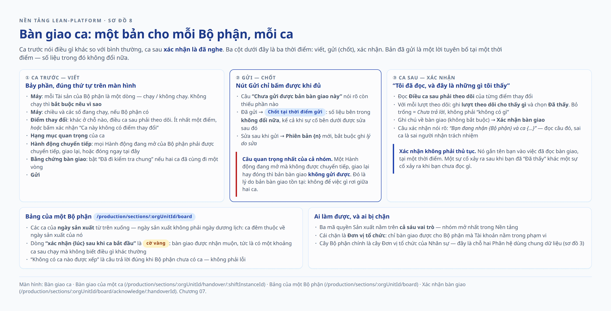
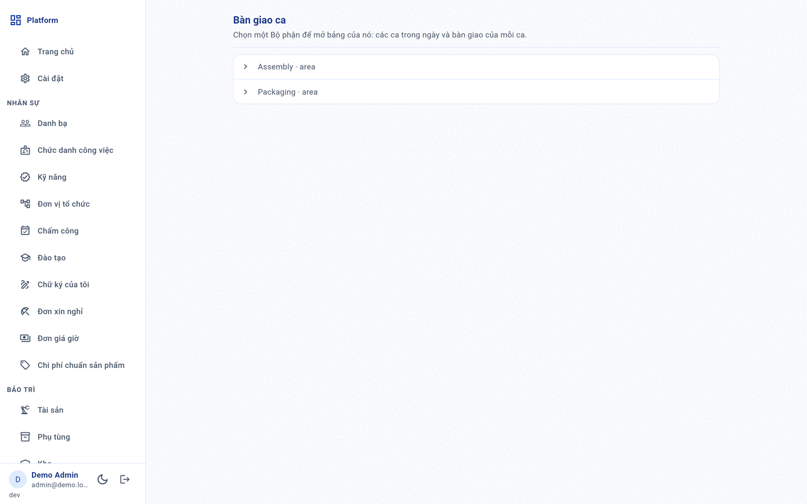
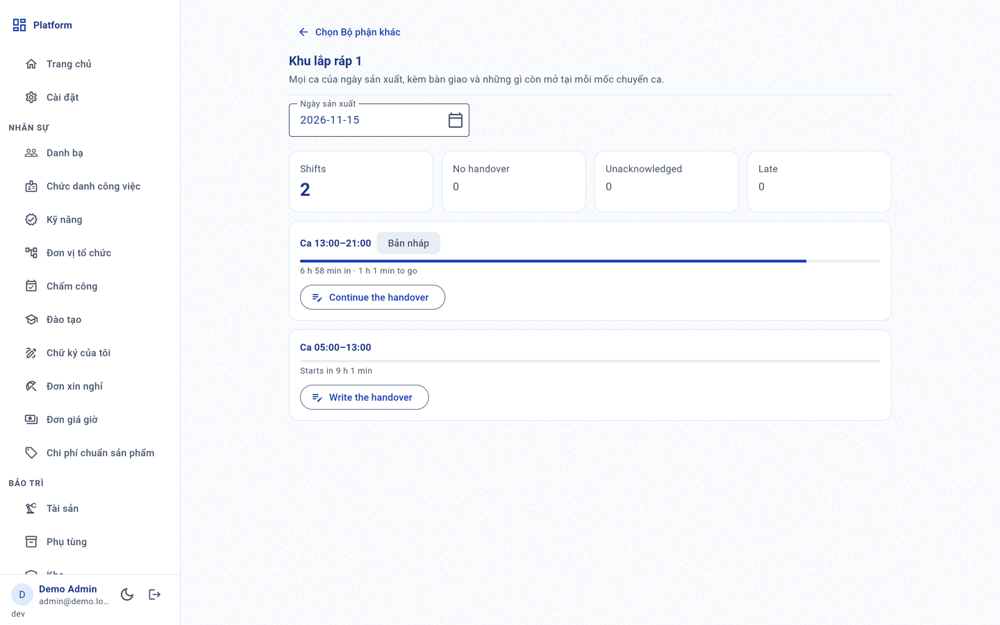
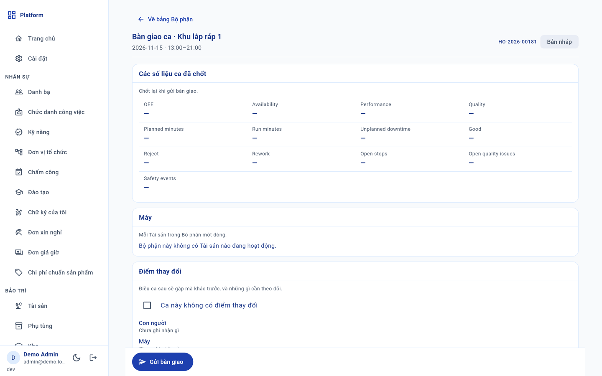
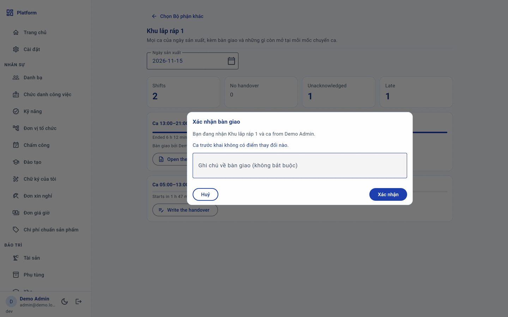

# 07 · Sản xuất

Nhóm **Sản xuất** có đúng một việc, nhưng nó là việc quan trọng nhất trong ngày trên
sàn: **bàn giao ca**. Ca trước nói cho ca sau biết điều gì khác so với bình thường,
và ca sau **xác nhận** là đã nghe.

**Một câu phải nói trước.** Nền tảng giữ **đúng một bản bàn giao cho mỗi Bộ phận, mỗi
lượt ca** — không phải mỗi người một bản. Nếu hai người cùng mở, họ đang sửa **cùng
một bản**.

---

***Sơ đồ 8.** Ba thời điểm: ca trước viết, gửi (chốt), ca sau xác nhận. Một Hành động
đang mở mà không được chuyển tiếp, giao lại hay đóng thì bản bàn giao không gửi được.*

---

## Chọn Bộ phận

| Hạng mục | Nội dung |
| --- | --- |
| **Công việc** | Mở bảng của một Bộ phận: chọn nó trong cây Đơn vị tổ chức — màn hình **Bàn giao ca**, `/production`. Phiếu 07.1. |
| **Ai thao tác được** | `PRD_HANDOVER_DISPLAY` — **mọi vai trò**. Phiếu này chỉ đọc. |
| **Vật tư, dữ liệu có trước** | Nhà máy có cây Đơn vị tổ chức (nhóm Nhân sự sở hữu), và Bộ phận cần mở đã có ca được xếp cho ngày hôm nay. |
| **Công cụ** | Ô **Nhà máy** (chỉ hiện khi Nền tảng có nhiều hơn một cơ sở); cây Đơn vị tổ chức với mũi tên **Mở rộng** / **Thu gọn** từng nhánh; dòng **Bộ phận** là dòng duy nhất bấm được. |
| **An toàn** | Không có thao tác ghi ở phiếu này. Một dòng không phải Bộ phận in tên kèm **loại đơn vị** và **không bấm được** — đó là thiết kế, không phải lỗi tài khoản. |
| **Thiết bị đào tạo** | Ảnh 07.1 |
| **Chủ tài liệu · Rev · Ngày · Trang** | Ban Lean Nền tảng · Rev 2 · 2026-11-15 · 07.1 |

| Các bước chính | Điểm then chốt | Vì sao | Minh hoạ |
| --- | --- | --- | --- |
| **1.** Chọn **Nhà máy**, nếu màn hình có ô này | [Dễ] Ô **Nhà máy** chỉ hiện khi Nền tảng có nhiều hơn một cơ sở | Nhà máy một cơ sở không có gì để chọn, nên đừng để người học đi tìm một ô không có | Ảnh 07.1 |
| **2.** Mở các nhánh bằng mũi tên cho tới dòng **Bộ phận** | [Hỏng] Chỉ dòng **Bộ phận** bấm mở được; dòng cấp trên in thêm **loại đơn vị** sau tên và chỉ mở/đóng nhánh | Người mới bấm vào tên một xưởng rồi kết luận "không có quyền" — nó chỉ là một nhánh, không phải một màn hình | Ảnh 07.1 |
| **3.** Bấm tên **Bộ phận** | [Dễ] Bảng mở ở **Ngày sản xuất** hôm nay; đổi ngày ở phiếu 07.2 | Bàn giao là việc của hôm nay; mở sẵn một ngày khác chỉ tổ mở nhầm ca | — |

***Ảnh 07.1.** Chọn một Bộ phận trong cây để mở bảng của nó — cây này là cây Đơn vị tổ chức, dùng chung với nhóm Nhân sự.*

---

## Bảng của một Bộ phận

| Hạng mục | Nội dung |
| --- | --- |
| **Công việc** | Nhìn cả ngày của một Bộ phận: mọi ca, bàn giao của mỗi ca, vị trí của ca đang chạy, và máy của từng ca — màn hình **Bảng của một Bộ phận**, `/production/sections/:orgUnitId/board`. Phiếu 07.2. |
| **Ai thao tác được** | Đọc: `PRD_HANDOVER_DISPLAY` — mọi vai trò. Nút **Xác nhận**: `PRD_HANDOVER_ACKNOWLEDGE`. |
| **Vật tư, dữ liệu có trước** | Ca đã được xếp cho ngày sản xuất đó; muốn xác nhận thì ca trước phải đã **gửi** bàn giao. |
| **Công cụ** | Ô **Ngày sản xuất**; mỗi ca một dòng **Ca {bắt đầu}–{kết thúc}** kèm chip trạng thái bàn giao, chip **Trễ** và các chip ngoại lệ; thanh vị trí ca và câu bên dưới; các ô máy mang **mã**, tên và trạng thái bằng chữ; nút mở bàn giao và nút **Xác nhận**. |
| **An toàn** | Ba chip ngoại lệ là ba tình trạng khác nhau — **Không có bàn giao**, **Chưa xác nhận**, **Sửa sau khi xác nhận**. Đọc chúng trước khi kết luận ca đó đã bàn giao xong. |
| **Thiết bị đào tạo** | Ảnh 07.2 |
| **Chủ tài liệu · Rev · Ngày · Trang** | Ban Lean Nền tảng · Rev 2 · 2026-11-15 · 07.2 |

| Các bước chính | Điểm then chốt | Vì sao | Minh hoạ |
| --- | --- | --- | --- |
| **1.** Chọn **Ngày sản xuất** | [Hỏng] **Ngày sản xuất** không phải ngày dương lịch: ca đêm thuộc về ngày sản xuất của nó | Mở nhầm ngày là mở nhầm ca, và mọi bước sau đó nói về ca của ngày khác | Ảnh 07.2 |
| **2.** Đọc từng dòng ca: giờ ca, chip trạng thái bàn giao, **Trễ**, và chip ngoại lệ | [Hỏng] Ba ngoại lệ nghĩa ba chuyện: **Không có bàn giao** (chưa ai viết), **Chưa xác nhận** (đã gửi, ca sau chưa nhận), **Sửa sau khi xác nhận** (đã nhận rồi mà bản bị sửa) | Người đào tạo đi kiểm một chuyện, và ba chip dẫn tới ba người khác nhau | Ảnh 07.2 |
| **3.** Đọc thanh vị trí ca và câu bên dưới | [Dễ] Câu dưới thanh đọc theo đồng hồ của chính máy bạn đang cầm — **{…} in · {…} to go**, **Starts in …** hoặc **Ended … ago** | Biết mình đang ở đâu trong ca là biết còn bao lâu trước khi phải bàn giao | Ảnh 07.2 |
| **4.** Đọc các ô máy của ca: mã, tên và trạng thái bằng chữ | [Hỏng] Màu chỉ nhóm trạng thái; **chữ** mới nói trạng thái — **Đang chạy**, **Chạy thủ công**, **Chờ**, **Dừng máy**, **Bảo trì**, **Vệ sinh**, **Đổi sản phẩm**, **Cô lập** | Đọc màu là đoán: một ô đỏ có thể là **Dừng máy** hoặc **Cô lập**, và hai chuyện đó cần hai người khác nhau | Ảnh 07.2 |
| **5.** Bấm nút mở bàn giao của ca | [Dễ] Nhãn in bằng tiếng Anh và đổi theo trạng thái: **Write the handover** (chưa có), **Continue the handover** (bản nháp), **Open the handover** (đã gửi) | Nói trước nhãn tiếng Anh để người học không dừng lại giữa buổi vì một nút lạ | — |
| **6.** Bấm **Xác nhận** — chỉ hiện khi bàn giao đã **gửi** | [An toàn] Nút **Xác nhận** chỉ hiện với bàn giao **Đã gửi**; bản nháp không xác nhận được | Xác nhận một bản nháp là nhận trách nhiệm cho một bản mà ca trước còn đang viết | — |

***Ảnh 07.2.** Cả ngày của một Bộ phận: số ca, số bàn giao, số chưa xác nhận và số nhận muộn — chip **Trễ** và câu **nhận muộn** là cờ vàng của người đào tạo.*

---

## Viết và gửi bàn giao

| Hạng mục | Nội dung |
| --- | --- |
| **Công việc** | Điền bản bàn giao của ca mình — máy nào đang ở trạng thái gì, điều gì khác thường, việc gì còn mở, ca sau phải để ý gì — rồi **gửi**. Màn hình **Bàn giao ca · {Bộ phận}**, `/production/sections/:orgUnitId/handover/:shiftInstanceId`. Phiếu 07.3. |
| **Ai thao tác được** | Ghi và gửi: `PRD_HANDOVER_WRITE`. Đọc: `PRD_HANDOVER_DISPLAY` — mọi vai trò. |
| **Vật tư, dữ liệu có trước** | Ca đã được xếp; dữ liệu **dừng máy** của ca đã có (quyết định danh sách máy); các Hành động đang mở của Bộ phận đã nêu. |
| **Công cụ** | Năm khối theo đúng thứ tự trên màn hình: **Các số liệu ca đã chốt**, **Máy**, **Điểm thay đổi**, **Hành động chuyển tiếp**, **Bằng chứng bàn giao**; nút **Gửi bàn giao**; panel đỏ **Chưa gửi được bản bàn giao này**. |
| **An toàn** | **Hành động chuyển tiếp không được bỏ trống.** Một Hành động đang mở mà không được chuyển tiếp, giao lại hay đóng thì bản bàn giao **không gửi được** — đây là lý do bản bàn giao tồn tại. |
| **Thiết bị đào tạo** | Ảnh 07.3 |
| **Chủ tài liệu · Rev · Ngày · Trang** | Ban Lean Nền tảng · Rev 2 · 2026-11-15 · 07.3 |

| Các bước chính | Điểm then chốt | Vì sao | Minh hoạ |
| --- | --- | --- | --- |
| **Chung** | [Hỏng] Một Bộ phận có **một** bản bàn giao cho mỗi ca, không phải mỗi người một bản | Hai người cùng mở là hai người đang sửa cùng một bản — người thứ hai ghi đè dòng của người thứ nhất | Ảnh 07.3 |
| **1.** Đọc khối **Các số liệu ca đã chốt** | [Hỏng] Ô nào server không có số thì in **—** kèm lý do ngay dưới ô; đó không phải số 0 | Ghi 0 cho một số chưa có là bịa một con số mà cả nhà máy sẽ đọc và tin | Ảnh 07.3 |
| **2.** Với mỗi dòng trong khối **Máy**: chọn **Trạng thái** — **Đang chạy**, **Chạy thủ công**, **Chờ**, **Dừng máy**, **Bảo trì**, **Vệ sinh**, **Đổi sản phẩm**, **Cô lập** | [Hỏng] Chip **Chưa có dòng nào** nghĩa là máy đã dừng trong ca này mà ca chưa giải thích; máy chạy bình thường thì không có dòng nào | Danh sách máy do dữ liệu dừng máy của ca quyết định — không ai phải điểm danh từng máy mỗi ca | Ảnh 07.3 |
| **3.** Ghi **Ghi chú** khi trạng thái không phải đang chạy bình thường | [An toàn] Ô ghi chú mang dòng **Bắt buộc: nêu vì sao máy không chạy bình thường**; thiếu lý do thì bản bàn giao không gửi được | Một dòng "Dừng máy" không có lý do là một câu hỏi mà ca sau phải đi hỏi người đã về | Ảnh 07.3 |
| **4.** Chọn **Bất thường** (**Không thấy gì** hoặc một trong bảy loại), ghi **Điều ca sau phải theo dõi**, bật **Đã đi kiểm tra**, rồi bấm **Ghi dòng** | [Dễ] Nút chỉ bấm được sau khi đã chọn **Trạng thái**, và dòng đã lưu đổi nhãn thành **Lưu dòng** | Lưu từng dòng ngay là mất điện hay hết ca giữa chừng cũng không mất việc đã ghi | — |
| **5.** Khối **Điểm thay đổi**: bật **Ca này không có điểm thay đổi**, hoặc thêm từng điểm theo **Chiều** (**Con người**, **Máy**, **Vật tư**, **Phương pháp**) với **Khác ở chỗ nào** và **Điều ca sau phải để ý**, rồi bấm **Thêm điểm thay đổi** | [Hỏng] Phải trả lời **một trong hai**: bật ô, hoặc thêm ít nhất một điểm. Bỏ trống cả hai thì khối này bị tính là chưa trả lời | Không ai ghi gì thì ca sau không biết là "không có gì khác" hay "chưa ai điền" | — |
| **6.** Khối **Hành động chuyển tiếp**: mỗi Hành động đang mở, chọn **Phương án xử lý** — **Chuyển tiếp**, **Giao lại** (kèm **Người phụ trách mới**) hoặc **Đã đóng** (kèm **Điều gì đã đóng nó**) — rồi bấm **Ghi nhận phương án xử lý** | [An toàn] Ba phương án đòi ba bằng chứng khác nhau: giao lại phải nêu người, đóng phải nêu điều gì đóng nó. Hành động đang mở mà chưa có phương án thì bản bàn giao không gửi được | Bàn giao là chỗ duy nhất việc đang mở buộc phải có người nhận, nên không có việc nào rơi giữa hai ca | — |
| **7.** Khối **Bằng chứng bàn giao**: bật **Đã đi kiểm tra chung**, ghi **Hạng mục quan trọng**, chọn **Sai khác so với bàn giao chuẩn** (**Không**, **Muộn**, **Một phần**, **Không có Tổ trưởng ca sau**), rồi bấm **Lưu bằng chứng** | [Dễ] Đây là ô ghi lại cách hai ca **thực sự** bàn giao, không phải cách đúng — chọn **Không** khi mọi thứ diễn ra bình thường | Một buổi bàn giao chuẩn không có bằng chứng thì không phân biệt được với một buổi bàn giao qua điện thoại | — |
| **8.** Bấm **Gửi bàn giao** | [An toàn] Còn thiếu gì thì panel **Chưa gửi được bản bàn giao này** liệt kê từng dòng: máy nào thiếu lý do, dòng nào thiếu tham chiếu, khối nào chưa trả lời, Hành động nào chưa có phương án | Đọc hết danh sách rồi mới sửa: sửa một dòng rồi gửi lại là gặp dòng tiếp theo, và ca sau chờ | — |

***Ảnh 07.3.** Bản bàn giao của ca đang mở: phần **Máy**, **Điểm thay đổi**, **Hành động chuyển tiếp**, **Bằng chứng bàn giao** — điền theo đúng thứ tự này.*

**Sửa sau khi đã gửi.** Một bản đã gửi in chip **Phiên bản {n}**; sửa nó tạo **phiên bản
mới**, phải ghi **Sai khác so với bàn giao chuẩn**, và bản gốc vẫn nằm trong lịch sử —
số liệu bên trong **Các số liệu ca đã chốt** thì đã chốt tại thời điểm gửi và không đổi
nữa.

---

## Xác nhận bàn giao

| Hạng mục | Nội dung |
| --- | --- |
| **Công việc** | Ca sau nói rõ: tôi đã đọc bàn giao của ca trước, và mỗi điều ca trước dặn theo dõi thì tôi thấy gì — hộp thoại **Xác nhận bàn giao**, `/production/sections/:orgUnitId/board/acknowledge/:handoverId`. Phiếu 07.4. |
| **Ai thao tác được** | `PRD_HANDOVER_ACKNOWLEDGE` — **mọi vai trò**. |
| **Vật tư, dữ liệu có trước** | Bàn giao của ca trước đã **gửi** (chip **Đã gửi** trên bảng Bộ phận). |
| **Công cụ** | Câu **Bạn đang nhận {Bộ phận} và ca {…}**; khối **Mỗi lượt theo dõi cho thấy gì** với ô **Đã thấy** và ô **Ghi chú (không bắt buộc)** cho từng điểm; ô **Ghi chú về bàn giao (không bắt buộc)**; hai nút **Huỷ** và **Xác nhận**. |
| **An toàn** | Xác nhận **không phải** thủ tục: nó gắn tên bạn vào việc đã đọc, tại một thời điểm. Đọc câu **Bạn đang nhận …** trước khi bấm. |
| **Thiết bị đào tạo** | Ảnh 07.4 |
| **Chủ tài liệu · Rev · Ngày · Trang** | Ban Lean Nền tảng · Rev 2 · 2026-11-15 · 07.4 |

| Các bước chính | Điểm then chốt | Vì sao | Minh hoạ |
| --- | --- | --- | --- |
| **1.** Đọc câu đầu: **Bạn đang nhận {Bộ phận} và ca {…}** | [An toàn] Đọc câu đó: sai ca là nhận trách nhiệm cho ca của người khác | Người nhận trách nhiệm là người đã xác nhận, không phải người đã gửi | Ảnh 07.4 |
| **2.** Với mỗi điểm thay đổi: đọc **Theo dõi: {…}**, chọn **Đã thấy** — **Đạt**, **Cần lưu ý** hoặc **Chưa chạy** | [Hỏng] Để nguyên **Chưa trả lời** nghĩa là **không có kết quả**, không phải "đạt" | Bằng chứng duy nhất rằng bạn đã thực sự theo dõi là kết quả của từng lượt, không phải cái nút đã bấm | — |
| **3.** Ghi **Ghi chú** cho lượt nào cần, và **Ghi chú về bàn giao** nếu có gì muốn nói thêm | [Dễ] Ô ghi chú từng lượt nằm ngay dưới ô **Đã thấy** của lượt đó | Một chữ "Cần lưu ý" không nói được là lưu ý điều gì | — |
| **4.** Bấm **Xác nhận** | [Dễ] Nút đổi thành **Đang xác nhận…** trong lúc gửi. Ca trước khai **không có điểm thay đổi** thì hộp thoại nói rõ, và bạn vẫn xác nhận được | Không có gì để theo dõi không phải là không có gì để xác nhận | — |

***Ảnh 07.4.** Câu đầu nói bạn đang nhận Bộ phận và ca nào; mỗi điểm thay đổi một lượt theo dõi, và **Ghi chú về bàn giao** là chỗ nói thêm.*

---

## Bảng tóm tắt phần Sản xuất

| Việc | Mọi vai trò | Người vận hành | Giám sát | Kỹ sư | Quản lý | Quản trị viên |
| --- | :-: | :-: | :-: | :-: | :-: | :-: |
| Xem bảng Bộ phận, xem bàn giao | ✓ | ✓ | ✓ | ✓ | ✓ | ✓ |
| Xác nhận bàn giao của ca trước | ✓ | ✓ | ✓ | ✓ | ✓ | ✓ |
| Viết và gửi bàn giao của ca mình | ✓ | ✓ | ✓ | ✓ | ✓ | ✓ |

**Toàn bộ ba mã quyền Sản xuất nằm trên cả sáu vai trò** — Sản xuất là nhóm mở nhất
trong Nền tảng. Cái chặn là **Đơn vị tổ chức**: bạn chỉ bàn giao được cho Bộ phận mà
Tài khoản của bạn nằm trong phạm vi.
