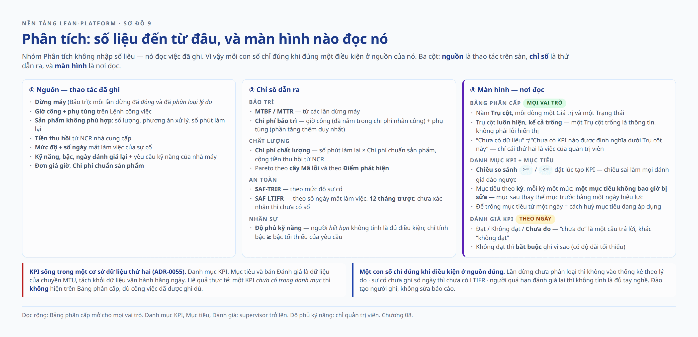
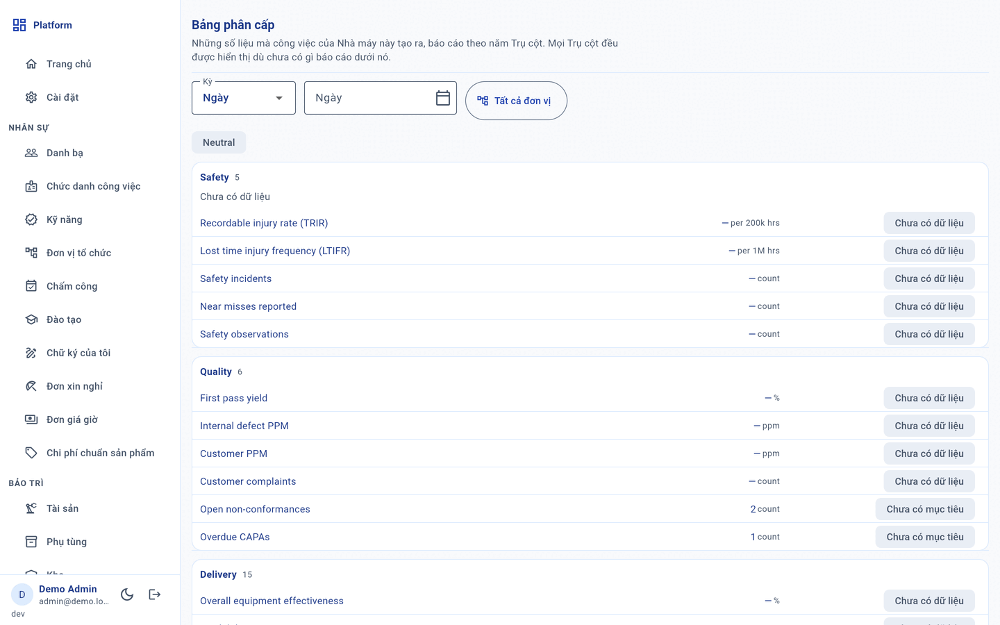
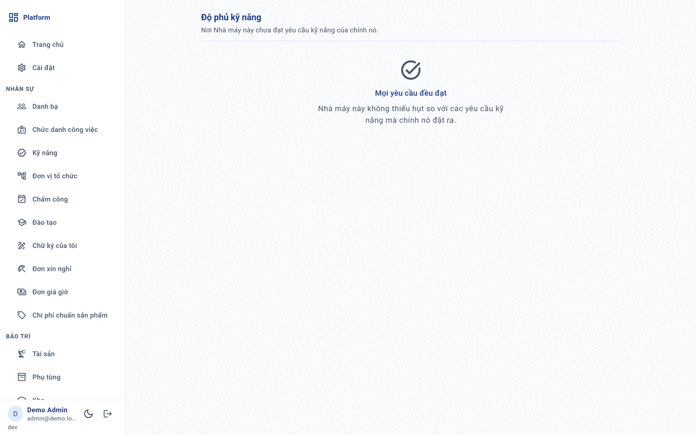

# 08 · Phân tích

Nhóm **Phân tích** trả lời "nhà máy đang chạy thế nào" bằng **số liệu đã có sẵn trong
Nền tảng**, không phải bằng cách nhập thêm.

Có một điều phải nói trước, vì nó giải thích gần hết các câu hỏi về nhóm này: **KPI
sống trong một cơ sở dữ liệu thứ hai** (ADR-0055). Danh mục KPI, Mục tiêu và bản Đánh
giá là dữ liệu của chuyền MTU, tách khỏi dữ liệu vận hành hằng ngày. Vì vậy một KPI
chưa có trong danh mục thì **không** hiện trên Bảng phân cấp, dù công việc đã được ghi
đủ.

**Ba phiếu KPI của chương này không có ảnh chụp, và đó là chuyện của môi trường, không
phải của tài liệu.** Bản demo dùng để chụp màn hình không cấu hình cơ sở dữ liệu KPI
(`MTU_DATABASE_URL`), nên ba màn hình **Danh mục KPI**, **Mục tiêu của một KPI** và
**Đánh giá KPI** mở ra rỗng. Người đào tạo dạy ba phiếu đó trên bản triển khai thật.

---

***Sơ đồ 9.** Ba cột: thao tác đã ghi trên sàn, chỉ số dẫn ra, màn hình nơi đọc. Mỗi con
số chỉ đúng khi đúng một điều kiện ở nguồn của nó.*

---

## Bảng phân cấp

| Hạng mục | Nội dung |
| --- | --- |
| **Công việc** | Đọc những số liệu mà công việc của Nhà máy này tạo ra, báo cáo theo **năm Trụ cột** — màn hình **Bảng phân cấp**, `/tier-board`. Phiếu 08.1. |
| **Ai thao tác được** | `INS_TIER_BOARD_DISPLAY` — **mọi vai trò**. Màn hình chỉ đọc. |
| **Vật tư, dữ liệu có trước** | Nhà máy đã có **Trụ cột**, và KPI đã có trong **Danh mục KPI** (phiếu 08.2) kèm **Mục tiêu** (phiếu 08.3) nếu muốn thấy màu. |
| **Công cụ** | Ô **Nhà máy** (chỉ hiện khi có nhiều hơn một cơ sở); ô **Kỳ**; ô **Ngày** (không bắt buộc, xoá được); nút lọc Đơn vị tổ chức mang tên đơn vị đang lọc hoặc **Tất cả đơn vị**; dải chú giải màu; các làn Trụ cột với ba cột **KPI**, **Giá trị**, **Trạng thái**. |
| **An toàn** | Màn hình không có thao tác ghi. Chú giải màu in bằng tiếng Anh (**Success**, **Warning**, **Danger**, **Neutral**) — đọc chữ trên từng dòng, đừng dạy người học đoán theo màu. |
| **Thiết bị đào tạo** | Ảnh 08.1 |
| **Chủ tài liệu · Rev · Ngày · Trang** | Ban Lean Nền tảng · Rev 2 · 2026-11-15 · 08.1 |

| Các bước chính | Điểm then chốt | Vì sao | Minh hoạ |
| --- | --- | --- | --- |
| **1.** Chọn **Kỳ** — **Ngày**, **Tuần** hoặc **Tháng** | [Hỏng] **Kỳ** là độ dài thời gian mà KPI được đo và đánh giá; đổi Kỳ là đổi cả cột **Mục tiêu** lẫn **Trạng thái** | KPI đặt Mục tiêu theo tháng mà đọc ở Kỳ **Ngày** sẽ hiện **Chưa có mục tiêu**, và người đọc tưởng KPI đó chưa ai đặt mức | Ảnh 08.1 |
| **2.** Chọn **Ngày** — không bắt buộc, ô có nút xoá | [Dễ] Bỏ trống ô **Ngày** là đọc kỳ đang chạy; chọn một ngày là đọc đúng ngày đó | Xem lại một ngày đã qua là cách duy nhất trả lời "hôm đó số thế nào" | Ảnh 08.1 |
| **3.** Thu hẹp bằng nút **Tất cả đơn vị**, chọn một Đơn vị tổ chức trong **Lọc theo Đơn vị tổ chức** | [Hỏng] Chọn một đơn vị là đọc số của nó **và mọi thứ bên dưới** nó; xoá về **Tất cả đơn vị** là đọc toàn Nhà máy | Chọn một tổ mà đọc ra số của cả bộ phận là kết luận sai về một tổ đang chạy tốt | Ảnh 08.1 |
| **4.** Đọc từng dòng KPI: **Giá trị** và **Trạng thái** | [Hỏng] **Chưa có dữ liệu** ≠ **Chưa có mục tiêu**: một cái là chưa ai làm, cái kia là chưa ai đặt mức. Hai trạng thái nữa là **Đạt mục tiêu**, **Gần mục tiêu**, **Không đạt mục tiêu** | Chỉ cái thứ hai mới là việc của quản trị viên; sửa nhầm cái thứ nhất là đi tìm một con số không có | Ảnh 08.1 |
| **5.** Đọc dải chú giải màu ở đầu bảng | [Dễ] Chú giải chỉ hiện những màu **đang có trên bảng**, và mỗi ô trạng thái luôn có chữ đi kèm | Một dải chú giải đủ bốn màu khi bảng chỉ có hai là dấu hiệu bảng chưa đọc xong | Ảnh 08.1 |

***Ảnh 08.1.** Bốn Trụ cột đều hiện, kể cả Trụ cột chưa có gì báo cáo — chọn một kỳ, rồi đọc từng Trụ cột.*

> **Điểm then chốt.** Mọi Trụ cột **luôn hiện**, kể cả trống — chính màn hình nói câu
> đó: "Mọi Trụ cột đều được hiển thị dù chưa có gì báo cáo dưới nó." Một Trụ cột trống
> là một thông tin, không phải một lỗi hiển thị.

> **Vì sao.** Bỏ một Trụ cột trống đi thì không ai nhận ra nhà máy chưa đo gì dưới Trụ
> cột đó.

---

## Danh mục KPI

| Hạng mục | Nội dung |
| --- | --- |
| **Công việc** | Đọc và khai báo các KPI của chuyền MTU, kèm **Mục tiêu đang áp dụng theo từng kỳ** và trạng thái đánh giá hôm nay — màn hình **Danh mục KPI**, `/kpi`. Phiếu 08.2. |
| **Ai thao tác được** | Đọc: `INS_KPI_CATALOGUE_DISPLAY` — supervisor, engineer, manager, quản trị viên. Thêm KPI: `INS_KPI_CATALOGUE_CHANGE` — cùng bốn vai trò đó. |
| **Vật tư, dữ liệu có trước** | Cơ sở dữ liệu KPI đã cấu hình (`MTU_DATABASE_URL`). Bản demo của tài liệu không có nó, nên phiếu này không có ảnh chụp. |
| **Công cụ** | Nút **Thêm KPI**; ô **Lọc KPI** (theo mã hoặc tiêu đề); bảng với các cột **KPI**, **Unit**, **Direction**, **Daily**, **Weekly**, **Monthly**, **Today**; hộp thoại **Thêm KPI** với **Mã**, **Tiêu đề**, **Chiều so sánh**, **Đơn vị (không bắt buộc)**, **Số chữ số thập phân**, **Chỉ số giá trị (không bắt buộc)**. |
| **An toàn** | **Chiều so sánh** và **Đơn vị** đặt một lần lúc tạo KPI; **Chiều so sánh** sai thì mọi bản đánh giá sau đó đảo ngược. Kiểm hai trường này trước khi đặt Mục tiêu đầu tiên. |
| **Thiết bị đào tạo** | — |
| **Chủ tài liệu · Rev · Ngày · Trang** | Ban Lean Nền tảng · Rev 2 · 2026-11-15 · 08.2 |

| Các bước chính | Điểm then chốt | Vì sao | Minh hoạ |
| --- | --- | --- | --- |
| **1.** Chọn **Nhà máy**, tìm bằng ô **Lọc KPI** | [Dễ] Ô lọc tìm theo **mã** hoặc **tiêu đề**, và tự báo số dòng khớp trên tổng số dòng | Danh mục của một chuyền đủ dài để tìm nhanh hơn cuộn | — |
| **2.** Bấm **Thêm KPI**: ghi **Mã** (ví dụ `OEE`), **Tiêu đề**, chọn **Chiều so sánh** | [Hỏng] **Chiều so sánh** in ra đúng nghĩa: ">= là đạt khi bằng hoặc trên Mục tiêu, <= là đạt khi bằng hoặc dưới" | Chọn `>=` cho một KPI "phế phẩm" là chấm nó **đạt** khi phế phẩm tăng | — |
| **3.** Ghi **Đơn vị (không bắt buộc)**, **Số chữ số thập phân** (số nguyên 0–6), **Chỉ số giá trị (không bắt buộc)** | [Dễ] **Số chữ số thập phân** chỉ là cách **hiển thị** con số, không phải làm tròn dữ liệu | Đặt 0 chữ số cho một chỉ số phần trăm là đọc ra "12%" cho cả 12,4% và 11,6% | — |
| **4.** Đọc một dòng: **Mục tiêu** theo **Daily**, **Weekly**, **Monthly** và cột **Today** | [Hỏng] Ba cột mục tiêu là ba kỳ; ô **—** nghĩa là kỳ đó **chưa có** Mục tiêu, không phải mục tiêu bằng 0 | Một KPI chỉ có mục tiêu tháng sẽ không bao giờ được chấm ở kỳ ngày, và đó là lý do nó hiện **Chưa có mục tiêu** trên bảng | — |
| **5.** Bấm một dòng để mở **Mục tiêu** của KPI đó | [Dễ] Cả dòng là một liên kết; không có nút sửa trên danh mục — KPI đã tạo thì sửa ở đây không được | Người mới tìm nút sửa mã KPI trên danh mục và kết luận không có quyền | — |

---

## Mục tiêu của một KPI

| Hạng mục | Nội dung |
| --- | --- |
| **Công việc** | Xem KPI này được đánh giá theo mức nào **hôm nay**, từ **khi nào**, và toàn bộ lịch sử; đặt mức mới — màn hình **Mục tiêu KPI**, `/kpi/:kpiId/targets`. Phiếu 08.3. |
| **Ai thao tác được** | Đọc: `INS_KPI_CATALOGUE_DISPLAY`. Đặt mục tiêu: `INS_KPI_CATALOGUE_CHANGE` — supervisor, engineer, manager, quản trị viên. |
| **Vật tư, dữ liệu có trước** | KPI đã có trong **Danh mục KPI** (phiếu 08.2); cơ sở dữ liệu KPI đã cấu hình. |
| **Công cụ** | Khối **Đang áp dụng** với các dòng **{kỳ}: {giá trị} (từ {ngày})**; nút **Đổi Mục tiêu** mở hộp thoại với **Kỳ**, **Mục tiêu**, **Hiệu lực từ**, **Ghi chú (không bắt buộc)**; khối **Lịch sử**. |
| **An toàn** | **Một mục tiêu không bao giờ bị sửa**: mục sau **thay thế** mục trước bằng một ngày hiệu lực. Sửa quá khứ làm báo cáo đã nộp thành sai, và Nền tảng không cho. |
| **Thiết bị đào tạo** | — |
| **Chủ tài liệu · Rev · Ngày · Trang** | Ban Lean Nền tảng · Rev 2 · 2026-11-15 · 08.3 |

| Các bước chính | Điểm then chốt | Vì sao | Minh hoạ |
| --- | --- | --- | --- |
| **1.** Đọc khối **Đang áp dụng** | [Hỏng] "Hôm nay không có Mục tiêu nào đang áp dụng." là một trạng thái **hợp lệ**, và khác "chưa đặt Mục tiêu nào" | Một KPI chưa có mức là một quyết định còn thiếu, không phải một lỗi dữ liệu | — |
| **2.** Bấm **Đổi Mục tiêu**: chọn **Kỳ**, ghi **Mục tiêu**, chọn **Hiệu lực từ** | [Hỏng] **Hiệu lực từ** phải là **hôm nay hoặc muộn hơn**; hộp thoại in hôm nay của Nhà máy để bạn đối chiếu | Đặt mục tiêu lùi ngày là sửa lại một báo cáo đã nộp — Nền tảng từ chối, và đó là chủ ý | — |
| **3.** Để **Mục tiêu** trống nếu muốn từ ngày đó **không có mục tiêu** | [Hỏng] Để trống là **huỷ** mức đang áp dụng, không phải "xoá" một dòng lịch sử; hộp thoại nói rõ: "Để trống nghĩa là từ ngày đó không có mục tiêu." | Một KPI không còn mục tiêu thì không bị chấm đạt/không đạt nữa — khác hẳn một KPI bị đặt mức 0 | — |
| **4.** Ghi **Ghi chú (không bắt buộc)**, bấm **Lưu** | [Dễ] Ghi chú là chỗ duy nhất giải thích **vì sao** mức đổi | Sáu tháng sau, người đọc lịch sử chỉ thấy những con số và một khoảng trống không giải thích được | — |
| **5.** Đọc khối **Lịch sử** | [Dễ] Dòng đầu khối nói sẵn quy tắc: **Mới nhất trước. Một mục không bao giờ bị sửa — mục sau thay thế mục trước.** | Người mới thường đi tìm chức năng "sửa mục tiêu"; nói trước là không có, và không nên có | — |

---

## Đánh giá KPI

| Hạng mục | Nội dung |
| --- | --- |
| **Công việc** | Chấm từng KPI của chuyền MTU theo **Mục tiêu ngày** của nó: **đạt**, **không đạt** hoặc **chưa đo** — màn hình **Đánh giá KPI**, `/kpi/review`. Phiếu 08.4. |
| **Ai thao tác được** | Đọc: `INS_KPI_REVIEW_DISPLAY`. Ghi: `INS_KPI_REVIEW_RECORD` — supervisor, engineer, manager, quản trị viên. |
| **Vật tư, dữ liệu có trước** | KPI đã có trong Danh mục, và **Mục tiêu ngày** đã đặt (phiếu 08.3) nếu muốn chấm được **Đạt**. |
| **Công cụ** | Ô **Nhà máy**, ô **Ngày**, ô **Lọc KPI** (theo tiêu đề); dải chú giải ba biểu tượng; mỗi KPI một ô với **Mục tiêu ngày: {mức}** và ba biểu tượng chấm; nút **Lưu**; dòng nhắc khi bộ lọc đang che thay đổi. |
| **An toàn** | **Chưa đo** là một câu trả lời, và nó khác **Không đạt**. Gộp hai thứ làm một là làm chỉ số trông tệ hơn thực tế và giấu mất việc thiếu dữ liệu. |
| **Thiết bị đào tạo** | — |
| **Chủ tài liệu · Rev · Ngày · Trang** | Ban Lean Nền tảng · Rev 2 · 2026-11-15 · 08.4 |

| Các bước chính | Điểm then chốt | Vì sao | Minh hoạ |
| --- | --- | --- | --- |
| **1.** Chọn **Nhà máy** và **Ngày** | [Hỏng] Bản đánh giá là **theo ngày**: lùi ngày để chấm bù ngày đã bỏ | Một ngày bỏ trống là một ngày không có kết luận, và tháng đó thiếu đúng ngày ấy | — |
| **2.** Với từng KPI, bấm một trong ba biểu tượng chấm: **Đạt**, **Không đạt**, **Chưa đo** | [Hỏng] KPI **chưa có Mục tiêu ngày** thì biểu tượng **Đạt** bị khoá — không có mức thì không thể đạt mức | Chấm **Đạt** cho một KPI không có mục tiêu là ghi một kết luận mà không ai đặt chuẩn | — |
| **3.** KPI **Không đạt**: ghi lý do vào ô **Vì sao không đạt Mục tiêu ({mức})?** | [Hỏng] Ô ghi chú có **độ dài tối thiểu**, và hộp thoại đếm ngay dưới ô: **Khi một KPI không đạt phải ghi chú ít nhất {n} ký tự (hiện có {m}).** Nút **Xác nhận** chỉ bấm được khi đủ | Lý do là thứ duy nhất biến một con số đỏ thành một việc phải làm | — |
| **4.** Đọc dải chú giải ba biểu tượng trước khi chấm | [Dễ] Mỗi biểu tượng có cả **chữ** trong chú giải — đừng dạy người học nhớ hình | Ba biểu tượng tròn gần giống nhau; nhớ nhầm là chấm ngược cả ngày | — |
| **5.** Bấm **Lưu** | [An toàn] Xoá ô **Lọc KPI** trước khi bấm: đang gõ dở mà bộ lọc bật thì một số KPI đã sửa **bị ẩn**, và màn hình chỉ nhắc bằng một dòng **{n} KPI đã thay đổi đang bị tìm kiếm ẩn đi.** | Thay đổi vẫn được lưu — bạn chỉ không nhìn thấy chúng, nên dễ tưởng mình chưa chấm và chấm lại | — |
| **6.** Đọc thông báo xác nhận: **Đã lưu {n} … cho {ngày}.** | [Dễ] Con số trong câu là số KPI đã ghi, không phải số KPI trên màn hình | Người chấm bù ba ngày cần biết lần lưu này đã ghi được mấy dòng | — |

---

## Độ phủ kỹ năng

| Hạng mục | Nội dung |
| --- | --- |
| **Công việc** | Đọc nơi Nhà máy này **chưa đạt yêu cầu kỹ năng của chính nó** — tức chỗ thiếu người đủ tay nghề — màn hình **Độ phủ kỹ năng**, `/skill-coverage`. Phiếu 08.5. |
| **Ai thao tác được** | `INS_SKILL_COVERAGE_DISPLAY` — **chỉ quản trị viên**. |
| **Vật tư, dữ liệu có trước** | Nhà máy đã đặt **Yêu cầu kỹ năng** (số người tối thiểu ở một bậc), và Nhân viên đã có bản ghi **Kỹ năng** kèm ngày đánh giá lại. |
| **Công cụ** | Ô **Nhà máy**; ô **Lọc độ phủ kỹ năng** (theo Đơn vị tổ chức hoặc kỹ năng); mỗi dòng một yêu cầu với **Cần {n} người ở bậc {m}+**, **Đủ điều kiện**, **Hết hạn**, **Thiếu {n}**; bấm một dòng mở danh sách người. |
| **An toàn** | Màn hình chỉ đọc. Danh sách này là **chỗ thiếu**, không phải bảng điểm: một dòng vắng mặt nghĩa là yêu cầu đó đang đủ người. |
| **Thiết bị đào tạo** | Ảnh 08.2 |
| **Chủ tài liệu · Rev · Ngày · Trang** | Ban Lean Nền tảng · Rev 2 · 2026-11-15 · 08.5 |

| Các bước chính | Điểm then chốt | Vì sao | Minh hoạ |
| --- | --- | --- | --- |
| **1.** Chọn **Nhà máy**, rồi thu hẹp bằng ô **Lọc độ phủ kỹ năng** | [Dễ] Ô lọc tìm theo **Đơn vị tổ chức** hoặc **kỹ năng**, và màn hình **Mọi yêu cầu đều đạt** là trạng thái tốt, không phải danh sách rỗng hỏng | Người mới thấy danh sách trống hay tưởng mất dữ liệu, rồi đi kiểm tra lại yêu cầu kỹ năng | Ảnh 08.2 |
| **2.** Đọc từng dòng: **Cần {n} người ở bậc {m}+**, **Đủ điều kiện**, **Hết hạn**, **Thiếu {n}** | [Hỏng] Người **hết hạn** đã có kỹ năng nhưng quá chu kỳ đánh giá lại — họ **không** tính vào **Đủ điều kiện** | Hai con số này là chỗ hay bị đọc lẫn: đủ nguồn lực trên giấy và đủ người còn hiệu lực là hai chuyện | Ảnh 08.2 |
| **3.** Bấm một dòng để xem **ai đang có kỹ năng đó** và ai **hết hạn** | [Dễ] Danh sách người là câu trả lời cho "thiếu ai", không phải bảng xếp hạng | Đào tạo lại một người hết hạn rẻ hơn tuyển một người mới, và chỉ danh sách này cho biết ai | Ảnh 08.2 |

***Ảnh 08.2.** Nơi Nhà máy chưa đạt yêu cầu kỹ năng của chính nó — danh sách thiếu hụt, không phải một bảng điểm.*

**Điểm then chốt.** Độ phủ tính trên **bậc tối thiểu** của yêu cầu. Một người ở bậc
cao hơn vẫn tính; một người ở bậc thấp hơn thì **không**.

> **Điểm then chốt thứ hai.** Yêu cầu kỹ năng do **chính Nhà máy** đặt. Một chỗ "đủ"
> chỉ có nghĩa là đủ so với mức nhà máy tự đặt, không phải đủ so với chuẩn của ai khác.

---

## Bảng tóm tắt phần Phân tích

| Việc | Mọi vai trò | Người vận hành | Giám sát | Kỹ sư | Quản lý | Quản trị viên |
| --- | :-: | :-: | :-: | :-: | :-: | :-: |
| Xem **Bảng phân cấp** | ✓ | ✓ | ✓ | ✓ | ✓ | ✓ |
| Xem **Danh mục KPI**, **Mục tiêu**, **Đánh giá KPI** | · | · | ✓ | ✓ | ✓ | ✓ |
| Thêm KPI, đổi Mục tiêu | · | · | ✓ | ✓ | ✓ | ✓ |
| Ghi bản Đánh giá KPI | · | · | ✓ | ✓ | ✓ | ✓ |
| **Độ phủ kỹ năng** | · | · | · | · | · | ✓ |

Cả bốn mã quyền của nhóm này **không** nằm trên nhóm mặc định — trừ
`INS_TIER_BOARD_DISPLAY`, thứ mà mọi vai trò đều có.
