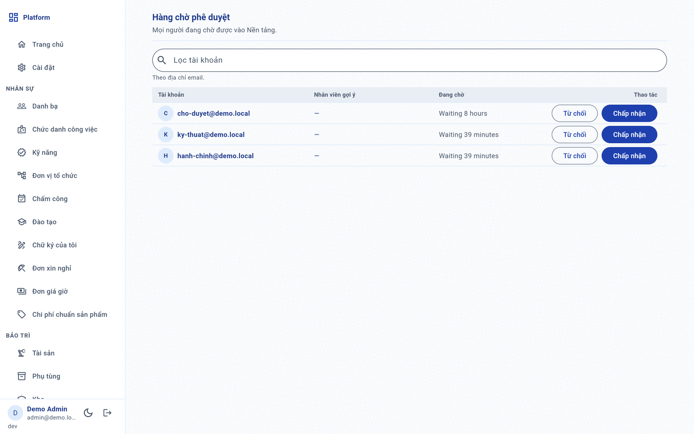
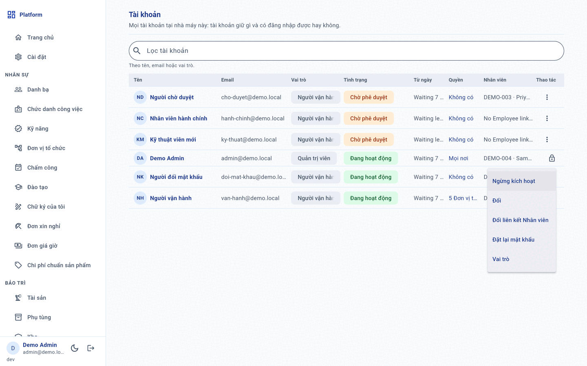
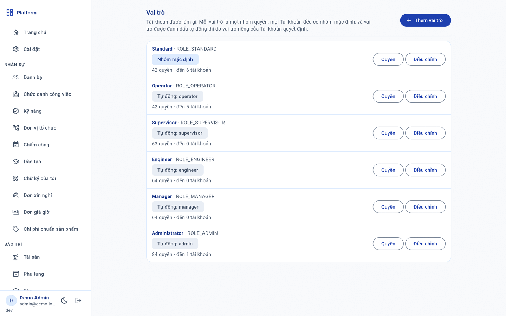

# 09 · Quản trị

Ba màn hình của nhóm này chỉ quản trị viên mở được, và chúng là **ba màn hình duy nhất
trong tài liệu mà một cú bấm sai không sửa lại được bằng cách bấm ngược**.

- **Phê duyệt** (`/approvals`) — cho một Tài khoản vào Nền tảng, và chọn vai trò của nó.
- **Tài khoản** (`/accounts`) — Tài khoản đang giữ gì, đăng nhập được không.
- **Vai trò** (`/roles`) — vai trò nào mang những mã quyền nào.

Đọc hết chương này trước khi dạy. Một người học bấm **Phân công** để thử, trên một Tài
khoản thật, là một người đã có thêm quyền mà không ai định cấp.

---

## Hàng chờ phê duyệt

| Hạng mục | Nội dung |
| --- | --- |
| **Công việc** | Cho người vừa đăng nhập lần đầu vào Nền tảng — hoặc từ chối họ — và chọn **vai trò** họ giữ. Màn hình **Hàng chờ phê duyệt**, `/approvals`. Phiếu 09.1. |
| **Ai thao tác được** | Đọc: `ADM_APPROVALS_DISPLAY`. Chấp nhận / Từ chối: `ADM_APPROVALS_DECIDE` — **chỉ quản trị viên**. |
| **Vật tư, dữ liệu có trước** | Người đó đã đăng nhập lần đầu bằng tài khoản Google của họ. Nếu họ đã có **Nhân viên** trong Danh bạ, chọn luôn ở bước 2. |
| **Công cụ** | Ô **Lọc tài khoản** (theo địa chỉ email); mỗi dòng một Tài khoản đang chờ với hai nút **Chấp nhận** và **Từ chối**; hộp thoại **Chấp nhận tài khoản này** với ô **Nhân viên**, danh sách vai trò, và khối **Quyền trên Đơn vị tổ chức**. |
| **An toàn** | Chọn vai trò **Quản trị viên** thì một dải đỏ hiện ra và khối Đơn vị tổ chức **biến mất** — quản trị viên thao tác ở mọi nơi và không cần quyền nào. Đọc dải đỏ đó trước khi bấm **Chấp nhận**. |
| **Thiết bị đào tạo** | Ảnh 09.1 |
| **Chủ tài liệu · Rev · Ngày · Trang** | Ban Lean Nền tảng · Rev 2 · 2026-11-15 · 09.1 |

| Các bước chính | Điểm then chốt | Vì sao | Minh hoạ |
| --- | --- | --- | --- |
| **1.** Mở **Hàng chờ phê duyệt**, tìm bằng ô **Lọc tài khoản** | [Hỏng] Không có thông báo nào khi có người chờ — màn hình này là đường duy nhất | Người mới đăng nhập đứng ở màn hình chờ và không ai gọi quản trị viên; họ chỉ được vào khi ai đó mở màn hình này | Ảnh 09.1 |
| **2.** Bấm **Chấp nhận** trên dòng của người đó | [Dễ] Câu đầu hộp thoại nói rõ ai đang được cho vào: "{email} sẽ được vào Nền tảng với vai trò được chọn ở đây." | Đọc email trước khi làm bước 3 — màn hình không hỏi lại lần nữa | — |
| **3.** Ở ô **Nhân viên**, chọn bản ghi trong Danh bạ (**Tìm trong Danh bạ**) hoặc để trống | [Dễ] Hệ thống **gợi ý** bản ghi khớp (**Gợi ý: {tên}**); không chọn thì Tài khoản vẫn vào được nhưng không có hồ sơ Nhân viên | Một Tài khoản không gắn Nhân viên sẽ không có Bảng chấm công, Kỹ năng, Đào tạo — và người đó không biết vì sao | — |
| **4.** Chọn **một** vai trò trong danh sách | [An toàn] **Quản trị viên** hiện dải đỏ: người đó thấy và đổi được mọi Nhà máy, mọi Đơn vị tổ chức, và **chấp nhận được Tài khoản khác** | Đây là quyền tự nhân bản: một quản trị viên chọn nhầm là cấp luôn quyền tự cấp quyền cho người khác | — |
| **5.** Với vai trò khác Quản trị viên: cấp **Quyền trên Đơn vị tổ chức** trong khối bên phải | [An toàn] Danh sách bên phải là **toàn bộ** những gì Tài khoản sẽ giữ — nó **thay thế**, không cộng thêm. Để trống thì hộp thoại nói trước: "đăng nhập được nhưng chưa thao tác được ở đơn vị nào." | Một Tài khoản vào được mà không thao tác được thì người ta đi báo "hệ thống hỏng", chứ không đi báo thiếu quyền | — |
| **6.** Bật **Thẩm quyền Chất lượng** / **Thẩm quyền An toàn** cho đơn vị nào cần | [An toàn] Hai thẩm quyền này **độc lập với cấp quyền và độc lập với nhau**, và mỗi cái bao trùm mọi thứ bên dưới đơn vị được cấp | Đây là hai quyền quyết định ai được mở CAPA và ai được phân loại thương tích — không có chúng thì nút tương ứng không hiện, và không có thông báo nào | — |
| **7.** Bấm **Chấp nhận** | [Hỏng] Nút chỉ bấm được **sau khi** đã chọn vai trò; nút **Từ chối** thì hỏi lại một lần (hộp thoại **Từ chối tài khoản này?**) | Từ chối **không xoá** gì: quản trị viên vẫn chấp nhận được sau; còn một lần chấp nhận thì không có nút "hoàn tác" nào ở đây | — |

***Ảnh 09.1.** Mọi Tài khoản đang chờ được vào Nền tảng, mỗi dòng một cặp **Từ chối** / **Chấp nhận**; ô **Lọc tài khoản** tìm theo địa chỉ email.*

**Điểm then chốt.** **Từ chối** và **chấp nhận nhầm** không đối xứng: từ chối là một
câu trả lời còn đổi được, chấp nhận nhầm thì phải sửa ở **Tài khoản** (phiếu 09.2)
hoặc ở **Vai trò** (phiếu 09.3).

---

## Tài khoản

| Hạng mục | Nội dung |
| --- | --- |
| **Công việc** | Đọc mọi Tài khoản tại nhà máy này: nó giữ gì, có đăng nhập được hay không; và sửa vai trò, quyền, liên kết Nhân viên, mật khẩu, trạng thái của một Tài khoản. Màn hình **Tài khoản**, `/accounts`. Phiếu 09.2. |
| **Ai thao tác được** | Đọc: `ADM_ACCOUNTS_DISPLAY`. Sửa: `ADM_ACCOUNTS_CHANGE` — chỉ quản trị viên. |
| **Vật tư, dữ liệu có trước** | Tài khoản đã được **chấp nhận** (phiếu 09.1) nếu muốn sửa vai trò hay quyền; Danh bạ có bản ghi Nhân viên nếu muốn liên kết. |
| **Công cụ** | Ô **Lọc tài khoản** (theo tên, email hoặc vai trò); mỗi dòng có cột quyền (**Mọi nơi**, **Không có** hoặc **{n} Đơn vị tổ chức**) và một nút **Thao tác** mở menu. |
| **An toàn** | **Tài khoản của chính bạn không có menu Thao tác** — chỉ một biểu tượng khoá. Server từ chối mọi thao tác tự sửa, nên đó là thiết kế, không phải thiếu quyền. |
| **Thiết bị đào tạo** | Ảnh 09.2 |
| **Chủ tài liệu · Rev · Ngày · Trang** | Ban Lean Nền tảng · Rev 2 · 2026-11-15 · 09.2 |

| Các bước chính | Điểm then chốt | Vì sao | Minh hoạ |
| --- | --- | --- | --- |
| **1.** Tìm Tài khoản bằng ô **Lọc tài khoản** | [Dễ] Ô lọc tìm theo **tên, email hoặc vai trò** | Tìm theo vai trò là cách nhanh nhất trả lời "ai đang là quản trị viên" | — |
| **2.** Đọc cột quyền: **Mọi nơi**, **Không có**, hoặc **{n} Đơn vị tổ chức** | [Hỏng] **Không có** nghĩa là đăng nhập được nhưng chưa thao tác được ở đâu — khác hẳn **Ngừng kích hoạt** | Người ta hay đi "kích hoạt lại" một Tài khoản thật ra chỉ thiếu quyền, và nó không sửa được gì | — |
| **3.** Mở **Thao tác** → **Đổi** (hộp thoại **Đổi vai trò và quyền**) khi cần đổi vai trò và cấp lại quyền | [An toàn] Hộp thoại nói rõ: "Những gì đặt bên dưới sẽ **thay thế toàn bộ** những gì tài khoản đang có." Danh sách bên phải là **toàn bộ**, không phải phần thêm | Cấp lại quyền mà quên một đơn vị cũ là **rút** quyền của người đó ở đơn vị ấy — và họ chỉ phát hiện lúc cần dùng | Ảnh 09.2 |
| **4.** Mở **Thao tác** → **Vai trò** khi cần gán **thêm** một vai trò | [An toàn] Đây là hộp thoại khác với **Đổi**: **Vai trò** chọn một **bộ** vai trò (đánh dấu ô), rồi **Phân công**; các vai trò hiện sẵn mà không bỏ dấu được là của nhóm mặc định hoặc tự động theo vai trò gốc | Dùng nhầm hộp thoại là hoặc mất quyền đang có, hoặc không gán được gì — hai hộp thoại này trông giống nhau và làm hai việc khác nhau | — |
| **5.** Mở **Thao tác** → **Đặt lại mật khẩu**, ghi **Mật khẩu mới** | [An toàn] Mật khẩu **không hiển thị lại lần nữa**, và Nền tảng không gửi email: bạn phải **tự báo** cho người đó. Tối thiểu 8 ký tự | Người đặt mật khẩu mới mà không báo là người vừa khoá đồng nghiệp của mình ra ngoài | — |
| **6.** Mở **Thao tác** → **Ngừng kích hoạt** và xác nhận | [An toàn] **Không có gì bị xoá**: vai trò và quyền giữ nguyên, và **Kích hoạt lại** đưa họ vào trong một cú bấm. Chỉ huỷ được trên Tài khoản **đã chấp nhận** | Dùng "xoá Tài khoản" như cách hiểu thông thường là sai: ở đây nghỉ việc là ngừng kích hoạt, và lịch sử công việc vẫn còn | — |

***Ảnh 09.2.** Cột **Quyền** đọc được ngay trên từng dòng; **Thao tác** mở menu **Đổi**, **Vai trò**, **Đặt lại mật khẩu**, **Ngừng kích hoạt**.*

---

## Vai trò

| Hạng mục | Nội dung |
| --- | --- |
| **Công việc** | Đọc vai trò nào mang những mã quyền nào; tạo vai trò mới, sửa bộ quyền của một vai trò, hoặc **ngừng dùng** một vai trò. Màn hình **Vai trò**, `/roles`. Phiếu 09.3. |
| **Ai thao tác được** | Đọc: `ADM_ROLES_DISPLAY`. Sửa: `ADM_ROLES_CHANGE` — chỉ quản trị viên. |
| **Vật tư, dữ liệu có trước** | Danh mục **84 mã quyền** đã có sẵn (xem [`90-phu-luc-ma-quyen.md`](90-phu-luc-ma-quyen.md)). |
| **Công cụ** | Danh sách vai trò với chip **Nhóm mặc định**, **Tự động: {vai trò gốc}** hoặc **Ngừng dùng**, dòng tóm tắt "{n} quyền · đến {m} tài khoản", hai nút **Quyền** và **Điều chỉnh**; nút **Thêm vai trò**. |
| **An toàn** | Bộ quyền của một vai trò là **toàn bộ** bộ quyền mới — bỏ dấu một ô là **rút** mã đó khỏi **mọi** người giữ vai trò này. Đọc con số "đến {m} tài khoản" trước khi lưu. |
| **Thiết bị đào tạo** | Ảnh 09.3 |
| **Chủ tài liệu · Rev · Ngày · Trang** | Ban Lean Nền tảng · Rev 2 · 2026-11-15 · 09.3 |

| Các bước chính | Điểm then chốt | Vì sao | Minh hoạ |
| --- | --- | --- | --- |
| **1.** Đọc danh sách: chip của từng vai trò và dòng **{n} quyền · đến {m} tài khoản** | [Hỏng] Vai trò có chip **Tự động: {vai trò gốc}** không sửa bộ quyền được — nó theo vai trò gốc | Sửa nó là việc không làm được, và người sửa sẽ tưởng màn hình hỏng | Ảnh 09.3 |
| **2.** Bấm **Quyền** trên một vai trò để xem nó mang gì | [Dễ] Mỗi quyền có **mã** và một **câu mô tả bằng tiếng Anh** — đọc câu mô tả, đừng đoán theo mã | Mã như `ADM_ROLES_CHANGE` chỉ đọc được nghĩa khi đã biết hệ thống; câu mô tả là thứ dạy được người mới | — |
| **3.** Đánh dấu/bỏ dấu các quyền rồi bấm **Lưu** | [An toàn] Bộ quyền gửi đi là **toàn bộ** những ô đang đánh dấu, không phải phần vừa đổi; dòng **{n} trên {total} quyền** đếm đúng số đó | Bỏ dấu một ô rồi lưu là rút mã đó khỏi mọi người giữ vai trò, không chỉ một người | — |
| **4.** Bấm **Thêm vai trò**: ghi **Mã**, **Tên**, **Dùng để làm gì** | [Hỏng] **Mã** có luật riêng: 3–30 ký tự A–Z, 0–9 và dấu gạch dưới, ví dụ `ROLE_STORE_ROOM` — và **không đổi lại được** sau khi tạo | Mã đi vào nhật ký và bảng quyền; đổi mã là đổi một thứ đã được tham chiếu ở nơi khác | — |
| **5.** Ngừng dùng một vai trò bằng công tắc **Đang dùng** trong hộp thoại **Điều chỉnh** | [An toàn] Vai trò đã ngừng dùng **vẫn giữ lịch sử** và **không gán được cho ai** nữa; nó không bị xoá | Xoá một vai trò đang có người giữ là làm mất dấu người đó đã từng có quyền gì | — |

***Ảnh 09.3.** Mỗi vai trò một chip trạng thái và một dòng **{n} quyền · đến {m} tài khoản**; hai nút **Quyền** và **Điều chỉnh** sửa nó, **Thêm vai trò** tạo vai trò mới.*

---

## Ba việc hay bị làm sai

| Việc | Dấu hiệu | Việc đúng |
| --- | --- | --- |
| Cấp **thẩm quyền Chất lượng / An toàn** cho cả một bộ phận trong khi chỉ một tổ cần | Người ở tổ khác mở được CAPA hoặc phân loại thương tích | Cấp ở **đơn vị nhỏ nhất** đủ dùng; thẩm quyền bao trùm mọi thứ bên dưới nó, nên cấp thấp hơn luôn an toàn hơn |
| Dùng **Ngừng kích hoạt** như "xoá Tài khoản" | Lịch sử công việc của người đó vẫn còn, và người đó bị gọi lại làm | Ngừng kích hoạt là cách đúng để người nghỉ việc; không có chức năng xoá Tài khoản |
| Cấp vai trò **Quản trị viên** để "cho đủ quyền" | Dải đỏ trong hộp thoại **Chấp nhận tài khoản này** | Cấp vai trò nhỏ nhất làm được việc đó, cộng quyền trên đơn vị cần thiết — quản trị viên là quyền **tự nhân bản** |

## Bảng tóm tắt phần Quản trị

| Việc | Mọi vai trò | Người vận hành | Giám sát | Kỹ sư | Quản lý | Quản trị viên |
| --- | :-: | :-: | :-: | :-: | :-: | :-: |
| Xem **Hàng chờ phê duyệt** | · | · | · | · | · | ✓ |
| Chấp nhận / Từ chối một Tài khoản | · | · | · | · | · | ✓ |
| Xem **Tài khoản** | · | · | · | · | · | ✓ |
| Sửa vai trò, quyền, mật khẩu, trạng thái | · | · | · | · | · | ✓ |
| Xem **Vai trò** và bộ quyền | · | · | · | · | · | ✓ |
| Thêm vai trò, sửa bộ quyền, ngừng dùng | · | · | · | · | · | ✓ |
