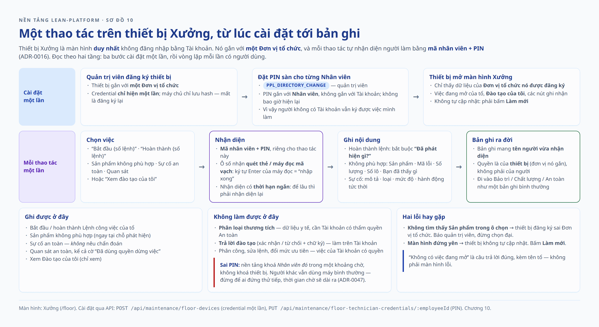

# 10 · Xưởng — thiết bị dùng chung trên sàn

Màn hình **Xưởng** (`/floor`) không giống mọi màn hình khác trong tài liệu này, và sự
khác biệt đó là điều đầu tiên phải dạy:

> **Thiết bị Xưởng không đăng nhập bằng Tài khoản.** Nó là một thiết bị **dùng chung**
> gắn với **một Đơn vị tổ chức** (ADR-0016). Không ai có "tài khoản thiết bị". Mỗi
> người, mỗi lần, tự nhận diện bằng **mã nhân viên và PIN** ngay trong thao tác mình
> đang làm.

> **Vì sao lại như vậy.** Phần lớn người trên sàn không có email công việc và không
> đăng nhập được (CONTEXT.md). Nếu bắt họ có Tài khoản, họ sẽ không ghi được gì — và
> việc ghi lại sẽ dồn về một người ở văn phòng.

**Thiết bị thấy gì.** Chỉ dữ liệu của **Đơn vị tổ chức nó được đăng ký**. Danh sách
Sản phẩm, Mã lỗi, Tài sản ở mọi ô chọn trên thiết bị đều là "những gì thiết bị này thấy
được".

***Sơ đồ 10.** Hai tầng: ba bước cài đặt một lần (đăng ký thiết bị, đặt PIN, mở màn hình)
rồi vòng lặp mỗi thao tác (chọn việc → nhận diện → ghi → bản ghi mang tên người vừa nhận
diện).*

**Chương này không có ảnh chụp nào, và đó là chuyện của môi trường.** Ảnh chụp trong tài
liệu được lấy từ bản dựng demo, mà bản dựng demo **không có credential thiết bị**
(`--dart-define=FLOOR_DEVICE_CREDENTIAL=…`). Mở `/floor` trên bản dựng thường chỉ in câu
**"Thiết bị này chưa được đăng ký. Hãy nhờ quản trị viên đăng ký thiết bị cho một Đơn vị
tổ chức."** Vì vậy mọi phiếu dưới đây in `Minh hoạ: —`, và người đào tạo dạy chúng trên
một thiết bị thật. `t_30897c2a` là thẻ chụp bổ sung những ảnh này.

---

## Ai cài đặt thiết bị — việc của quản trị viên, không phải của công nhân

Phần này **không phải một phiếu**, vì nó không có màn hình: nó là hai lệnh gọi API. Người
vận hành có thể bỏ qua.

| Việc | Ai làm | Ở đâu |
| --- | --- | --- |
| Đăng ký một thiết bị Xưởng cho một Đơn vị tổ chức | Quản trị viên, hoặc người có quyền ghi bao trùm đơn vị đó | `POST /api/maintenance/floor-devices` — **credential chỉ hiện một lần** |
| Đặt PIN sàn cho một Nhân viên | `PPL_DIRECTORY_CHANGE` (quản trị viên) | `PUT /api/maintenance/floor-technician-credentials/:employeeId` — **PIN không bao giờ hiện lại** |

**Hai điểm then chốt cho người cài đặt.**

1. **Credential của thiết bị chỉ hiện một lần.** Chỉ **hash** được lưu. Mất là phải
   đăng ký lại thiết bị, và mọi bản ghi cũ vẫn trỏ về thiết bị cũ.
2. **PIN gắn với Nhân viên, không gắn với Tài khoản.** Đó là lý do một công nhân không
   có Tài khoản vẫn ký được việc mình đã làm.

---

## Màn hình Xưởng

| Hạng mục | Nội dung |
| --- | --- |
| **Công việc** | Một chỗ cho người trên sàn: việc đang mở của tổ, đào tạo đang chờ mình, và ba việc ghi nhận — không cần đăng nhập. Màn hình **Công việc trên sàn**, `/floor`. Phiếu 10.1. |
| **Ai thao tác được** | Ai có **mã nhân viên + PIN** mà thiết bị này chấp nhận. Không có mã quyền nào ở đây — phạm vi của thiết bị là **Đơn vị tổ chức nó được đăng ký**. |
| **Vật tư, dữ liệu có trước** | Thiết bị đã được đăng ký cho một Đơn vị tổ chức, và Nhân viên đã có PIN sàn (hai việc ở phần trên, làm một lần). |
| **Công cụ** | Thanh tiêu đề **Công việc trên sàn** kèm tên Đơn vị tổ chức; nút **Làm mới**; bốn nút **Sản phẩm không phù hợp**, **Sự cố an toàn**, **Quan sát**, **Đào tạo của tôi**; danh sách việc đang mở. Bản demo không có credential thiết bị nên phiếu này không có ảnh chụp. |
| **An toàn** | Không có Tài khoản nào để đăng xuất. Thiết bị để mở giữa sàn là thiết kế, nhưng **PIN của bạn là chữ ký của bạn** — đừng đọc nó cho người bên cạnh. |
| **Thiết bị đào tạo** | — |
| **Chủ tài liệu · Rev · Ngày · Trang** | Ban Lean Nền tảng · Rev 2 · 2026-11-15 · 10.1 |

| Các bước chính | Điểm then chốt | Vì sao | Minh hoạ |
| --- | --- | --- | --- |
| **1.** Đọc thanh tiêu đề: **Công việc trên sàn** và tên Đơn vị tổ chức | [An toàn] Tên đơn vị trên thanh tiêu đề là **toàn bộ** phạm vi thiết bị này thấy — không có dữ liệu của đơn vị khác | Một thiết bị đặt nhầm tổ sẽ hiện danh sách rỗng hoặc danh sách của tổ khác, và không có thông báo nào | — |
| **2.** Đọc danh sách việc đang mở | [Hỏng] **Không có việc đang mở** kèm tên tổ là một câu trả lời đúng, không phải lỗi | Người mới bấm **Làm mới** mười lần rồi gọi điện, trong khi câu trả lời đã ở trên màn hình | — |
| **3.** Bấm **Làm mới** khi cần số liệu mới | [Hỏng] Thiết bị **không tự cập nhật**: màn hình đứng yên cho tới khi có người bấm **Làm mới** | Hai người cùng nhìn một thiết bị thì người thứ hai đang đọc dữ liệu cũ | — |
| **4.** Chọn một trong bốn nút ở dải dưới tiêu đề | [Dễ] Bốn nút **không** phụ thuộc danh sách việc: ghi nhận được cả khi không có việc nào đang mở | Sự cố không chờ có Lệnh công việc mở; chờ là mất bản ghi | — |

---

## Bắt đầu và Hoàn thành một Lệnh công việc

| Hạng mục | Nội dung |
| --- | --- |
| **Công việc** | Người thợ bắt đầu và hoàn thành **Lệnh công việc** ngay tại máy, không phải về văn phòng. Trên màn hình **Công việc trên sàn**, `/floor`. Phiếu 10.2. |
| **Ai thao tác được** | Người có **mã nhân viên + PIN** hợp lệ trên thiết bị của tổ đó. Không cần Tài khoản, không cần mã quyền. |
| **Vật tư, dữ liệu có trước** | Lệnh công việc đã được tạo và phân công cho tổ (nhóm Bảo trì); Nhân viên đã có PIN sàn. |
| **Công cụ** | Mỗi dòng việc một nút **Bắt đầu** và/hoặc **Hoàn thành**; hộp thoại **Bắt đầu {số lệnh}** / **Hoàn thành {số lệnh}** với **Mã nhân viên**, **PIN**, và khi hoàn thành thêm ô **Đã phát hiện gì?**. Bản demo không có credential thiết bị nên phiếu này không có ảnh chụp. |
| **An toàn** | Mỗi thao tác hỏi nhận diện **riêng cho thao tác đó** — hộp thoại viết rõ: "Mã nhân viên và PIN xác định bạn chỉ cho thao tác này." Không có trạng thái "đã đăng nhập rồi". |
| **Thiết bị đào tạo** | — |
| **Chủ tài liệu · Rev · Ngày · Trang** | Ban Lean Nền tảng · Rev 2 · 2026-11-15 · 10.2 |

| Các bước chính | Điểm then chốt | Vì sao | Minh hoạ |
| --- | --- | --- | --- |
| **1.** Tìm việc trong danh sách, đọc mã và tên Tài sản cùng mức ưu tiên | [Hỏng] **P1** là khẩn cấp nhất; con số nhỏ hơn là gấp hơn | Đọc ngược thứ tự ưu tiên là làm việc của ngày mai trước việc của giờ này | — |
| **2.** Bấm **Bắt đầu** trên dòng việc | [Dễ] Nút trên dòng và nút xác nhận trong hộp thoại cùng tên **Bắt đầu** — bấm nút trong hộp thoại mới là ghi | Bấm nút trên dòng chỉ mở hộp thoại; không có bản ghi nào cho tới khi nhận diện xong | — |
| **3.** Quét thẻ vào ô **Mã nhân viên**, gõ **PIN**, bấm **Bắt đầu** trong hộp thoại | [An toàn] Ô **Mã nhân viên** nhận **quét thẻ**: máy đọc gửi mã kèm một ký tự Enter và con trỏ tự nhảy sang ô **PIN** — đừng gõ lại mã. PIN là chữ ký của bạn: **không nhập PIN của người khác**, và không đọc nó cho người bên cạnh | Bản ghi mang tên người đã nhận diện, và đó là bằng chứng duy nhất về ai đã làm việc này | — |
| **4.** Xong việc: bấm **Hoàn thành** trên dòng, nhận diện, và ghi **Đã phát hiện gì?** | [Hỏng] **Đã phát hiện gì?** là nội dung bắt buộc trên Lệnh công việc — để trống thì không ai biết lần sau phải làm gì | Không có nội dung thì lần sau người khác mở lại đúng lệnh đó và đi tìm lại từ đầu | — |
| **5.** Đọc kết quả: dòng việc rời danh sách khi đã hoàn thành | [Dễ] Danh sách chỉ có việc **đang mở**; việc đã xong đọc ở nhóm Bảo trì | Người mới đi tìm việc vừa xong trên thiết bị và tưởng nó bị mất | — |

**Điểm then chốt.** Hoàn thành trên thiết bị Xưởng **không** đòi quyền trực tiếp của
người đó: quyền là của **thiết bị**, và việc **ai đã làm** được ghi lại bằng mã nhân
viên vừa nhận diện.

> **Nhận diện có thời hạn rất ngắn — 120 giây.** Mở hộp thoại rồi để đó vài phút là
> Nền tảng báo hết hạn và bạn phải nhận diện lại. Đó là chủ ý, không phải lỗi.

---

## Đào tạo của tôi

| Hạng mục | Nội dung |
| --- | --- |
| **Công việc** | Xem buổi đào tạo đang chờ mình và tự xác nhận đã học xong, ngay trên sàn. Từ nút **Đào tạo của tôi** trên màn hình **Công việc trên sàn**, `/floor`. Phiếu 10.3. |
| **Ai thao tác được** | Người có **mã nhân viên + PIN** hợp lệ trên thiết bị đó. |
| **Vật tư, dữ liệu có trước** | Một buổi **Đào tạo** đã được tổ chức cho Nhân viên đó và đang chờ họ xác nhận (nhóm Nhân sự). |
| **Công cụ** | Hộp thoại **Đào tạo của bạn** / **Đào tạo của {tên}**, danh sách buổi đang chờ, ô **Mã nhân viên** và **PIN**, nút **Xong**. Bản demo không có credential thiết bị nên phiếu này không có ảnh chụp. |
| **An toàn** | Xác nhận là **chữ ký của chính người học**: hộp thoại nói rõ mã và PIN chỉ dùng để nhận diện bạn cho bản ghi này. Không xác nhận hộ giúp người khác. |
| **Thiết bị đào tạo** | — |
| **Chủ tài liệu · Rev · Ngày · Trang** | Ban Lean Nền tảng · Rev 2 · 2026-11-15 · 10.3 |

| Các bước chính | Điểm then chốt | Vì sao | Minh hoạ |
| --- | --- | --- | --- |
| **1.** Bấm **Đào tạo của tôi** | [Dễ] Nút này **luôn có**, kể cả khi không có buổi nào chờ — hộp thoại là chỗ trả lời, không phải sự vắng mặt của nút | Người mới đi tìm nút và kết luận không có quyền, trong khi nút vẫn ở đó và câu trả lời nằm sau nó | — |
| **2.** Đọc danh sách buổi đang chờ, chọn buổi vừa học | [Hỏng] "Không có gì đang chờ bạn ở thiết bị này." là câu trả lời đúng khi danh sách trống | Đào tạo chờ ở **thiết bị của tổ** đã tổ chức buổi đó, không phải ở mọi thiết bị | — |
| **3.** Nhập **Mã nhân viên** (quét thẻ) và **PIN**, bấm **Xong** | [An toàn] PIN xác nhận **bạn** đã học — người đào tạo không bấm hộ được | Một chữ ký đào tạo mà người học không tự bấm là một chữ ký vô nghĩa khi có sự cố | — |

**Bản ghi này nuôi Độ phủ kỹ năng** (phiếu 08.5): người **chưa xác nhận** vẫn bị tính là
chưa đủ điều kiện, dù buổi đào tạo đã diễn ra.

---

## Ghi nhận không phù hợp

| Hạng mục | Nội dung |
| --- | --- |
| **Công việc** | Ghi một **Sản phẩm không phù hợp** ngay tại máy, trong lúc còn cầm sản phẩm trên tay. Từ nút **Sản phẩm không phù hợp** trên màn hình **Công việc trên sàn**, `/floor`; bản ghi vào `/api/quality/floor/nonconformances`. Phiếu 10.4. |
| **Ai thao tác được** | Người có **mã nhân viên + PIN** hợp lệ trên thiết bị đó. |
| **Vật tư, dữ liệu có trước** | Danh mục **Sản phẩm** và **Mã lỗi** của đơn vị đó đã có (nhóm Chất lượng) — danh sách trên thiết bị chỉ chứa những gì thiết bị này thấy. |
| **Công cụ** | Hộp thoại **Ghi nhận không phù hợp**: ô **Quét tem**, **Sản phẩm**, **Mã lỗi**, **Số lượng bao nhiêu**, **Số lô (nếu có)**, **Phát hiện lúc**, **Bạn đã thấy gì?**, **Mã nhân viên**, **PIN**; nút **Ghi nhận**. Bản demo không có credential thiết bị nên phiếu này không có ảnh chụp. |
| **An toàn** | Ghi nhận **không** phải quyết định xử lý: phiếu này tạo bản ghi. Phương án xử lý là một bước riêng ở nhóm Chất lượng (phiếu 05.5). |
| **Thiết bị đào tạo** | — |
| **Chủ tài liệu · Rev · Ngày · Trang** | Ban Lean Nền tảng · Rev 2 · 2026-11-15 · 10.4 |

| Các bước chính | Điểm then chốt | Vì sao | Minh hoạ |
| --- | --- | --- | --- |
| **1.** Bấm **Sản phẩm không phù hợp** | [Dễ] Nút nằm ở dải dưới tiêu đề nên bấm được **cả khi không có việc nào đang mở** | Hàng lỗi không chờ có Lệnh công việc; chờ là mất bằng chứng | — |
| **2.** Quét tem vào ô **Quét tem** | [Hỏng] Quét **một lần** là điền **mã sản phẩm**, **số lô** và **số lượng**; màn hình đọc lại những gì đã đọc được | Gõ tay ba trường đó là ba cơ hội gõ sai số lượng, và số lượng sai làm hỏng cả báo cáo phế phẩm | — |
| **3.** Tem không có mã sản phẩm, hoặc mã không có trong danh sách: chọn **Sản phẩm** bằng tay | [Hỏng] Tem ghi mã lạ thì màn hình nói rõ: "Tem ghi {mã} — không có trong danh sách sản phẩm của phiếu này, hãy chọn trong danh sách." Ô **Số lô** và **Số lượng** vẫn phải gõ | Đoán một sản phẩm gần giống là ghi một bản không phù hợp vào nhầm sản phẩm — và nó không sửa được sau | — |
| **4.** Chọn **Mã lỗi** và đọc dòng dưới ô | [Hỏng] Dòng **Bắt đầu từ {mức độ} — mức độ mặc định của mã lỗi này.** cho biết bản ghi sẽ bắt đầu ở mức độ nào | Mức độ là con số báo cáo chất lượng dựa vào; chọn mã lỗi nhẹ hơn sự thật là hạ mức cả lô | — |
| **5.** Ghi **Phát hiện lúc**, **Bạn đã thấy gì?**, nhận diện bằng **Mã nhân viên** và **PIN**, bấm **Ghi nhận** | [An toàn] **Ai phát hiện?** là câu hỏi của ô nhận diện: bản ghi được ghi công cho người vừa nhận diện, và PIN không hiện lại | Một bản ghi không có tên người phát hiện thì không ai hỏi lại được đã thấy gì | — |

---

## Báo sự cố an toàn

| Hạng mục | Nội dung |
| --- | --- |
| **Công việc** | Báo một **Sự cố an toàn** ngay chỗ vừa xảy ra. Từ nút **Sự cố an toàn** trên màn hình **Công việc trên sàn**, `/floor`; bản ghi vào `/api/safety/floor/incidents`. Phiếu 10.5. |
| **Ai thao tác được** | Người có **mã nhân viên + PIN** hợp lệ trên thiết bị đó. |
| **Vật tư, dữ liệu có trước** | Danh mục **Loại sự cố** và thang **Mức độ** đã có; Đơn vị tổ chức là đơn vị thiết bị được đăng ký. |
| **Công cụ** | Hộp thoại **Báo sự cố an toàn**: **Đã xảy ra chuyện gì**, **Loại sự cố**, **Mức độ**, **Xảy ra lúc**, **Hành động tức thời (không bắt buộc)**, **Mã nhân viên**, **PIN**; nút **Báo cáo**. Bản demo không có credential thiết bị nên phiếu này không có ảnh chụp. |
| **An toàn** | Báo sự cố **không** phải khai báo chẩn đoán. Phiếu này ghi chuyện đã xảy ra; **ai bị thương, thương tích gì** là bước phân loại riêng, cần **thẩm quyền An toàn** (phiếu 06.3). |
| **Thiết bị đào tạo** | — |
| **Chủ tài liệu · Rev · Ngày · Trang** | Ban Lean Nền tảng · Rev 2 · 2026-11-15 · 10.5 |

| Các bước chính | Điểm then chốt | Vì sao | Minh hoạ |
| --- | --- | --- | --- |
| **1.** Bấm **Sự cố an toàn** | [Dễ] Nút này **không** đòi quyền nào ngoài PIN của người đang đứng đó | Người đứng cạnh cái máy là người phải báo được, không phải người có Tài khoản | — |
| **2.** Ghi **Đã xảy ra chuyện gì**, chọn **Loại sự cố** và **Mức độ** | [An toàn] Chọn **Mức độ** là chọn **hậu quả thực tế nặng nhất với một người**, và lựa chọn có dấu **· phải báo cáo** là mức buộc phải báo cáo | Đây là con số nuôi TRIR/LTIFR của cả năm; ước lượng cho nhanh là báo cáo an toàn sai | — |
| **3.** Ghi **Xảy ra lúc** và **Hành động tức thời (không bắt buộc)** | [Hỏng] **Xảy ra lúc** là lúc chuyện xảy ra, không phải lúc điền phiếu — nó quyết định ca và ngày sản xuất của sự cố | Một sự cố ghi sau ba ngày là một sự cố mà thống kê xếp vào tuần sau | — |
| **4.** Nhận diện bằng **Mã nhân viên** và **PIN**, bấm **Báo cáo** | [An toàn] Ô nhận diện nói rõ mã và PIN chỉ dùng để nhận diện bạn cho bản ghi này — bản ghi được ghi công cho bạn | Báo cáo ẩn danh không tồn tại trên sàn: mọi bản ghi đều có tên người báo, và đó là chỗ dựa khi điều tra | — |

---

## Ghi nhận quan sát an toàn

| Hạng mục | Nội dung |
| --- | --- |
| **Công việc** | Ghi một **Quan sát an toàn**: điều kiện hay hành vi không an toàn thấy **trước khi** có chuyện. Từ nút **Quan sát** trên màn hình **Công việc trên sàn**, `/floor`; bản ghi vào `/api/safety/floor/observations`. Phiếu 10.6. |
| **Ai thao tác được** | Người có **mã nhân viên + PIN** hợp lệ trên thiết bị đó. |
| **Vật tư, dữ liệu có trước** | Danh mục **Loại**, **Hạng mục** và thang **Mức độ tiềm ẩn** đã có (nhóm An toàn). |
| **Công cụ** | Hộp thoại **Ghi nhận quan sát an toàn**: **Đã thấy gì**, **Loại**, **Hạng mục**, **Mức độ tiềm ẩn**, **Hành động đã làm (không bắt buộc)**, **Đã dùng quyền dừng việc**, **Mã nhân viên**, **PIN**; nút **Ghi nhận**. Bản demo không có credential thiết bị nên phiếu này không có ảnh chụp. |
| **An toàn** | **Mức độ tiềm ẩn** là hậu quả xấu nhất **có thể** xảy ra, không phải điều đã xảy ra. Đó là chỗ hay bị chọn thấp, và nó là con số để cải thiện, không phải để báo cáo. |
| **Thiết bị đào tạo** | — |
| **Chủ tài liệu · Rev · Ngày · Trang** | Ban Lean Nền tảng · Rev 2 · 2026-11-15 · 10.6 |

| Các bước chính | Điểm then chốt | Vì sao | Minh hoạ |
| --- | --- | --- | --- |
| **1.** Bấm **Quan sát** | [Dễ] Quan sát và **Sự cố an toàn** là hai nút cạnh nhau và là hai sổ khác nhau: đã xảy ra, hay thấy trước | Ghi một quan sát vào sổ sự cố là báo động một chuyện chưa xảy ra | — |
| **2.** Ghi **Đã thấy gì**, chọn **Loại**, **Hạng mục** | [Hỏng] Ba trường này đều chọn từ danh sách, không gõ tự do — hộp thoại nói rõ những trường có danh sách cố định đều được chọn | Gõ tự do là ba tháng sau không ai đếm được loại quan sát nào lặp lại | — |
| **3.** Chọn **Mức độ tiềm ẩn** | [An toàn] Chọn theo hậu quả **xấu nhất có thể**, không theo điều đã xảy ra — một suýt xảy ra ở độ cao 3 m vẫn là mức nghiêm trọng | Chọn thấp là tự làm mất chỗ đáng sửa nhất trong tuần | — |
| **4.** Bật **Đã dùng quyền dừng việc** nếu bạn đã dừng công việc | [An toàn] Đây là bản ghi duy nhất cho thấy ai đã thực sự dừng một công việc không an toàn | Không ai biết quyền dừng việc đã được dùng, thì lần sau không ai dám dùng | — |
| **5.** Ghi **Hành động đã làm (không bắt buộc)**, nhận diện bằng **Mã nhân viên** và **PIN**, bấm **Ghi nhận** | [Dễ] Đây là ô ghi việc đã xử lý ngay tại chỗ; nó khác **Hành động** (Concern/CAPA) mở sau đó | Xử lý ngay tại chỗ là hết việc; mở một Hành động là một cam kết có người theo | — |
